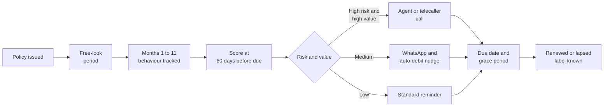
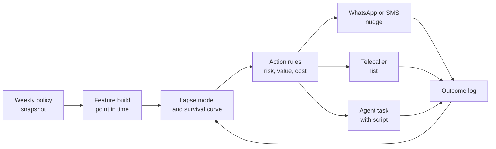

# Case Study 29: Life and Health Insurance Renewal and Persistency Prediction

**Domain:** Finance (insurance) | **Problem Type:** Classification and survival analysis | **Difficulty:** Intermediate

---

## 1. Business Context

### Company background

- **Suraksha Life** (fictional) is a private life and health insurer selling term, endowment, savings and health-rider policies through agents (65%), bank partners (25%) and its own app and website (10%).
- Scale: about **5 lakh new policies a year**, average annual premium about **₹36,000**, and an in-force book of about 22 lakh policies.
- Persistency means the share of policies still alive (premiums paid) at a given point. The two numbers the Board watches are the **13th-month persistency** (did the customer pay the second-year premium) and the **25th-month persistency** (did the customer pay the third-year premium).
- Today: 13th-month persistency is **80%** and 25th-month persistency is **70%** (by policy count). A policy that lapses (stops paying) early earns little, because the insurer spent heavily on commission, medical tests and sales cost in year one.

### The pain, with numbers

| Item | Value |
| --- | --- |
| New policies a year | 5 lakh |
| Policies lapsing before the 13th month | 20%, so about 1 lakh |
| Average annual premium | ₹36,000 |
| Year-two premium lost on those lapses | 1 lakh x ₹36,000 = **₹360 Cr** of renewal premium a year |
| Cost already spent on a policy (commission, underwriting, onboarding) | about ₹9,000 per policy, so about ₹90 Cr written off on early lapses |
| Current reminder process | Same SMS at 30 days before due date and 7 days after, for every policy |
| Agent follow-up | Ad hoc, mostly for the agent's favourite customers |
| Target | Raise 13th-month persistency by **2 points** (80% to 82%), which is **10,000 more policies** renewing |
| **Renewal premium protected** | 10,000 x ₹36,000 = **₹36 Cr** a year, plus later-year premiums |

- Regulatory backdrop: IRDAI's customer-protection rules cover fair sales (needs-based selling, suitability), a **free-look period** after purchase, a **grace period** for late premium payment, clear lapse and revival terms, and grievance handling. Mis-selling (selling a product the customer did not understand) is a prime reason for early lapse, and a regulator concern. The DPDP Act 2023 applies to health and financial data used in scoring.

### Stakeholders and what each wants

| Stakeholder | What they want | What they fear |
| --- | --- | --- |
| Chief Distribution Officer | Higher persistency without annoying agents | Agents feeling policed |
| Chief Actuary | Realistic lapse assumptions in pricing and reserves | A model that reports too-rosy persistency |
| Head of Customer Service | Efficient call lists, a fair load per caller | Too many calls to people who would pay anyway |
| Compliance and Legal | No pressure tactics, no misleading renewal calls, clean grievance handling | A regulatory finding on mis-selling or harassment |
| Head of Digital | More auto-debit sign-ups | Customers who pay manually every year and forget |
| Finance | Cost of retention under control | Spending ₹100 to save a ₹30 renewal margin |

---

## 2. Translating Business to ML

### The business question vs the ML question

| Business question | ML question |
| --- | --- |
| "Who is likely to miss the next premium?" | "For each policy at a point before the due date, estimate the probability that the premium is not paid by the end of the grace period" |
| "When do customers drift away?" | "Model time to lapse as a survival problem: the hazard of lapsing by policy month and cohort" |
| "Who should get a call, and who needs just a reminder?" | "Combine lapse risk with the value of the policy and the effect of an action to rank policies for different treatments" |

### Target variable definition

- **Primary label for the 13th-month model:** `lapsed_at_renewal = 1` if the second-year premium was not received **by the end of the grace period** (and the policy was not revived within that period).
- **Survival version:** time from issue to lapse in months, with censoring for policies still alive at the data cut-off.
- **Scoring point:** 60 days before the due date, rescored at 30 days and at the due date.
- **Other persistency targets:** 25th-month model uses the same design on policies that survived year two.

### Edge cases

| Edge case | Recommended treatment | Reason |
| --- | --- | --- |
| Customer cancels in the free-look period | Exclude from persistency. Track as a **mis-selling and cancellation signal** | Not a renewal event, but a strong early warning of poor sale quality |
| Premium paid on day 20 of the grace period | Label as renewed, but keep `paid_in_grace` as a feature for next year | These customers are at higher risk the following year |
| Policy lapses and is revived after 4 months | Label as lapsed at the due date, and flag revival separately | Revival is a different, later outcome |
| Monthly-mode policy (premium paid 12 times a year) | Model at policy-month level or use "missed instalment" as the target | Annual and monthly modes behave differently |
| Single-premium policy (no renewals) | Exclude | No renewal event |
| Death or maturity during the window | Exclude as a benefit event | Not a lapse |
| Policy bought as a mandatory add-on to a bank loan | Keep, flag with `bundled_with_loan` | Often lapses quickly once the loan closes |

### Unit of prediction

- One **policy at one renewal point**. Aggregations exist at customer, agent, branch and **issue-cohort** level (for example "policies issued in March from a given bank branch").

### Prediction timing



- Scoring is **batch**, weekly, for all policies due in the next 60 to 90 days.
- Label arrives at the **end of the grace period**, so about 30 days after the due date.

### What success looks like

| Lens | Success |
| --- | --- |
| Business | 13th-month persistency from 80% to 82% and 25th-month from 70% to 72%. About ₹36 Cr of year-two renewal premium protected a year |
| Model | AUC of 0.78 or more and top-decile capture of at least 35% of lapses, on a time-based test |
| Operations | Fewer than 20% of due policies get a human call. Cost of retention under 5% of renewal premium saved |
| Compliance | Zero complaints on pressure tactics. Every outreach is scripted and logged |

---

## 3. Data Understanding

### Data sources and key features

| Feature group | Source | Why it matters |
| --- | --- | --- |
| Policy basics (product, sum assured, premium, term, mode) | Policy admin system | Premium size and product shape drive affordability |
| Premium-to-income ratio (premium divided by declared annual income) | Proposal form | A premium above 12% to 15% of income is a classic stress and mis-selling signal |
| Payment channel (auto-debit, ECS or UPI mandate, card, cash, cheque, branch, manual online) | Billing | Auto-debit customers lapse far less than manual payers |
| Payment history in year one (days from due to payment, bounced debits, grace-period payments) | Billing | Late first payment is the strongest early-lapse indicator |
| Customer profile (age, city tier, occupation, existing policies, marital status) | CRM | Context for stability and need |
| Sales context (agent, branch, bank partner, sales month, same-day proposal-to-payment) | Sales system | Agent effect and sales-quality signals |
| Mis-selling signals (free-look cancellation by same agent, complaint on product understanding, customer age 60 plus with long-term product, pitch recorded as "investment") | Complaints and call QA | Patterns of poor suitability |
| Engagement (app logins, portal visits, call-centre contacts, bounced SMS) | Digital and call logs | Silent customers drift |
| Reminder history (SMS, email, WhatsApp, calls and outcomes) | Communication platform | Needed to separate reminder effect from risk |
| Outcome (paid, lapsed, revived, surrendered) | Billing | The label |

### Data volume, granularity and refresh

- **Volume:** 3 years of cohorts, about 15 lakh policies at first renewal, about 12 lakh at second renewal. With 20% early lapse, about 3 lakh lapse events for the 13th-month model.
- **Granularity:** one row per policy and renewal point. A longer panel (policy-month) is used for the survival version.
- **Refresh:** weekly scoring, monthly cohort tracking, label backfill each month.
- **Data hierarchy:** policies sit inside agents, branches and issue-month cohorts, which share behaviour. This **grouped structure** drives how the model is validated.

### Common data issues

| Issue | How it shows up here |
| --- | --- |
| Censoring | Recent cohorts have not yet reached the grace-period end, so labels are incomplete |
| Grouped data | Policies sold by the same agent or in the same campaign month are not independent |
| Agent effect | A few agents have 95% persistency and a few have 55%, and the difference is mostly sales style |
| Mis-selling hidden as lapse | Customers who never understood the product just stop paying |
| Payment-mode change | A customer switches from auto-debit to manual mid-year without anyone noticing |
| Missing income and occupation | Proposal data is often self-declared and noisy |
| Multiple policies per customer | One customer may renew one policy and let another lapse |

> **Mentor note: Where juniors usually go wrong here.**
>
> - They split policies randomly into train and test, so the same agent and the same cohort sit on both sides and the model memorises agents.
> - They include "premium received in the grace period" or "reminder call completed" features that are known only after the scoring date.
> - They say "high-risk customers should get calls," but never check whether the call changes behaviour. Some high-risk customers will lapse no matter what, and some low-risk customers need only a reminder.

---

## 4. Approach and Decision Points

### Baseline first

- **Baseline 1:** historical persistency by product and payment channel (a lookup table). Simple, hard to beat by much.
- **Baseline 2:** logistic regression on 15 hand-picked features: mode, channel, premium-to-income, first-payment delay, age, product, sales month.
- **Why it matters:** payment channel and first-year payment behaviour already explain a large share of lapse. Any complex model has to beat this honestly.

### Candidate models

| Model | Pros | Cons | Verdict |
| --- | --- | --- | --- |
| Lookup of persistency by segment | Transparent, instant | Misses interactions and individual signals | Benchmark |
| Logistic regression | Stable, explainable to Actuarial | Misses non-linear effects | Good baseline |
| Gradient boosting (LightGBM) | Strong on tabular data, handles missing values | Needs grouped validation to avoid agent leakage | **Primary classifier** |
| Discrete-time survival model (logistic on policy-month rows) | Uses all months, handles censoring, gives a lapse curve | More data prep | Use for early-lapse and 25th-month modelling |
| Cox proportional hazards or random survival forest | Classic survival view | Harder in production, proportionality assumption | Analysis and Actuarial comparison |
| Mixed-effects model or target encoding with shrinkage for agent and branch | Separates agent effect from customer risk | Added complexity | Use shrinkage for agent features |
| Uplift model (who responds to a call) | Targets the persuadable | Needs randomised outreach data | Phase 2 (similar idea to Case 3) |

### Decision scenarios

| What if... | Recommended action | Reasoning |
| --- | --- | --- |
| **Customer pays on day 27 of a 30-day grace period every year** | Do not treat as a lapse. Add `paid_in_grace` and `days_late_last_year` as features, and plan a pre-due reminder rather than a post-due rescue call | The grace period hides risk. Late payers are a cheap segment to help with an auto-debit nudge |
| **Auto-debit customers lapse at 6% but manual-payment customers lapse at 31%** | Make **channel conversion** an action: offer an auto-debit or UPI mandate at renewal, and track the conversion rate. Model risk **given** the channel and show the channel as a lever | Payment friction is the cheapest cause to fix. The model should point to the action, not only the risk |
| **One agent's customers have 92% persistency and another's 58%** | Shrink agent effects toward the average using a mixed model or smoothed target encoding. Flag agents with high early free-look cancellations and complaints for a **quality review**, not for punishment based on the model | Agent effect is a mix of customer fit and sales behaviour. A raw rate for an agent with 40 policies is noise. Mis-selling checks must be fair and reviewed |
| **Lapse is 3 times more likely when sold to a customer aged 60 plus on a 20-year endowment** | Raise this as a **suitability alert at point of sale**, not only a renewal feature. Feed it to Compliance for sales-quality review | The cheapest fix for early lapse is not selling the wrong product. The model has a second use |
| **A customer's 13th-month risk is high, but the policy is a ₹12,000 premium health-rider** | Use value-aware ranking: expected retained margin (P(lapse) x uplift x margin), then spend call effort in order, and use cheap channels for small policies | Calls cost ₹90 each. Saving a ₹1,000 margin policy at that price is not worth it |
| **The year-two model works. The 25th-month model has far fewer policies and a different pattern** | Train a separate model, with year-two behaviour (payment pattern, claims, servicing requests) as extra features, and with survival modelling to use the whole timeline | Behaviour in year two (a rejected claim, a missed service request) changes the story |
| **A recent policy cohort looks great on lapse because many have not reached the end of their grace period** | Mark such cases as censored, evaluate only on matured cohorts, and use the survival model to project recent cohorts | Immature labels make recent months look safer than they are (the same lesson as in Case 2) |

---

## 5. Feature Engineering

### Top 10 features to build

| # | Feature | Business logic |
| --- | --- | --- |
| 1 | Payment channel at issue and at scoring date (auto-debit, mandate, manual) | Auto-debit is the largest single protection |
| 2 | Days from due date to payment for the first-year premium and bounced-debit count | Late or failed first payment foreshadows year-two lapse |
| 3 | Premium divided by declared annual income | High burden leads to stress lapses |
| 4 | Product type and policy term (for example 20-year savings vs term cover) | Savings plans with long terms lapse more when the customer expected a short horizon |
| 5 | Sales-quality flags: same-day proposal and payment, free-look cancellation share of the agent, bundled with loan | Proxies for rushed or poorly explained sales |
| 6 | Agent tenure and the agent's shrunk 13th-month persistency | The agent effect with noise removed |
| 7 | Engagement in the last 90 days (app logins, statement downloads, service requests) | Silent customers are drifting |
| 8 | Customer's other active policies with us | Multi-policy customers are stickier |
| 9 | Premium due month and festival or school-fee month | Cash-flow timing (for example April school fees, January tax season) |
| 10 | Reminder history: touches already tried and delivery success (bounced SMS, wrong number) | A wrong phone number means no reminder was ever received |

### Features to avoid (leakage risks)

| Feature | Problem |
| --- | --- |
| Premium received date for the due being predicted, or status after the due date | Direct leakage |
| Lapse, surrender or revival flags | These are the outcome |
| Reminder calls made after the scoring date | The model will think a call predicts lapse because calls go to people already late |
| Agent persistency computed with the target policies included | Target leakage through the agent average. Use only earlier cohorts |
| Complaint text added after the lapse | Post-event information |
| Health claims after the due date | Not available at scoring time |

Discrete-time survival data prep (policy-month rows) with a grouped cross-validation split:

```python
import pandas as pd
from sklearn.model_selection import GroupKFold

# One row per policy per month until lapse or censoring
def expand_policy_months(policies):
    rows = []
    for p in policies.itertuples():
        for m in range(1, int(p.months_observed) + 1):
            rows.append({
                "policy_id": p.policy_id,
                "agent_id": p.agent_id,
                "month": m,
                "lapsed_this_month": int(p.lapsed and m == p.months_observed),
                "channel": p.channel,
                "premium_to_income": p.premium_to_income,
            })
    return pd.DataFrame(rows)

panel = expand_policy_months(policies)
gkf = GroupKFold(n_splits=5)  # all rows of one agent stay in one fold
for train_idx, test_idx in gkf.split(panel, groups=panel["agent_id"]):
    pass  # fit a LightGBM or logistic hazard model on train_idx, evaluate on test_idx
```

---

## 6. Evaluation Strategy

### Metrics

| Metric | Role | Why |
| --- | --- | --- |
| **AUC and PR-AUC** at the 60-day scoring point | Primary model metrics | Ranking quality for lapse. PR-AUC matters because 20% lapse is a real minority |
| **Top-decile and top-20% lapse capture** | Primary business metric | Matches how call lists are cut |
| **Calibration of predicted persistency by cohort** | Actuarial | Actuaries use the numbers in reserves and pricing |
| Concordance index and calibration of the hazard curve | Survival quality | Measures time-to-lapse ranking |
| Persistency (13th and 25th month) by channel and agent group | Business | The reported KPI |
| Cost per policy saved | Financial | Controls the retention spend |
| Complaint rate on outreach | Compliance | Guardrail against pressure tactics |

### Metrics that look good but are misleading here

- **Overall accuracy:** 80% by predicting "no lapse" for everyone.
- **AUC from a random split:** can reach 0.88 because the model recognises agents and campaigns. On a time-and-agent-grouped split it drops to about 0.78.
- **"Saved" policies counted as all calls that ended in renewal:** many would have renewed anyway. Only a holdout shows the true effect.
- **Reported persistency of the latest cohort:** immature until the grace period ends.

### Validation strategy

| Step | Design | Why |
| --- | --- | --- |
| Time-based split by issue cohort | Train on cohorts of year 1 and 2, test on year 3 cohorts with matured labels | Mimics scoring a future cohort |
| Grouped split by agent | All policies of an agent on the same side in cross-validation | Stops the model learning agents |
| Cohort-wise reporting | AUC, lift and calibration for each issue-quarter and each channel | Shows stability across cohorts |
| Censoring check | Evaluate only on policies whose grace period has ended, and use a survival model for the rest | Avoids optimistic recent cohorts |
| Randomised outreach test | 10% of high-risk policies get no extra outreach (only the standard SMS) | The only true measure of the effect of a call |
| Shadow scoring | Score weekly for 2 cycles before using the list | Operational readiness |

### From model metric to business value

- Policies due for first renewal: 5 lakh. Baseline lapse 20%, so 1 lakh lapses.
- Call the **top 20% by risk and value**: 1 lakh policies at about ₹90 per call (including telecaller time and agent incentive) = **₹0.9 Cr**.
- Reminder and nudge messaging for all 5 lakh at about ₹0.5 each = **₹0.25 Cr**.
- Calls reduce lapse in this group by about 8 points (for example, from 45% to 37%) = **8,000 policies saved**. Channel conversion to auto-debit saves another about **2,000 policies**. Total about **10,000 policies**, which is **2 points** of persistency.
- Renewal premium protected: 10,000 x ₹36,000 = **₹36 Cr** in year two, with more to come in later years.
- Cost: about ₹1.15 Cr, plus about ₹0.5 Cr for tools and analysts. Net benefit in year two premium terms is about **₹34 Cr**, and in **margin terms** (about 12% of premium) about **₹4 Cr** in the first renewal year, with the longer-term value far higher. Finance should state which view they use.

---

## 7. Deployment and Monitoring

### Batch vs real time

- **Batch weekly:** score all policies due in the next 60 to 90 days and re-score at 30 days and at the due date.
- **Near real time (optional):** if a customer's debit bounces, refresh the score and trigger a message that day.
- **Point-of-sale use:** the sales-quality alert (a lighter model on proposal data) runs when the policy is issued.



### What to monitor

| Type | What to track | Alert trigger |
| --- | --- | --- |
| Data drift | Distribution of channel, premium-to-income, product mix per cohort | PSI above 0.2 |
| Model quality | Weekly AUC and top-decile capture on policies whose grace period ended | AUC drop of more than 0.03 |
| Calibration | Predicted vs actual lapse by channel and product | Gap above 2 points |
| Business KPIs | 13th and 25th-month persistency, auto-debit share | Persistency below plan for two months |
| Outreach quality | Call connect rate, complaint rate, opt-out rate | Complaint rate above 0.3% of contacted customers |
| Agent fairness | Share of agents flagged and review outcomes | Flag rate above 10% of agents, or flags not reviewed within 30 days |
| Pipeline | Late files, missing phone numbers, wrong-number share | More than 5% of policies without a valid phone |

### Retraining

- **Scheduled:** quarterly, using only matured cohorts.
- **Triggered:** new product launch, change in the bank-partner mix, a regulatory change in grace or free-look terms.
- **Governance:** the actuarial team signs off the persistency forecast used in reserving.

### A/B test or champion-challenger design

- **Champion:** the current "same SMS for everyone" process. **Challenger:** risk and value-based treatment.
- **Randomise by policy** within risk-and-value bands: 50% challenger and 50% control for the first two cycles, then ramp up to 90% with a 10% permanent holdout.
- **Primary metric:** renewal by end of grace period, measured on matured policies. **Secondary:** cost per saved policy, complaints, opt-outs.
- **Guardrails:** stop an arm if complaints exceed 0.3% or if a segment shows lower renewal than control by 2 points.
- **Call-script control:** scripts fixed and reviewed by Compliance. No promise of benefits that the policy does not give.

---

## 8. Stakeholder Communication

### Explain it to a non-technical leader

> "Every week we score the policies coming up for renewal in the next 60 days, and estimate how likely each is to miss the payment.
> Customers likely to renew get a normal reminder. Customers at risk are nudged to move to auto-debit, and the highest-risk, highest-value ones get a call from the agent or our telecallers.
> Our target is to renew about 2 more policies in every 100, protecting about ₹36 Cr of year-two premium. The same signals also tell Compliance which sales look like mis-selling, so we can fix the problem at the source."

### Questions leadership will ask

| Question | Suggested answer |
| --- | --- |
| "Isn't persistency just a function of the agent?" | "The agent matters, and we measure it with noise removed. But payment channel and first-year payment behaviour matter just as much, and we can act on those" |
| "Why not call everyone?" | "Calls cost ₹90 each and many customers would renew anyway. We call where the expected retained margin is higher than the cost, and we test with a holdout" |
| "Will agents see this as surveillance?" | "Agent-level views are for coaching and sales-quality review, with context and human review. No automatic penalty comes from the model" |
| "Does this help with regulators?" | "Yes. Scripts are fixed, calls are logged, and the sales-quality alert helps stop poor-fit sales before they happen, in line with customer-protection expectations" |
| "Why is margin benefit smaller than premium protected?" | "Premium is the revenue number, margin is what remains after claims, expenses and commission. Both are reported, and the benefit grows over later years as the policy continues" |

---

## 9. Common Pitfalls and Lessons

| Mistake | Why it happens | How to avoid it |
| --- | --- | --- |
| Random train-test split on policies | It is the default | Split by issue cohort and group by agent |
| Using grace-period payments as a lapse signal wrongly | Grace period hides risk | Keep `paid_in_grace` as a feature and score before the due date |
| Treating immature cohorts as clean | Labels arrive after the grace period | Mark censored rows and use survival or matured cohorts only |
| Raw agent persistency as a feature | Easy aggregation | Shrink for small samples and compute from earlier cohorts |
| Calling every high-risk customer | Risk looks like opportunity | Use value and, when possible, response-based targeting with a holdout |
| Ignoring wrong or missing phone numbers | Data quality is not checked | Track reach rate and fix contact data as an action |
| Blaming customers for mis-selling | Model flags the customer, not the sale | Use the model as a sales-quality signal and fix the sale |
| Overpromising in renewal scripts | Pressure to save the policy | Compliance-approved scripts, call recording, and complaint monitoring |
| Reporting persistency by count only | Easy to compute | Report by count and by premium, as small policies lapse more |

---

## 10. Mentor's Focus Checklist

- ✅ **Where to spend 80% of the effort:**
  - Correct label design: due date, grace period, censoring and revival.
  - Grouped, time-based validation by agent and issue cohort.
  - The action layer: auto-debit conversion, reminder channel choice, call value rules, and a holdout to measure the true effect.
  - Sales-quality and mis-selling signals shared with Compliance.
- ❌ **What not to over-engineer:**
  - Deep survival networks. A discrete-time hazard model or LightGBM is enough.
  - Predicting lapse month to the day. Risk bands at the 60-day point are what the business uses.
  - Fine individual agent rankings from small samples.
- 💡 **Key takeaway:** In insurance persistency, **the best fixes are upstream and cheap**: right product to the right person, an auto-debit mandate, and a well-timed reminder. Use the model to find where each fix applies, and prove the effect with a holdout.
