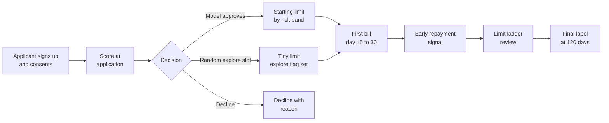
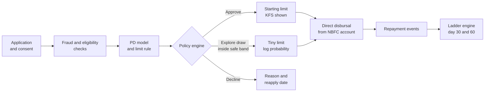

# Case Study 30: Buy-Now-Pay-Later Underwriting with Micro-Limits for First-Time Users

**Domain:** Finance (digital lending) | **Problem Type:** Classification plus exploration policy (test-and-learn) | **Difficulty:** Advanced

---

## 1. Business Context

### Company background

- **SnapLater** (fictional) is a buy-now-pay-later (BNPL) app. Users get a small credit line, shop at partner merchants (food, grocery, pharmacy, mobile recharge, fashion) and repay in 15 to 30 days or in 3 equal instalments.
- SnapLater is a **loan service provider (LSP)**, meaning it runs the app, scoring and collections support. The money is lent by a regulated partner, an NBFC (non-bank lender) called **Sahay Finance** (fictional).
- Scale: about **10 lakh new applicants a year**. About 60% have **no credit bureau record** (first-time borrowers) or a very thin file (one or two products, under 6 months).
- Today's policy: bureau score above a cut-off gets a limit of ₹4,000, everyone else is declined. That means **thin-file applicants are almost all declined**, so there is no data on them. Competitors are signing up these users.

### The pain, with numbers

| Item | Value |
| --- | --- |
| New applicants a year | 10 lakh |
| Currently approved | 3 lakh (all with bureau score above cut-off), starting limit ₹4,000 |
| Declined by the model | 7 lakh, of which about 4.5 lakh are thin-file or no-file |
| Default (90 days past due) rate on approved first-time users | 9% |
| Average drawn amount per approved user | 70% of ₹4,000 = ₹2,800 |
| **Annual credit loss on today's book** | 3,00,000 x 9% x ₹2,800 = **about ₹7.6 Cr** |
| Revenue per approved user per year (merchant fee share, convenience fee, late fees) | about ₹300, so ₹9 Cr |
| **Net contribution today** | about ₹1.4 Cr |
| Proposal | Start approved users at **small limits (₹500 to ₹2,000)**, approve 4.5 lakh, and use a **learning budget** for thin-file users |

- Regulatory backdrop: RBI's digital lending directions say that loans should be disbursed to and repaid from the borrower's bank account **directly with the regulated lender** (not through an LSP's pool account), that a **Key Fact Statement** with the annualised cost (APR) must be shown before acceptance, that fees must be disclosed upfront and not added later, that borrowers get a cooling-off window and a grievance route, and that data collection must be need-based with consent. The DPDP Act 2023 adds consent and purpose limits. RBI also expects LSPs to be disclosed and the regulated entity to remain accountable for underwriting.

### Stakeholders and what each wants

| Stakeholder | What they want | What they fear |
| --- | --- | --- |
| Head of Credit | A controlled loss rate (under 6% of drawn value) | A "growth" push that breaks the loss budget |
| Head of Growth | Approve more first-time users and win share | Rejecting good users to competitors |
| NBFC partner (Sahay Finance) | Compliance with RBI digital lending rules and no surprise exposure | Being held accountable for an LSP's aggressive approvals |
| Compliance | Clear disclosures, direct flows, no hidden fees, data minimisation | A regulatory finding on fees or data use |
| Collections head | Small, collectable balances and early warning | A large pool of tiny loans with expensive recovery (cost to collect ₹120 a case) |
| Data science lead | A way to learn about people the model has never approved | Selection bias that makes every new model look better than it is |
| Merchants | Higher checkout conversion | Declines at the moment of purchase |

---

## 2. Translating Business to ML

### The business question vs the ML question

| Business question | ML question |
| --- | --- |
| "Who should we approve, and at what starting limit?" | "Estimate probability of default (PD) and expected loss at each possible limit, and choose the limit that maximises expected profit within a loss budget" |
| "How do we learn about people we have never lent to?" | "Design a **randomised exploration policy**: approve a small, random share of otherwise declined applicants at tiny limits, to collect unbiased outcome data" |
| "When should the limit go up?" | "Learn a **limit ladder**: promote a user to the next limit when early repayment and usage signals show low risk" |

### Target variable definition

- **Final label:** `bad_90 = 1` if any instalment from the first 3 months is more than 90 days past due or written off, measured on the user's first-cycle drawn amount. The label matures about **120 days** after first use.
- **Fast proxy labels (for quick learning):**
  - `late_first_cycle = 1` if the first bill is not fully paid by its due date plus 5 days (known by day 30 to 35).
  - `paid_early = 1` if the first bill is repaid before the due date (known by day 15 to 30).
  - `second_use_within_30d` as a behaviour signal.
- **Dollar-style label (rupees):** `loss_given_default x exposure` for expected loss calculations.

### Edge cases

| Edge case | Recommended treatment | Reason |
| --- | --- | --- |
| User never uses the limit | Exclude from default models. Track as `inactive` | No exposure, no outcome. Activation is a separate model |
| User pays on time but only ₹50 of a ₹1,000 limit | Keep, as outcome at small exposure is weak evidence | Low usage does not prove low risk at higher limits |
| Randomly approved user (from the exploration pool) | Tag with `explore_flag` and the approval probability | Needed for unbiased training and for reject inference |
| User repays only after repeated reminders | Mark as `late_first_cycle`. Keep `reminders_needed` | Collections cost is part of the loss |
| Fraudulent first-party default (borrow and vanish) | Separate label `first_party_fraud` | Needs fraud features, not credit features |
| User defaults on another app and not on ours | Keep as a bureau feature for later cycles | Behaviour is not a purely local label |
| Merchant refund after a returned order | Net it from exposure | Otherwise the loss is overstated |

### Unit of prediction

- One **applicant at the time of first approval** (decide yes or no, and limit), then one **user at each review point** (day 30, day 60, day 90) for limit changes.

### Prediction timing



- First decision is **real time** (under 3 seconds, while the user is at checkout or onboarding).
- Limit reviews are **batch**, daily, at day 30 and day 60.
- The final default label matures after about 120 days, so early repayment is used as a **fast proxy**.

### What success looks like

| Lens | Success |
| --- | --- |
| Business | Approve 4.5 lakh first-time users at an average starting limit of ₹1,200. Keep default at 8% or lower. Net contribution of about ₹8 Cr, up from ₹1.4 Cr |
| Model | AUC of 0.70 or more at application on thin-file users. Early-repayment proxy correlated at 0.6 or more with the 120-day outcome |
| Learning | Exploration loss within the budget of ₹12 lakh a year. At least 15,000 randomised approvals to learn from |
| Compliance | 100% of approvals shown a Key Fact Statement. Disbursal and repayment direct with the regulated lender. No fee change after acceptance |

---

## 3. Data Understanding

### Data sources and key features

| Feature group | Source | Why it matters |
| --- | --- | --- |
| Application data (age, city, occupation type, declared income band) | Application form | Basic context. Weak for thin-file users |
| Bureau data (score, number of accounts, enquiries) | Credit bureau, with consent | Strong when present, absent for about 60% |
| Bank-account signals (with consent through the account aggregator framework: average balance, salary credits, bounced payments) | Account aggregator | Useful cash-flow evidence for people with a bank account but no loan history |
| Phone and device signals (device age, OS, SIM age, phone-number tenure, KYC-linked) | App SDK | Weak risk signal, strong fraud signal. Use with care |
| Behaviour in app (time spent on repayment screen, number of sign-up attempts, merchant categories browsed) | App events | Intent and stability cues |
| Merchant and basket context (category, order value, repeat merchant) | Checkout data | Essentials like groceries and pharmacy tend to be safer than impulse items |
| Repayment events (bill paid early, on time, late, reminders needed) | Billing and collections | Fast proxy labels and ladder inputs |
| Explore flag and approval probability | Policy engine | Needed to correct for selection bias |
| Final default outcome | Loan system | Ground truth at about 120 days |

### Data volume, granularity and refresh

- **Volume:** 10 lakh applicants a year. 3 lakh with outcome data today. With the new policy, 4.5 lakh approved plus **15,000 randomised approvals**.
- **Granularity:** one row per applicant at decision, then one row per user and billing cycle for the ladder.
- **Refresh:** application features are real time. Repayment features update daily. Models retrain monthly in the learning phase.

### Common data issues

| Issue | How it shows up here |
| --- | --- |
| Selection bias | All outcome data comes from people the old rule approved (high bureau score), so the model knows nothing about the other 7 lakh |
| No history | 60% of applicants have no bureau file |
| Label delay | The 90 days past due outcome matures only after about 120 days |
| Tiny exposures | With ₹500 limits, the loss per default is small and outcomes are noisy |
| Intent-to-default fraud | Some users build a good record, then borrow the maximum and vanish |
| Thin app signals | Behavioural features can be gamed or reflect phone type instead of risk |
| Consent and minimisation | Collecting extra data (contacts, SMS) is restricted. Only need-based, consented data is allowed |

> **Mentor note: Where juniors usually go wrong here.**
>
> - They train on approved users only and then score the declined pool. The model has never seen them, so its predictions there are guesses that look confident.
> - They try to "infer" what would have happened to declined applicants with fancy reject-inference tricks, when a small randomised approval gives the real answer.
> - They set the starting limit by default risk alone, ignoring that **exposure** (limit times usage) is what creates loss.

---

## 4. Approach and Decision Points

### Baseline first

- **Baseline:** the bureau-cut-off rule (approve above the cut-off at ₹4,000, decline the rest).
- **Simple improvement:** a logistic scorecard using bureau (where present), age, income band and a handful of bank and device features, with limits by band: ₹500, ₹1,000, ₹2,000, ₹4,000.
- **Why it matters:** the scorecard gives an auditable starting point. Limits are mapped to risk bands so a loss budget can be computed before launch.

### Candidate models

| Model | Pros | Cons | Verdict |
| --- | --- | --- | --- |
| Bureau cut-off rule | Simple, regulator-friendly | Blind to 60% of applicants | Keep as one input |
| Logistic scorecard with bands | Explainable, stable, easy to document | Limited with thin data | **Baseline and fallback** |
| Gradient boosting on mixed features (LightGBM) | Handles missing bureau data, many weak signals | Needs unbiased data to be trusted on thin-file | **Primary model** once exploration data exists |
| Two-stage model (stage one: will they use the limit, stage two: will they default given use) | Separates activation from risk | More models to maintain | Good for expected-loss maths |
| Contextual bandit for limit assignment | Learns the best starting limit by segment | Needs careful exposure caps | Phase 2 |
| Reject inference (parcelling, augmentation) | Uses declined data without new approvals | Depends on untestable assumptions | Use only as a supplement to randomised data |
| Survival or early-signal model for ladder | Uses early repayment to decide promotions | Needs day-30 data | **Ladder model** |

### Decision scenarios

| What if... | Recommended action | Reasoning |
| --- | --- | --- |
| **We have no history on 4.5 lakh thin-file applicants** | Give a **tiny starting limit** of ₹500 to ₹1,000 to those the model scores as plausible, and approve a **random 5% of the rest** at ₹500. Treat the first 3 months as paid learning | Small limits cap the loss per user while the data builds. A ₹500 loss is a cheap lesson, a ₹4,000 loss is not |
| **Finance asks "how much will learning cost?"** | Compute the **expected loss budget** up front: 15,000 explore approvals x ₹400 average drawn x 20% expected loss = **₹12 lakh**. Get the budget approved, set a hard stop at 1.5 times it, and report spend weekly | Exploration is an investment with a price. A budget turns it from a risk into a decision |
| **The ladder lifts a user from ₹1,000 to ₹2,000 after two on-time bills, and defaults jump at the next step** | Model default by **ladder step and tenure**, cap the step size at 2 times, and require repayment of at least 80% of the earlier limit usage before promotion. Track default by step | Many frauds and over-leveraged users show up at the step where exposure rises. Gradual steps limit damage |
| **We want to learn the true default rate of declined applicants without randomisation** | Do not rely on reject inference alone. Use a small randomised approval (with known probability), then use the inverse of that probability as a weight in training. Reject inference can supplement, not replace | Only randomised approvals give unbiased outcomes. Inferred labels rest on assumptions that cannot be tested |
| **Full default takes 120 days, but the team needs feedback in 30** | Train a model on **early signals**: first bill paid early, paid on time, reminders needed, second use within 30 days. Validate that these predict the 120-day default (check correlation and lift), then use them for ladder decisions and for fast model monitoring | A fast proxy cuts the learning loop from 4 months to 1 month. Always check the proxy against the final label |
| **The NBFC partner says the LSP may not hold customer funds or collect fees outside the agreed flow** | Design disbursal and repayment **directly between the borrower and the regulated lender**. Keep SnapLater's fees disclosed in the Key Fact Statement. Do not use contact lists or SMS content for scoring | Digital lending directions require direct flows, upfront disclosures and need-based data. Violations are a business risk, not just a model risk |
| **Random approvals include people the model thinks are very risky (PD 40%)** | Randomise only within a **safe band** (for example PD between 10% and 25%) and at ₹500, never in a fraud-flagged or underage band. Document the eligibility rule | Exploration must be ethical and compliant. Randomise where uncertainty is highest, not where harm is likely |

---

## 5. Feature Engineering

### Top 10 features to build

| # | Feature | Business logic |
| --- | --- | --- |
| 1 | Bureau score, number of tradelines and age of oldest account (with a "no file" flag) | Strong when present. The flag itself carries information |
| 2 | Average monthly balance and salary-credit regularity from consented bank data | Cash-flow stability for people with no loan history |
| 3 | Share of days with a balance below ₹500 in the last 90 days | Liquidity stress |
| 4 | Declared income band against ticket size of the first order | Order value relative to means |
| 5 | Phone-number tenure and SIM age | Stable people keep numbers. New SIMs can mean fraud |
| 6 | Number of sign-up attempts and device sharing (accounts per device) | Fraud and multiple-identity signal |
| 7 | Merchant category of the first order (grocery, pharmacy, utilities vs fashion, electronics) | Essentials are safer than impulse purchases |
| 8 | First bill paid early flag and days paid before due date | Fast proxy label and strongest early signal |
| 9 | Utilisation of the limit in the first 30 days | Maxing out immediately is risky. Very low use gives little evidence |
| 10 | Time on repayment screen and reminder response in the app | Intent to repay |

### Features to avoid (leakage and compliance risks)

| Feature | Problem |
| --- | --- |
| Final default, write-off or collections status | Direct leakage |
| Days past due measured after the scoring date | Look-ahead leakage |
| Contact list, SMS content, photos or location history | Not allowed as unconsented or non-need-based data under digital lending norms and data-protection principles |
| Features that only exist for the old policy's approved users (for example a bureau-based limit flag) | Selection leakage that does not exist in the declined pool |
| Pincode or surname as direct inputs | Community proxies. See Case 28 on fairness |
| Phone price as a hard decision rule | Proxy for income, weak risk link, and unfair friction |

Weighted training with exploration, plus a simple expected-loss limit rule:

```python
import numpy as np
import lightgbm as lgb

# Randomised approvals carry weight 1 / approval_prob, so rare explore users represent the declined pool
train = df[df["approved"] == 1].copy()
train["w"] = 1.0 / train["approval_prob"].clip(lower=0.02)

model = lgb.LGBMClassifier(n_estimators=300, learning_rate=0.05, num_leaves=31)
model.fit(train[features], train["bad_90"], sample_weight=train["w"])

def starting_limit(pd_hat, usage=0.7, lgd=0.9, loss_cap_per_user=60.0,
                   ladder=(500, 1000, 2000, 4000)):
    """Highest limit whose expected loss stays within the cap per user."""
    best = 0
    for limit in ladder:
        expected_loss = pd_hat * usage * limit * lgd
        if expected_loss <= loss_cap_per_user:
            best = limit
    return best  # 0 means decline
```

---

## 6. Evaluation Strategy

### Metrics

| Metric | Role | Why |
| --- | --- | --- |
| **AUC and KS on the randomised pool** | Primary model metric | The only unbiased check on people the old policy would have declined |
| **Expected loss versus actual loss by risk band and limit step** | Primary business metric | Ensures the loss budget is respected |
| **Calibration of PD by band** | Model quality | Limit rules use PD directly in rupee maths |
| First-cycle early-repayment rate and its lift for the 120-day outcome | Proxy quality | Fast labels must predict final labels |
| Approval rate and average starting limit | Growth | The business upside |
| Activation rate (used the limit within 30 days) | Growth | Approved is not the same as active |
| Cost to collect per delinquent account | Operations | ₹120 a case matters at ₹500 balances |
| Disclosure compliance rate | Compliance | A Key Fact Statement shown to every borrower |

### Metrics that look good but are misleading here

- **AUC on approved users only:** reflects a filtered, safer pool and overstates performance on thin-file applicants.
- **Approval rate alone:** a high approval rate with 15% defaults is a loss.
- **First-cycle on-time rate as the final truth:** some users repay early and then default at higher limits.
- **Default rate on ₹500 limits:** a 15% default on ₹500 is a smaller rupee loss than 6% default on ₹4,000.

### Validation strategy

| Step | Design | Why |
| --- | --- | --- |
| Time-based split by application month | Train on months 1 to 8, test on months 9 to 12 | Models face future applicants |
| Randomised-pool evaluation | Report AUC and calibration on the explore pool alone, with weights | Fixes selection bias in the test |
| Limit-step evaluation | Default and loss per ladder step and tenure | Shows where risk rises |
| Proxy validation | Correlation and lift of day-30 early repayment against 120-day default | Confirms the proxy is trustworthy |
| Cohort tracking | Vintage curves by application month and risk band | Standard credit view of delinquency over time |
| Shadow run | Score declined applicants silently for a month, compare with later explore outcomes | Safe check of the new model on the declined pool |

### From model metric to business value

- **Today:** 3 lakh approved x 9% default x ₹2,800 average drawn = **₹7.6 Cr** loss. Revenue 3 lakh x ₹300 = ₹9 Cr. Net about **₹1.4 Cr**.
- **New policy:** 4.5 lakh approved at an average limit of ₹1,200 and 75% drawn (₹900). Default 8%. Loss = 4,50,000 x 8% x ₹900 = **₹3.2 Cr**. Revenue per user ₹260 (smaller limits, lower fee volume) x 4.5 lakh = **₹11.7 Cr**. Net **₹8.5 Cr**.
- **Exploration cost:** 15,000 x ₹400 average drawn x 20% = **₹12 lakh**, included in the loss.
- **Improvement:** about ₹8.5 Cr minus ₹1.4 Cr = about **₹7 Cr a year**, before ladder gains (users who graduate to higher limits earn more) and before extra collections cost (about 36,000 delinquent cases x ₹120 = ₹0.4 Cr, so net about ₹6.6 Cr).

---

## 7. Deployment and Monitoring

### Batch vs real time

- **Real time:** application scoring, limit assignment and the explore draw at sign-up.
- **Batch:** daily ladder review at day 30 and 60, weekly vintage reports, monthly model retraining and bureau refresh.



### What to monitor

| Type | What to track | Alert trigger |
| --- | --- | --- |
| Loss budget | Cumulative expected and actual loss on the explore pool | Spend above 70% of budget before 70% of the year |
| Vintage performance | First-cycle late rate and 90 days past due by band and month | Late rate 2 points above forecast |
| Calibration | Predicted vs observed PD per band | Gap above 1.5 points |
| Proxy health | Correlation of early repayment with final default | Drop below 0.5 |
| Ladder risk | Default after each promotion step | A step with a default rate above 1.3 times the base |
| Fraud | First-party default within 30 days, accounts per device | Spike of 50% in a week |
| Data drift | PSI of bureau, bank and device features, share of no-file applicants | PSI above 0.2 |
| Compliance | KFS shown, disclosure logs, data requests honoured, complaint rate | Any miss, or complaints above agreed band |

### Retraining

- **Scheduled:** monthly during the learning phase, quarterly after.
- **Triggered:** drift alert, a new acquisition channel, new bureau data source.
- **Governance:** the regulated lender approves the policy and model changes, and holds the audit trail for underwriting.

### A/B test or champion-challenger design

- **Champion:** bureau-cut-off rule with ₹4,000 limit. **Challenger:** scorecard or model with small limits and a ladder.
- **Randomise by applicant** (hash of applicant ID): 80% challenger and 20% champion for the first quarter, then 90% and 10%.
- **Exploration inside the challenger:** a 5% random draw from the safe band of otherwise declined applicants, with logged probability.
- **Guardrails:** stop the explore draw if cumulative loss exceeds 1.5 times the budget, or if 90 days past due on any band is 2 points above forecast.
- **Holdout:** a permanent 5% of applicants on the old rule for ongoing comparison.

---

## 8. Stakeholder Communication

### Explain it to a non-technical leader

> "Today we only lend to people with a credit history, so we know nothing about the 4.5 lakh first-time users we turn away.
> We will start them with very small limits, ₹500 to ₹2,000, so a bad outcome costs little. We will also approve a small random group of people the model is unsure about, with a fixed learning budget of about ₹12 lakh, so that the model finally learns about them.
> Users who repay on time earn higher limits step by step. We estimate this moves our net contribution from about ₹1.4 Cr to about ₹6 to ₹7 Cr a year, and every loan runs directly through our regulated lending partner with a full disclosure of cost."

### Questions leadership will ask

| Question | Suggested answer |
| --- | --- |
| "Why would we lend to someone the model says is risky?" | "Because without outcomes on that group we will never know if the model is right. A random 5% at ₹500 costs about ₹12 lakh, and tells us how to approve lakhs of users safely" |
| "What stops the learning budget from running away?" | "A hard cap and a stop at 1.5 times the budget, reviewed weekly. The limits are small and the exploration is restricted to a safe risk band" |
| "Is this legal under the digital lending rules?" | "Yes, with direct disbursal and repayment with the regulated lender, a Key Fact Statement shown upfront, no hidden fees, and only consented, need-based data. Our NBFC partner and Compliance sign off each policy" |
| "Can we trust early repayment as a signal?" | "We check it against the 120-day outcome every month. It speeds up decisions, but we do not promote users on that signal alone" |
| "What if fraudsters learn the ladder?" | "We cap step size, monitor first-party fraud by step, and use device and identity checks. Some loss is unavoidable, and it is capped by small limits" |

---

## 9. Common Pitfalls and Lessons

| Mistake | Why it happens | How to avoid it |
| --- | --- | --- |
| Training only on approved users | Only they have outcomes | Run a randomised approval pool and weight by approval probability |
| Over-trusting reject inference | It avoids spending on exploration | Treat as a supplement, validate with randomised data |
| Setting limits by PD alone | PD is the headline number | Use expected loss, which is PD times exposure times loss given default |
| No exploration budget | "We will experiment a bit" | Approve a rupee budget, a hard stop and weekly reporting |
| Trusting early repayment blindly | It is fast and tempting | Validate the proxy against final default every month |
| Big steps on the ladder | Growth pressure | Cap step size and track default by step and tenure |
| Using unconsented or invasive data | More data seems to mean better models | Use only consented, need-based data and follow the digital lending rules |
| Ignoring collection cost at small balances | Cost is tracked elsewhere | Include cost to collect in unit economics for each limit band |
| Letting the LSP handle funds | Easier operationally | Keep disbursal and repayment direct with the regulated lender |

---

## 10. Mentor's Focus Checklist

- ✅ **Where to spend 80% of the effort:**
  - Exploration design: safe band, probability logging, loss budget, hard stop.
  - Unbiased evaluation on the randomised pool and weighting by approval probability.
  - Limit ladder rules with expected-loss maths and step caps.
  - Fast proxy labels validated against final default.
  - Compliance with digital lending rules: direct flows, disclosures, consented data.
- ❌ **What not to over-engineer:**
  - Complex reject-inference algorithms when a small randomised approval answers the question.
  - Deep models on weak thin-file features. A good scorecard and bank-cash-flow features go far.
  - A fully learned bandit for limits before the basic ladder is stable.
- 💡 **Key takeaway:** For thin-file users, **data does not exist until you pay for it**. Buy it in small, capped, randomised amounts, measure it without bias, and let limits grow only as repayment evidence builds.
