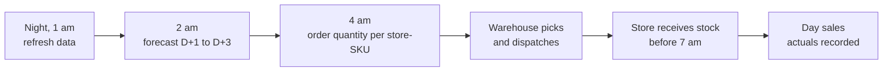
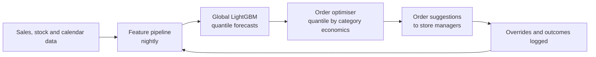

# Case Study 5: SKU-Level Demand Forecasting per Dark Store

**Domain:** Quick Commerce | **Problem Type:** Time-series forecasting (hierarchical, intermittent demand) | **Difficulty:** Advanced

---

## 1. Business Context

### Company background

- **Jhatpat** (fictional) is a quick-commerce app delivering groceries, fresh produce, snacks and daily essentials in 10 to 15 minutes.
- It runs **320 dark stores** (small warehouses closed to the public) in 9 cities. Each store serves a radius of about 2 to 3 km and lists about 4,500 active SKUs (Stock Keeping Units, one SKU is one product in one pack size).
- Scale: about 3 lakh orders a day, average basket about ₹480, so about ₹14.4 Cr GMV (Gross Merchandise Value) a day, about ₹5,200 Cr a year.
- Stores are replenished from city warehouses **once or twice a day**. Fresh items (milk, bread, vegetables) are replenished daily.

### The pain, with numbers

| Item | Value |
| --- | --- |
| Perishable share of sales (dairy, fruit, veg, bakery, meat) | about 28% |
| Wastage on perishables (expired or damaged, at cost) | about 5% of perishable cost, about ₹57 Cr a year |
| On-shelf availability (share of time a listed SKU is in stock) | 91% |
| Lost sales from stock-outs | about 6% of potential GMV, about ₹59 Cr of lost margin a year |
| Number of forecast series | 320 stores x 4,500 SKUs = **about 14.4 lakh series** |
| Share of series with intermittent demand (many zero-sale days) | about 60% |
| **Total annual pain (wastage plus lost margin)** | **about ₹116 Cr** |
| Current method | Store manager's spreadsheet: last 7-day average plus a manual buffer |

- Target for this year: cut wastage by 20% (about ₹11 Cr) and stock-outs by 25% (about ₹15 Cr of margin). Total **about ₹26 Cr**.

### Stakeholders and what each wants

| Stakeholder | What they want | What they fear |
| --- | --- | --- |
| Head of Supply Chain | Lower wastage and higher availability at the same time | Having to pick one over the other |
| Category managers (dairy, snacks, etc.) | Forecasts that respect launches, promotions and festivals | A model that ignores their market knowledge |
| Store managers | Simple, believable order suggestions | Extra work, or being blamed for model errors |
| Finance | Lower inventory holding and write-offs | Working capital stuck in slow movers |
| Customer experience | Fewer "out of stock" and "item unavailable" moments | Customers moving to rival apps |

---

## 2. Translating Business to ML

### The business question vs the ML question

| Business question | ML question |
| --- | --- |
| "How much of each item should each store hold tomorrow?" | "For each store-SKU, forecast the **distribution** of demand for the next 1 to 3 days, and give the P50, P80 and P90 quantiles. The order quantity is then chosen from the right quantile per item." |

> **Mentor note:** A forecast is not the decision. The decision is the order quantity. For milk, running out is worse than a little wastage, so we order near the P90. For a fragile bakery item, wastage costs more, so we order near the P60. Same forecast model, different quantile per category. This is the newsvendor idea: balance the cost of too little against the cost of too much.

### Target variable definition

- **Target:** `units_demanded` per store-SKU-day.
- **Important:** what we observe is **sales**, not demand. If the item is out of stock at 4 pm, sales after 4 pm are zero but demand was not.
- Treatment here: use hourly in-stock flags to **mark days with stock-outs**, and adjust or down-weight those days in training. (Case 8 goes deeper into stock-outs and phantom inventory.)

### Edge cases

| Edge case | Recommended treatment | Reason |
| --- | --- | --- |
| Item out of stock for part of the day | Flag the day. Scale up observed sales by the share of open hours using the typical hourly curve, or down-weight the row | Raw sales understate demand |
| Item delisted, or on temporary supplier shortage | Remove those periods from training | Zero sales here do not mean zero demand |
| Huge one-day spike (cricket final, flash sale, rain) | Keep, but add event features. Do not blindly delete | Events repeat, and the model must learn them |
| Item with a bundle or substitute (for example two milk brands) | Use a "substitute group" feature | When one is out, the other sells more |
| Cancelled or returned orders | Net them out of demand | Not real demand |

### Unit of prediction

- One row per **store x SKU x day** (with an optional hourly breakdown for perishables).

### Prediction timing



- Forecast is made the night before. It is used to place the morning replenishment order.
- Lead time (order to shelf) is 1 day for fresh and 2 to 3 days for packaged goods, so the horizon is 1 to 3 days.

### What success looks like

| Lens | Success |
| --- | --- |
| Business | Wastage down 20%, availability up from 91% to 94%, about ₹26 Cr a year |
| Model | WAPE (explained in section 6) improved by 15% or more over the 7-day average baseline at store-SKU level, with bias close to zero |
| Operations | Order suggestions accepted (not overridden) at least 85% of the time |

---

## 3. Data Understanding

### Data sources and key features

| Feature group | Source | Why it matters |
| --- | --- | --- |
| Sales history (units, price, discount) per store-SKU-day | Order system | The core signal |
| Stock history (hourly in-stock flag, opening stock) | Inventory system | Separates demand from sales |
| Calendar (day of week, month-end, salary day, festivals, school holidays) | Calendar table | Strong weekly and monthly patterns. Festivals shift by date each year |
| Promotions and price changes | Pricing and marketing tools | Demand reacts strongly to discounts |
| Weather (rain, temperature) | Weather API | Rain increases ordering of snacks and hot beverages and cuts fruit and vegetables |
| Events (IPL matches, local festivals, exams) | Events calendar | Spikes that no history alone can predict |
| Store attributes (catchment type: office, residential, student; store age; size) | Store master | Same SKU sells differently in an office area vs a residential one |
| SKU attributes (category, brand, pack size, shelf life, price band) | Catalogue | Allows borrowing information across similar SKUs |
| App traffic (sessions, search counts for the SKU, add-to-cart) | Analytics | Leading indicator of demand |

### Data volume, granularity and refresh

- **Volume:** 14.4 lakh series x 2 years of daily history is about 100 crore rows. In practice, train on the last 12 to 18 months with careful sampling, and keep the rest for seasonality.
- **Granularity:** store-SKU-day. Hourly for perishables.
- **Refresh:** sales and stock data refreshed hourly. Forecasts regenerated nightly.

### Common data issues

| Issue | How it shows up here |
| --- | --- |
| Intermittent demand | 60% of series have many zero days, so ordinary models and MAPE break |
| Censored demand | Stock-outs hide true demand |
| Cold start | A new store or a new SKU has no history |
| Seasonality at several levels | Day-of-week, payday, festival, monsoon, and intra-day |
| Promotions and substitution | A discount on one brand steals sales from another |
| Hierarchy | Store-SKU numbers must add up sensibly to store, city and national totals |
| Data errors | Duplicate orders, wrong units, items re-coded under new SKU IDs |
| Concept drift | A competitor opens near a store, and demand shifts in a week |

> **Mentor note: Where juniors usually go wrong here.**
>
> - They fit one model per series (14 lakh models) and wonder why it is slow, unstable and bad on sparse items. A **global model** learning across all series is almost always better.
> - They report MAPE. A series with 0 sales has an undefined MAPE, and a series with 1 sale makes it explode.
> - They forget that sales are not demand, and end up building a model that learns to predict stock-outs.

---

## 4. Approach and Decision Points

### Baseline first

- **Baseline 1:** last 7-day average (the store managers' method).
- **Baseline 2:** seasonal naive: same weekday last week, or the average of the same weekday over the last 4 weeks.
- **Baseline 3 (for intermittent items):** Croston or TSB, which forecast the chance of a sale and the size of a sale separately.
- **Why it matters:** the key business measure is **Forecast Value Added (FVA)**, the improvement over the simple baseline. If a complex model adds only 2%, the cost of running it is not justified.

### Candidate models

| Model | Pros | Cons | Verdict |
| --- | --- | --- | --- |
| Moving average and seasonal naive | Very fast, transparent | Ignores promotions, weather, and trends | Must-keep baseline and fallback |
| Per-series ETS or ARIMA | Classical, well understood | 14 lakh models to maintain, poor for sparse data, no external features | Not at this scale |
| Croston and TSB | Designed for intermittent demand | Weak with promotions or events | Useful for the slowest 20% of series |
| Global LightGBM with lag features (Poisson, Tweedie or quantile objective) | Handles all series together, uses promotions and weather, fast to train and run | Needs careful lag features, no native sequence memory | **Primary model** |
| Deep global models (DeepAR, Temporal Fusion Transformer, N-BEATS) | Learn complex patterns, native probabilistic output | GPU cost, harder to debug and explain | Challenger for top 20% of revenue SKUs |
| Hierarchical reconciliation (bottom-up, MinT) | Makes forecasts consistent across levels | Extra step, some accuracy trade-off | Use for planning views and for sparse series |

### Decision scenarios

| What if... | Recommended action | Reasoning |
| --- | --- | --- |
| **A new dark store opens with no history** (cold start) | Forecast using a **similar-store cluster**: pick 5 to 10 mature stores with similar catchment (office, residential, student), scale by the new store's expected size and an opening-ramp curve (for example 40% of mature volume in week 1, 80% by week 8). Replace with store-specific learning as data grows | Without history, the best prior is similar stores. A ramp curve avoids both over-stocking and empty shelves in the first weeks |
| **A new SKU is launched** | Use attribute-based matching: forecast from similar SKUs (same category, price band and brand tier) and from the launch plan of the category team | New items have no history, but similar items do |
| **60% of series are intermittent** (mostly zeros) | Train the global model with a Poisson or Tweedie objective and predict quantiles. Judge with pinball loss and WAPE, not MAPE. For the slowest items, stock the minimum display quantity and avoid forecasting noise | Count data with many zeros needs a count-aware loss. Forecasting 0.3 units per day is meaningless without a sensible rounding policy |
| **Milk must be near 100% available, but bakery items expire in 24 hours** | Choose the order quantile by item economics: P95 for essentials with low wastage cost, P60 to P70 for fragile or short-shelf-life items. Use cost of a lost sale vs cost of wastage to set it | Same forecast, different service levels. This is where the money is made |
| **A festival (Diwali, Holi) or IPL final changes demand sharply** | Add event features with a calendar table that includes lead-in and lead-out days. For rare events, add a category-manager override with a logged reason. Keep the model forecast visible next to the override | Events recur yearly, so they can be learned, but with only 2 years of data a human adjustment adds safety |
| **Store managers override the forecast all the time** | Track override accuracy (FVA of the manager vs the model) per category and store. Keep overrides where managers are consistently better | Respect domain knowledge, and measure it |
| **The model keeps over-forecasting after a competitor opens** | Add a fast adaptation layer: the last 7-day bias correction per store-category, and a monitoring alert on bias | Slow retraining cannot catch sudden local shifts |

---

## 5. Feature Engineering

### Top 10 features to build

| # | Feature | Business logic |
| --- | --- | --- |
| 1 | Lag sales: same weekday in the last 1, 2, 3, 4 weeks, and the previous 1, 3, 7 days | Recent level and weekly pattern |
| 2 | Rolling mean and standard deviation over 7, 14 and 28 days (stock-out adjusted) | Level and volatility. Volatility sets the safety buffer |
| 3 | Share of zero-sales days in the last 28 days | Tells intermittent from smooth demand |
| 4 | Days since last sale | Strong signal for slow items |
| 5 | Calendar flags: day of week, payday week, month-end, festival and lead-in days, school holiday | Systematic demand patterns |
| 6 | Price, discount percent, and price relative to category average | Price elasticity |
| 7 | Promotion flags and promotion depth, planned in advance | Known future events are the most valuable features |
| 8 | Weather forecast for the day (rain, heat) | Demand shifts, especially for beverages, snacks, fruits and vegetables |
| 9 | Substitute availability (is the competing brand in stock?) | Demand moves to substitutes when an item is out |
| 10 | Store and SKU embeddings or attributes (catchment type, category, shelf life) | Allows learning across similar stores and items |

### Features to avoid (leakage risks)

| Feature | Problem |
| --- | --- |
| Same-day actual weather or traffic that is not available at forecast time | Use only the forecast value made at the same time |
| Rolling statistics that include the target day | Classic look-ahead error. Shift by one day |
| Promotions that were decided after the forecast was made | Not known at the time. Use the plan version frozen at forecast time |
| Stock levels at end of day | Strongly related to sales, but unknown in advance |
| Adjusted demand using future information (for example, smoothing across the target day) | Leaks the answer |

Safe lag creation example:

```python
# Always shift before rolling, so the target day never sees itself
df = df.sort_values(["store_id", "sku_id", "date"])
g = df.groupby(["store_id", "sku_id"])["units_adj"]
df["lag_7"] = g.shift(7)
df["roll_mean_14"] = g.shift(1).rolling(14).mean().reset_index(level=[0, 1], drop=True)
```

---

## 6. Evaluation Strategy

### Metrics

| Metric | Role | Why |
| --- | --- | --- |
| **WAPE** (Weighted Absolute Percentage Error: total absolute error divided by total actual sales) | Primary accuracy metric | Handles zeros, and weights big sellers more, which matches rupee impact |
| **Bias** (total forecast minus total actual, as a percent) | Primary | Persistent over-forecasting means wastage, under-forecasting means stock-outs |
| **Pinball loss** at P50, P80, P90 | Primary for probabilistic output | Directly scores the quantile used for ordering |
| MASE (error scaled by naive-forecast error) | Secondary, for intermittent series | Comparable across items |
| Forecast Value Added (improvement over the baseline) | Business-facing | Shows the real contribution |
| Availability, wastage and fill rate | Outcome KPIs | The real goals |

### Metrics that look good but are misleading here

- **MAPE:** undefined for zero days, explodes for tiny sales, and treats a 1-unit miss on a 2-unit item the same as a 100-unit miss on a 200-unit item.
- **Accuracy at city or national level:** errors cancel out across stores. The store-SKU level is where stock-outs happen.
- **RMSE alone:** dominated by a few fast-moving SKUs and spike days.
- **Accuracy on in-stock days only:** hides the stock-out problem.

### Validation strategy

| Step | Design | Why |
| --- | --- | --- |
| Rolling-origin backtest | Train up to week N, forecast the next 1 to 3 days, move forward, repeat for 8 to 12 origins | Matches how the model runs in production |
| Include festival periods | Make sure at least one backtest window covers a major festival and a monsoon spell | Models often fail at these |
| Segment reporting | Report by category, store age, demand type (smooth, intermittent, lumpy) and revenue band | Averages hide weak segments |
| New store and new SKU holdout | Treat the first 4 weeks of recently opened stores as a separate test | Tests the cold-start logic |
| Simulation | Replay past days with forecast-based orders and compute simulated availability and wastage | Turns the forecast error into business KPIs |

### From model metric to business value

- WAPE at store-SKU-day level improves from 48% (7-day average) to 39% (LightGBM), a 19% relative gain.
- Bias is cut from +6% (over-ordering on average, driven by manual buffers) to about +1%.
- Simulation of orders based on the forecast quantiles shows:
  - wastage down 20%, about **₹11 Cr**;
  - availability from 91% to 94%, which recovers about 25% of the lost margin, about **₹15 Cr**.
- **Total about ₹26 Cr a year**, against a cost of data platform and compute in the order of ₹1.5 Cr.

---

## 7. Deployment and Monitoring

### Batch vs real time

- **Nightly batch** for next-day and next-3-day forecasts (14.4 lakh series), finished by 3 am.
- **Intraday update** for perishables: at 11 am and 3 pm, adjust the remaining-day forecast using sales so far, and trigger a top-up order if the store has the option.
- Real time (milliseconds) is not required.



### What to monitor

| Type | What to track | Alert trigger |
| --- | --- | --- |
| Forecast accuracy | WAPE and bias by store, category and week | Bias beyond plus or minus 3% for 3 days |
| Data quality | Missing sales days, sudden item recoding, stock-flag gaps | Any store with missing data above 2% |
| Data drift | Distribution of demand and lag features by city | PSI above 0.2 |
| Business KPIs | Availability, wastage by category, fill rate | Outside agreed bands |
| Overrides | Override rate and FVA of overrides | Override rate above 20% |
| Coverage of quantiles | Share of days actual sales fall below P90 (should be about 90%) | Below 85% or above 95% |

### Retraining

- **Scheduled:** weekly retraining or refresh of the global model, with daily refresh of features.
- **Triggered:** a big shift in a city (new competitor, price war), a catalogue change, or a bias alert.

### A/B test or champion-challenger design

- Store-level randomisation is needed, because orders are placed per store. Use **matched pairs of similar stores**: one runs the new forecast, the other the old method.
- Duration: at least 4 weeks (so every weekday appears 4 times), ideally covering a payday cycle.
- Readout: availability, wastage and order-override rate, not just WAPE.
- Because stores share a city warehouse, watch for interference. If one group over-orders, others can get less stock.

---

## 8. Stakeholder Communication

### Explain it to a non-technical leader

> "For every store and every product, the model predicts how many units we will sell tomorrow and also how uncertain that is.
> Then we decide how much to stock. We play it safe for milk and eggs because empty shelves lose customers. We stock less for bakery items that expire in a day.
> Compared with the 7-day average that stores use today, we expect fewer empty shelves and 20% less wastage, about ₹26 Cr a year.
> Store managers can change any suggestion, and we learn from the changes."

### Questions leadership will ask

| Question | Suggested answer |
| --- | --- |
| "Why not just forecast more accurately and drop the buffers?" | "Demand is random. Even a perfect model cannot predict one customer's craving for chips. We forecast the range and choose the stock level by the cost of running out vs the cost of waste" |
| "How will it handle new stores?" | "We start from similar mature stores, adjust for size and opening ramp, and shift to the store's own data within 3 to 4 weeks" |
| "What about festivals and cricket matches?" | "We have an events calendar in the model, and category managers can add adjustments for new events. We track how good their adjustments are" |
| "Why is the accuracy at item level only about 60%?" | "At the single store-item-day level, demand is noisy. Accuracy at store-category level is above 90%. What matters is whether the right number is on the shelf, which we measure through availability and wastage" |
| "What if the forecast service fails?" | "Stores fall back to the 7-day average rule automatically, which is what they use today" |

---

## 9. Common Pitfalls and Lessons

| Mistake | Why it happens | How to avoid it |
| --- | --- | --- |
| Using MAPE on sparse items | It is the most familiar metric | Use WAPE, bias and pinball loss, and report by demand type |
| Treating sales as demand | The sales table is easy to get | Mark stock-out hours, and adjust or down-weight those days |
| One model per series | Classical forecasting habits | Use global models that learn across series, with item and store attributes |
| Random train-test split | Default in ML libraries | Rolling-origin backtest only |
| Forecasting a single number | Simpler to explain | Forecast quantiles, then choose by economics per category |
| Ignoring bias | Teams focus on error size | Track bias separately. Over-bias is wastage, under-bias is lost sales |
| Rolling features that include the target day | Forgetting to shift | Shift before rolling, and add an automatic leakage test |
| Accuracy only at aggregate level | Looks better | Evaluate at the decision level, store-SKU, and tie to availability and wastage |
| Ignoring human knowledge | Wanting a fully automatic system | Allow overrides, log reasons, and measure their value |

---

## 10. Mentor's Focus Checklist

- ✅ **Where to spend 80% of the effort:**
  - Turning sales into demand (stock-out handling) and building clean history.
  - Quantile forecasts and the order-quantity rule by category economics.
  - A solid rolling backtest with simulation of availability and wastage.
  - Cold-start logic for new stores and SKUs.
- ❌ **What not to over-engineer:**
  - Deep learning for all 14 lakh series. Use it only where it clearly beats LightGBM, on the top revenue items.
  - Tuning for 0.5% WAPE gains on slow movers. Set minimum stock rules for them.
  - Perfect hierarchical consistency for operational orders.
- 💡 **Key takeaway:** **A forecast is a means, not the goal.** The goal is the right quantity on the shelf. Forecast the distribution, choose the quantile by cost of error, and measure success in availability and wastage, not in MAPE.
