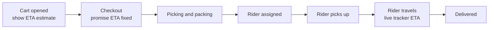
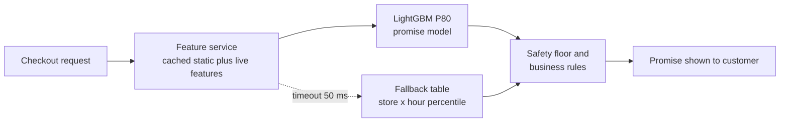

# Case Study 6: Delivery ETA Prediction (The "12 Minutes" Promise)

**Domain:** Quick Commerce | **Problem Type:** Regression with asymmetric loss (quantile regression) | **Difficulty:** Intermediate

---

## 1. Business Context

### Company background

- Same company as Case 5: **Jhatpat** (fictional), 320 dark stores, about 3 lakh orders a day, about 10.95 crore orders a year.
- At checkout, the app shows a promised delivery time, for example "Delivery in 12 mins". During the order, a live tracker shows the updated arrival time.
- Delivery partners (riders) are a mix of full-time and gig workers, assigned by a dispatch system.

### The pain, with numbers

| Item | Value |
| --- | --- |
| Median actual delivery time (order placed to handed over) | 11.5 minutes |
| 90th percentile of delivery time | 19 minutes |
| Orders delivered later than the promised ETA (by more than 2 minutes) | 18% (about 54,000 orders a day) |
| Average cost of a late order (coupons, support contact, lower repeat rate) | about ₹35 |
| **Annual cost of late orders** | **about ₹69 Cr** |
| Average ETA shown to customers | 13 minutes |
| Effect of ETA on conversion | Each extra minute of shown ETA lowers checkout conversion by about 1.2% |
| Current ETA method | Static value per store plus distance bucket, with a 2-minute buffer |

- The static method is **too optimistic** in rain and at peak hours, and **too conservative** at quiet times. So customers get late orders in some hours and see needlessly long ETAs in others.
- Targets: reduce late orders from 18% to 10%, and reduce the average shown ETA by 1 minute.

### Stakeholders and what each wants

| Stakeholder | What they want | What they fear |
| --- | --- | --- |
| Head of Growth | Shorter ETA shown, so more people check out | Padding the ETA to look safe, which kills conversion |
| Head of Customer Experience | Fewer late deliveries, fewer complaints | Broken promises and refund costs |
| Head of Operations and Dispatch | ETA that reflects reality, not a number that pressures riders | Unrealistic ETAs that push riders to unsafe riding |
| Engineering | A fast and reliable service at checkout | Latency spikes at peak load |
| Public relations and policy | A promise that is honest and safe | Public criticism about speed pressure on riders |
| Riders | Fair, achievable targets | Being penalised for delays they cannot control |

---

## 2. Translating Business to ML

### The business question vs the ML question

| Business question | ML question |
| --- | --- |
| "What time should we promise the customer?" | "Predict the distribution of total delivery time for this order, now. Promise a high quantile (about P80 to P85), because being late hurts more than being early." |
| "When will the order really arrive?" | "Predict the median (P50) arrival, refreshed at each stage, for the live tracker." |

> **Mentor note:** There are two products here. The **promise** is a commitment, so it should be a high quantile. The **tracker ETA** is an estimate, so it should be the median. Using the same number for both is a very common mistake and causes either broken promises or needlessly long ETAs.

### Target variable definition

- **Target:** `delivery_minutes = delivered_time minus order_placed_time` for completed orders.
- **Stage targets (for a decomposed model):** pick and pack time, rider wait time, rider-to-store time, store-to-customer ride time, handover time.

### Edge cases

| Edge case | Recommended treatment | Reason |
| --- | --- | --- |
| Rider taps "delivered" early, or late, or not at all | Clean timestamps with GPS: use the time when the rider enters a geofence around the address plus a handover estimate | Label noise teaches the model wrong times |
| Order cancelled or a rider could not be found | Exclude from the regression, but model separately as a risk (an ETA is meaningless if no rider is available) | Not a completed delivery |
| Customer unreachable or wrong address | Exclude or cap | Not a normal delivery |
| Very long outliers (above 60 minutes, bike breakdown, accident) | Keep in evaluation, winsorise (cap) for training, or use quantile loss which is robust | These are real, but they distort squared-error models |
| Multi-order batching (one rider carries two orders) | Add a batching flag as a feature, as the second order is later | Strongly changes delivery time |
| Orders with scheduled delivery slots | Separate flow | Different logic |

### Unit of prediction

- One **order**, predicted at checkout, and re-predicted at later stages (picked, rider assigned, rider picked up, rider near).

### Prediction timing



- The **promise** is made at checkout, with a strict budget of under 100 ms at p99, because it sits on the payment path.
- The **tracker ETA** updates every 30 to 60 seconds with better information.

### What success looks like

| Lens | Success |
| --- | --- |
| Business | Late orders (more than 2 minutes beyond promise) from 18% to 10%. Average shown ETA from 13 to 12 minutes. About ₹31 Cr a year |
| Model | Promise at P80 is on time for 80% of orders in every city, hour band and weather condition (**calibration**), and MAE of the median ETA at or below 2.2 minutes |
| Safety | No increase in rider speeding indicators, and no ETA shortened below what normal safe riding can achieve |

---

## 3. Data Understanding

### Data sources and key features

| Feature group | Source | Why it matters |
| --- | --- | --- |
| Order basics (item count, categories, weight, frozen or fragile items, basket value) | Order system | More items mean longer picking |
| Store state (open orders in queue, pickers on shift, average pick time in the last 30 minutes) | Store operations system | Live load at the store |
| Rider supply (idle riders within 2 km, average assignment wait in the last 10 minutes) | Dispatch system | Waiting for a rider is often the biggest delay |
| Road distance and travel time store-to-customer | Routing engine and live traffic | Distance on roads, not a straight line |
| Address features (high-rise, gated society, floor, lift wait, historical last-100-metre time) | Past deliveries, address book | Last-metre time is a big hidden delay |
| Weather (rain intensity, temperature) | Weather API | Rain slows riders and increases demand |
| Time features (hour, day of week, holiday, match day) | Calendar | Peak and off-peak patterns |
| Demand surge (orders per minute in the area vs normal) | Streaming | Congestion in stores and among riders |
| Past delivery history for the store, hour and neighbourhood | Order history | Strong baseline signal |

### Data volume, granularity and refresh

- **Volume:** about 3 lakh orders a day, so about 9 crore orders a year. Use the last 6 to 9 months, about 5 to 7 crore rows, and plenty of stage-level data.
- **Granularity:** one row per order, with a timeline of stage timestamps.
- **Refresh:** live features updated every 30 to 60 seconds. Model refreshed weekly.

### Common data issues

| Issue | How it shows up here |
| --- | --- |
| Noisy timestamps | Riders tap buttons early or late, GPS jumps in tall buildings |
| Heavy right tail | A few very long deliveries distort averages |
| Real-time feature freshness | Store load a minute old at training but 5 minutes old in production |
| Feedback loop | The ETA shown affects who orders, how dispatch prioritises, and how fast riders try to ride |
| Distribution shift | Monsoon, a big match, a road closure, or a new city behave differently |
| Sparse addresses | New buildings have no history |
| Training-serving skew | Historical rider supply is computed at order time in batch, but live data is partial |

> **Mentor note: Where juniors usually go wrong here.**
>
> - They train with squared error, get a model that predicts the average, and then promise the average. This breaks the promise to about half the customers.
> - They include a feature such as "rider assigned time" or "pick completed time". These are not known at checkout, so the model looks brilliant offline and fails live.
> - They do not realise that the ETA changes the system it measures. If the ETA is shortened, dispatch and riders react.

---

## 4. Approach and Decision Points

### Baseline first

- **Baseline 1 (current):** store average plus distance bucket plus 2-minute buffer. 18% late, MAE about 3.1 minutes.
- **Baseline 2:** historical median or P80 by store x hour-of-week. Simple and surprisingly strong.
- **Why it matters:** if a simple table of historical percentiles gets halfway, you know how much room for ML is left, and you have a safe fallback.

### Candidate models

| Model | Pros | Cons | Verdict |
| --- | --- | --- | --- |
| Historical percentile table by store and hour | Instant, transparent, a safe fallback | Ignores live load, weather and order size | Keep as fallback |
| Linear or ridge regression | Fast, interpretable | Weak for interactions (rain x peak x distance) | Quick benchmark |
| **LightGBM with quantile objective** (P50 and P80 models) | Accurate, fast to score (about 1 to 3 ms), handles missing values and mixed features | One model per quantile, and quantiles may cross | **Primary model** |
| Stage-wise models (pick time, rider wait, ride time, handover) summed with simulation | Explains where time goes, helps operations | Errors combine, more engineering | Strong for the live tracker and for diagnosis |
| Deep learning (multi-task networks, graph neural networks on road network) | Good with raw routes and sequences | Heavy to serve, harder to debug | Only if the gains are proven |
| Conformal prediction on top of a point model | Gives calibrated intervals with guarantees | Needs a calibration set, can be wide | Useful add-on for calibration |

### Decision scenarios

| What if... | Recommended action | Reasoning |
| --- | --- | --- |
| **Late delivery costs more than early delivery** (asymmetric cost) | Train with **quantile (pinball) loss** at the target quantile (for example 0.8), not squared error. Choose the quantile from costs: late order costs about ₹35, each extra shown minute costs conversion. Pick the quantile that minimises the total cost | A mean predictor is late half the time by design. The right promise is a high quantile, and the quantile is a business decision |
| **Checkout latency budget is under 100 ms** | Precompute static features (address history, store-hour baselines) and cache them. Fetch only a few live features (store queue, idle riders). Use a small LightGBM (about 300 trees), set a 50 ms timeout, and fall back to the percentile table | The ETA sits on the payment path. A slow or failed ETA loses sales directly |
| **Timestamps are noisy because riders tap buttons carelessly** | Rebuild labels using GPS geofence events when possible, drop orders with impossible stage durations, and report the share of cleaned rows. Use quantile loss so that outliers matter less | Garbage labels set a ceiling on accuracy that no model can fix |
| **A short ETA makes riders hurry, which may be unsafe** | Add a guardrail: the promised ETA cannot go below a minimum based on safe travel speed, and monitor rider safety indicators. Model riding time with realistic speed limits | A model that lowers promises without limit creates real harm and reputational risk. Be transparent with leadership about this trade-off |
| **Rain or a big match changes everything and the historical data is thin** | Add weather and event features, use short-memory live features (last 10-minute pick time and rider wait), and add a **real-time bias corrector** that adjusts the quantile if recent orders in the area were late | Live features adapt faster than retraining |
| **A new city or store opens with no history** | Start from a similar city or store cluster with road distance and weather, then switch to local data after 2 to 3 weeks. Widen the promise by 1 to 2 minutes at first | Better to be slightly conservative than wrong in a new area |
| **Customers see the ETA, and the ETA changes behaviour** (feedback loop) | Evaluate with an online A/B test, not only offline. Watch conversion, repeat rate and late rate. Randomise at user level | Offline accuracy cannot show how users and dispatch react |

---

## 5. Feature Engineering

### Top 10 features to build

| # | Feature | Business logic |
| --- | --- | --- |
| 1 | Road distance and routing-engine travel time, store to customer, with live traffic | Core driver of ride time |
| 2 | Hour of week (168 buckets) and holiday or event flags | Peak and off-peak patterns |
| 3 | Number of items, weight, and presence of frozen or fragile items | Picking and packing effort |
| 4 | Store queue: open orders per picker right now | The main driver of pick delays |
| 5 | Average pick time at this store in the last 30 minutes | Live store speed |
| 6 | Idle riders within 2 km divided by open orders in the area | Rider supply and demand balance |
| 7 | Average rider assignment wait in the last 10 minutes at this store | Direct evidence of rider shortage |
| 8 | Rain intensity and road-closure flags | Slows riders and increases demand |
| 9 | Address type (high-rise, gated community, floor) and historical last-100-metre time at this address or building | Often 2 to 4 minutes of hidden delay |
| 10 | Share of orders in the last 60 minutes at this store that were late | Captures the live system state in one number |

### Features to avoid (leakage risks)

| Feature | Problem |
| --- | --- |
| Pick-complete time, rider-assigned time, rider ID, or actual route of the same order | Known only after checkout |
| Final delivery time of nearby orders that finished after this order was placed | Look-ahead leakage in the neighbour features |
| Customer rating or complaint | Happens after delivery |
| Cancellation flags | Outcome, not input |
| Features aggregated over a full hour that includes the future | Compute them with a strict cut-off at checkout time |
| Rider personal attributes (age, gender) | Fairness and legal risk, and not known at checkout anyway |

Pinball loss for the promise model (quantile 0.8):

```python
import lightgbm as lgb

# alpha=0.8 means the model aims to be late for only about 20% of orders
promise_model = lgb.LGBMRegressor(objective="quantile", alpha=0.8,
                                  n_estimators=300, learning_rate=0.05)
promise_model.fit(X_train, y_train)
```

---

## 6. Evaluation Strategy

### Metrics

| Metric | Role | Why |
| --- | --- | --- |
| **Calibration of the promise** (share of orders delivered on or before the promise, by city, hour band and weather) | Primary for the promise | If we target 80%, we must see about 80% everywhere, not 90% in some places and 65% in others |
| **Sharpness** (average promised minutes, given the same calibration) | Primary for the promise | Any model can reach 95% on-time by promising 30 minutes. A better model reaches 80% with shorter promises |
| **Pinball loss** at the chosen quantile | Model training and comparison | The right loss for quantile prediction |
| **MAE of the median ETA** | Tracker accuracy | Simple for operations to understand |
| Late-by-more-than-5-minutes rate | Customer pain | Severe lateness drives the biggest drop in repeat |
| Conversion and late-order cost | Business | The final return |

### Metrics that look good but are misleading here

- **Overall MAE or RMSE for the promise model:** a mean-based model can have low MAE and still break the promise 45% of the time.
- **R-squared:** high because distance explains most of the variance, which does not mean the ETA is useful.
- **On-time rate alone:** can be gamed by padding the ETA. Always show it together with the average promised minutes.
- **Overall calibration only:** may hide that the model is poor in rain or at peak hours. Check by segment.

### Validation strategy

| Step | Design | Why |
| --- | --- | --- |
| Time-based split | Train on weeks 1 to 20, validate on weeks 21 to 22, test on weeks 23 to 24 | Matches deployment |
| Hold out special days | Include at least one heavy-rain day, a match day, and a holiday in the test set | Tests the hard cases |
| Store-group holdout | Hold out 10% of stores completely | Tests behaviour in new stores |
| Calibration plots by segment | Reliability chart per city, hour, rain flag | Finds hidden failures |
| Shadow mode | Log the new ETA next to the current one for 2 weeks without showing it | Real-world check without risk |
| Online A/B test | User-level randomisation with conversion, late rate, repeat rate, and rider safety guardrails | The ETA changes behaviour |

### From model metric to business value

- Late orders fall from 18% to 10% (8 points) on 10.95 crore orders a year: about 87 lakh fewer late orders.
- At ₹35 each, the saving is about **₹30 Cr** at the full effect. We take a cautious ₹19 Cr, because only part of the gain is realised after allowing for overlap with other fixes.
- Shorter average promise (13 to 12 minutes) lifts conversion by about 1.2%: about ₹62 Cr of GMV, at about 20% contribution margin, **about ₹12 Cr**.
- **Total about ₹31 Cr a year**.

---

## 7. Deployment and Monitoring

### Batch vs real time

- **Real-time inference** at checkout (the promise) and at every stage change (the tracker).
- **Batch jobs:** nightly refresh of store-hour baselines and address history, and weekly retraining.
- Design for failure: every call has a timeout and a fallback (the percentile table).



### What to monitor

| Type | What to track | Alert trigger |
| --- | --- | --- |
| Calibration | On-time share vs target, by city and hour band, every hour | Off by more than 5 points for 3 hours |
| Accuracy | MAE of tracker ETA, by stage | 15% worse than the baseline week |
| Data and features | Freshness of live features, null rates, queue-length distribution | Feature lag above 2 minutes |
| Latency and reliability | p50, p95, p99 latency, timeout and fallback rates | p99 above 80 ms, or fallback above 1% |
| Business KPIs | Conversion, late-order cost, refund rate, repeat rate | Outside agreed bands |
| Rider safety and fairness | Speeding indicators, incident rate, rider earnings per order | Any adverse trend |
| Drift | PSI on distance, queue length and weather features | PSI above 0.2 |

### Retraining

- **Scheduled:** weekly, on a rolling 8 to 12 week window.
- **Triggered:** calibration drift, a new city launch, a major change in dispatch logic or store operations.

### A/B test or champion-challenger design

- Randomise by **user** (not by order, or the same user will see different ETAs), 50-50 for 2 weeks.
- Primary: late-order rate and conversion. Guardrails: refund rate, rider safety indicators, ETA complaints.
- Because dispatch is shared, a store-level or city-hour switchback design is also worth considering to catch spillovers.

---

## 8. Stakeholder Communication

### Explain it to a non-technical leader

> "Today every order in a store gets nearly the same ETA. The new model looks at the order size, how busy the store is, how many riders are free nearby, the road distance, the weather, and how long this building usually takes.
> We promise a time that we expect to meet 4 times out of 5, and we show a shorter promise where the model sees an easy delivery, and a longer one where it sees trouble.
> Late deliveries drop from 18% to about 10%, and the average promise gets about a minute shorter.
> A safety floor makes sure we never promise a time that needs unsafe riding."

### Questions leadership will ask

| Question | Suggested answer |
| --- | --- |
| "Why not promise 10 minutes everywhere?" | "Because about 1 in 5 orders cannot be done in 10 minutes safely. Missing the promise costs more than the conversion we would gain, and it hurts trust. The model gives 10 or 11 minutes where it is realistic" |
| "Why do you promise a higher number than the median?" | "A late order costs us about ₹35 and a customer's trust. An early order costs almost nothing. So we promise a time we hit 80% of the time, and the tracker shows the median" |
| "Will it work in heavy rain?" | "It uses live store and rider data and the weather forecast. It will not be perfect on a day we have never seen, so a live corrector widens the promise when recent orders run late" |
| "What if the service is slow or down?" | "A simple table of historical times takes over within 50 milliseconds, with no impact on checkout" |
| "Does this push riders harder?" | "No. The model predicts how long deliveries take under normal safe riding. The safety floor stops the promise from going below that. We watch rider safety metrics as part of the A/B test" |

---

## 9. Common Pitfalls and Lessons

| Mistake | Why it happens | How to avoid it |
| --- | --- | --- |
| Promising the mean prediction | MAE or RMSE are the default loss functions | Use quantile loss, and set the quantile from late-order cost vs conversion |
| Using features not available at checkout | Order tables contain later stage timestamps | Tag every feature with its availability time, and test with a strict cut-off |
| Measuring only average accuracy | It gives one simple number | Check calibration by city, hour, rain and store |
| Ignoring noisy timestamps | The label is trusted blindly | Reconstruct from GPS, filter impossible values, and report label quality |
| Reporting on-time rate without average promise | On-time looks great when promises are long | Always show sharpness next to calibration |
| Not thinking about feedback | Offline evaluation seems enough | A/B test with user-level randomisation, and watch dispatch behaviour |
| No safety constraint | Optimising only for conversion | Add safety floors and guardrails, and agree on them with operations and policy |
| Heavy model with no fallback | Accuracy first, reliability later | Add timeouts, caching, and a simple fallback table from day one |

---

## 10. Mentor's Focus Checklist

- ✅ **Where to spend 80% of the effort:**
  - Choosing the right quantile and the loss that reflects the business cost.
  - Clean labels (GPS-based) and strict availability-time rules for features.
  - Live features (store queue, rider supply) with freshness monitoring.
  - Calibration by segment, and a proper online A/B test.
- ❌ **What not to over-engineer:**
  - Deep networks on road graphs before a quantile LightGBM with good live features.
  - Per-minute accuracy improvements in off-peak low-volume hours.
  - Complex multi-stage simulation, unless operations needs the breakdown.
- 💡 **Key takeaway:** **Predict the number that matches the business cost of being wrong.** When late is worse than early, a high quantile beats the mean, and the proof is calibration and sharpness, not a lower MAE.
