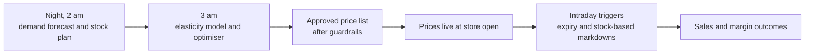
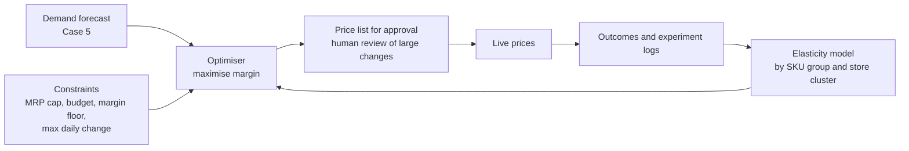

# Case Study 7: Dynamic Discount Optimisation

**Domain:** Quick Commerce | **Problem Type:** Causal estimation (price elasticity) plus constrained optimisation | **Difficulty:** Advanced

---

## 1. Business Context

### Company background

- Same company as Cases 5 and 6: **Jhatpat** (fictional), 320 dark stores, about ₹5,200 Cr GMV a year.
- Item-level discounts ("₹10 off", "15% off") are used to drive orders, clear short-dated stock, and win against rivals.
- Discounts are set today by category managers using simple rules: "10% off beverages every weekend", "match the rival's price on top 200 items", "20% off bakery after 6 pm".
- **Legal limit:** in India, a product cannot be sold above its printed MRP (Maximum Retail Price). So "dynamic pricing" in quick commerce mostly means **choosing how much discount to give from the MRP**, not raising prices above it.

### The pain, with numbers

| Item | Value |
| --- | --- |
| Company-funded item discounts | about ₹110 Cr a year (about 2.1% of GMV). Brand-funded discounts are on top |
| Share of that discount given to customers who would have bought anyway (estimated from a few small tests) | about 35%, so about **₹38 Cr** a year of waste |
| Incremental contribution margin per ₹1 of discount spent (after the discount cost) | about ₹0.40 |
| Time of price changes | Manual, weekly. Prices cannot react to stock or demand within the day |
| Short-dated stock that is cleared at a deep discount or written off | A part of the ₹57 Cr perishable wastage (see Case 5) |

- Target: keep the discount budget at ₹110 Cr but raise incremental margin per ₹1 of discount from ₹0.40 to about ₹0.58.
- Value: 0.18 x ₹110 Cr is about **₹20 Cr** a year. Plus about **₹4 Cr** from smarter markdowns of short-dated items. **About ₹24 Cr in total.**

### Stakeholders and what each wants

| Stakeholder | What they want | What they fear |
| --- | --- | --- |
| Chief Business Officer | Growth and market share without burning cash | Rivals winning on price, or an over-aggressive model that gives money away |
| Category managers | Control, and respect for brand deals and festival plans | A black box overriding their relationships with suppliers |
| Finance | Contribution margin and predictable discount spend | Discount budget overruns |
| Brand and supplier partners | Agreed price and promotion terms honoured | Surprise price changes |
| Legal and Compliance | Prices never above MRP, no unfair practices, and no personal price discrimination | Regulatory scrutiny of deep discounting |
| Customers | Consistent, fair prices they trust | Seeing different prices for the same item for no reason |

---

## 2. Translating Business to ML

### The business question vs the ML question

| Business question | ML question |
| --- | --- |
| "How much discount should each item get in each store, and when?" | "For each store-SKU-day, estimate the **causal effect** of each discount level (0, 5, 10, 15, 20%) on units, basket effects and margin. Then choose the discount that maximises expected contribution margin subject to a budget and business rules." |

> **Mentor note:** Two traps lurk here. The first: sales go up when discounts run, but that is **correlation**. Discounts are placed on festival weekends and on items that are already trending, so a naive model credits the discount with sales it did not cause. The second: the best discount for one item may hurt another (cannibalisation). The job is to measure the **effect** of price, then optimise.

### Target variable definition

- **Outcome of interest:** `units_sold(price)` per store-SKU-day, as a function of the discount depth.
- **Business objective:** contribution margin = units x (selling price minus cost) plus halo (extra items bought in the same basket) minus cannibalisation (lost sales of substitutes).
- **Key estimated quantity:** the **price elasticity** (percent change in units for a 1% change in price), possibly different for each SKU, store type and time.

### Edge cases

| Edge case | Recommended treatment | Reason |
| --- | --- | --- |
| Item out of stock during the promo | Remove from elasticity training, or adjust for in-stock hours | A discount on an unavailable item shows zero effect |
| Supplier-funded promo with a fixed price | Treat as a constraint (price fixed), not a decision variable | Not ours to change |
| Pull-forward (customers stock up, then buy less next week) | Measure the dip for 14 days after the promotion | The net effect is what counts |
| Same discount in all stores (central promo) | Little price variation to learn from. Use the cross-store differences in cost and timing, or run a store-level test | Without variation no model can learn elasticity |
| Near-expiry items | Separate "clearance" logic using remaining shelf life and forecast demand | Different goal: avoid write-off, not grow volume |
| Loss-leader items (milk, eggs) used to attract traffic | Evaluate by basket-level impact, not by item margin | Their job is to bring the customer in |

### Unit of prediction

- One **store x SKU x day (or time block)** decision, with a discount from a small menu: 0, 5, 10, 15, 20%.

### Prediction timing



### What success looks like

| Lens | Success |
| --- | --- |
| Business | Same ₹110 Cr discount budget gives about ₹20 Cr more contribution margin, and about ₹4 Cr from better short-dated markdowns |
| Model | Estimated elasticities agree with the randomised price test within the confidence interval. The optimiser beats the manager rules in a store-level A/B test |
| Guardrails | No price above MRP, discount budget not exceeded, no fall in basket size or repeat rate |

---

## 3. Data Understanding

### Data sources and key features

| Feature group | Source | Why it matters |
| --- | --- | --- |
| Sales, price, discount, cost per store-SKU-day | Order and pricing systems | Raw material for elasticity |
| Promotion calendar and funding (company or brand) | Marketing and category tools | Know which prices were choices and which were fixed |
| Competitor prices (scraped or via partner feeds) | Price intelligence | Relative price drives choice |
| Substitute and complement groups | Catalogue | Needed for cannibalisation and halo |
| Stock, days of cover, remaining shelf life | Inventory system | Drives clearance decisions |
| Demand forecast (from Case 5) | Forecasting service | Baseline demand without the discount |
| Basket data (items bought together, basket value) | Order system | Halo and traffic-driver effects |
| Store catchment and customer mix | Store master, CRM | Different areas have different price sensitivity |
| Past experiment logs | Experiment platform | The most valuable source of true causal signal |

### Data volume, granularity and refresh

- **Volume:** 14.4 lakh store-SKU series, about 2 years daily. Price variation is limited: most SKUs have only 3 to 6 distinct discount levels in history.
- **Experiments available:** a few small A/B tests of discount banners, and a 4-week test in 12 stores last year.
- **Refresh:** prices decided daily, elasticity models refreshed weekly or monthly.

### Common data issues

| Issue | How it shows up here |
| --- | --- |
| **Confounding** (discounts were not random) | Discounts coincide with festivals, weekends and trending items, which inflates apparent effects |
| **Reverse causality** | Managers discount items that are already slow, which makes discounts look ineffective |
| Little price variation | Many SKUs had only one or two prices, so elasticity cannot be estimated |
| Pull-forward and stockpiling | Short-term lift is partly borrowed from the future |
| Cannibalisation and halo | Item-level analysis misses effects on other items and on the basket |
| Competitor effects | Rival promotions shift demand in ways that look like our own price effect |
| Stock-outs | Hide the real response |
| Structural breaks | New competitors and festival seasons change price sensitivity |

> **Mentor note: Where juniors usually go wrong here.**
>
> - They fit "units ~ price" with a gradient boosting model and read off the price effect. The model happily learns that higher price goes with higher sales (because prices rise in festival weeks). That is not elasticity.
> - They optimise item by item, so the optimiser gives a deep discount on the item with the highest elasticity, even when the extra units simply come from the neighbouring item.
> - They never run a price experiment, because "randomising price sounds risky", and then have no way to prove that the model works.

---

## 4. Approach and Decision Points

### Baseline first

- **Baseline 1:** the current manager rules. Incremental margin about ₹0.40 per ₹1 of discount.
- **Baseline 2:** a simple rule by category, "no discount on inelastic staples, 10% on elastic snacks", based on a category-level elasticity table.
- **Why it matters:** category-level rules from clean experiments often capture 60 to 70% of the gain. The SKU-level model must add clear value on top of them.

### Candidate models

| Model | Pros | Cons | Verdict |
| --- | --- | --- | --- |
| Log-log regression with controls (log units on log price, fixed effects for store, SKU, week, promo flags) | Interpretable elasticity, a standard in retail analytics | Linear and averaged, assumes controls remove confounding | Strong first step |
| Double Machine Learning (DML) | Uses ML to remove the influence of confounders, then estimates a clean price effect | Needs enough price variation, more complex | **Primary approach for elasticity** |
| Causal forest or meta-learners (for example X-learner) | Estimate how elasticity differs by SKU, store and time | Needs data and experiments to validate | Use for heterogeneity |
| Instrumental variables (for example supplier cost shocks as the source of price change) | Can handle hidden confounding | Valid instruments are rare | Use when a good instrument exists |
| Randomised price experiments (store-day switchbacks, store-level tests) | Gold standard | Cost, time, and business nervousness | **Essential, even if small** |
| Contextual bandits (Thompson sampling) | Learn while earning, explore safely | Needs infrastructure and guardrails | Second phase, after base elasticity is known |
| Pure demand-prediction GBM with price as a feature | Easy | Confounded price effect | Use only for baseline demand, not for the price effect |

### Decision scenarios

| What if... | Recommended action | Reasoning |
| --- | --- | --- |
| **Past prices were not randomised** (they followed manager rules, festivals and trends) | Run a **randomised price test**: for a sample of 40 stores and 200 SKUs, randomly assign discount levels by store-day (a switchback design) for 6 weeks, with a loss budget approved by Finance. Use that data to calibrate or validate the observational elasticity model | Randomisation is the only way to be sure the price effect is causal. A small experiment is cheaper than a year of wrong discounts |
| **Elasticity differs by SKU, store and time** (milk is inelastic, chips are elastic, offices differ from hostels) | Estimate elasticity at a hierarchy level: SKU group x store cluster x time block. Shrink noisy SKU-level estimates toward the group average (partial pooling) | Separate estimates for sparse SKUs are noise. Pooling gives stable estimates |
| **Discounting one item steals from a neighbour** (cannibalisation) | Model substitute groups, and measure effect on **category** margin, not only item margin. Include the prices of substitutes as features | Optimising each item separately double-counts gains |
| **Some items are traffic drivers** (milk, bread) | Add a basket-effect term: the extra margin from other items in the same basket. Use a separate "role" tag per SKU (traffic driver, margin earner, filler) | The best discount on a loss-leader may be negative item margin but positive total margin |
| **Short-dated stock must be cleared to avoid a write-off** | Use a separate clearance rule: compute the markdown so that expected leftover stock at expiry is near zero, using the Case 5 forecast, remaining shelf life and the elasticity curve. Apply it only to the specific batch | The objective is different: minimise write-off cost, not maximise growth |
| **A rival drops prices on 200 items** | Add the competitor price gap as a feature and a rule-based cap for "price matching" on the top traffic items. Re-estimate elasticity with competitor controls | Part of what looks like our price effect is competitor behaviour |
| **Regulators and the public care about fairness** | Prices vary by store and SKU and time only, never by individual customer. Never above MRP. Keep a log and a reason for each price | Personalised pricing carries high trust and legal risk, and the gain is small in this setting |
| **Leadership fears the model will give money away** | Hard guardrails: budget cap per category per week, margin floor per SKU, maximum daily change, and a human-approval step for large changes | The optimiser works within a safe box |

---

## 5. Feature Engineering

### Top 10 features to build

| # | Feature | Business logic |
| --- | --- | --- |
| 1 | Discount depth (percent off MRP) and price index versus the store's normal price | The treatment itself |
| 2 | Baseline demand forecast without promotion (from Case 5) | Removes normal seasonality, so the model focuses on the price effect |
| 3 | Days since the last promotion and promotion frequency in the last 30 days | Customers adapt to frequent discounts and wait for them |
| 4 | Competitor price gap (our price minus rival price) | Relative price drives choice |
| 5 | Substitute prices and substitute discount depth | Cannibalisation signal |
| 6 | Unit cost and margin at current price | Needed for the objective and the margin floor |
| 7 | Days of stock cover and remaining shelf life | Drives clearance and avoids stock-outs under promotion |
| 8 | SKU role (traffic driver, margin earner, filler) and category | Different objectives |
| 9 | Store cluster (office, residential, student), and income index of the catchment | Different price sensitivity |
| 10 | Calendar, festival and weather flags | Control for demand shifts unrelated to price |

### Features to avoid (leakage and bad-control risks)

| Feature | Problem |
| --- | --- |
| Realised sales on the same day, or realised in-stock hours | Outcome variables, leakage |
| Promo flags that were set **because** sales were low or high | Reverse causality, and distort the price effect |
| Post-promotion sales dip used as a feature for the same promotion | Look-ahead |
| Customer-level data used to personalise the price | Legal and trust risk, and outside the design |
| Variables that are results of price (for example basket size after price change) used as controls | "Bad controls" that block part of the real effect |

Simple elasticity estimate with controls:

```python
import statsmodels.formula.api as smf

# log-log model with fixed effects: the coefficient on log_price is the elasticity
m = smf.ols(
    "log_units ~ log_price + log_comp_price + log_baseline_fcst"
    " + C(store_id) + C(sku_id) + C(week)",
    data=df[df.in_stock_share > 0.9],
).fit(cov_type="cluster", cov_kwds={"groups": df.loc[df.in_stock_share > 0.9, "store_id"]})
print(m.params["log_price"])
```

---

## 6. Evaluation Strategy

### Metrics

| Metric | Role | Why |
| --- | --- | --- |
| **Incremental contribution margin per ₹1 of discount** (from experiments) | Primary business metric | Measures real return on discount spend |
| **Incremental units and incremental margin vs a control group** | Primary | True effect, not before-and-after |
| Elasticity estimate error against randomised test results | Model quality | Tells you whether the causal model is right |
| Basket size and category-level margin | Guardrails | Catch cannibalisation and halo |
| Post-promo dip (net effect over 14 days) | Guardrail | Shows pull-forward |
| Discount budget utilisation and margin floor breaches | Constraints | Policy compliance |

### Metrics that look good but are misleading here

- **Units lift during the promotion:** includes pull-forward from the future and sales stolen from neighbours.
- **Accuracy (R-squared or MAPE) of a sales prediction model with price as a feature:** it can predict sales well and still give the wrong price effect.
- **Revenue or GMV:** a deep discount raises GMV and loses margin.
- **Redemption rate:** shows how many people used the discount, not how many were changed by it.

### Validation strategy

| Step | Design | Why |
| --- | --- | --- |
| Offline check against experiments | Estimate elasticity from observational data, then compare with the randomised test results on the same SKUs | Tells whether the observational model can be trusted |
| Placebo tests | Check that the model finds no effect of "future" discounts on past sales | Detects confounding |
| Time-based split | Train on older weeks, evaluate on newer ones | No look-ahead |
| Online store-level A/B test | Randomise matched stores (or store-days in a switchback) into optimiser vs manager rules | Direct measure of the margin gain |
| Duration | At least 4 weeks, with a 2-week follow-up to capture pull-forward | Net effect |

### From model metric to business value

- Randomised test: average elasticity of snacks is about -2.1 (a 10% price cut lifts units by about 21%), milk about -0.4, fruit and vegetables about -1.3, personal care about -1.8.
- Discount spend today: ₹110 Cr, of which about 35% goes to customers who would have bought anyway.
- Optimiser re-allocates: cut discounts on inelastic staples, and use the money on elastic categories and on high-halo items.
- Incremental margin per ₹1 of discount: from ₹0.40 to ₹0.58, so +₹0.18 x ₹110 Cr = **about ₹20 Cr**.
- Smarter markdowns on short-dated items reduce residual write-off by **about ₹4 Cr**. This is on top of Case 5's wastage saving and counts only the leftover after better ordering.
- **Total about ₹24 Cr a year.**

---

## 7. Deployment and Monitoring

### Batch vs real time

- **Daily batch** for the standard price list (3 am run, live at store opening).
- **Intraday event-driven** markdowns for short-dated stock and sudden stock-outs, using simple rules fed by the model's elasticity.
- No per-user real-time pricing.



### What to monitor

| Type | What to track | Alert trigger |
| --- | --- | --- |
| Business KPIs | Contribution margin, discount spend vs budget, units, basket size, repeat rate | Spend more than 5% over plan, or margin below floor |
| Model quality | Predicted vs actual lift in the always-on holdout stores | Gap above 25% |
| Elasticity drift | Rolling re-estimates for top categories | Change of more than 30% from the last estimate |
| Competitive shifts | Competitor price index | Sudden change on top traffic items |
| Guardrails | Prices above MRP (must be zero), items with price changes above the daily cap | Any breach |
| Fairness and trust | Price consistency across neighbouring stores, complaints about price | Spikes in complaints |

### Retraining

- **Scheduled:** elasticity models re-estimated monthly, and after every major experiment.
- **Triggered:** festival season changes, new competitor entry, major cost change from suppliers.
- **Always:** keep a **permanent small holdout** (about 5% of store-SKU combinations on manager rules) to measure the model's value over time.

### A/B test or champion-challenger design

- **Design:** store-level matched pairs (or switchback by store-day) with the optimiser vs manager rules, for 4 weeks plus 2 weeks follow-up.
- **Exploration:** after the base model works, add a bandit that tries neighbouring discount levels on a few SKUs to keep learning.
- **Decision rule:** roll out only if incremental margin per ₹1 of discount is at least 0.50 with no drop in basket size or repeat rate.

---

## 8. Stakeholder Communication

### Explain it to a non-technical leader

> "We give ₹110 Cr a year in discounts, but about a third goes to customers who would have bought anyway.
> We ran a small controlled test to measure what a discount really changes for each type of item and store.
> The new system gives bigger discounts where they bring in real extra orders, such as snacks, and fewer where people buy regardless, such as milk, within the same budget.
> It never goes above MRP, never exceeds the budget, and keeps a margin floor. We expect about ₹24 Cr more margin a year."

### Questions leadership will ask

| Question | Suggested answer |
| --- | --- |
| "Why not just match the rival's price everywhere?" | "Matching everywhere is expensive. We match on the few traffic-driving items where customers compare prices, and use the data to decide on the rest" |
| "Is it fair that two stores show different prices?" | "Prices vary by store cost and local demand, as in any retail chain, but never by individual customer, and never above MRP" |
| "How do you know the model is right, not just lucky?" | "We compare it with a randomised test, and we keep a small group of stores on the old rules all the time, so we can always measure the difference" |
| "What if it gives away too much?" | "There are hard limits: weekly budget per category, a margin floor per item, and a cap on the daily change. Large changes need human approval" |
| "Why do you need a price experiment? Customers will notice." | "A small test in a few stores over a few weeks costs less than one month of wasted discounts. It is the only way to separate cause from coincidence" |

---

## 9. Common Pitfalls and Lessons

| Mistake | Why it happens | How to avoid it |
| --- | --- | --- |
| Reading elasticity from a plain demand model | Easy with GBMs, and R-squared looks great | Use causal methods (DML, IV) and validate with an experiment |
| Skipping randomised tests | Fear of lost revenue | Run a small switchback test with a loss budget, and show it pays back |
| Counting only units during the promo | Easy to measure | Measure net effect over the following 14 days, and at category and basket level |
| Optimising item by item | Simpler problem | Model substitutes, and optimise at category level with basket effects |
| Using revenue or GMV as the goal | Familiar metric | Use contribution margin after discount cost |
| Ignoring constraints | Treating it as pure maths | Encode MRP cap, budget, floors, change limits and supplier agreements |
| No ongoing holdout | Feels like leaving money on the table | Keep 5% on the old rules, as the control that proves the value each month |
| Ignoring legal and trust risk | Focus on margin only | Review with Legal, avoid personal pricing, log reasons for each price |

---

## 10. Mentor's Focus Checklist

- ✅ **Where to spend 80% of the effort:**
  - Getting a clean causal estimate of price effect: a randomised test plus an observational model validated against it.
  - Modelling category and basket effects (cannibalisation, halo, pull-forward).
  - Designing the optimiser constraints with Finance, Category and Legal.
  - A holdout and A/B framework that keeps proving the value.
- ❌ **What not to over-engineer:**
  - A separate deep model for each SKU. Pool by group and cluster.
  - Real-time per-user pricing. It adds risk and little value here.
  - Reinforcement learning before the base elasticity is trusted.
- 💡 **Key takeaway:** **A price is a decision, not just a feature.** If past prices were set by people reacting to demand, a model trained on that history will confuse cause and effect. Get at least a little randomised data, and measure success in incremental margin, not units.
