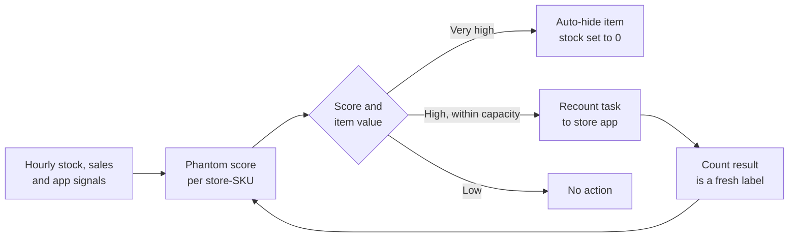

# Case Study 8: Stock-Out Prediction and Phantom Inventory Detection

**Domain:** Quick Commerce | **Problem Type:** Anomaly detection (with weak labels) plus short-horizon stock-out prediction | **Difficulty:** Intermediate

---

## 1. Business Context

### Company background

- Same company as Cases 5 to 7: **Jhatpat** (fictional), 320 dark stores, about 4,500 active SKUs per store, about 3 lakh orders a day.
- The app shows an item as "available" when the **system stock** is above zero. Pickers in the store then walk to the shelf and pick it.
- **Phantom inventory** means the system says there is stock, but the shelf is empty (or the item is damaged, expired, stolen, in the wrong bin, or was never received).
- A related problem is the true **stock-out**: the item sells out between replenishments, and the store needs an emergency top-up or must hide the item.

### The pain, with numbers

| Item | Value |
| --- | --- |
| Orders where a picker cannot find at least one item ("item missing") | 4.2% of orders, about 12,600 a day |
| Cost of each item-missing order (item refund, coupon, support contact, lower repeat) | about ₹60 |
| **Annual cost of item-missing orders** | **about ₹27.6 Cr** |
| Inventory shrinkage (theft, damage, mis-picks, receiving errors, excluding expiry), about 0.9% of cost of goods | about ₹37 Cr a year |
| Physical cycle counts (a staff member counts one SKU and corrects the system) | about 50 SKUs per store per day, 16,000 a day in all |
| Hit rate of today's cycle counts (share where the count differs from the system) | 11% when chosen at random, about 20% with a simple rule list |
| Recount capacity | Each store can do at most **40 recount tasks a day** without slowing picking |

- Targets: item-missing rate from 4.2% to 2.5%, shrinkage down 15%, and fewer true stock-outs through earlier top-ups.
- Value: about ₹11 Cr (fewer failed picks) + ₹5.5 Cr (lower shrinkage) + ₹4 Cr (stock-out prediction, only the part not already counted in Case 5) = **about ₹20 Cr a year**.

### Stakeholders and what each wants

| Stakeholder | What they want | What they fear |
| --- | --- | --- |
| Head of Operations | Fewer failed picks and faster picking | Extra tasks that slow stores down |
| Store managers | A short, believable task list ("recount these 40 items") | Flood of false alarms, blame for shrinkage |
| Inventory control and audit | Find the real causes: theft, damage, receiving errors | Missing patterns across stores |
| Customer experience | Fewer "item unavailable" apologies and refunds | Customers leaving after a failed order |
| Finance | Lower write-offs and shrinkage | Hidden stock losses in the books |
| Engineering | Hourly scoring of about 3.5 crore store-SKU states a day | Heavy compute and alert noise |

---

## 2. Translating Business to ML

### The business question vs the ML question

| Business question | ML question |
| --- | --- |
| "Which items does the system think we have, but we do not?" | "For each store-SKU, every hour, estimate the probability that the physical stock is zero (or far below the system stock). Use unusual sales patterns and ledger gaps as signals. Rank to fill the recount capacity, and auto-hide items above a high-confidence threshold." |
| "Which items will run out soon?" | "For each store-SKU, will the system stock reach zero within the next 3 hours, given demand forecast and stock?" |

> **Mentor note:** Phantom inventory is an anomaly detection problem where **the anomaly is "a gap between the system and the shelf"**, and the shelf cannot be seen directly. You infer it from behaviour. If a fast-moving item suddenly sells nothing for 6 hours while the system shows 5 units, either demand vanished (rare) or the shelf is empty (likely).

### Target variable definition

- **Primary label (hard phantom):** `phantom = 1` if a physical count found **zero units** while the system showed 1 or more.
- **Secondary label (soft mismatch):** `mismatch = 1` if the count differs from the system by at least 2 units and at least 25%.
- **Weak label:** "item not found" events logged by pickers. These are noisy (a picker may just miss an item).
- **Stock-out prediction label:** `stockout_3h = 1` if the system stock hits zero within 3 hours of the snapshot.

### Edge cases

| Edge case | Recommended treatment | Reason |
| --- | --- | --- |
| Count done while orders are being picked | Reconcile using timestamps: adjust the system stock for units picked after the count start | Otherwise counts show false mismatches |
| Item found in the wrong bin later | Label as a **location error**, a separate class of phantom | Different fix, the item exists |
| Items in transit between stores | Exclude from the stock-ledger gap | Not a loss |
| New item just received but not yet put away | Use goods-receipt timestamps and a put-away window | Looks like phantom for a few hours |
| Very slow items that normally sell once a week | Use a longer window or mark as low-information | Silence is normal for them |
| Seasonal drop in demand (a festival ended) | Compare with the forecast, not the previous week | Silence due to demand change is not phantom |

### Unit of prediction

- One **store x SKU x hour** state, scored hourly.

### Prediction timing



- Score every hour, act within the hour, and get the label back within a few hours when the store recounts. This quick feedback is valuable.

### What success looks like

| Lens | Success |
| --- | --- |
| Business | Item-missing rate from 4.2% to 2.5%, shrinkage down 15%. About ₹20 Cr a year |
| Model | Hit rate of the top 40 recount tasks per store per day at 55% or more (vs 20% for the rule list, 11% for random). Precision of auto-hide above 90% |
| Operations | No more than 40 extra recount tasks per store per day, and under 5% of auto-hidden items found to be actually in stock |

---

## 3. Data Understanding

### Data sources and key features

| Feature group | Source | Why it matters |
| --- | --- | --- |
| Stock ledger (opening stock, receipts, sales, returns, adjustments, wastage entries) | Inventory system | Shows gaps that sales and receipts do not explain |
| Sales per hour per store-SKU | Order system | Zero sales when the forecast expects sales is the strongest signal |
| Demand forecast (Case 5) | Forecasting service | Expected sales rate for the anomaly test |
| Picker events (item not found, substituted, short-picked) | Picking app | Direct evidence of a failed pick |
| App signals (searches, product views, add-to-carts for the SKU) | App analytics | Customers still want it, but orders do not complete |
| Receiving data (purchase order vs received quantity, damage on receipt) | Warehouse system | Receiving errors create phantom units from day one |
| Cycle count history and mismatch history per store-SKU | Audit logs | Past mismatches predict future ones |
| Item and store attributes (value, size, theft-risk class, shelf type, shift staffing) | Master data | Some items and stores are riskier |
| Shelf events (re-slotting, planogram change, new put-away rules) | Operations logs | Moving an item can cause location errors |

### Data volume, granularity and refresh

- **Volume:** about 14.4 lakh store-SKUs scored 24 times a day: about **3.5 crore hourly states a day**.
- **Labels:** about 16,000 counts a day. In 6 months, about 29 lakh labelled counts, with about 11% (random sample) mismatches, so about 3 lakh positive labels.
- **Refresh:** stock and sales data hourly. Labels arrive within hours of a recount.

### Common data issues

| Issue | How it shows up here |
| --- | --- |
| Very few labels, and **biased labels** | Counts are done on items chosen by the old rule, not at random, so the labelled sample is not the real population |
| Weak labels | "Item not found" events can be picker error |
| Censored demand | During a phantom, sales are zero, which also hides real demand (link to Case 5) |
| Feedback loop | Once an item is hidden, there are no more sales or pick events for it |
| Alert fatigue | Too many false alarms and stores ignore the list |
| Timing mismatches | Counts, sales and receipts have timestamps from different systems |
| Forecast errors | A wrong forecast makes normal silence look like an anomaly |
| Class definitions | Theft, damage, receiving error and location error need different actions |

> **Mentor note: Where juniors usually go wrong here.**
>
> - They train a classifier on the audit labels and report great precision, but the audits were of items the old rule already suspected. Performance on the other 99% of items is unknown.
> - They treat all zero-sales hours as suspicious, so slow movers flood the list. The test must be relative to **expected demand**, not to zero.
> - They hide items automatically without measuring how many hidden items were actually in stock. Lost sales from wrong hides never show up in a dashboard unless you look for them.

---

## 4. Approach and Decision Points

### Baseline first

- **Baseline 1:** a rule, "system stock above 0 and no sale in the last 24 hours". Hit rate about 20%, with many false alarms among slow movers.
- **Baseline 2:** random cycle counts, hit rate 11%.
- **Why it matters:** the rule gives operations something that works from day one, and the model must beat it by a clear margin on hit rate **at the same number of tasks**.

### Candidate models

| Model | Pros | Cons | Verdict |
| --- | --- | --- | --- |
| Rule-based filters | Instant, simple, explainable | Poor on slow movers, easy to over-fire | Keep as guardrails |
| Statistical zero-sales test (Poisson or negative-binomial: probability of seeing this few sales given forecast demand) | Needs no labels, adjusts for item speed, explainable | Depends on forecast quality | **Core signal and first model** |
| Isolation Forest, robust z-scores, or autoencoders on ledger residuals | Find unusual ledger behaviour without labels | Hard to tune, hard to explain | Secondary signals |
| Supervised GBM on audit labels with anomaly scores as features | Combines all signals, gives calibrated probability | Needs unbiased labels | **Primary production model** (after label fix) |
| Positive-unlabelled or weak-supervision methods | Use noisy picker events as extra labels | Added complexity | Optional improvement |
| Sequence models on the stock ledger | Learn complex patterns | Heavy, hard to maintain | Not needed |

### Decision scenarios

| What if... | Recommended action | Reasoning |
| --- | --- | --- |
| **There are almost no labels at the start** | Start with the statistical zero-sales anomaly score plus rules. Use cycle counts to measure hit rate. Train a supervised model once a few months of counts exist | Anomaly detection gives value on day one, and the first recounts create the labels |
| **Audit labels are biased because counts followed the old rule** | Reserve **30% of daily counts for random items** (stratified by category and velocity). Use them for unbiased evaluation and for training weights. Apply inverse-propensity weighting to the rest | Without a random sample, you are measuring how well you copy the old rule |
| **Stores can do only 40 recounts a day** | Rank by expected benefit: P(phantom) x expected lost orders per day (from item velocity) x item value. Pick the top 40. Split the budget: 30 model-ranked, 10 random | Value per recount matters more than raw probability. A phantom on a top seller costs far more than one on a slow item |
| **Hiding an item wrongly loses sales, not hiding it causes failed orders** | Set the auto-hide threshold by cost: hide when P(phantom) x cost of a failed order is greater than (1 minus P) x margin lost from a wrong hide. For a typical item, that is about P above 0.85 | A threshold based on business cost beats a fixed 0.5 |
| **Different causes need different actions** (theft, damage, receiving error, location error) | Add a second-stage classifier or rules that tag the likely cause using patterns: gradual ledger drift suggests theft, a drop right after receiving suggests a receiving error, a sudden stop after re-slotting suggests a location error | Fixing causes reduces future phantoms, not just current ones |
| **A festival or a competitor changes demand and the forecast is off** | Compare each store-SKU with its **peer stores and sibling SKUs** at the same time. If everyone's sales dropped, it is demand, not phantom. Add peer-relative features | A real phantom is local to one store-SKU |
| **The model decides which items get counted, which biases the next training set** | Keep the 30% random counts permanently, and retrain on them with weights | Standard way to break the feedback loop (as in Case 3) |
| **The same pipeline should also predict true stock-outs** | Add a short-horizon stock-out model: using stock, forecast of the next 3 hours, and replenishment ETA, estimate P(stock hits zero). Trigger an emergency top-up if the risk is above a threshold and stock exists in the warehouse | Closely related problem, and it reuses the same features |

---

## 5. Feature Engineering

### Top 10 features to build

| # | Feature | Business logic |
| --- | --- | --- |
| 1 | Probability of the observed sales in the last 6 and 24 hours given the forecast (Poisson or negative-binomial tail) | Tells how surprising the silence is, adjusting for item speed |
| 2 | Hours since last sale divided by the expected inter-sale gap | Normalised silence |
| 3 | Ledger residual: stock change not explained by sales, receipts, returns and recorded wastage | Hidden losses show up as unexplained decline |
| 4 | Item-not-found events in the last 7 days, and the picker short-pick rate | Direct failed-pick evidence |
| 5 | App demand without orders: views and add-to-carts for the SKU with low completed sales | Demand is there, supply is not |
| 6 | Days since last physical count, and past mismatch rate for this store-SKU | Items that were wrong before tend to be wrong again |
| 7 | Receiving discrepancy at the last goods receipt (ordered vs received vs damaged) | Errors start at receiving |
| 8 | Peer comparison: sales rate relative to the same SKU in similar stores and to sibling SKUs in the same store | Separates local phantom from market-wide changes |
| 9 | Item risk class: value, size, theft-risk tag, shelf life | Some items disappear more often |
| 10 | Recent shelf event: re-slotting, planogram change, shift change or new staff | Operational changes cause location and process errors |

### Features to avoid (leakage risks)

| Feature | Problem |
| --- | --- |
| Count result or adjustment entries made after the score time | Direct label leakage |
| Stock corrections posted automatically after an audit | They reveal the mismatch |
| "Item hidden" or "stock set to zero" flags | Created by the model's own actions, which creates a loop |
| Picker "item not found" events that occurred **after** the prediction hour | Look-ahead |
| Store-level shrinkage computed over a period that includes the label date | Leakage through aggregation |

Probability of seeing this few sales given the forecast (a simple, label-free anomaly score):

```python
from scipy.stats import poisson

# lam = forecast units for the last 6 hours, k = observed units sold
# Small p means "very surprising silence": a phantom candidate
df["p_silence_6h"] = poisson.cdf(df["units_6h"], df["fcst_units_6h"])
df["phantom_signal"] = (df["p_silence_6h"] < 0.01) & (df["system_stock"] > 0)
```

---

## 6. Evaluation Strategy

### Metrics

| Metric | Role | Why |
| --- | --- | --- |
| **Precision at K** (hit rate of the top 40 recount tasks per store per day, measured on a mix of random and model-selected counts) | Primary | Matches the capacity constraint |
| **Value-weighted hit rate** (hits weighted by item velocity and value) | Primary | A phantom on a top seller is worth more |
| Precision of auto-hide (share of hidden items that were truly empty) | Primary guardrail | Wrong hides lose sales |
| **Item-missing rate** per 100 orders | Business outcome | The real goal |
| Recall of phantoms on the **random** audit sample | Secondary | Honest estimate of what the model misses |
| Time to detection (hours from phantom start to recount) | Operational | The earlier, the fewer failed orders |
| Stock-out model: recall at 3-hour lead time and false top-up rate | Secondary for the second model | Needs lead time to be useful |

### Metrics that look good but are misleading here

- **Accuracy:** about 99% for predicting "no phantom" everywhere.
- **AUC on the audited sample:** the audited sample is biased toward items the old rule suspected.
- **Number of anomalies flagged:** more flags are not better. They are cost.
- **Precision on slow movers:** low-volume items rarely matter for the business.

### Validation strategy

| Step | Design | Why |
| --- | --- | --- |
| Random-audit evaluation | Use the 30% random counts as the unbiased test set | Honest recall and precision |
| Time-based split | Train on months 1 to 4, validate on month 5, test on month 6 | Mimics production |
| Store-group holdout | Hold out 10% of stores | Tests transfer to new stores |
| Backtest on events | Include festival periods and re-slotting events | Where false alarms rise |
| Online A/B test | Randomise stores into model-ranked recounts vs rule-ranked recounts with the same capacity | Direct effect on item-missing rate |
| Cost simulation | Replay a week with the thresholds and compute failed orders avoided vs sales lost to wrong hides | Sets the action thresholds |

### From model metric to business value

- Daily recounts: 12,800 (320 stores x 40). Phantoms found per day: random 11% = 1,400; rule list 20% = 2,560; model 55% = about 7,000.
- Each fixed phantom prevents about 0.8 failed orders (the item would have been ordered again, not found, and refunded). Extra fixes over the rule: 4,400 x 0.8 = about 3,500 failed orders a day, plus auto-hides of high-confidence items.
- Together with auto-hide, the item-missing rate falls from 4.2% to about 2.5%: 1.7 points x 10.95 crore orders = about 18.6 lakh fewer failed orders x ₹60 = **about ₹11 Cr**.
- Better detection of loss patterns (receiving errors, theft clusters) cuts shrinkage by about 15%: **about ₹5.5 Cr**.
- Stock-out prediction and emergency top-ups: about **₹4 Cr** of extra sales and margin.
- **Total about ₹20 Cr a year.**

---

## 7. Deployment and Monitoring

### Batch vs real time

- **Hourly batch scoring** of all store-SKU states (3.5 crore a day). Streaming is not needed, since the key actions take minutes to hours.
- **Event-driven triggers:** immediately re-score an item after a picker reports "item not found" or after a goods receipt.
- **Stock-out model:** runs every 30 minutes for fast movers and perishables.

### What to monitor

| Type | What to track | Alert trigger |
| --- | --- | --- |
| Model performance | Hit rate of recounts (model slice and random slice) | Hit rate drops by 10 points |
| Action quality | Share of auto-hidden items found in stock, share of recount tasks closed as "no issue" | Above 10% |
| Data quality | Missing ledger entries, delayed picker events, time-sync gaps between systems | Lag above 15 minutes |
| Drift | Forecast error (Case 5 WAPE), distribution of silence probabilities | Forecast WAPE up by 20% |
| Business KPIs | Item-missing rate, refunds, shrinkage, availability | Outside agreed bands |
| Operations | Recount tasks completed per store per day, task time | Completion below 80% |
| Fairness between stores | Alert rates per store | A single store's rate far above peers (may signal a real problem, or bad data) |

### Retraining

- **Scheduled:** weekly refresh of the supervised model with new counts, monthly review of thresholds.
- **Triggered:** a new store-format, planogram changes, a new inventory system release, or a drop in hit rate.

### A/B test or champion-challenger design

- Randomise **stores** into two arms: rule-ranked recounts (champion) vs model-ranked recounts (challenger), same number of tasks.
- Run 4 weeks. Primary outcome: item-missing rate and hit rate. Guardrails: picking time, recount time, sales on hidden items.
- Keep a permanent 30% random-count slice in both arms. It is the source of unbiased labels.

---

## 8. Stakeholder Communication

### Explain it to a non-technical leader

> "Sometimes our system says an item is in stock, but the shelf is empty. The customer orders it, our picker cannot find it, and we refund and apologise. That happens in about 4 of every 100 orders.
> The model notices when an item is not selling although it should be, or when its stock numbers do not add up, and it points the store to the 40 items most likely to be wrong each day. For very clear cases, it hides the item from the app.
> In pilots, more than half of the recounts it asks for find a real problem, against about 1 in 5 today.
> We expect failed orders to fall from 4.2% to about 2.5%, and we will also learn where stock is being lost."

### Questions leadership will ask

| Question | Suggested answer |
| --- | --- |
| "Why not count everything, every day?" | "Each count takes a staff member about 2 minutes. Counting 4,500 items a day per store is impossible. The model tells us which 40 matter most" |
| "What if it hides items that are actually in stock?" | "We measure that every week. The auto-hide threshold is set so that a wrong hide costs less than a failed order. Today the target is under 10% wrong hides, and we recheck regularly" |
| "Can it tell if staff are stealing?" | "It finds unusual patterns, like gradual loss on small high-value items at a store. It does not accuse anyone. It gives the audit team a place to look" |
| "How do you know it works if you only count what it flags?" | "We keep 30% of counts random. That unbiased slice tells us how much the model misses" |
| "How is this different from the demand forecast?" | "The forecast says how much we should sell. This model says whether what the system thinks is on the shelf is real. It uses the forecast as an input" |

---

## 9. Common Pitfalls and Lessons

| Mistake | Why it happens | How to avoid it |
| --- | --- | --- |
| Training on audit labels chosen by the old rule | Only labelled data available | Keep a permanent random-audit slice, and weight by selection probability |
| Treating all zero-sales as suspicious | Simple rule | Test against expected demand (Poisson or similar), use peer comparison |
| Flagging by probability instead of expected value | Easy ranking | Rank by P x item velocity x value within the capacity |
| Ignoring the cost of a wrong hide | Focus on failed orders only | Measure wrongful hides and set thresholds by cost |
| Alert flood | Low thresholds | Cap the tasks per store, and track the "no issue" closure rate |
| Not tagging causes | One label for all phantoms | Use patterns to tag theft, receiving, damage and location errors |
| Feedback loop from auto-hide | Hidden items produce no events | Random counts, and periodically un-hide a sample to check |
| Mixing censored sales with demand | Using raw sales as demand | Use stock-adjusted demand, and share it with the forecasting team |

---

## 10. Mentor's Focus Checklist

- ✅ **Where to spend 80% of the effort:**
  - Getting honest labels: random counts, timestamp reconciliation, and cause tagging.
  - The anomaly signal relative to expected demand (and peers), not just to zero.
  - Ranking by expected value under the capacity limit, and cost-based hide thresholds.
  - Feedback loop control and a clean A/B test.
- ❌ **What not to over-engineer:**
  - Sequence models and autoencoders before a statistical test plus GBM works.
  - Perfect classification of the cause on day one.
  - Streaming infrastructure when hourly batch meets the need.
- 💡 **Key takeaway:** **When you cannot see the truth directly, buy a little of it.** A small random sample of physical counts is worth more than any clever algorithm, because it is the only thing that tells you whether the model works and keeps the feedback loop honest.
