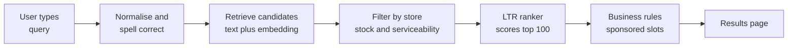
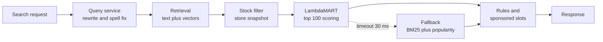

# Case Study 31: In-App Search Ranking (From "dhaniya" to the Right Product)

**Domain:** Quick Commerce | **Problem Type:** Learning to rank (query to ordered product list) | **Difficulty:** Advanced

---

## 1. Business Context

### Company background

- **Jhatpat** (fictional): 320 dark stores in 9 cities, about 3 lakh orders a day, about 10.95 crore orders a year, average basket about ₹480, GMV about ₹5,200 Cr a year.
- A dark store is a small warehouse closed to the public. Each one stocks about 6,000 to 7,000 SKUs and serves customers within roughly 2 to 3 km.
- In quick commerce there is no shelf to browse. Customers either scroll category pages or **type a query** and expect the right item at the top, in seconds.

### The pain, with numbers

| Item | Value |
| --- | --- |
| Search sessions a day | about 9 lakh (about 45% of app sessions) |
| Orders where search was used (search-led orders) | about 40%, so about 1.2 lakh orders a day, about 4.38 crore a year |
| Search-led GMV | about ₹2,100 Cr a year (4.38 crore orders at ₹480) |
| Search session to order conversion | about 13.3% (1.2 lakh orders from 9 lakh sessions) |
| Zero-result sessions | about 6% of search sessions, about 54,000 a day |
| Out-of-stock item shown in top 5 results | about 7% of result pages |
| Hinglish or misspelt queries ("dhaniya", "paner", "aata", "doodh") | about 35% of queries |
| Current ranking | Text match score (BM25) plus a popularity boost, with hand-tuned weights |

- Many queries are short and vague ("milk", "chips"). The customer wants one of 40 products, and which one is right depends on brand habit, price, pack size and what is in stock **at this store right now**.
- A tap on an out-of-stock product is a dead end. The customer often leaves the app.
- Targets: raise search conversion from 13.3% to about 13.7% (3% relative lift), and cut zero-result sessions from 6% to about 3.5%.

### Stakeholders and what each wants

| Stakeholder | What they want | What they fear |
| --- | --- | --- |
| Head of Growth | More search sessions turning into orders | A model that optimises clicks, not orders |
| Category managers | Fair visibility for their categories and private labels | Their products buried by a popularity loop |
| Brand partners (FMCG companies) | Visibility for sponsored and organic placements | Opaque ranking and unfair treatment |
| Customers | The right item at the top, in stock, at a fair price | Having to scroll, or seeing items they cannot buy |
| Finance | Revenue and margin per search, not only conversion | A ranker that pushes expensive items and lowers repeat rate |
| Engineering | Search latency under 150 ms end to end | A heavy ranker that slows the app at peak |
| Legal and policy | Sponsored results clearly marked, MRP shown correctly | Misleading placement |

---

## 2. Translating Business to ML

### The business question vs the ML question

| Business question | ML question |
| --- | --- |
| "Show the product the customer wants, first" | "Given a query, user and store, order the candidate products so that products likely to be bought are at the top" |
| "Stop sending people to dead ends" | "Combine a stock-availability signal with relevance so that unavailable items are never ranked above available ones" |
| "Why did my search for paner return nothing" | "Normalise misspelt and Hinglish queries into the catalogue vocabulary, and rewrite zero-result queries" |

> **Mentor note:** Ranking is not classification. We do not care whether product A has a 30% or 35% purchase chance in isolation. We care that A is **above** B when A is more likely to satisfy this customer. That is why we use ranking losses and ranking metrics. Also remember that clicks are not the truth: the customer can only click what we show, and mostly at the top.

### Target variable definition

- **Relevance label** per (query, product) impression, graded from behaviour:
  - Ordered after search: 3
  - Added to cart: 2
  - Clicked (opened the product card): 1
  - Shown but ignored: 0
- **Bias-corrected weight:** each positive label is weighted by 1 divided by the estimated probability that the customer even looked at that position (see Section 4).
- **Human judgement set:** about 20,000 (query, product) pairs rated 0 to 3 by catalogue reviewers, used as a clean test set and to calibrate the behaviour labels.

### Edge cases

| Edge case | Recommended treatment | Reason |
| --- | --- | --- |
| Product out of stock at the user's store | Hard filter to the bottom (or a separate "currently unavailable" section). Never train it as a negative for relevance | Not irrelevant, just unavailable. Training it as a negative teaches the wrong thing |
| Branded query ("amul butter") | Exact brand match gets a strong rule-based boost | The customer wants a specific item |
| Generic query ("butter") | Personalise by past brands and pack size, then popularity | The customer will accept several items |
| Misspelt or Hinglish query | Rewrite to a canonical form before retrieval, and keep the original for logging | Retrieval fails on exact text match |
| Query with a typo that is also a valid word | Prefer the interpretation with higher purchase rate in the catalogue | Avoid over-correction ("tur" dal vs "tour") |
| Sponsored products | Rank organic relevance first, then insert paid slots at fixed positions, clearly marked | Keeps relevance model clean and transparent |
| Sessions with no interaction | Keep as weak negatives only for queries with at least 20 impressions | A silent session can mean "found nothing" or "just browsing" |

### Unit of prediction

- One **(query, user, store, candidate product)** tuple. The model scores each candidate, and the list is sorted by score.
- Retrieval first brings 300 to 500 candidates, and the ranker orders the top 100. The app shows 4 to 6 products above the fold.

### Prediction timing



- All of this must happen inside a budget of about 150 ms. The ranker gets about 30 ms.
- Stock is read from the store inventory snapshot, refreshed every 1 to 2 minutes (see Case 8 for why stock data can be wrong).

### What success looks like

| Lens | Success |
| --- | --- |
| Business | Search conversion from 13.3% to 13.7%, zero-result sessions from 6% to 3.5%, about ₹15 Cr a year |
| Model | NDCG@10 on the human-judged set up by at least 6% over the current ranker, and a statistically significant online win in interleaving |
| Experience | Out-of-stock items in the top 5 from 7% to below 1% of result pages |
| Guardrail | Revenue per search and average selling price do not fall, no category loses more than 5% of impressions without a reason |

---

## 3. Data Understanding

### Data sources and key features

| Feature group | Source | Why it matters |
| --- | --- | --- |
| Query features (length, language mix, brand present, spelling confidence, historical conversion of the query) | Search logs | Different queries need different strategies |
| Text relevance (BM25 on title, brand, category, synonyms; embedding similarity) | Catalogue and encoder | Basic match between words and product |
| Product popularity (orders, add-to-cart rate, conversion in last 7 and 28 days, by store) | Order and event logs | Strong signal, but biased towards what was already shown |
| Availability (in stock now, units left, stock-out probability in the next hour) | Inventory system | A dead end loses the sale |
| Price and offer (selling price, discount vs MRP, price per 100 g, price rank within query) | Catalogue | Price sensitivity, and MRP rules require correct display |
| User history (past purchases, brands bought, repeat-purchase interval, price tier) | CRM | "My usual milk" should rank first |
| Position and context (rank shown, device, hour, store) | Impression logs | Needed to model position bias. **Not used at serving** |
| Margin and sponsored flag | Finance and ads | Used in the business-rule layer, not inside the relevance model |

### Data volume, granularity and refresh

- **Volume:** about 9 lakh search sessions a day, so about 8.1 crore in 90 days. At about 20 products shown per session, that is about 160 crore impression rows. Sample all sessions with an interaction and about 10% of the rest.
- **Granularity:** one row per (search session, product shown) with position, label and context.
- **Refresh:** popularity and stock features hourly or faster. Model retrained weekly, query rewrite dictionary daily.

### Common data issues

| Issue | How it shows up here |
| --- | --- |
| Position bias | The product at position 1 gets about 3 to 4 times the clicks of position 5 for the same relevance |
| Selection bias | We only observe feedback on products that retrieval and the old ranker chose to show |
| Popularity loop | Ranker boosts popular items, they get more clicks, and new items never get a chance |
| Spelling and transliteration variants | "paneer", "panir", "paner", "पनीर" are one product |
| Stock-dependent labels | A good product has no orders only because the store was out of stock |
| Sparse long-tail queries | 60% of distinct queries are seen fewer than 10 times |
| Duplicate catalogue entries | The same item appears with two titles and splits the clicks (see Case 44) |
| Delayed labels | Orders come minutes after the search, so the label window needs care |

> **Mentor note: Where juniors usually go wrong here.**
>
> - They treat every non-click as a negative. Most non-clicks are simply "never looked at".
> - They train a model on raw click-through rate, which learns "rank 1 is good" instead of "this product is good".
> - They judge success with offline NDCG on logged clicks, which rewards copying the old ranker.

---

## 4. Approach and Decision Points

### Baseline first

- **Baseline 1 (current):** BM25 text score plus popularity boost with hand-set weights.
- **Baseline 2:** Add the stock filter and a spelling-corrected query. Often this alone removes a third of the pain, so measure it before any ML.
- **Why it matters:** the biggest early gains come from fixing retrieval, stock and spelling, not from a clever ranker.

### Candidate models

| Model | Pros | Cons | Verdict |
| --- | --- | --- | --- |
| Hand-tuned weights (current) | Simple, explainable | Does not scale, cannot use many signals | Keep as fallback |
| Pointwise model (predict order probability per item) | Easy to build with logistic regression or GBM | Ignores list context, learns position bias | Quick benchmark |
| **LambdaMART (LightGBM lambdarank) with position-bias correction** | Optimises NDCG directly, fast to score, works well on tabular features | Needs graded labels and group structure | **Primary model** |
| Unbiased learning to rank (propensity-weighted or dual-tower with a bias tower) | Principled correction of position bias | Needs propensity estimates, noisier training | Add as the debiasing layer |
| Neural ranker with query-item embeddings (two-tower or cross-encoder) | Handles Hinglish and semantics better | Heavy to serve, cross-encoder too slow for 100 items at peak | Use embeddings as features, cross-encoder only for the top 10 if latency allows |
| Contextual bandits for exploration | Learns from new items | Complex to run and explain | Later, small exploration traffic only |

### Decision scenarios

| What if... | Recommended action | Reasoning |
| --- | --- | --- |
| **Top-ranked items get most clicks simply because they are on top** (position bias) | Run a small randomisation experiment: for 1% of traffic, swap positions 1 and 3 or shuffle the top 5. Estimate the click probability by position (the examination curve). Train with each positive weighted by 1 divided by that probability, or add a position tower used only in training | The swap data gives a causal estimate of position effect. Without it we cannot separate "good product" from "good position" |
| **A customer searches "paner" and gets zero results** | Build a rewrite chain: transliteration dictionary, character n-gram fuzzy match, then embedding nearest neighbours. Log rewrites and measure conversion of rewritten queries separately | Rewriting is retrieval, not ranking. A ranker cannot rank what retrieval never brings |
| **The best product for the query is out of stock at this store** | Rank in-stock items first. Show the unavailable item in a greyed "currently unavailable" slot only if the query is clearly branded. Offer the best in-stock substitute above it | Relevance is useless if the customer cannot buy. A branded searcher wants to know it is out, but should not scroll for it |
| **NDCG improves offline but revenue per search falls** | Check what moved up: cheap small packs, or discounted items. Compare NDCG with graded labels to revenue per search by price tier. Add price tier and margin as guardrail metrics, not training targets | NDCG measures order of relevance, not rupees. A ranker that favours low-price items raises conversion but lowers basket value |
| **A new product has no click history** | Give it an exploration boost for its first 1,000 impressions using content features (category, brand, price) and a similar-product prior, and then let behaviour take over | Without exposure the popularity loop never lets it start |
| **Offline and online results disagree** | Trust online. Use team-draft interleaving for fast comparisons: mix results from model A and model B in one list and count whose items get the clicks and orders. Follow with a full A/B test for revenue | Interleaving needs about 10 times fewer sessions to detect a ranking preference, but it cannot measure basket value |
| **Query is ambiguous ("cream")** | Detect with entropy of clicked categories for the query. For high-entropy queries, diversify the top 6 across categories (face cream, cooking cream, shaving cream) | One category at the top ruins the experience for the others |

---

## 5. Feature Engineering

### Top 10 features to build

| # | Feature | Business logic |
| --- | --- | --- |
| 1 | Normalised text match score on title and brand, after spelling correction | Core relevance |
| 2 | Embedding similarity between query and product (multilingual encoder) | Handles Hinglish and synonyms ("aata" and "wheat flour") |
| 3 | In-stock flag, units left, and probability of stock-out in the next 60 minutes | Do not send customers to an item that will vanish |
| 4 | Product conversion rate for this query in the last 28 days, shrunk towards the category average | Query-specific popularity with small-sample protection |
| 5 | Past purchases of this product or brand by the user, and days since last purchase vs usual interval | "My usual brand" matters more than the global best-seller |
| 6 | Price rank within the candidate set and discount vs MRP | Price sensitivity, and promotion visibility |
| 7 | Pack size match with the user's usual pack (500 ml vs 1 L) | The right pack often decides the order |
| 8 | Query specificity (brand present, number of tokens, historical click entropy) | Lets the model behave differently for generic and exact queries |
| 9 | Product age and impression count in the last 7 days | Used for exploration and new-item boost |
| 10 | Store-level popularity (orders per 1,000 sessions in this store's catchment) | Local taste, for example regional brands |

### Features to avoid (leakage risks)

| Feature | Problem |
| --- | --- |
| Position shown in the old ranker, at serving time | Model learns to copy old ranking. Use only in the bias tower during training |
| Product's total orders including those after the query time | Look-ahead leakage, and it also contains the effect of this very query |
| Click-through rate computed on the same sessions in the training set | Label leakage. Compute popularity strictly from earlier days |
| Whether the item was added to cart, or ordered, in this session | This is the label |
| Sponsored flag and margin as relevance features | Teaches the model to push paid items, and blurs relevance with commerce |
| Customer demographic attributes (age, gender, religion proxies) | Fairness and DPDP Act 2023 data minimisation concerns, and not needed |

Position-debiased LambdaMART with propensity weights:

```python
import lightgbm as lgb

# w = 1 / examination_probability(position), clipped to avoid huge weights
w = (1.0 / exam_prob[train.position]).clip(upper=10.0)

ranker = lgb.LGBMRanker(
    objective="lambdarank",
    n_estimators=400,
    learning_rate=0.05,
    lambdarank_truncation_level=20,   # focus on the top of the list
)
ranker.fit(
    X_train, y_train,                  # y: 0 to 3 graded labels
    group=train.groupby("search_id").size().values,
    sample_weight=w,
    eval_set=[(X_val, y_val)], eval_group=[val_groups],
    eval_at=[5, 10],
)
```

---

## 6. Evaluation Strategy

### Metrics

| Metric | Role | Why |
| --- | --- | --- |
| **NDCG@5 and NDCG@10** on the human-judged set | Primary offline | Rewards putting the best products at the top. Judged labels avoid position bias |
| **Interleaving win rate** | Primary fast online | Detects which ranker customers prefer with a small number of sessions |
| **Search conversion** (search sessions ending in an order) | Primary online | The business outcome |
| **Revenue per search** and average order value from search | Guardrail and co-primary | Stops a conversion win from hiding a basket-size loss |
| Zero-result rate and recovery rate after rewrite | Retrieval health | Where the largest single gain sits |
| Out-of-stock-in-top-5 rate | Availability health | Direct measure of dead ends |
| Mean reciprocal rank of the first clicked item | Diagnostic | How far the customer scrolls |
| Latency p95 and p99 | Reliability | Search must stay fast at peak |

### Metrics that look good but are misleading here

- **Click-through rate:** rises when we show attractive but poor items. It is also heavily position-driven.
- **NDCG on logged clicks:** rewards agreeing with the old ranker, which produced those clicks.
- **Conversion alone:** can rise by ranking cheap small packs first, while revenue per search falls.
- **Overall NDCG:** hides failures on Hinglish and long-tail queries. Always slice by query type.

### Validation strategy

| Step | Design | Why |
| --- | --- | --- |
| Time-based split | Train on days 1 to 70, validate on days 71 to 80, test on days 81 to 90 | Matches deployment |
| Query-grouped split | Keep all rows of a search session together, and hold out 10% of distinct queries | Tests generalisation to unseen queries |
| Slice report | NDCG by query type (branded, generic, Hinglish, misspelt, long tail) and by city | Finds hidden failures |
| Judged set | 20,000 human-rated pairs, refreshed quarterly | Clean offline truth |
| Offline counterfactual check | Inverse-propensity estimate of expected clicks under the new ranking | Cheap sanity check before online |
| Interleaving test | Team-draft interleaving on 5% of search traffic for 5 to 7 days | Fast ranking preference |
| A/B test | User-level 50-50 split for 2 weeks on conversion, revenue per search, and repeat rate | Final proof, including basket effect |

### From model metric to business value

- Search-led GMV is about ₹2,100 Cr a year. A 3% relative conversion lift (13.3% to 13.7%) adds about ₹63 Cr of GMV. At about 18% contribution margin, that is about **₹11.3 Cr**.
- Zero-result sessions fall from 54,000 to about 31,500 a day, so about 22,500 sessions a day are saved. If 12% of them end in an order, that is about 2,700 orders a day, about 9.9 lakh a year, about ₹47 Cr of GMV. Assume only half is truly incremental, and 18% margin: about **₹4.3 Cr**.
- **Total about ₹15.6 Cr a year**, rounded to about ₹15 Cr. Cost: about 4 engineers and 1 data scientist for 6 months, and a labelling budget of a few lakh rupees.

---

## 7. Deployment and Monitoring

### Batch vs real time

- **Real time:** query normalisation, retrieval, stock filtering and ranking at each search, with a p99 budget of about 150 ms for the whole pipeline.
- **Batch:** nightly rebuild of the query rewrite dictionary, product embeddings, and popularity tables. Weekly retraining of the ranker.
- Design for failure: if the ranker times out at 30 ms, fall back to BM25 plus popularity with the stock filter.



### What to monitor

| Type | What to track | Alert trigger |
| --- | --- | --- |
| Relevance health | Online NDCG on judged queries replayed daily, top-query conversion | Drop of more than 3% from the launch week |
| Retrieval | Zero-result rate, rewrite coverage, share of queries not in vocabulary | Zero-result rate above 4.5% |
| Availability | Out-of-stock-in-top-5 rate, stock snapshot age | Above 2%, or snapshot older than 5 minutes |
| Business | Conversion, revenue per search, average selling price in results | Outside agreed bands |
| Fairness and exposure | Impression share by category, private label share, new-item exposure | Any category down more than 5% without reason |
| Latency | p50, p95, p99 by city, and fallback rate | p99 above 150 ms or fallback above 1% |
| Drift | PSI on query length, language mix and price distributions | PSI above 0.2 |

### Retraining

- **Scheduled:** weekly, on a rolling 60 to 90 day window, with propensities refreshed monthly.
- **Triggered:** festival seasons (Diwali, Holi), catalogue re-platforming, a new city launch, or a drop in online NDCG.

### A/B test or champion-challenger design

- Start with interleaving to rank candidate models cheaply, then A/B test the winner against the champion.
- Randomise by **user**. Run for at least 2 weeks to cover weekday and weekend behaviour.
- Primary: search conversion. Co-primary: revenue per search. Guardrails: zero-result rate, latency, repeat purchase rate, brand-partner complaints.
- Keep 1% of traffic on the old ranker and 1% on position-randomised results so we can keep estimating the bias curve.

---

## 8. Stakeholder Communication

### Explain it to a non-technical leader

> "Today our search finds products by matching words and pushing best-sellers. The new system understands that 'paner' means paneer, remembers the brand you usually buy, and never ranks something we cannot deliver from your store above something we can.
> We learn from what customers buy, but we correct for the fact that people mostly click the first item. We test it live by mixing old and new results in one list and watching which one customers choose.
> We expect about 3% more searches to end in an order, and far fewer searches that show nothing."

### Questions leadership will ask

| Question | Suggested answer |
| --- | --- |
| "Why not just rank by best-sellers?" | "Best-sellers are only best because we showed them first. We would never discover a better product and we would ignore each customer's own brand and pack choice" |
| "Can brands pay to be on top?" | "Paid placements go in clearly marked fixed slots after the organic ranking. The relevance model never sees the sponsored flag, so the organic list stays honest" |
| "Why is conversion not the only target?" | "A ranker can raise conversion by pushing cheap small packs. We track revenue per search and repeat rate to make sure we win in rupees and in customer trust" |
| "How do you handle Hindi and mixed-language queries?" | "We map spelling and transliteration variants to the catalogue word, and use multilingual embeddings for meaning. We measure results separately for these queries so they do not hide in the average" |
| "What if the stock data is wrong?" | "We use the freshest inventory snapshot and an out-of-stock risk score. Cases where an item shown turns out unavailable are tracked as a quality metric (see Case 8)" |

---

## 9. Common Pitfalls and Lessons

| Mistake | Why it happens | How to avoid it |
| --- | --- | --- |
| Training on raw clicks | Clicks are plentiful and easy | Weight by position propensity, use graded labels with orders and add-to-cart, and validate on human-judged pairs |
| Treating non-clicks as negatives | Looks like a normal classification label | Use only impressions likely to have been seen, or use pairwise loss within a list |
| Ranking out-of-stock items | Stock lives in another system | Make availability a hard rule in the serving path and monitor out-of-stock-in-top-5 |
| Optimising NDCG without checking revenue | NDCG is the textbook metric | Report revenue per search and average selling price next to every model comparison |
| Ignoring retrieval and spelling | Ranking is the interesting part | Fix zero-result queries and Hinglish normalisation first, since a missing candidate cannot be ranked |
| Popularity loop starves new items | Popularity features are strong | Add exploration traffic and a new-item boost, and track exposure of new products |
| Judging with offline logs only | A/B tests are slow | Use interleaving for quick direction, then a proper A/B test |
| Mixing sponsored and relevance signals | Easy way to raise ad revenue | Keep paid slots in a separate rule layer and label them clearly |

---

## 10. Mentor's Focus Checklist

- ✅ **Where to spend 80% of the effort:**
  - Query understanding: spelling, Hinglish transliteration, zero-result rewriting.
  - Position-bias estimation with a small randomisation experiment, and a clean human-judged test set.
  - Availability-aware ranking and a fresh stock snapshot.
  - Interleaving plus an A/B test that reports revenue per search, not only conversion.
- ❌ **What not to over-engineer:**
  - Cross-encoder neural rankers on all 100 candidates before LambdaMART with good features is exhausted.
  - Perfect propensity models. A coarse position curve captures most of the gain.
  - Personalisation for long-tail queries that nobody types twice.
- 💡 **Key takeaway:** **Logged clicks describe what we showed, not what customers wanted.** Correct for position, never rank what cannot be delivered, and prove the win with interleaving and revenue, not only NDCG.
