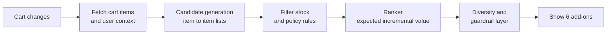
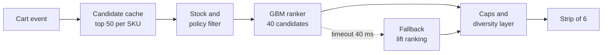

# Case Study 32: Cart Add-On Recommendations ("Forgot Something?")

**Domain:** Quick Commerce | **Problem Type:** Recommender system (candidate generation plus ranking) | **Difficulty:** Intermediate

---

## 1. Business Context

### Company background

- **Jhatpat** (fictional): 320 dark stores in 9 cities, about 3 lakh orders a day, about 10.95 crore orders a year, average basket about ₹480, GMV about ₹5,200 Cr a year.
- On the cart page, a strip titled "Forgot something?" shows 6 add-on products with a one-tap "Add" button. This is the last chance to grow the basket before payment.
- Customers in quick commerce buy for an immediate need ("I need tea, and now I also want biscuits"). A good add-on feels like a reminder. A bad one feels like spam.

### The pain, with numbers

| Item | Value |
| --- | --- |
| Carts that reach the cart page | about 4.4 lakh a day, and about 92% see the add-on strip |
| Orders with at least one add-on accepted (attach rate) | about 14% |
| Average value of an accepted add-on | about ₹55 |
| Share of accepted add-ons that were truly incremental (would not have been bought anyway) | about 45%, measured with a 10% holdout that sees no strip |
| **Incremental basket value from add-ons today** | **about ₹3.47 per order** (0.14 x ₹55 x 0.45) |
| Current method | Store-level top sellers with a simple "bought together" rule list refreshed monthly |
| Typical failure | Milk in the cart, and the strip suggests another milk. Or a recommendation for an item the customer bought two days ago |

- The current strip is accepted often enough to look healthy on a click-rate dashboard, but more than half of those add-ons would have been bought anyway.
- Target: attach rate 14% to about 20%, average add-on value ₹55 to ₹62, and incremental share 45% to about 60%. That gives about ₹7.44 per order, a gain of about ₹3.97 per order.

### Stakeholders and what each wants

| Stakeholder | What they want | What they fear |
| --- | --- | --- |
| Head of Growth | Larger basket, better margin per order | A recommender that boosts clicks and not rupees |
| Category managers | Fair space for their categories and new launches | Best-sellers hogging the strip |
| Brand partners | Sponsored placement in the strip | Unfair or hidden promotion |
| Customers | Useful reminders, no pressure | Spam, repeated items, pushy upsell |
| Policy and trust team | No pushing of unhealthy or age-restricted items | Public criticism of manipulative design |
| Engineering | A service that answers in under 100 ms | Latency on the checkout path |
| Finance | Margin and profit per order | Discount-heavy add-ons that lose money |

---

## 2. Translating Business to ML

### The business question vs the ML question

| Business question | ML question |
| --- | --- |
| "What should we suggest at the cart page?" | "Given the items in this cart, the user and the store stock, rank candidate add-ons by the expected **extra** basket value they create" |
| "Which products go well together?" | "Learn which products are complements (bought together because they go together) and avoid substitutes (alternatives to the same need)" |
| "How do we make new products visible?" | "Give new SKUs a fair chance with content-based signals when there is no purchase history" |

> **Mentor note:** The easy target is "will the customer tap Add". That is a click-rate target and it rewards suggesting things the customer was going to buy anyway. The right target is **incremental basket value**: the extra rupees we earn because the strip was shown. Everything in this case follows from that one choice.

### Target variable definition

- **Training label (stage 1, ranking):** the add-on was accepted (tapped Add and still in the final order), given that it was shown.
- **Value label (stage 2):** expected incremental value = P(accept) x price x incrementality factor, where incrementality comes from the 10% no-strip holdout (the share of accepted items that the holdout group also buys in the same order).
- **Final score:** expected incremental margin, not revenue, so that discount-heavy items do not win.

### Edge cases

| Edge case | Recommended treatment | Reason |
| --- | --- | --- |
| Item is a substitute for something in the cart (another milk brand) | Filter by category and function. Show only if the cart item is out of stock | The customer buys one or the other, not both |
| Item bought in the last N days and not typically bought that often (a monthly item) | Suppress for its usual repeat interval | Reminders at the wrong time look careless |
| Customer declined the same item earlier in the session | Do not show it again in this session | Repeating a rejected item is spam |
| Cart already has 20 or more items | Show fewer add-ons or hide the strip | Large baskets have different intent |
| Item is out of stock or about to go out of stock | Remove from candidates | Dead end, and a failed order costs more than it earns |
| Age-restricted or regulated items | Never recommended as add-ons | Policy and legal risk |
| Guest or new user with no history | Use cart content and store-level popularity | No personal data available |
| Sponsored add-on | Show in a labelled fixed slot, and keep out of the relevance model | Transparency, and a clean relevance signal |

### Unit of prediction

- One **(cart state, candidate product)** pair. The cart state includes items, value, the user and the store.
- The strip is refreshed each time the cart changes (an item is added or removed).

### Prediction timing



- Whole path must finish in about 100 ms at p99, since the cart page cannot wait.
- Candidates are precomputed offline. Only filtering and ranking happen live.

### What success looks like

| Lens | Success |
| --- | --- |
| Business | Incremental add-on value from about ₹3.47 to about ₹7.44 per order, about ₹8.7 Cr a year of contribution |
| Model | Higher incremental revenue per cart-page view in the holdout test, NDCG@6 up at least 8% on accepted add-ons |
| Customer | No rise in cart abandonment, no rise in "I did not want this" refunds or complaints |
| Guardrail | Share of add-on slots going to policy-sensitive categories stays within agreed caps |

---

## 3. Data Understanding

### Data sources and key features

| Feature group | Source | Why it matters |
| --- | --- | --- |
| Cart contents (SKUs, categories, quantities, value) | Cart service | The core context for complementarity |
| Co-purchase history (pairs bought in the same order, and in the same session) | Order history | Basic signal for "goes with" |
| User history (categories bought, repeat intervals, price tier, past add-on acceptance) | CRM | Personal taste and timing |
| Product attributes (category, brand, price, pack size, margin, vegetarian flag, shelf life) | Catalogue | Content signal for cold start |
| Store stock and local popularity | Inventory and orders | Only suggest what we can deliver |
| Context (hour, day, weather, festival) | Calendar and weather | Chai with rain, ice cream on hot nights |
| Past impressions and acceptance by position | Event logs | Training labels and position effect |
| Holdout group data | Experiment platform | Needed to estimate incrementality |

### Data volume, granularity and refresh

- **Volume:** about 4.4 lakh cart-page views a day, about 4 lakh strip impressions with 6 products each, about 24 lakh impression rows a day. Training on 60 days is about 14 crore rows.
- **Granularity:** one row per (cart state, candidate product shown) with label and position.
- **Refresh:** item-to-item lists rebuilt daily. User features hourly. Ranker retrained weekly.

### Common data issues

| Issue | How it shows up here |
| --- | --- |
| Popularity bias | Milk, bread, eggs and bananas appear in everyone's strip because they co-occur with everything |
| Position bias | The first and second slots get most taps regardless of fit |
| Non-incremental acceptance | Customer taps Add on something already planned |
| Cold-start SKUs | New launches have no co-purchase history |
| Basket intent shift | A cart for a party looks different from a cart for breakfast, but both contain the same items |
| Stale co-occurrence | Seasonal and promotional baskets distort pairs |
| Training-serving skew | Offline cart is the final cart, but live the cart is partial |

> **Mentor note: Where juniors usually go wrong here.**
>
> - They train on the **final** basket in the order to predict "what was bought together". At serving time the cart is only half built, so the model sees a different input.
> - They count raw co-occurrence. Everything co-occurs with milk and bananas, so every recommendation looks the same.
> - They celebrate click rate while incremental revenue is flat.

---

## 4. Approach and Decision Points

### Baseline first

- **Baseline 1 (current):** store-level top sellers plus a monthly "bought together" rule list. Attach rate 14%.
- **Baseline 2:** item-to-item co-purchase with lift or normalised PMI (pointwise mutual information, a score that discounts items that are popular everywhere), filtered by stock and recent purchases.
- **Why it matters:** a lift-based baseline fixes most of the popularity problem with a few lines of SQL. Measure it before adding a model.

### Candidate models

| Model | Pros | Cons | Verdict |
| --- | --- | --- | --- |
| Popularity by store | Simple and fast | No personalisation, repeats best-sellers | Fallback |
| Item-to-item co-purchase with lift or PMI | Interpretable, fast, easy to precompute | Ignores user, session and price | **Candidate generator** |
| Matrix factorisation or item embeddings (word2vec style on baskets) | Captures similarity and softer relations | Mixes substitutes with complements | Use as extra candidate source |
| **GBM ranker (LightGBM) on cart, user and candidate features** | Combines many signals, fast to score, supports business features | Needs good labels and feature pipelines | **Primary ranker** |
| Session-based sequence models (GRU4Rec, transformer) | Uses order of additions in the session | Heavier to serve, gains small on short sessions of 8 to 10 items | Only if gains are proven |
| Uplift model (predict incremental effect of showing) | Directly targets the right quantity | Needs randomised data and more volume | Add as a second-stage reweighting |
| Bandit on the top candidates | Handles cold-start and exploration | More complex to monitor | Use for new SKUs only |

### Decision scenarios

| What if... | Recommended action | Reasoning |
| --- | --- | --- |
| **The strip shows milk and bread to everyone** (popularity bias) | Replace raw co-occurrence by normalised PMI, cap each SKU to at most 8% of strip impressions in a store per day, and add a personal repeat-interval filter | Popular items are accepted often but are rarely incremental. The cap forces the system to find items that add value |
| **Customer has paneer and onions in the cart. Is "cooking cream" a good add-on or a substitute for "fresh cream" already in the cart** | Tag each SKU with a function group (for example dairy cream). Do not show candidates from a group already in the cart, unless the cart item is out of stock | Complement means "different need that goes together". Substitutes cannibalise the sale and look careless |
| **A product was launched last week with no history** (cold start) | Generate candidates by content: embeddings from category, brand, price and title, then reserve one of six slots for exploration on items with fewer than 2,000 impressions. Move to behaviour data after enough impressions | Without exposure a new SKU stays invisible, and content similarity is a decent prior |
| **Add-on acceptance is high but average basket value is flat** | Check the holdout. Compute incremental value per cart view in the strip group vs the no-strip group. Retrain with value-weighted labels and an incrementality estimate | High acceptance with no lift means we are recommending what would have been bought anyway |
| **The 100 ms latency budget is exceeded at 9 PM peak** | Precompute the top 50 candidates for each of the top 8,000 SKUs per store cluster, keep them in an in-memory cache, and run a small GBM (about 150 trees) on a maximum of 40 candidates. Time out at 40 ms and fall back to lift-only ranking | Latency is a product feature. A cached candidate list plus a small ranker is fast and nearly as good |
| **The model learns that sugary snacks and soft drinks are accepted most** | Add category exposure caps (for example no more than 1 slot of 6 for high-sugar or high-fat items), exclude them for baby and health-related carts, and report share by category. Do not infer medical conditions | Short-term acceptance is not the same as customer interest. A healthy long-term relationship matters, and the brand risk is real |
| **A price-sensitive user repeatedly sees expensive add-ons** | Match price tier to user history, and suppress add-ons above 2x the user's median item price. Cap the strip at 6 items and hide it after two consecutive cart views with zero taps | Pushing irrelevant, costly items feels like spam and increases abandonment |

---

## 5. Feature Engineering

### Top 10 features to build

| # | Feature | Business logic |
| --- | --- | --- |
| 1 | Normalised PMI between candidate and each cart item (max and mean over cart) | Complementarity with what is already in the cart |
| 2 | Function-group overlap between candidate and cart (0 or 1) | Avoids substitutes |
| 3 | Days since the user last bought the candidate vs the usual repeat interval | "Time to restock" reminders are the best add-ons |
| 4 | User's historical add-on acceptance rate in the candidate's category | Personal taste |
| 5 | Candidate price divided by the user's median item price | Price fit |
| 6 | Candidate margin percentage and stock units left | Profit and availability |
| 7 | Cart value gap to the free-delivery or small-cart-fee threshold, and candidate price vs the gap | A small item that crosses the threshold is genuinely useful |
| 8 | Hour, day type, weather and festival flags crossed with candidate category | Context fit (chai biscuits in rain) |
| 9 | Candidate's impressions in the last 7 days and age in the catalogue | Exploration and cold-start handling |
| 10 | Position in the strip (training only, in a separate bias term) | Separates position effect from fit |

### Features to avoid (leakage risks)

| Feature | Problem |
| --- | --- |
| Items in the final order but not in the cart at recommendation time | Future information, since the final basket includes the add-ons themselves |
| Whether the user accepted any add-on in this same session after the shown moment | This is the label |
| Candidate's orders in the last hour including this order | Self-leakage |
| Sponsored flag as a relevance feature | Teaches the model to push paid items |
| Health, diet or religion proxies inferred from baskets | Sensitive inference, DPDP Act 2023 data-minimisation concerns, and trust risk |
| Discount depth as a feature without a margin check | Model learns to push discounted items that lose money |

Reconstructing the partial cart for training:

```python
import pandas as pd

# For each order, create training examples at every cart step, not only the final basket.
# At step k the cart holds the first k items added, the label comes from later steps.
def make_examples(order_items: pd.DataFrame) -> pd.DataFrame:
    rows = []
    for oid, g in order_items.sort_values("added_at").groupby("order_id"):
        items = g["sku"].tolist()
        for k in range(1, len(items)):
            rows.append({"order_id": oid,
                         "cart": items[:k],           # what the model sees
                         "next_items": items[k:]})    # positives to learn from
    return pd.DataFrame(rows)
```

---

## 6. Evaluation Strategy

### Metrics

| Metric | Role | Why |
| --- | --- | --- |
| **Incremental basket value per cart view** (strip group vs holdout) | Primary online | Measures real extra rupees |
| **Incremental margin per order** | Primary online | Stops discount-driven wins |
| Attach rate and average add-on value | Secondary | Useful, but not enough alone |
| Recall@6 and NDCG@6 on held-out basket steps | Offline model comparison | Quick screening of models |
| Coverage and catalogue diversity (share of SKUs shown at least once a week) | Popularity-bias check | Avoids a strip of the same 50 items |
| Cart abandonment and add-on removal rate | Guardrail | Spam shows up here first |
| Latency p95 and p99 | Reliability | The cart page must stay fast |
| Share of strip slots by sensitive category | Policy guardrail | Check caps are respected |

### Metrics that look good but are misleading here

- **Click or tap rate:** rises with obvious, cheap, repeated suggestions.
- **Recall@k on the final basket:** the model that suggests milk and bread scores well because those are in many baskets.
- **Attach rate alone:** includes items bought anyway.
- **Revenue per strip view without a holdout:** counts the baseline purchases as wins.

### Validation strategy

| Step | Design | Why |
| --- | --- | --- |
| Time-based split | Train on days 1 to 45, validate on days 46 to 52, test on days 53 to 60 | Matches deployment |
| Cart-step replay | Evaluate at each cart step with the partial cart, not the final basket | Matches how the model is used |
| Cold-start slice | Report recall for SKUs launched in the last 30 days | Finds the new-item gap |
| Segment slice | By city, user tenure, basket size, price tier | Finds hidden failures |
| Persistent holdout | 10% of carts never see the strip | Needed for incrementality estimates |
| A/B test | User-level 50-50 for 3 weeks with incremental margin and guardrails | Final proof |

### From model metric to business value

- Incremental value today: 0.14 x ₹55 x 0.45 = about ₹3.47 per order.
- Target: 0.20 x ₹62 x 0.60 = about ₹7.44 per order. Gain of about **₹3.97 per order**.
- On 10.95 crore orders a year: about ₹43.5 Cr of extra GMV (10.95 crore x ₹3.97).
- At about 20% contribution margin: **about ₹8.7 Cr a year**. After a cautious haircut for the A/B gap (assume 70% of the target is realised): about ₹6 Cr.
- Cost is small: one data scientist, one engineer, and a feature cache. The bigger risk is trust, so the guardrails matter more than the last 1% of lift.

---

## 7. Deployment and Monitoring

### Batch vs real time

- **Batch:** nightly item-to-item lists (PMI and embedding neighbours), user features, and SKU function groups. Weekly ranker retraining.
- **Real time:** on each cart change, fetch precomputed candidates, filter stock and policy, score about 40 candidates, apply caps and diversity, and return 6 items.
- Design for failure: timeouts fall back to lift-only ranking with stock filters.



### What to monitor

| Type | What to track | Alert trigger |
| --- | --- | --- |
| Value | Incremental basket value per cart view, attach rate, average add-on value | Down 10% from launch band |
| Popularity bias | Top 50 SKUs share of impressions, catalogue coverage | Top 50 above 35% of impressions |
| Cold start | Share of impressions to SKUs under 30 days old | Below 5% |
| Guardrails | Sensitive category share, repeat-show rate, strip-hide events | Any cap breached |
| Customer harm | Cart abandonment, add-on removal rate, complaint tags | Up more than 1 point |
| Latency | p50, p95, p99, fallback rate | p99 above 90 ms or fallback above 2% |
| Drift | PSI on cart size, price distribution, and category mix | PSI above 0.2 |

### Retraining

- **Scheduled:** weekly ranker retrain on a rolling 45 to 60 day window. Daily candidate refresh.
- **Triggered:** festival seasons, a catalogue reorganisation, a new city, or a drop in incremental value.

### A/B test or champion-challenger design

- Keep a **permanent 10% holdout** that never sees the strip. This is the measuring stick for incrementality.
- Randomise by user. Run the test for 3 weeks.
- Primary: incremental margin per order. Guardrails: cart abandonment, complaint rate, sensitive-category share, repeat rate at 30 days.
- Test the new ranker against the lift-based baseline, not only against the current top-sellers strip, so we know what ML adds on top of a simple fix.

---

## 8. Stakeholder Communication

### Explain it to a non-technical leader

> "Today the cart page suggests what is popular in the store, so half the items it sells are things the customer would have bought anyway.
> The new system looks at what is in this cart right now, what the customer usually buys and when they are due to buy it again, and suggests things that go with the basket and are not a substitute.
> We measure success on a group of customers who see no suggestions, so we count only the extra rupees we really create. We also cap how often we show sugary items, and we never suggest age-restricted products."

### Questions leadership will ask

| Question | Suggested answer |
| --- | --- |
| "Why not push the highest-margin items?" | "Margin matters, so we rank by expected incremental margin. But items the customer does not want hurt trust and increase abandonment. Margin sits inside the score, with guardrails around it" |
| "Why keep a 10% holdout? That loses revenue" | "It costs about 10% of the add-on gain. Without it we cannot know how much is real and we would pay for suggestions that sell nothing new" |
| "Can brands pay for the slots?" | "Yes, in clearly labelled fixed slots. Relevance is ranked first and paid items are added after, so the model does not learn to favour sponsors" |
| "What about new products?" | "One slot in six is for exploration. New items are chosen by similarity to existing ones and then judged by real taps" |
| "Are we pushing unhealthy food?" | "We cap high-sugar and high-fat items per strip, exclude them from carts that look like baby or health shopping, and report category share monthly" |

---

## 9. Common Pitfalls and Lessons

| Mistake | Why it happens | How to avoid it |
| --- | --- | --- |
| Optimising click or attach rate | It is easy to measure | Use incremental margin per cart view with a persistent holdout |
| Recommending substitutes | Co-occurrence data contains alternatives that appear in the same session | Tag function groups and filter, and check complement vs substitute in review |
| Training on the final basket | Order tables are complete baskets | Replay carts step by step so the model sees partial carts |
| Popular items dominate | Raw counts favour milk and bread | Use PMI or lift, exposure caps and coverage metrics |
| Ignoring position bias | Top slots get most taps | Add a position term in training and use randomised slot tests |
| Cold-start SKUs never appear | No history means no candidates | Add content-based candidates and an exploration slot |
| Heavy model on the cart path | Offline accuracy is the focus | Cache candidates, use a small ranker, and keep a fallback |
| No guardrails on category or price | Model follows acceptance | Add caps, price-fit rules and policy filters before launch, and agree them with the policy team |

---

## 10. Mentor's Focus Checklist

- ✅ **Where to spend 80% of the effort:**
  - Defining the target as incremental margin, and keeping a persistent holdout to measure it.
  - Separating complements from substitutes with function groups.
  - Candidate generation with PMI, and a cached low-latency serving path.
  - Guardrails agreed with policy and category teams before the first A/B test.
- ❌ **What not to over-engineer:**
  - Transformer session models when sessions have 8 to 10 items.
  - Real-time embedding updates. Daily is enough.
  - Fine position-bias modelling, a simple position term is adequate.
- 💡 **Key takeaway:** **A recommendation that the customer would have bought anyway is not a win.** Measure the extra rupees against a holdout, and let guardrails decide what is allowed to be recommended at all.
