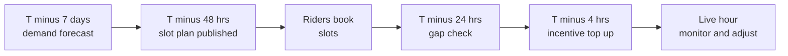
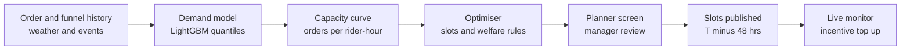

# Case Study 33: Rider Demand Forecasting and Shift Planning (How Many Riders, Where, When)

**Domain:** Quick Commerce | **Problem Type:** Time-series forecasting plus staffing optimisation | **Difficulty:** Intermediate

---

## 1. Business Context

### Company background

- **Jhatpat** (fictional): 320 dark stores in 9 cities, about 3 lakh orders a day, about 10.95 crore orders a year, average basket about ₹480.
- Orders are delivered by riders: a mix of full-time partners and gig workers who log into the app in shifts they choose from a published slot list. A "zone" here is the delivery area of one dark store.
- Riders are paid per order plus a per-hour assured earning in the slot, and extra incentives at peak times.
- This case is about **how many riders to have logged in, in each zone, in each hour**. Case 6 predicts delivery time, Case 50 handles intraday nowcasting, and Case 34 decides which rider gets which order.

### The pain, with numbers

| Item | Value |
| --- | --- |
| Rider-hours logged a day | about 1.19 lakh |
| Maximum capacity of one rider (a full cycle of assign, pickup, ride, handover, return takes about 13 minutes) | about 4.5 orders per rider-hour at 100% busy time |
| Rider utilisation today (share of logged-in time spent on an order) | about 56%, so about 2.5 orders per rider-hour |
| Cost of one rider-hour (per-order pay, assured earnings, incentives, insurance) | about ₹110 |
| **Annual rider cost** | **about ₹478 Cr** (1.19 lakh x ₹110 x 365), about ₹44 per order |
| Zone-hours with too few riders (average rider assignment wait above 2 minutes) | about 14% |
| Orders placed in those under-supplied zone-hours | about 20% of orders, about 60,000 a day |
| Extra cost of an order in an under-supplied hour (late coupons, cancellations, lost repeat) | about ₹30 |
| **Annual cost of under-supply** | **about ₹66 Cr** (60,000 x ₹30 x 365) |
| Target utilisation | about 63%, so about 2.84 orders per rider-hour |
| Idle rider-hours above the target | about 13,200 a day, about ₹53 Cr a year |

- Shifts are planned by city operations managers in spreadsheets using last week's numbers and gut feel. They over-staff quiet afternoons and under-staff rainy evenings and match nights.
- Both errors are costly, and they are **not equally costly**. Over-supply wastes ₹110 per idle hour. Under-supply during peak breaks the delivery promise.

### Stakeholders and what each wants

| Stakeholder | What they want | What they fear |
| --- | --- | --- |
| Head of Operations | Enough riders at peak, low idle time elsewhere | Missed ETAs, and angry store managers |
| City managers | A simple plan they can act on 2 days ahead | A black box that ignores local knowledge |
| Finance | Lower rider cost per order | Paying for idle hours and for emergency incentives |
| Rider community | Predictable slots, fair earnings per hour, safe hours | Being booked for slots with no orders, or pushed to work in a storm |
| Rider onboarding team | Realistic hiring targets | Hiring too many or too few, with a 5 to 7 day lead time |
| Policy and legal | Compliance with gig-worker rules and welfare norms | Press stories about excessive hours or low pay |
| Customer Experience | On-time delivery | Late orders in rain and on match nights |

---

## 2. Translating Business to ML

### The business question vs the ML question

| Business question | ML question |
| --- | --- |
| "How many riders do we need in zone Z at 8 PM on Saturday" | "Forecast the distribution of orders per zone and hour, then convert it into required riders using a capacity curve" |
| "How many slots should we open, and for how long" | "Choose rider counts per slot to minimise expected cost of under-supply plus over-supply, subject to rider welfare rules" |
| "Should we pay a surge incentive today" | "Estimate how much extra supply an incentive of ₹X creates, and compare to its cost" |

> **Mentor note:** There are two models in one. The first is a **demand forecast** (orders per hour). The second is an **orders-to-riders conversion** (how many orders one rider can handle at a given load, batching rate and weather). Juniors build a great demand forecast and then divide by a fixed number. Most of the planning error sits in that division.

### Target variable definition

- **Demand target:** orders placed per zone per hour (also kept at 15-minute level for peak hours).
- **Supply requirement target:** riders needed per zone-hour so that average assignment wait stays under 2 minutes at the 90th percentile of the hour.
- **Capacity curve:** orders served per rider-hour as a function of utilisation, batching share, average ride time, and rain.

### Edge cases

| Edge case | Recommended treatment | Reason |
| --- | --- | --- |
| Hours when the store was closed, or orders were blocked because no rider was available | Mark as censored. Estimate true demand from app opens, cart creations and search volume | Observed orders understate demand when supply is short |
| Store out of stock in a category for most of the evening | Flag, and keep demand features from sessions rather than only orders | Orders fell because of stock, not because of demand (see Case 8) |
| Rider logs in but never accepts orders | Count as supply only after the first accepted order in the shift | Idle logins inflate supply |
| Public holiday, strike or road closure | Add as calendar and event features, and allow manual override by city managers | Rare events need human input |
| Rain starts after the plan is published | Real-time adjustment with incentives, not a re-plan of the whole schedule | Slots are already booked |
| Rider logs out early in extreme heat or storm | Accept it as a welfare right, and model the log-out rate as a function of weather | Planning must not assume riders will ride in unsafe conditions |

### Unit of prediction

- One **zone x hour** (and a 15-minute view for peak windows), planned for the next 7 days, with short-horizon updates at 48 hours, 24 hours and 4 hours before.

### Prediction timing



- The first forecast sets onboarding and slot volume. The later updates mostly decide incentives.
- Different levers have different lead times, and the model must be matched to each lever.

### What success looks like

| Lens | Success |
| --- | --- |
| Business | Utilisation from 56% to 63%, under-supplied zone-hours from 14% to 7%, about ₹41 Cr a year net |
| Model | Hourly order forecast WAPE (weighted absolute percentage error) at or below 12% at zone-hour level, and the P70 forecast covers actuals about 70% of the time at peak |
| Operations | Share of zone-hours with average assignment wait above 2 minutes halves |
| Welfare | No rider scheduled above the weekly hour cap, assured hourly earnings met in 95% of booked slots |

---

## 3. Data Understanding

### Data sources and key features

| Feature group | Source | Why it matters |
| --- | --- | --- |
| Historical orders per zone and hour | Order system | Core of the demand signal |
| Funnel signals (app opens, searches, carts created per zone, per 15 minutes) | Event logs | Capture demand that was lost because no rider was available |
| Calendar (day of week, month-start salary days, festivals, school and college calendar) | Calendar | Strong weekly and monthly patterns |
| Events (IPL and cricket match times, concerts, local strikes) | Event calendar, ops input | Spikes around the match |
| Weather (rain intensity forecast, temperature, heat index) | Weather API | Raises demand and lowers rider supply and speed |
| Rider supply (logged-in riders, accepted orders, log-out reasons, bookings per slot) | Rider app | Actual vs planned supply |
| Operational (average pick time, batching rate, ride time, assignment wait) | Dispatch and store systems | Drives the orders-per-rider conversion |
| Incentive history (amount, slot, uptake) | Rider payouts | Estimates how much supply an incentive creates |
| Store features (opening hours, catchment type: residential, office, mixed) | Network master | Demand profile differs by catchment |

### Data volume, granularity and refresh

- **Volume:** 320 zones x 24 hours x 365 days is about 28 lakh zone-hours a year. A 2-year history gives about 56 lakh rows, small enough for a laptop.
- **Granularity:** one row per zone x hour, with a 15-minute table for the peak hours.
- **Refresh:** forecasts rebuilt daily with weather updates every 3 hours. Conversion curves refit weekly.

### Common data issues

| Issue | How it shows up here |
| --- | --- |
| Censored demand | Orders were lower than demand when riders were short, so history understates peaks |
| Plan-vs-actual supply gap | Booked riders are not the same as logged-in riders |
| Changing batching policy | A dispatch change shifts orders per rider-hour overnight |
| Weather forecast error | Rain predicted for 6 PM arrives at 8 PM |
| Structural breaks | A new store opens nearby and takes orders from an old zone |
| Rider app definitions | Different cities define "active hour" differently |
| Small zones | Low-volume zones have noisy hourly counts |

> **Mentor note: Where juniors usually go wrong here.**
>
> - They forecast **orders**, divide by a fixed orders-per-rider number from last month, and call it a staffing plan. Capacity changes with rain, batching and ride distance.
> - They train on observed orders and never notice that peak demand was suppressed by rider shortages, so the model learns to under-plan the very hours that hurt.
> - They minimise a symmetric error like RMSE, but under-supply and over-supply have very different costs.

---

## 4. Approach and Decision Points

### Baseline first

- **Baseline 1 (current):** manager spreadsheet: same hour last week, plus a 10% buffer on weekends.
- **Baseline 2:** seasonal naive: average of the same weekday-hour over the last 4 weeks, with a rain multiplier from history.
- **Why it matters:** retail demand is strongly weekly. Baseline 2 sets a fair bar and a fallback.

### Candidate models

| Model | Pros | Cons | Verdict |
| --- | --- | --- | --- |
| Seasonal naive and exponential smoothing per zone | Simple, transparent | Cannot use weather, events or the funnel | Baseline and fallback |
| Prophet or similar additive model per zone | Handles seasonality and holidays | 320 separate models to maintain, weak on rain and match effects | Optional benchmark |
| **LightGBM global model across all zones** (with lags, calendar, weather, funnel features) with Poisson or quantile objective | One model for all zones, accurate, fast, handles events | Needs careful lag features | **Primary demand model** |
| Hierarchical forecast (zone, city, total) with reconciliation | Consistent numbers across levels | More plumbing | Use for city totals and onboarding |
| Deep learning (TFT, DeepAR) | Probabilistic forecasts, good with many series | Heavier and harder to debug | Only if gains over LightGBM are proven |
| **Capacity curve** (orders per rider-hour vs load, batching and rain) | Turns demand into riders honestly | Needs regular refit | **Essential second model** |
| Optimiser (integer programming or newsvendor rule per slot) | Turns forecasts and costs into a plan | Needs clear cost inputs | **Planning layer** |

### Decision scenarios

| What if... | Recommended action | Reasoning |
| --- | --- | --- |
| **Under-supply costs more than over-supply at peak** (asymmetric cost) | Plan to a demand quantile set by the critical ratio: cost of a missing rider-hour divided by the sum of missing and idle costs. At peak, about ₹250 shortage vs ₹110 idle gives 250 divided by 360, about the 69th percentile. Off-peak, about ₹70 vs ₹110 gives about the 39th percentile | This is the newsvendor idea: plan above the median when shortage is dearer, and below it when idle is dearer. One rule, different quantiles for each hour |
| **It is going to rain tonight** (rain spike) | Use rain forecast as a demand feature, but also lower the rider capacity: ride time up about 20% and log-outs up about 15%. Use incentives for 4-hour-ahead top-up instead of a re-plan | Rain raises demand and cuts supply at the same time. The capacity curve must change, not only the forecast |
| **An IPL match starts at 7:30 PM** | Add match start, innings break and finish as features with lead and lag windows. Check past matches by city and team, and let ops override for a final | Orders spike at the break and just after the match. A calendar feature alone will smear the effect across the whole evening |
| **Riders need to book slots 48 hours ahead and new riders take 5 to 7 days to onboard** | Use different horizons: 14-day city-level forecast for onboarding, 48-hour zone forecast for slot volume, 4-hour forecast for incentives | A forecast is only useful if the lever it drives can still move. Match accuracy to lead time |
| **Offering a ₹30 extra per order in a slot** (incentive lever) | Estimate incentive response from history by zone and hour. If ₹30 on top of base pay brings about 4 extra riders in a slot, compare it with the 4 x ₹110 cost of adding scheduled riders. Use incentives for short, uncertain gaps and scheduled slots for predictable ones | Incentives are fast but pricey per rider, and riders learn to wait for them. Scheduled supply is cheaper for predictable peaks |
| **The forecast says 31 riders for a zone in a 2-hour slot, but riders prefer 4-hour slots** | Plan in 15-minute demand, round up to slot blocks with an optimiser, and allow staggered start times so coverage follows the curve | Slot granularity creates unavoidable idle time. The optimiser can reduce it with staggered shifts |
| **The plan would require some riders to work 12 hours** | Add hard constraints: maximum daily and weekly hours, minimum rest between shifts, and a cap on afternoon heat-hour slots. If demand cannot be met, flag a gap and use incentives or accept a longer ETA | Rider welfare is a constraint, not a cost term. Violating it is not an option |
| **Dispatch changes batching and orders per rider-hour jumps from 2.5 to 2.8** | Refit the capacity curve after every dispatch release, and keep the curve as a separate versioned table | Changes in operations silently break a stale conversion factor |

---

## 5. Feature Engineering

### Top 10 features to build

| # | Feature | Business logic |
| --- | --- | --- |
| 1 | Same weekday-hour orders for the last 4 weeks (mean and last value) | Strong weekly seasonality |
| 2 | Hour-of-week and day-of-month (salary week flag) | Demand peaks after salary credit and on weekends |
| 3 | Rain forecast (intensity and start time) and temperature or heat index | Weather drives both demand and rider supply |
| 4 | Event features: minutes to match start, innings break, finish, and festival markers | Sharp local spikes |
| 5 | App opens and carts created in the last 60 minutes (for short horizons) | Leading indicator of orders |
| 6 | Catchment type (residential, office, mixed) and share of orders from offices | Different daily curves |
| 7 | Average batching rate and ride time in the last 7 days | Used by the capacity curve |
| 8 | Rider log-out rate by weather and hour | Realistic supply, not booked supply |
| 9 | Fraction of last week's hour that was under-supplied (assignment wait above 2 minutes) | Flags suppressed demand |
| 10 | Active promotions and marketing pushes in the zone | Campaign-driven spikes |

### Features to avoid (leakage risks)

| Feature | Problem |
| --- | --- |
| Actual rain observed in the target hour (instead of the forecast issued at planning time) | Leakage. Use the forecast available at T minus 48 hours |
| Orders from the target day used in any lag or rolling average | Future information |
| Realised rider count of the target hour as a demand feature | Supply responds to demand and incentives, so this contaminates |
| Rider personal attributes (age, gender, home area) for supply planning | Fairness and DPDP Act 2023 concerns, and not needed |
| Final incentive paid in the hour | Known only after the hour, and a response to the gap |
| Cancelled-order counts for the target hour | Outcome |

Newsvendor staffing at a chosen quantile:

```python
import numpy as np

def riders_needed(demand_samples, orders_per_rider_hr, shortage_cost, idle_cost):
    """demand_samples: simulated orders for the hour (e.g., 500 draws from the forecast)."""
    critical_ratio = shortage_cost / (shortage_cost + idle_cost)   # e.g. 250 / 360 = 0.69
    q_orders = np.quantile(demand_samples, critical_ratio)
    return int(np.ceil(q_orders / orders_per_rider_hr))

# Peak hour example: 95 orders median, 2.84 orders per rider-hour at target utilisation
```

---

## 6. Evaluation Strategy

### Metrics

| Metric | Role | Why |
| --- | --- | --- |
| **WAPE of hourly orders** (sum of absolute errors divided by sum of actuals) | Primary demand accuracy | Robust to small zones with near-zero hours |
| **Quantile coverage** (P70 forecast exceeded by actuals about 30% of the time at peak) | Primary for planning | Checks the quantile we actually plan to |
| **Pinball loss** at the planning quantile | Model comparison | The right loss for quantile forecasts |
| **Under-supplied zone-hour share** (assignment wait above 2 minutes) | Primary business | Direct operational outcome |
| **Rider utilisation** and idle hours per 100 orders | Primary business | Cost lever |
| Rider cost per order | Finance | The final rupee measure |
| Incentive spend per extra rider-hour | Lever efficiency | Checks incentives are not wasteful |
| Welfare checks (hours cap breaches, assured earnings met) | Constraint | Must be at zero or near target |

### Metrics that look good but are misleading here

- **MAPE at zone-hour level:** explodes in low-volume hours and rewards under-forecasting.
- **Daily or city-level accuracy:** hides a missed 8 PM spike inside a good daily total.
- **Utilisation alone:** can be pushed up by under-staffing, which just lengthens waits.
- **Orders-per-rider improvement without ETA check:** may come from slower deliveries.

### Validation strategy

| Step | Design | Why |
| --- | --- | --- |
| Rolling-origin backtest | Forecast each week of the last 12 weeks using only data before it | Matches deployment |
| Special-day test set | Include at least 2 heavy-rain days, 2 match nights, and one festival | Hard cases decide the plan quality |
| Horizon-specific accuracy | Report at 7 days, 48 hours, 4 hours | Each lever uses a different horizon |
| Zone-size slices | Small, medium and large zones separately | Finds failures in low-volume zones |
| Censoring check | Compare forecast with sessions-based demand estimate in under-supplied hours | Confirms we are not learning suppressed demand |
| Pilot | Run the plan in 2 cities for 6 weeks, with matched control cities and difference-in-differences | Supply plans have spillovers, so test by city, not by customer |

### From model metric to business value

- **Over-supply:** 13,200 idle rider-hours a day x ₹110 x 365 is about ₹53 Cr a year. Capture about 50% (minimum guarantees and slot rounding remain): about **₹26 Cr**.
- **Under-supply:** halve the under-supplied share (14% to 7%): the ₹66 Cr cost falls by about ₹33 Cr. Realise 70% after allowing for extra riders needed: about **₹23 Cr**.
- **Incentive budget** for short-notice top-ups: about **₹8 Cr** a year.
- **Net about ₹41 Cr a year.** Cost to build: 2 data scientists, 1 engineer and a planner tool for 6 months.

---

## 7. Deployment and Monitoring

### Batch vs real time

- **Batch:** daily forecast of the next 14 days for each zone, a slot recommendation file at T minus 48 hours, and weekly capacity-curve refit.
- **Near real time:** every 15 minutes during the live day, compare actual orders with the forecast, and update the incentive recommendation.
- Humans stay in the loop: city managers see the plan, can override with a reason, and the system logs overrides.



### What to monitor

| Type | What to track | Alert trigger |
| --- | --- | --- |
| Forecast accuracy | WAPE by city and horizon, bias (over or under) | WAPE 20% worse than backtest, or bias above 5% for 3 days |
| Quantile coverage | Share of peak hours above the planned quantile | Outside 25% to 35% for a week |
| Supply plan vs actual | Booked vs logged-in vs active riders by slot | Show-up rate below 85% |
| Service level | Under-supplied zone-hour share, assignment wait | Above 9% in any city |
| Cost | Rider cost per order, incentive spend per extra rider-hour | Outside budget band |
| Welfare | Hours cap breaches, assured earnings met, log-outs due to weather | Any breach, or earnings met below 95% |
| Drift | PSI on order mix, batching rate and ride time | PSI above 0.2 |

### Retraining

- **Scheduled:** weekly demand model refresh on the last 12 to 18 months, with a higher weight on recent weeks. Capacity curve refit weekly, and always after a dispatch release.
- **Triggered:** a new store in the catchment, a major policy change on pay, a festival season, or quantile coverage drift.

### A/B test or champion-challenger design

- Randomising customers does not work because riders are shared. Use a **city-level or zone-cluster pilot** with matched controls and a difference-in-differences read-out over 6 weeks.
- Primary: rider cost per order and under-supplied zone-hour share. Guardrails: ETA, rider earnings per hour, rider retention and welfare breaches.
- Run the old spreadsheet plan in the control cities, and keep it as the fallback.

---

## 8. Stakeholder Communication

### Explain it to a non-technical leader

> "Today each city manager plans riders from last week's numbers. The new system forecasts orders for every store and hour, looks at the weather and match schedule, and works out how many riders that really needs, using how fast riders have been delivering lately.
> It plans a little above the expected demand in busy hours, because a missed order costs us more than an idle rider-hour, and a little below in quiet hours, where an idle rider costs more.
> We expect to cut idle rider time and late orders together, and we have built in hard limits on rider hours and minimum earnings."

### Questions leadership will ask

| Question | Suggested answer |
| --- | --- |
| "Why not always keep extra riders so we never miss an order" | "Each idle rider-hour costs about ₹110. Across 320 stores that is more than the cost of the lateness we avoid. The plan puts the extra riders where a miss costs the most" |
| "Can incentives fix everything on the day" | "They fix small gaps quickly, but each extra rider through an incentive costs more than a scheduled one, and riders may start waiting for incentives. We use them for the last 10 to 15% of the gap" |
| "What happens in a sudden storm" | "Scheduled riders may log out for safety, and we accept that. We raise incentives where it is safe, widen the ETA and pause promotions, instead of pushing riders into danger" |
| "Is this fair to riders" | "The plan has hard caps on hours, rest between shifts, and a minimum earning per booked hour. We report these checks every week and the rider team signs them off" |
| "How do we know it works" | "We pilot in two cities with matched control cities for six weeks, and compare cost per order, late orders and rider earnings" |

---

## 9. Common Pitfalls and Lessons

| Mistake | Why it happens | How to avoid it |
| --- | --- | --- |
| Treating orders forecast as the staffing plan | Forecasting is the visible ML task | Build a capacity curve and optimise with cost asymmetry |
| Learning suppressed demand | History shows only served orders | Use app opens, carts and searches to estimate true demand in short-supply hours |
| Planning to the median | Median is the default output | Choose the planning quantile from the critical ratio, by hour |
| Using a fixed orders-per-rider constant | It is easy and was true last month | Refit by rain, batching and ride time, and version it with each dispatch release |
| Ignoring lead times | Accuracy is judged on a single horizon | Provide a forecast per lever: onboarding, slot booking, incentive |
| Counting booked riders as supply | Booking data is clean | Use show-up and accepted-order rates, and model weather log-outs |
| Treating welfare rules as soft costs | Optimisers allow trade-offs | Make hours caps and earnings floors hard constraints and report them |
| Testing with customer-level A/B | It is the usual method | Use city or zone-cluster pilots because riders are shared |

---

## 10. Mentor's Focus Checklist

- ✅ **Where to spend 80% of the effort:**
  - The orders-to-riders capacity curve and how it moves with rain, batching and distance.
  - Quantile planning from the cost of shortage vs idle time.
  - Handling suppressed demand in history and matching each forecast horizon to its lever.
  - Welfare constraints and a city-level pilot design.
- ❌ **What not to over-engineer:**
  - Deep learning forecasters before a global LightGBM with weather and event features is tuned.
  - Minute-level forecasts when slots are booked by the hour.
  - A fully automatic plan with no manager override in the first release.
- 💡 **Key takeaway:** **The forecast is only half the plan.** Convert demand to riders with an honest capacity curve, plan to the quantile that matches the cost of being short or idle, and treat rider welfare as a limit, not a cost.
