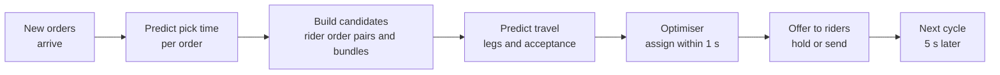
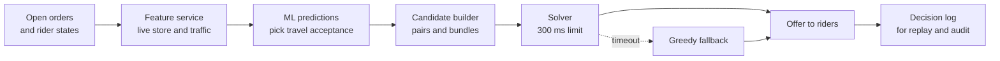

# Case Study 34: Order Batching and Rider Assignment (The Dispatch Engine)

**Domain:** Quick Commerce | **Problem Type:** Combinatorial optimisation with ML inputs (assignment and vehicle routing) | **Difficulty:** Advanced

---

## 1. Business Context

### Company background

- **Jhatpat** (fictional): 320 dark stores in 9 cities, about 3 lakh orders a day, about 10.95 crore orders a year.
- Each store has riders waiting nearby. When an order is placed, a dispatch system must decide **which rider takes it**, **when to send them**, and **whether to bundle it with another order** (batching).
- Rider cost is about ₹110 per rider-hour, about ₹1.83 a minute, and about ₹44 per order (see Case 33 for staffing). Dispatch decides how many of those minutes are wasted.
- Case 6 predicts the ETA shown to customers. This case is the engine that actually makes the delivery happen.

### The pain, with numbers

| Item | Value |
| --- | --- |
| Peak orders per minute across the network | about 550 (about 11% of daily orders in the peak hour) |
| Dispatch cycle | Every 5 seconds per city, with about 5 to 15 new orders and 40 to 120 available riders per city at peak |
| Orders delivered in a batch (rider carries two orders in one trip) | about 8% |
| Average rider travel time from current position to the store (pickup leg) | about 3.0 minutes |
| Average rider wait at the store for the order to be packed | about 2.4 minutes |
| Cost of one rider minute | about ₹1.83 |
| Current assignment rule | Nearest idle rider by straight-line distance, assigned the moment the order arrives |
| Late orders (over 2 minutes beyond promise) | about 18% (see Case 6) |
| Complaints from riders | "Same riders get all the good orders", "I wait 5 minutes at the store" |

- Assigning **instantly** to the nearest rider is simple but wasteful. The rider reaches the store before the order is packed and waits. A closer rider may be about to free up. A second order from the same store a few seconds later could have been bundled.
- Batching two orders saves about 9 minutes of rider time per pair (26 minutes for two single trips vs about 17 for one paired trip) but makes the first customer wait longer.
- Targets: batched share from 8% to 18%, pickup travel 3.0 to 2.6 minutes, store wait 2.4 to 1.7 minutes, and late orders not worse than today.

### Stakeholders and what each wants

| Stakeholder | What they want | What they fear |
| --- | --- | --- |
| Head of Operations | Lower cost per order at the same speed | A cleverer system that delays orders |
| Head of Customer Experience | On-time delivery, no surprises | Batching that makes the first customer wait |
| Finance | Lower rider minutes per order | Savings that exist only in a simulator |
| Riders | A fair share of good orders, little waiting | Being penalised by an opaque algorithm, unsafe routes |
| Store managers | Riders arriving when orders are ready | A crowd of waiting riders at a small store |
| Engineering | A solver that returns inside the 5-second cycle | Timeouts and unstable behaviour at peak |
| Policy and legal | Fair treatment, no discrimination in allocation | Complaints about algorithmic management |

---

## 2. Translating Business to ML

### The business question vs the ML question

| Business question | ML question |
| --- | --- |
| "Who should deliver this order" | "Solve an assignment problem every few seconds, minimising expected total cost over a set of open orders and available riders" |
| "Should we bundle these two orders" | "Choose bundles (sets of orders for one rider trip) that save rider time while keeping each customer within their promised time" |
| "When should the rider leave" | "Predict when each order will be packed, and dispatch so the rider arrives just then" |

> **Mentor note:** Dispatch is mostly **optimisation**, and ML supplies the numbers the optimiser trusts. The optimiser is only as good as three predictions: how long the order will take to pack, how long the rider will take to reach the store, and how long the ride to the customer will take. A fancy solver on bad predictions produces confident but wrong decisions, so put the first effort into prediction quality and calibration.

### Target variable definition

- **Optimiser objective (minimise):** total expected cost = rider minutes x ₹1.83 + lateness penalty per order + fairness penalty.
- **ML targets feeding the optimiser:**
  - Pick-and-pack completion time of each order (as a distribution).
  - Rider travel time rider-to-store and store-to-customer.
  - Probability that a rider accepts an offered order.
- **Constraints:** each order to exactly one rider, a rider carries at most 2 orders (3 if same building or society), each order's predicted delivery time within promise slack.

### Edge cases

| Edge case | Recommended treatment | Reason |
| --- | --- | --- |
| Rider rejects the offered order | Reassign within the next cycle, and include acceptance probability in the cost | A rejected order wastes seconds |
| Rider is already carrying a batch and a new order is on the way | Allow insertion only if it keeps all customers inside slack | Dynamic insertion can help but creates lateness |
| Order has frozen or fragile items | Do not batch with incompatible items, and limit time out of the store | Quality risk |
| Two orders from different stores | Do not batch in this release, only batch within the same store | Cross-store routing adds a lot of complexity and risk |
| Store has no idle riders nearby | Pull from the next store zone if the extra pickup leg is under 4 minutes, otherwise hold | Cross-zone help is costly |
| GPS jump places a rider in the wrong spot | Smooth GPS with a filter and ignore points that imply impossible speed (see Case 49) | Bad positions create bad matches |
| Customer cancels after assignment | Release the rider immediately and re-optimise | The rider should not be stranded |

### Unit of prediction

- One **dispatch cycle** (every 5 seconds per city): a set of open orders and available riders. ML scores each possible (order, rider) pair and each candidate bundle. The optimiser picks the best combination.

### Prediction timing



- Each cycle must finish in about 1 second so the system has time to respond and retry within 5 seconds.
- Orders not yet worth sending (the packing will take 3 more minutes) stay in the pool, and are reconsidered in the next cycle.

### What success looks like

| Lens | Success |
| --- | --- |
| Business | Rider minutes per order down by about 1.1 minutes plus 9 minutes saved per batched pair, about ₹17 Cr a year net |
| Model | Pick-time MAE at or below 1.0 minute, travel-time P50 error within 12%, and calibrated quantiles |
| Optimiser | Solution within 3% of the best-known cost from an offline exact solver, returned in under 1 second at p99 |
| Fairness | Orders per rider-hour inside the same shift and zone are balanced: Gini coefficient below 0.15 |
| Guardrail | Late-order rate no worse than 0.3 percentage points above the control |

---

## 3. Data Understanding

### Data sources and key features

| Feature group | Source | Why it matters |
| --- | --- | --- |
| Order details (items, categories, weight, frozen flag, basket value) | Order system | Drives pick time |
| Store state (open orders, pickers on shift, recent pick times) | Store operations | Live packing speed |
| Rider state (position, speed, status, current batch, recent acceptance history) | Rider app and GPS | Who is available and where |
| Road network and live traffic | Routing engine | Base travel time |
| Historical delivery legs (actual vs predicted) | Delivery logs | Used to correct travel-time bias |
| Address features (building type, last-100-metre time) | Address history | Hidden delay at handover |
| Promise time and slack per order | ETA service | Constraint for the optimiser |
| Rider allocation history (orders per rider-hour, idle time, earnings) | Payout and dispatch logs | Needed for fairness checks |
| Weather and events | Weather API, calendar | Changes speeds and demand |

### Data volume, granularity and refresh

- **Volume:** about 3 lakh orders a day. Each dispatch cycle for a large city produces about 20 x 100 = 2,000 candidate pairs, plus bundles, and cities run about 17,000 cycles a day each. Logged data is stored for decisions, not for every candidate.
- **Granularity:** order-level pick times, leg-level travel times, and cycle-level decisions.
- **Refresh:** live features every few seconds. Models retrained weekly, with quick recalibration each night.

### Common data issues

| Issue | How it shows up here |
| --- | --- |
| Counterfactual data | We only see travel time for the rider actually chosen, not for the riders we did not choose |
| Noisy timestamps | Riders tap "arrived" and "picked" early or late |
| GPS noise | Tall buildings and underpasses |
| Selection bias | Past nearest-rider policy means data is rich for near pairs and thin for far pairs |
| Pick time depends on dispatch | If we hold a rider, the store packs differently |
| Rare events | Heavy rain or a major jam break all predictions |
| Rider heterogeneity | Speed and acceptance behaviour differ, and the model must not unfairly punish slower or older riders |

> **Mentor note: Where juniors usually go wrong here.**
>
> - They train the travel-time model only on pairs the old policy chose, then use it to score far-away riders the model has never seen.
> - They look at average accuracy of the pick-time model, but the **tail** (orders that take twice as long) decides whether riders wait or customers wait.
> - They jump to reinforcement learning, when a good objective and a robust heuristic solver deliver most of the gain.

---

## 4. Approach and Decision Points

### Baseline first

- **Baseline 1 (current):** nearest idle rider, assigned on order arrival, with a simple rule to batch if two orders arrive within 20 seconds at the same store.
- **Baseline 2:** same, but with delayed dispatch based on predicted pick time (send the rider so they arrive when the order is ready).
- **Why it matters:** just-in-time dispatch alone removes a good part of the store waiting time without any bundling. It also tells us how good our pick-time model is.

### Candidate approaches

| Approach | Pros | Cons | Verdict |
| --- | --- | --- | --- |
| Nearest rider, instant assign (current) | Simple, fast, easy to explain | Wasteful, ignores future | Fallback |
| Greedy by lowest marginal cost | Very fast, easy to reason about | Local choices can block better global ones | **Safety fallback when the solver is late** |
| Linear assignment (Hungarian algorithm) each cycle | Optimal for one-to-one matching in milliseconds | No bundling | **Core for single-order assignment** |
| **Heuristic bundling plus assignment** (generate feasible pairs, then solve a set-partitioning or assignment on top) | Handles batching and constraints, fast | Not guaranteed optimal | **Primary production approach** |
| Exact MIP or CP-SAT solver with a time limit | Optimal for small cycles, good as a benchmark | Can time out at peak and is hard to scale | Offline benchmark, and live only with a 300 ms limit for small cities |
| Metaheuristics (insertion with local search, adaptive large neighbourhood search) | Strong on routing with several stops | More tuning | Use for multi-stop bundles |
| Reinforcement learning for dispatch | Can learn long-horizon effects | Hard to test and explain, safety risk | Research only |

### Decision scenarios

| What if... | Recommended action | Reasoning |
| --- | --- | --- |
| **The pick-time prediction is too optimistic and riders wait at the store** | Dispatch using a slightly high quantile of pick time (about P60) so the rider arrives just after the order is ready, and track rider wait and customer wait separately. Tune the quantile from rider wait cost vs order delay cost | Rider waiting costs about ₹1.83 a minute. A delayed order costs more because it risks a late delivery. So bias towards the rider arriving a little late rather than early, but not too late |
| **Holding an order for 30 seconds could allow a batch, but delays the first customer** | Compute **slack** for each order: promised time minus predicted delivery time. Allow a hold only if the first order keeps slack above 2 minutes after the hold, and cap the hold at 40 seconds | Batching trades speed for efficiency. Slack makes the trade explicit, order by order, instead of a single global rule |
| **At 9 PM the exact solver exceeds the 1 second limit in the biggest city** | Split the city into store clusters, warm-start with the greedy solution, give the solver a 300 ms limit, and use the best solution found so far. If nothing is ready, use greedy | A good answer on time is better than a perfect answer late. Anytime solvers give a solution at every stage |
| **The same fast riders get the best orders every shift** (fairness) | Add a fairness term that raises the cost of giving another order to a rider who is already ahead of the shift average of orders per hour. Report the Gini coefficient of orders per rider-hour by shift. Do not use rider age, gender, or rating in assignment | The nearest-rider rule rewards position and luck. A cost term, not a hard rule, balances efficiency and fairness and keeps riders trusting the system |
| **A model change looks good offline but we cannot risk live orders** | Build an event-driven **simulator** that replays a week of real orders and rider positions, with predicted pick and travel times. Check first that it reproduces today's policy within 3% on late rate and rider minutes. Then compare policies, and follow up with a city-level pilot | Simulation is the safe sandbox. It is only useful if it can reproduce what we already know |
| **The travel-time model has never seen far-away riders** (counterfactual gap) | Train on all riders' trips, not only assigned pairs, and use the routing engine's time as the base. Add a small random exploration of second-best assignments in 2% of cycles to collect data | Without exploration, the model learns only about the pairs the old policy picked |
| **Riders in an area decline long pickup legs** | Include acceptance probability in the assignment cost, learned from past offers, and cap pickup leg length. Do not penalise a rider's future allocation for declining | Declines delay orders, but punishing riders is unfair and may drive attrition |

---

## 5. Feature Engineering

### Top 10 features to build

| # | Feature | Business logic |
| --- | --- | --- |
| 1 | Items count, weight, and number of distinct aisles or zones in the store | Main driver of picking time |
| 2 | Open orders per picker in the store and last 20 minutes average pick time | Live packing capacity |
| 3 | Road distance and live-traffic travel time rider to store | Pickup leg |
| 4 | Road distance and live-traffic travel time store to customer, with the model correction factor for this zone and hour | Delivery leg |
| 5 | Last-100-metre time at the building (history) and floor, lift flag | Hidden delay at handover |
| 6 | Rider's current speed profile (median speed in the last 7 days, adjusted for weather) | Rider-specific travel time. Used for time, not for ranking riders in allocation |
| 7 | Rider acceptance rate for similar offers (distance and time of day) | Expected offer success |
| 8 | Order slack: promised time minus predicted delivery time | Constraint for the optimiser |
| 9 | Pairwise bundle detour: extra minutes for the second customer if bundled | Core batching feature |
| 10 | Rider's orders so far this shift versus shift average | Fairness balance |

### Features to avoid (leakage risks)

| Feature | Problem |
| --- | --- |
| Actual pick completion time or actual rider arrival of the same order | Known only after the decision |
| Final route taken by the rider | Outcome |
| Orders placed after the current cycle | Look-ahead in the simulator or the training data |
| Rider age, gender, religion, or home locality | Discrimination risk, and DPDP Act 2023 data minimisation |
| Rider's customer rating as an assignment feature | Ratings can be biased, and it creates a rich-get-richer loop |
| Whether a rider later complained or quit | Outcome, and not available at the time |

A compact set-partitioning view of one cycle with candidate bundles (OR-Tools style):

```python
from ortools.sat.python import cp_model

def solve_cycle(orders, riders, candidates, time_limit_s=0.3):
    """candidates: list of (rider_id, tuple_of_order_ids, expected_cost)."""
    m = cp_model.CpModel()
    x = [m.NewBoolVar(f"c{i}") for i in range(len(candidates))]
    for o in orders:                      # each order assigned at most once
        m.Add(sum(x[i] for i, c in enumerate(candidates) if o in c[1]) <= 1)
    for r in riders:                      # each rider used at most once
        m.Add(sum(x[i] for i, c in enumerate(candidates) if c[0] == r) <= 1)
    # reward assigning orders: unassigned orders carry a waiting penalty
    served = sum(len(c[1]) * 1000 * x[i] for i, c in enumerate(candidates))
    cost = sum(int(c[2] * 100) * x[i] for i, c in enumerate(candidates))
    m.Minimize(cost - served)
    s = cp_model.CpSolver(); s.parameters.max_time_in_seconds = time_limit_s
    s.Solve(m)
    return [candidates[i] for i in range(len(candidates)) if s.Value(x[i])]
```

---

## 6. Evaluation Strategy

### Metrics

| Metric | Role | Why |
| --- | --- | --- |
| **Rider minutes per order** (pickup leg, store wait, ride, return) | Primary business | Direct cost lever |
| **Late-order rate** and delivery time P50 and P90 | Primary guardrail | Efficiency must not hurt customers |
| **Batched share** and extra minutes for the first customer in a batch | Batching health | Shows the trade-off directly |
| Pick-time MAE and quantile coverage; travel-time error by leg | ML input quality | Quality of the optimiser inputs |
| **Optimality gap** vs an offline exact solver | Solver quality | Shows how much heuristics lose |
| Solver latency p50, p95, p99 and fallback rate | Reliability | Must finish inside the cycle |
| Gini of orders per rider-hour, earnings per hour by rider group | Fairness | Prevents unfair allocation |
| Rider acceptance rate and re-offer rate | Rider experience | Sign of friction |

### Metrics that look good but are misleading here

- **Batched share alone:** a high share may be forced batching that makes customers wait.
- **Average pickup distance:** can fall while store wait rises, so look at total rider minutes.
- **Offline cost of the chosen solution:** is computed with the same predictions that chose it, which flatters the optimiser. Evaluate with realised times in a simulator.
- **Average orders per rider-hour:** can rise while a few riders do much more than others.

### Validation strategy

| Step | Design | Why |
| --- | --- | --- |
| Component tests | Pick-time and travel-time models on a time-based split, with calibration by hour and city | Good inputs are the first requirement |
| Simulator calibration | Replay 2 weeks with the old policy and check late rate and rider minutes within 3% of reality | Without this, nothing from the simulator can be trusted |
| Simulator A/B | Compare policies over 4 weeks of replays across 3 cities, including rainy days and match nights | Safe estimate of gains and risks |
| Solver benchmark | Compare the production heuristic with an exact solver on 1,000 sampled cycles | Measures the optimality gap |
| Shadow mode | Run the new dispatcher in parallel, log its decisions without acting | Real data, no risk |
| City-level pilot | Switchback or matched cities for 4 to 6 weeks, since riders are shared | Customer-level randomisation is not possible |

### From model metric to business value

- **Batching:** 10 more percentage points of orders in pairs is about 1.095 crore orders a year. Each batched order saves about ₹8.2 (half of ₹16.5 saved per pair). Saving: about **₹9 Cr**.
- **Better matching:** pickup travel 3.0 to 2.6 minutes and store wait 2.4 to 1.7 minutes, a total of about 1.1 minutes per order x ₹1.83 = about ₹2.0 per order. Over 10.95 crore orders: about **₹22 Cr** gross.
- Gross about ₹31 Cr. Only about 60% turns into fewer paid rider-hours (staffing cannot shrink minute by minute, see Case 33): about ₹18.6 Cr.
- Allow for 0.3 points more late orders: 0.003 x 10.95 crore x ₹35 is about ₹1.15 Cr.
- **Net about ₹17 Cr a year.**

---

## 7. Deployment and Monitoring

### Batch vs real time

- **Real time:** a dispatch service per city, running every 5 seconds, calling the feature service, models, and the solver, with a 1-second budget.
- **Batch:** nightly model recalibration, weekly retraining, and daily simulator replays of the previous day for regression checks.
- Every cycle has a fallback: if models or the solver miss the deadline, run greedy nearest-cost assignment with the last known predictions.



### What to monitor

| Type | What to track | Alert trigger |
| --- | --- | --- |
| Cost and speed | Rider minutes per order, late rate, delivery time P90, by city and hour | Late rate 1 point above control |
| Prediction quality | Pick-time MAE and bias, travel-time error by leg | Bias beyond 0.5 minute for 3 hours |
| Batching | Share batched, first-customer delay, batch lateness rate | Delay above 3 minutes on average |
| Solver | Latency p99, timeouts, fallback share, optimality gap on sampled cycles | p99 above 900 ms or fallback above 3% |
| Fairness | Gini of orders per rider-hour, earnings per hour by rider tenure | Gini above 0.2 |
| Rider experience | Acceptance rate, rejects after assignment, complaints | Acceptance down 5 points |
| Safety | Speed bursts, hard braking indicators from rider app | Any adverse trend |

### Retraining

- **Scheduled:** weekly for pick-time and travel-time models. Nightly bias recalibration by zone and hour.
- **Triggered:** store layout change, new city, major road closure, change of pay structure, or a fairness alert.

### A/B test or champion-challenger design

- Customer-level randomisation does not work because riders and stores are shared. Use **city-hour switchback** (alternate policies by time block within a city) or **matched-city pilots**.
- Primary: rider minutes per order. Guardrails: late-order rate, rider acceptance, Gini of allocation, and rider earnings per hour.
- Keep the old policy as the instant rollback via a feature flag.

---

## 8. Stakeholder Communication

### Explain it to a non-technical leader

> "Today the nearest rider gets the order the second it arrives. Often he reaches the store before the order is packed and waits, and sometimes a better-placed rider was about to be free.
> The new system predicts when each order will be ready and how long each rider will take, and every few seconds picks the best set of assignments. It can pair two orders from the same store when neither customer will be late.
> We tested it first in a simulator that matched our real results, and we will pilot it in two cities. We expect about ₹17 Cr a year, with no more late orders and a fairer spread of orders among riders."

### Questions leadership will ask

| Question | Suggested answer |
| --- | --- |
| "Will batching make customers wait" | "Only when it is safe. Each order has a slack, which is the time we have left before the promise is at risk. We batch only if both customers keep a safe margin" |
| "Why not just use a better solver for the exact answer" | "Our heuristic is within about 3% of the exact answer in tests but runs in under a second. The ML predictions matter more than the last 3% of optimality" |
| "How do you know the simulator is right" | "We first make it reproduce today's results within 3%. If it cannot do that, we do not trust its answers about new policies" |
| "Is it fair to riders" | "The system includes a fairness term and we track how evenly orders are spread. It never uses age, gender, or rating, and riders are not penalised for declining" |
| "What if the system is slow or fails" | "A simple greedy rule takes over within the same 5-second cycle, so orders never wait for the optimiser" |

---

## 9. Common Pitfalls and Lessons

| Mistake | Why it happens | How to avoid it |
| --- | --- | --- |
| Investing in the solver and ignoring the predictions | Optimisation is the interesting part | Measure pick-time and travel-time quality first, and report calibration by hour |
| Assigning instantly by distance | It is the simplest rule | Use predicted pick time for just-in-time dispatch |
| Fixed batching rule for all orders | One number is easy to explain | Use order slack to decide batching order by order |
| Trusting a simulator that was never calibrated | It produces impressive numbers | Reproduce the current policy first, and test on rainy and match days |
| Training travel-time models only on past assignments | That is the data we have | Train on all trips and add small exploration |
| No fairness measure | Efficiency is the stated goal | Track Gini of allocation and earnings, with a fairness term in the objective |
| No time-boxed fallback | Exact solvers feel safe | Use an anytime solver, a greedy fallback and a latency alert |
| Customer-level A/B for a shared fleet | It is the usual test | Use switchback or matched-city pilots |

---

## 10. Mentor's Focus Checklist

- ✅ **Where to spend 80% of the effort:**
  - Calibrated pick-time and travel-time predictions, especially the tail.
  - A clear objective with slack-based batching rules and a fairness term.
  - A calibrated simulator and a city-level pilot design.
  - A time-boxed solver with a safe greedy fallback.
- ❌ **What not to over-engineer:**
  - Reinforcement learning before the heuristic plus good predictions is exhausted.
  - Cross-store batching and three-stop bundles in the first release.
  - Chasing the last 2 or 3 percent of solver optimality.
- 💡 **Key takeaway:** **The optimiser is only as honest as its predictions.** Make pick and travel times calibrated, make the batching trade-off explicit with slack, and prove the gain in a simulator that first reproduces today.
