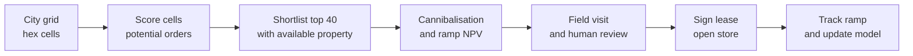
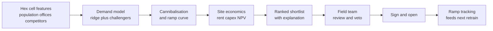

# Case Study 35: Dark-Store Location Selection (Where Should Store 321 Go)

**Domain:** Quick Commerce | **Problem Type:** Regression and spatial modelling, plus site ranking | **Difficulty:** Intermediate

---

## 1. Business Context

### Company background

- **Jhatpat** (fictional): 320 dark stores in 9 cities, about 3 lakh orders a day (about 937 orders per store per day on average), average basket about ₹480.
- The plan is to add about **120 new stores in the next 18 months**, mostly inside existing cities, to cut delivery distance and win more demand.
- Each store needs a 2,500 to 3,500 sq ft ground-floor space with vehicle access, and it serves customers within roughly 2 to 3 km (about a 10-minute ride).
- Site search is done by the expansion team with brokers, based on experience, a few maps, and rent quotes.

### The pain, with numbers

| Item | Value |
| --- | --- |
| Contribution per order (gross margin including ad income, less discounts, rider pay, picking, packaging, payments and support) | about ₹40 |
| Fixed cost per store per day (rent about ₹3.2 lakh a month, fixed staff about ₹4.4 lakh, utilities and upkeep about ₹2.0 lakh) | about ₹32,000 |
| **Break-even orders per store per day** | **800** (₹32,000 divided by ₹40) |
| Capex per new store (fit-out, racks, cold chain, IT) | about ₹60 lakh |
| Orders per day of a strong mature store | about 1,100 to 1,200 |
| Annual profit of a store at 1,100 orders a day | about ₹44 lakh (1,100 x ₹40 minus ₹32,000, times 365) |
| Stores opened in the last 12 months (60) that are below break-even at week 26 | 14, which is 23% |
| Average orders per day of those 14 stores | about 620 |
| **Annual loss of one such store** | **about ₹26 lakh** (620 x ₹40 minus ₹32,000, times 365) |

- Ramp-up is slow: a new store reaches about 40% of its mature volume in week 4, 65% in week 8, 90% in week 14, and full volume around week 26. So we learn the truth about a site only after 6 months, and by then the lease and capex are sunk.
- A weak store loses about ₹26 lakh a year, and the same site as a good one would earn about ₹44 lakh. The gap is about ₹70 lakh a year per site.
- Target: cut the weak-store rate from 23% to about 12% on the next 120 stores.

### Stakeholders and what each wants

| Stakeholder | What they want | What they fear |
| --- | --- | --- |
| Head of Expansion | A ranked shortlist of sites and a defensible reason for each | A black-box model overruling field experience |
| CFO | High return on each rupee of capex, and a clear payback | Stranded capex on weak stores |
| City managers | Coverage of promising areas, fewer delivery delays | A model that favours only rich areas and leaves gaps |
| Operations | Stores with good road access and rider flow | A site that looks great on the map but has no access |
| Existing store managers | No unfair loss of their own volume | Their store being starved by a new one nearby |
| Real estate and legal | Compliant sites, fair rent | Deals that fall through late |
| Policy and brand team | Reasonable service coverage across neighbourhoods | Accusations of ignoring lower-income areas |

---

## 2. Translating Business to ML

### The business question vs the ML question

| Business question | ML question |
| --- | --- |
| "Is this a good place for a store" | "Predict the mature orders per day (week 26 level) that a store at this location would reach, with an uncertainty band" |
| "How much volume will it steal from our other stores" | "Estimate the loss in orders at neighbouring stores, and report the **incremental** orders, not the gross" |
| "Which of these 40 shortlisted sites should we sign first" | "Rank sites by expected net present value (NPV) after rent, capex, ramp-up and cannibalisation" |

> **Mentor note:** The model predicts demand potential. The ranking needs **money**: orders per day times contribution, minus rent, minus the volume lost by neighbours, spread over a ramp-up curve. A site with 1,000 predicted orders and a rent of ₹9 lakh a month can be worse than a site with 900 orders and ₹3 lakh. Always rank on rupees, not on orders.

### Target variable definition

- **Primary target:** average orders per day in weeks 20 to 30 after opening (the mature level), for each existing store. About 260 of the 320 stores have this.
- **Ramp target:** orders per day by week since opening, as a share of the mature level, for each store with at least 14 weeks of history.
- **Cannibalisation target:** change in neighbours' orders per day, measured before and after each opening.
- **Decision target:** incremental NPV of the site over 3 years.

### Edge cases

| Edge case | Recommended treatment | Reason |
| --- | --- | --- |
| Stores less than 26 weeks old | Use for the ramp curve, not as mature targets. Or predict their mature level from the curve | Immature volume understates potential |
| Stores that were affected by a long stock-out, a flood or a closure | Drop the affected weeks or mark them as outliers | Noise in a small dataset has a large effect |
| A store that opened next to an old one and took its orders | Use combined volume of the pair when learning demand of the catchment, and cannibalisation separately | Otherwise potential is overstated for the new store and understated for the old |
| Sites where a competitor opened later | Include competitor presence as a time-varying feature | Competitor entry changes the mature level |
| Pincodes with high app opens but no store in range (latent demand) | Keep as a separate demand signal, and do not treat as actual orders | Real signal of unserved demand, but conversion is uncertain |
| A site with a gated society that restricts rider entry | Flag for field review. Do not rely on the model | Access is hard to see from data |

### Unit of prediction

- One **candidate location** (a point) with a catchment defined by a 10-minute ride isochrone (the area reachable by road within 10 minutes).
- Candidates are screened from a grid of hexagonal cells (about 0.7 sq km each) across each city, and then shortlisted for site visits.

### Prediction timing



- This is a planning exercise run quarterly, not a real-time system. Latency does not matter, correctness and explanation do.

### What success looks like

| Lens | Success |
| --- | --- |
| Business | Weak-store share (below 800 orders a day at week 26) from 23% to 12% on the next 120 stores, about ₹6 Cr a year after a cautious haircut |
| Model | Spatial cross-validation R-squared of about 0.55 or higher, median absolute percentage error below 22%, and at least 75% of the top-third ranked sites actually clearing break-even |
| Calibration | Predicted probability of clearing 800 orders a day matches actual share (for example 70% predicted gives about 70% actual) |
| Process | Every shortlisted site has a one-page explanation, a field review and a documented override reason if any |

---

## 3. Data Understanding

### Data sources and key features

| Feature group | Source | Why it matters |
| --- | --- | --- |
| Population density and households within the 10-minute ride isochrone | Census-based gridded population data | Basic size of the customer pool |
| Income proxies (average property price or rent per sq ft, share of high-rise apartments, number of premium malls and cafes, two-wheeler vs car registrations) | Real estate listings, map data, transport data | We do not have personal income, so use area proxies |
| Office and campus clusters (offices, co-working spaces, colleges, hostels) | Map points of interest, company directories | Weekday lunch and evening demand, and student orders |
| Competitor stores within 1, 2 and 3 km | Public app listings, field surveys | Share of demand available to us |
| Existing Jhatpat stores (distance to nearest, number within 3 km, their load and wait times) | Internal | Cannibalisation, and overloaded stores that need relief |
| App demand outside serviceable area (app opens, carts, "not serviceable" messages by pincode) | App logs | Observed latent demand, a very strong signal |
| Road network (travel time isochrones, one-way streets, flyovers, rail lines as barriers) | Routing engine | A rail line can split a catchment |
| Site attributes (area, frontage, loading access, rent per sq ft, nearby parking) | Brokers and field team | Cost and operability |
| City growth index and opening vintage | Internal | Separates market growth from site quality |

### Data volume, granularity and refresh

- **Volume:** only **320 stores**, about 260 with mature volume, and about 60 with ramp history. About 9 cities, so about 30 stores per city.
- **Candidate side:** about 6,000 hex cells across the 9 cities, with feature values for each.
- **Granularity:** one row per store (target) and one row per hex cell (candidate).
- **Refresh:** features quarterly, app-demand features monthly, store outcomes updated weekly during ramp.

### Common data issues

| Issue | How it shows up here |
| --- | --- |
| Very small sample | 260 labelled stores, with 40 features, makes overfitting easy |
| Spatial autocorrelation | Nearby stores have similar demand, so a random split leaks information |
| Selection bias | We opened stores where the old team expected success, so we have no data from places they never tried |
| Endogenous competitors | Competitors choose good areas too, so more competitors can look positively linked to demand |
| Cannibalisation entangled with potential | A new store's volume is part new demand and part moved from neighbours |
| Changing market | A store opened in 2023 faced a different competitive field than one opened last month |
| Proxy features | Property price as an income proxy can mislead in old city centres |

> **Mentor note: Where juniors usually go wrong here.**
>
> - They run a random 5-fold cross-validation, see R-squared of 0.8, and are shocked when new sites disappoint. Neighbouring stores sit on both sides of the split, so the model memorised the neighbourhood.
> - They fit a large gradient-boosting model to 260 rows. It looks clever and gives wild predictions on new areas.
> - They report gross orders for the new store and forget what it took from nearby stores.

---

## 4. Approach and Decision Points

### Baseline first

- **Baseline 1 (current):** expansion team judgement, helped by population within 2 km and rent. Rough hit rate: 77% of stores clear break-even.
- **Baseline 2:** a simple formula: orders per day = households in the isochrone x penetration rate (orders per household in comparable mature stores), adjusted by competitor count.
- **Why it matters:** with 260 data points, a transparent formula is a very strong competitor to ML, and gives the team something they can argue with.

### Candidate models

| Model | Pros | Cons | Verdict |
| --- | --- | --- | --- |
| Expert scorecard (weights set by experience) | Easy to explain, no data needed | Weights are untested | Benchmark |
| **Regularised linear model** (ridge or elastic net on log orders) | Stable with small samples, coefficients are readable | Misses interactions | **Primary model** |
| Gravity or Huff-style catchment model (demand pulled by distance and attractiveness of stores) | Built for competition and cannibalisation | Needs calibration | Use for the cannibalisation module |
| Gradient boosting with strong constraints (shallow trees, monotone rules) | Captures non-linear effects | Easy to overfit with 260 rows | Secondary challenger |
| Random forest | Robust to noise | Poor extrapolation to new areas | Optional |
| Spatial models (kriging, spatial lag regression, Gaussian processes) | Handle neighbour similarity | Harder to maintain | Use for residual checks and as a challenger |
| Deep learning on satellite imagery | Catches building patterns | Far too little data, hard to explain | Not now |

### Decision scenarios

| What if... | Recommended action | Reasoning |
| --- | --- | --- |
| **Only 260 labelled stores, and cross-validation gives R-squared of 0.8 with random folds** | Use **spatial block cross-validation**: group stores by area (for example 5 km blocks or whole neighbourhood clusters), and hold out entire blocks with a buffer of about 3 km. Also try leave-one-city-out. Report the lower number | Spatial neighbours leak information. The spatial score is the honest estimate of performance in a new area |
| **The model says the best potential is in the central business district, but those stores will take orders from our two existing stores** (cannibalisation) | Estimate the volume loss of neighbours with a before-and-after study on the last 40 openings, using similar far-away stores as controls. Report **incremental orders** = new store orders minus neighbour losses. Rank on incremental NPV | Historical data show neighbours within 1.5 km lose about 18% of volume. Gross orders flatter the site |
| **The ramp-up takes 26 weeks and we cannot wait to learn** | Fit a ramp curve (share of mature volume by week) by city type and use it to build a cash-flow NPV. Monitor the first 8 weeks against the curve and flag early under-performers | A store at 65% of the curve in week 8 is on track, while 45% is a warning. This turns a 6-month wait into an 8-week signal |
| **A site predicted at 1,000 orders a day has a rent of ₹9 lakh a month** | Recompute break-even: fixed cost rises to about ₹32,000 + (₹9 lakh minus ₹3.2 lakh) divided by 30, about ₹51,300 a day, so break-even is about 1,280 orders a day. Compare NPV, not orders | High rent can wipe out a strong catchment. The ranking is in rupees |
| **We have only opened stores in places the old team chose** (selection bias) | Reserve about 5 of the 120 new openings for "explore" sites that the model likes but the team would not normally pick, and record outcomes. Be careful with model use on areas unlike our past stores | Without exploration the model can never learn that it is wrong about unfamiliar areas |
| **Competitor count is positively related to orders in the data** | Treat the sign with suspicion. Add controls for area attractiveness, use competitor entry timing, and fix the coefficient sign if you believe it must be negative after controlling for density | Competitors enter where demand is high, so correlation is not causation |
| **The model ranks a site highly, but the field team finds a narrow lane and a society that bans delivery riders** | Human review has a veto. Record the reason, add an "access score" from field notes as a feature over time, and avoid retraining on overridden cases without noting this | Data cannot see access problems. The model is a screening tool, not a decision-maker |
| **The model scores low-income neighbourhoods lower on average** | Check coverage by area type. Keep a minimum coverage rule per city, and report model scores by income proxy band. Use the model for ranking within an area type as well as across | Pure profit ranking can leave areas underserved, which may harm brand and policy goals |

---

## 5. Feature Engineering

### Top 10 features to build

| # | Feature | Business logic |
| --- | --- | --- |
| 1 | Population and households within the 10-minute ride isochrone (log) | Size of the customer pool |
| 2 | Share of high-rise apartments and gated societies | Dense, repeat-order-friendly housing |
| 3 | Rent or property price per sq ft in the catchment (as an income proxy) | Spending power proxy |
| 4 | Number of offices, co-working seats and college hostels within 2 km | Daytime and student demand |
| 5 | Latent demand: app opens and carts per 1,000 households from outside the current serviceable area | Directly observed intent |
| 6 | Competitor dark stores within 2 km, and years since the first one | Share of demand and market maturity |
| 7 | Distance to the nearest Jhatpat store and number of stores within 3 km | Cannibalisation exposure |
| 8 | Load and wait time at neighbouring stores (peak orders per picker, assignment wait) | Congested neighbours mean spare demand |
| 9 | Road barriers: rail lines, rivers, highways crossing the isochrone | Real catchment is smaller than a circle |
| 10 | City growth index and opening year | Separates market trend from the site |

### Features to avoid (leakage risks)

| Feature | Problem |
| --- | --- |
| Orders from the store's own catchment in the weeks after opening | That is the target |
| Customer counts of the store itself (active customers, repeat rate) | Outcome of the store, derived from the target |
| Rider productivity and delivery time of the store | Caused by volume, not a cause of it |
| Rent actually paid in the lease (as demand evidence) | Rent reflects what the landlord thought, but also bargaining and broker pull. Use it in the economics, not as a demand predictor |
| Features computed after the store opened (for example new competitor entering later) | Must use values at the time of the decision, otherwise look-ahead |
| Personal data of customers in the area (names, individual addresses) | Use aggregated area data only, in line with DPDP Act 2023 data minimisation |

Spatial block cross-validation with a ridge model:

```python
import numpy as np
from sklearn.linear_model import RidgeCV
from sklearn.pipeline import make_pipeline
from sklearn.preprocessing import StandardScaler
from sklearn.model_selection import GroupKFold

# stores.block_id groups stores into ~5 km blocks, so neighbours stay on the same side of the split
X, y, groups = stores[feature_cols], np.log(stores["mature_orders"]), stores["block_id"]
model = make_pipeline(StandardScaler(), RidgeCV(alphas=np.logspace(-2, 3, 20)))

preds = np.zeros(len(y))
for train_idx, test_idx in GroupKFold(n_splits=6).split(X, y, groups):
    model.fit(X.iloc[train_idx], y.iloc[train_idx])
    preds[test_idx] = model.predict(X.iloc[test_idx])

mape = np.mean(np.abs(np.exp(preds) - np.exp(y)) / np.exp(y))   # target below 0.22
```

---

## 6. Evaluation Strategy

### Metrics

| Metric | Role | Why |
| --- | --- | --- |
| **Spatial-CV R-squared and MAPE** of mature orders per day | Primary model accuracy | Honest estimate for new areas |
| **Hit rate of top-ranked sites** (share of the top third that clear 800 orders a day) | Primary decision metric | What the expansion team actually cares about |
| **Calibration of P(orders at least 800)** | Primary for risk | Lets the CFO see the downside |
| Spearman rank correlation between predicted and actual order within a city | Ranking quality | We rank, we do not just predict |
| Error in cannibalisation estimate (predicted vs observed neighbour loss) | Network effect | Wrong cannibalisation misleads the NPV |
| Ramp-curve error at week 8 and week 14 | Early warning | Used to decide on early action |
| Realised NPV vs predicted for opened sites | Business | The true test after 12 months |

### Metrics that look good but are misleading here

- **Random-split R-squared:** inflated by spatial leakage.
- **R-squared on log orders only:** hides large errors in rupees at the high end.
- **Training fit:** with 260 rows and 40 features, it is meaningless.
- **Gross predicted orders:** includes the volume taken from neighbours.

### Validation strategy

| Step | Design | Why |
| --- | --- | --- |
| Spatial block CV | Hold out blocks of about 5 km with a 3 km buffer, repeated across 5 seeds | Removes neighbour leakage |
| Leave-one-city-out | Train on 8 cities, test on the 9th | Tests transfer across cities |
| Time-based backtest | Train on stores opened before last year, predict the 60 newest stores at week 26 | Matches the real decision problem |
| Rank backtest | For each city, check how the model would have ranked actual openings | Matches the use case |
| Cannibalisation check | Before-and-after study with synthetic controls on the last 40 openings | Validates network effects |
| Prospective tracking | Log predictions for every new site before signing, compare at week 8, 14, 26 | The only fully honest test |

### From model metric to business value

- Without the model, about 23% of 120 new stores, about **28** (27.6) are weak. With the model at about 12%, about **14** (14.4) are weak. That is about 13 fewer weak stores.
- Each swap from a weak store (loss about ₹26 lakh a year) to a typical strong store (profit about ₹44 lakh) is worth about ₹70 lakh a year. Gross: 13 x ₹70 lakh is about ₹9.1 Cr a year.
- Assume only 70% of the swaps find a truly better available site: about **₹6.4 Cr a year**.
- Capex at risk avoided: 13 x ₹60 lakh is about ₹7.8 Cr (one time, partly recoverable).
- Cost to build: one data scientist and one analyst for 4 months, data purchases of about ₹30 to ₹40 lakh a year.

---

## 7. Deployment and Monitoring

### Batch vs real time

- **Batch, quarterly:** rebuild hex-cell features, rescore all cells, refresh competitor data, and rerun cannibalisation for candidate sites.
- **Interactive tool:** a map for the expansion team where they enter a candidate address and see predicted orders, probability of break-even, incremental NPV, and the effect on neighbours.
- **Human in the loop:** every shortlisted site goes through field review. The model never signs a lease.



### What to monitor

| Type | What to track | Alert trigger |
| --- | --- | --- |
| Prediction vs ramp | New store orders vs curve at weeks 4, 8, 14 | Below 80% of the expected curve at week 8 |
| Accuracy | MAPE at week 26, hit rate of top-ranked sites, calibration | Hit rate below 65% on the last 20 stores |
| Cannibalisation | Observed neighbour loss vs predicted | Error above 8 percentage points |
| Data | Freshness of competitor and population data, coverage of latent-demand data | Older than 6 months |
| Override log | Share of model-ranked sites vetoed by the field team and reasons | Above 30%, or the same reason repeated |
| Coverage | Share of new stores by area type and city | Large gap between income bands |
| Economics | Realised rent, capex and contribution per order vs plan | Rent more than 15% above plan |

### Retraining

- **Scheduled:** after every batch of about 20 new stores reaches week 26, and at least once a year.
- **Triggered:** a major competitor entry or exit, a big change in contribution per order, or a repeated field veto reason.

### A/B test or champion-challenger design

- Customer-style A/B tests do not apply. Use **prospective tracking** and a **staged rollout**: for the first 40 openings, record both the model ranking and the team's own ranking and compare the hit rates later.
- Keep an **explore budget** of about 5 sites to learn in areas the team would not normally choose.
- Primary: share of new stores above break-even at week 26 and realised NPV. Guardrails: coverage by area type, and payback time under 3 years.

---

## 8. Stakeholder Communication

### Explain it to a non-technical leader

> "We look at every part of a city and estimate how many orders a store there would reach after six months, using population, offices, housing type, competitors, and how many people already open our app from places we do not serve.
> We then subtract what the new store would take from our existing stores and add rent and set-up cost. That gives a rupee value for each site and a ranked shortlist.
> The field team still visits and has the final say. We expect fewer weak stores, about 14 instead of 28 out of the next 120, worth about ₹6 Cr a year."

### Questions leadership will ask

| Question | Suggested answer |
| --- | --- |
| "Why not use a deep model with satellite images" | "We have only 260 mature stores. A deep model would memorise them. A simple, tested model with good features is more reliable, and the team can understand it" |
| "How do we know it works for areas we have never served" | "We test by holding out whole neighbourhoods and whole cities, not random stores. That is the honest check for new areas, and we will track every new store against its prediction" |
| "What about the sales we take from our own stores" | "Each site report shows incremental orders after the loss at nearby stores. A site that mostly moves orders around ranks lower" |
| "Does it only pick rich areas" | "Income proxies are one of many features, and we check coverage by area type. A minimum coverage rule and the field team ensure we do not ignore whole neighbourhoods" |
| "When will we know the model was right" | "At week 8 we see whether the store is on its ramp curve, and at week 26 we see the mature level. We will publish the hit rate for each batch" |

---

## 9. Common Pitfalls and Lessons

| Mistake | Why it happens | How to avoid it |
| --- | --- | --- |
| Random cross-validation on spatial data | It is the default | Use spatial block CV, leave-one-city-out, and report the lower score |
| Complex model on 260 stores | Tools make it easy | Start with ridge or a transparent formula, and add complexity only if spatial CV improves |
| Ranking on orders instead of rupees | Orders are the model output | Convert to incremental NPV with rent, capex, ramp and cannibalisation |
| Ignoring cannibalisation | Each site is looked at alone | Measure neighbour losses on past openings and rank on incremental volume |
| Using immature stores as mature labels | Recent stores are the most relevant | Use ramp curves to project to week 26, or exclude them from the target |
| Selection bias from past decisions | Only opened sites have labels | Reserve an explore budget, and be cautious in unfamiliar areas |
| Trusting competitor coefficients | The data show correlation | Reason causally, control for area attractiveness, and use entry timing |
| Letting the model overrule the field team | A score looks objective | Keep human veto, log overrides, and learn from them |

---

## 10. Mentor's Focus Checklist

- ✅ **Where to spend 80% of the effort:**
  - Honest validation: spatial block CV, leave-one-city-out and a time-based backtest.
  - Cannibalisation and ramp-up, so the ranking is on incremental NPV.
  - Clean, timestamped features, especially latent demand from app logs.
  - A simple model, an explanation for each site, and a field-review process with a logged veto.
- ❌ **What not to over-engineer:**
  - Satellite-image deep learning with a few hundred labels.
  - Very fine hex grids. A cell of about 0.7 sq km is enough.
  - Precise rent forecasts. A range and a sensitivity table is enough.
- 💡 **Key takeaway:** **With a few hundred stores, the validation design matters more than the model.** Split by geography, rank by incremental rupees after cannibalisation and rent, and let humans veto what data cannot see.
