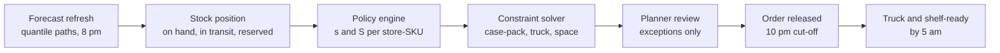
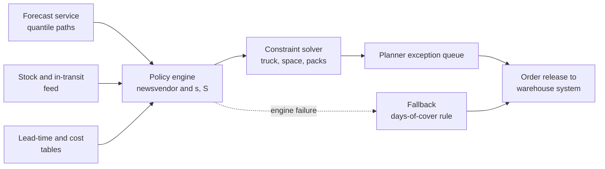

# Case Study 36: Replenishment and Reorder-Point Optimisation (From City Warehouse to Dark Store)

**Domain:** Quick Commerce | **Problem Type:** Inventory optimisation using probabilistic forecasts | **Difficulty:** Advanced

---

## 1. Business Context

### Company background

- Same company as Case 5: **Jhatpat** (fictional), 320 dark stores in 9 cities, about 3 lakh orders a day, about 10.95 crore orders a year, about ₹480 basket, about ₹5,200 Cr GMV a year (GMV means gross merchandise value, the total value of goods sold).
- Each city has one **mother warehouse** (also called a city warehouse or hub). Suppliers deliver to the warehouse. The warehouse sends trucks to the dark stores.
- Each store lists about 4,500 SKUs (a SKU is one sellable item, for example "Amul Gold milk 500 ml"). That is about 14.4 lakh store-SKU pairs to replenish.
- Two truck runs a day per store: the **night run** (order cut-off 10 pm, shelf-ready by 5 am) and the **afternoon run** (cut-off 10 am, shelf-ready by 3 pm).
- Case 5 gives us a probabilistic demand forecast per store-SKU. Case 8 tells us whether the on-hand count can be trusted. This case turns those two inputs into **how many units to order**.

### The pain, with numbers

| Item | Value |
| --- | --- |
| Store-SKU pairs managed | about 14.4 lakh (320 stores x 4,500 SKUs) |
| Sales lost because the item was out of stock | about 2.4% of GMV, about ₹125 Cr a year |
| Perishables (dairy, bread, fruit, vegetables, ready-to-cook) share of GMV | 22%, about ₹1,144 Cr |
| Perishable wastage (expired or unsellable) | 3.8% of perishable sales, about ₹43.5 Cr a year |
| Average inventory cover in stores | about 4.0 days, about ₹45.6 Cr at cost |
| Store deliveries a year (320 stores x 2 runs x 365) | about 2,33,600 |
| Unplanned top-up trips (emergency runs outside the schedule) | 14% of deliveries, about 32,700 trips at about ₹1,100 extra each, about ₹3.6 Cr |
| Average truck fill | 71% |
| Current method | Fixed days-of-cover rule per category, with a planner override |

- The rule "keep 3 days of cover for dairy" is too much for slow items and too little for fast items with a spiky demand.
- Planners override the rule by hand for the top few hundred SKUs, but cannot do it for 14.4 lakh pairs.
- Targets: lost sales from 2.4% to 1.6% of GMV, perishable wastage from 3.8% to 3.0%, unplanned trips from 14% to 8%, **with inventory cover held flat at about 4.0 days**. We want better availability from the same stock, not more stock.

### Stakeholders and what each wants

| Stakeholder | What they want | What they fear |
| --- | --- | --- |
| Head of Supply Chain | Higher availability without more working capital | Cash locked in stock, and expiry write-offs |
| Category managers | Their hero items always on the shelf, promotions fully stocked | A "black box" that ignores what they know about suppliers and festivals |
| Store managers | Orders they can physically fit and put away | Trucks that arrive with more than the shelf can hold |
| Warehouse and transport head | Full trucks, stable picking load, fewer emergency runs | Last-minute spikes in orders at cut-off |
| Finance | Lower wastage, controlled inventory value | Savings claimed twice (forecast team and supply chain) |
| Suppliers | Predictable, smoother purchase orders | Sudden swings in quantity |
| Customers | The item is there when they open the app | A cart full of "out of stock" |

---

## 2. Translating Business to ML

### The business question vs the ML question

| Business question | ML question |
| --- | --- |
| "How much should each store receive tonight?" | "Given the demand distribution for the next protection period and the lead-time distribution, what order quantity minimises expected cost (stock-out cost plus wastage plus holding cost), subject to case-pack, truck and space limits?" |
| "How safe is safe enough for each item?" | "What service level (the share of demand we meet from stock) should each category get, as set by the cost of a lost sale vs the cost of an unsold unit?" |

> **Mentor note:** Do not call this a forecasting problem. The forecast is an input. The decision is a quantity, and the loss function is money. A forecast with a lower error can still give a worse order if the lead time is ignored, or if the pack size rounds the order the wrong way. Decide the policy first, then ask what forecast quality it needs.

### Policy and target definition

- **Policy type:** an **(s, S) policy** (also called min-max). If stock position (on hand plus in transit minus reserved) falls to or below the **reorder point s**, order up to the **order-up-to level S**. Otherwise order nothing.
- **Newsvendor logic** sets S for each store-SKU. Order up to the demand quantile equal to the **critical ratio**: `Cu / (Cu + Co)`, where `Cu` is the cost of one unit short and `Co` is the cost of one unit too many.
- **Protection period** = review period plus lead time. For the night run, review is 12 hours (two runs a day) and lead time is about 7 hours, so protection is about 19 hours.
- **Decision output:** order quantity per store-SKU per run, in whole case packs.
- **Evaluated target:** total expected cost in a simulator, plus availability, wastage and trips.

### Worked example of critical ratios

| SKU | Cu (cost of being short) | Co (cost of being long) | Critical ratio | Meaning |
| --- | --- | --- | --- | --- |
| Paneer 200 g, price ₹95, cost ₹76, 5-day life | ₹19 lost margin plus ₹6 lost goodwill = ₹25 | ₹76 (whole cost, no salvage) | 25 / 101 = 0.25 | Target about 25% cycle service. Accept stock-outs, because waste is expensive |
| Milk 500 ml, daily delivery, shelf life 3 days | ₹4 margin plus ₹30 (the basket often leaves, traffic driver) = ₹34 | ₹26 | 34 / 60 = 0.57 | Moderate service, but very tight forecast needed |
| Atta 5 kg, price ₹290, cost ₹250 | ₹40 margin plus ₹20 goodwill = ₹60 | ₹3 (holding cost for a few days) | 60 / 63 = 0.95 | Target about 95% service, holding stock is cheap |

- The same maths gives very different service levels. This is the key teaching point: **one service-level target for all SKUs is wrong in both directions**.
- Customers add a fresh-category item to nearly every basket, so milk and bread also carry a "basket loss" in `Cu`. Ask category and growth teams for it, and test sensitivity.

### Edge cases

| Edge case | Recommended treatment | Reason |
| --- | --- | --- |
| SKU with minimum order quantity (MOQ) or case pack of 24, store sells 6 a day | Order in packs, evaluate floor vs ceil by expected cost, and share packs across nearby stores where possible | Plain rounding up inflates stock for slow items |
| SKU with fixed shelf life, such as 4 days for bread | Cap S by remaining shelf life at arrival, not only by demand | Stock that will expire before it sells is already waste |
| SKU out of stock at the warehouse | Allocate the available units across stores by predicted demand, not first come first served | Otherwise a few stores take everything |
| Delisted, seasonal or festival SKU | Short-horizon policy with an end date, sell-through target instead of service level | Terminal stock has no future value |
| Frozen or chilled items | Separate chiller capacity as a hard constraint | Cannot overflow into ambient shelves |

### Unit of prediction

- One **store-SKU-run**: the quantity to order at this cut-off for this store and this SKU.
- Policies are set per store-SKU, but constraints (truck, space, supplier budget) couple all SKUs of a store and a run.

### Prediction timing



- Forecasts must be **fresh before cut-off**. A forecast that ignores the evening spike of the same day is wrong at 10 pm.
- The engine runs twice a day, for the night run and the afternoon run, each in under 30 minutes for all 320 stores.

### What success looks like

| Lens | Success |
| --- | --- |
| Business | Lost sales from 2.4% to 1.6% of GMV, wastage from 3.8% to 3.0% of perishable sales, unplanned trips from 14% to 8%, inventory cover flat at about 4.0 days. About ₹13 Cr a year |
| Model and policy | In simulation, the new policy beats the days-of-cover rule on total cost in at least 8 of 10 categories. In-stock rate (demand-weighted) at or above the target set for each category |
| Operations | Truck fill from 71% to 80%, order quantity changes day to day within agreed limits, planners override fewer than 5% of lines |

---

## 3. Data Understanding

### Data sources and key inputs

| Feature group | Source | Why it matters |
| --- | --- | --- |
| Probabilistic demand forecast (P10, P50, P90 and sample paths by hour) | Case 5 forecasting service | The main input to S and s |
| Stock position (on hand, in transit, reserved, damaged) | Store inventory system, after the phantom-stock cleaning of Case 8 | A wrong on-hand number gives a wrong order |
| Lead-time history by lane and run (cut-off to shelf-ready) | Warehouse and transport logs | Lead-time variability drives safety stock |
| Case-pack, MOQ, shelf life, weight, volume, temperature class | Item master | Hard constraints |
| Cost data (cost price, margin, salvage, holding rate, markdown history) | Finance and category teams | Sets the critical ratio |
| Store space (shelf slots, chiller litres, back-room volume) | Store layout sheets | Hard limit on S |
| Truck capacity (volume and weight) and trip cost | Transport system | Truck-load constraint and cost of emergency runs |
| Warehouse stock and supplier arrival schedule | Warehouse system | Upstream availability |
| Promotion and festival calendar | Marketing and category | Demand shocks the forecast must see |

### Data volume, granularity and refresh

- **Volume:** 14.4 lakh store-SKU pairs, two decisions a day, so about 29 lakh order decisions a day. Of these, about 40% are "do nothing" because stock is above s.
- **Granularity:** store-SKU-run for decisions, store-SKU-hour for demand, delivery-level for lead times (about 2,33,600 deliveries a year per direction).
- **Refresh:** stock position every few minutes, forecasts twice a day, lead-time distributions weekly, cost parameters monthly.

### Common data issues

| Issue | How it shows up here |
| --- | --- |
| Demand observed is not demand | Sales are capped by stock. Estimate true demand before replaying policies (see Cases 5 and 8) |
| Lead time is not one number | A truck that is late on 1 day in 15 (road closure, flooding) creates a long right tail |
| Case-pack data wrong in the item master | A pack of 12 recorded as 6 doubles the order |
| Cost parameters guessed | Critical ratios move with them, so the orders move too |
| Stale or double-counted in-transit stock | Orders placed twice or not at all |
| Upstream shortage hidden | The warehouse "ships" what it has, so a store looks short because the warehouse was short |
| Forecast too narrow | The probabilistic forecast looks confident, but its actual coverage is 70% for a nominal 90% interval |

> **Mentor note: Where juniors usually go wrong here.**
>
> - They plug the P50 forecast into the order and add a flat 20% buffer. That buffer is the same for paneer and for atta, which is exactly the problem.
> - They treat lead time as fixed. Most of the safety stock for items with steady demand comes from lead-time variation, not demand variation.
> - They validate by checking whether the order was "close to what sold". The right test is a simulation of cost under the policy.

---

## 4. Approach and Decision Points

### Baseline first

- **Baseline 1 (current):** days-of-cover rule by category plus planner overrides. Lost sales 2.4%, wastage 3.8%, cover 4.0 days.
- **Baseline 2:** a classical (s, S) policy using mean demand, standard deviation and a normal approximation, with service levels set by category from the critical ratio.
- **Why it matters:** Baseline 2 is cheap, transparent, and often gets half of the gain. The probabilistic forecast and the optimiser must beat it to earn their complexity.

### Candidate approaches

| Approach | Pros | Cons | Verdict |
| --- | --- | --- | --- |
| Days-of-cover rule | Simple, planners understand it | Same buffer for all items, blind to variability | Baseline to beat |
| Classical (s, S) with normal demand and normal lead time | Closed-form, fast, easy to explain | Normal assumption is poor for slow, lumpy items and for festival spikes | Strong benchmark and fallback |
| **Newsvendor on simulated demand over the protection period** (forecast paths plus empirical lead time) | Uses the real shape of demand and lead time, handles skew | Needs good probabilistic forecasts and calibration checks | **Primary policy for most SKUs** |
| Constrained optimisation (integer programme or Lagrangian) for truck, space and budget | Respects hard limits and gives a price for each limit | More engineering, solver time | Add on top of the newsvendor quantities |
| Reinforcement learning or deep policy networks | Can learn complex dynamics | Hard to audit, needs a very good simulator | Only after the simulator is trusted, and for pilots |
| Direct "decision-focused" model (predict the order, not demand) | Optimises the cost directly | Hard to explain, harder to constrain | Research only |

### Decision scenarios

| What if... | Recommended action | Reasoning |
| --- | --- | --- |
| **The truck is only 62% full at cut-off, but the cost is the same** | Add a truck-fill step: top up with items whose marginal value is highest (fast movers near s, high-margin, long shelf life), without going over store space. Do not fill with slow items just to reach 100% | An empty truck costs the same as a full one, but stock added blindly raises wastage. Use the shadow price of the truck constraint to choose |
| **Storm flooding delays the night truck on one lane by 3 hours on 1 day in 20** | Use the empirical lead-time distribution per lane and run (with a bimodal tail), not mean and standard deviation. Flag lanes with fat tails, and for them lift s for the key SKUs only | A normal model hides a rare but costly delay. Targeted safety stock is cheaper than a general buffer |
| **A store has 28 chiller shelf slots, and the policy asks for 41 slots of dairy** | Solve a constrained problem: scale back order-up-to levels using the shadow price of space, cutting items with the lowest "value per slot" first (slow, low margin) | Space is a hard limit. An equal cut for all items harms the heroes. A price on space gives the right trade-off |
| **A pack of 24 sells at 5 a day and the store has 9 left** | Compare "order 1 pack" vs "order 0 and risk a stock-out", by expected cost using the demand paths | Rounding up all the time creates stock, rounding down all the time creates stock-outs. A cost comparison per line decides |
| **The probabilistic forecast claims 90% coverage but gets 74% on the last 4 weeks** | Recalibrate with a conformal adjustment using the forecast errors on the same horizon, and widen the quantiles. Tell the forecasting team | The safety stock is only as honest as the forecast spread. Overconfident forecasts cause the stock-outs we are trying to remove |
| **Two brands of curd are partly substitutable** | Pool demand with an estimated substitution rate (for example 35%, from observed switching when one is out of stock) and lower the combined safety stock accordingly. Do not assume full substitution | Pooling reduces variability, but over-assuming it leads to stock-outs in both brands |
| **The warehouse has only 60% of what stores asked for** | Allocate fairly using each store's remaining days of cover and predicted demand, and protect the top-selling SKUs in each store first. Record the shortfall so the lost sales are not blamed on the policy | First come first served starves the stores that order last in the sequence |
| **Category managers want to override the order for Diwali** | Let them change the demand uplift (a number the system can audit), not the order itself, and cap the effect with the space constraint | An override of the input is traceable and can be learned from. An override of the output hides the reason |

---

## 5. Feature Engineering

The "features" here are the **inputs to the policy and the forecast adjustments**, not only columns for a model.

### Top 10 inputs and derived features

| # | Feature | Business logic |
| --- | --- | --- |
| 1 | Simulated demand over the protection period (sum of forecast paths over lead time plus review) | The core quantity, includes the uncertainty |
| 2 | Empirical lead-time distribution by lane, run, weekday and weather flag | Lead-time variation is often the main safety stock driver |
| 3 | Stock position: on hand plus in transit minus reserved minus quarantined | The starting point of every order |
| 4 | Critical ratio by SKU (from cost, margin, goodwill and salvage) | Sets the target service level per item |
| 5 | Remaining shelf life at expected arrival | Caps the useful order-up-to level |
| 6 | Case-pack size and MOQ | Rounding rules |
| 7 | Space cost per unit (slots or litres) and the store's shadow price of space | Prioritises SKUs under a store limit |
| 8 | Forecast calibration error (coverage gap) per category and store cluster, last 28 days | Adjusts quantiles when the forecast is overconfident |
| 9 | Warehouse availability ratio and supplier fill rate for the SKU | Predicts upstream shortage |
| 10 | Truck fill and marginal value of the next unit in the cart | Decides how to use spare truck space |

### Inputs to avoid (leakage and logic risks)

| Input | Problem |
| --- | --- |
| Actual demand after the order cut-off (for example the morning rush) | Look-ahead leakage in policy evaluation |
| Stock-out-censored sales used as demand | The policy learns to order too little for items it keeps running out of |
| Realised lead times of the same night's truck | Not known at cut-off |
| Planner overrides as a feature for a model of demand | Learns the planner's mistakes and hides forecast issues |

Computing an order-up-to quantity from simulated demand and a critical ratio:

```python
import numpy as np

def order_quantity(demand_paths, cost_under, cost_over, on_hand, in_transit, case_pack):
    """demand_paths: simulated demand over the protection period for one store-SKU,
    built from the Case 5 forecast paths and sampled lead times."""
    critical_ratio = cost_under / (cost_under + cost_over)
    order_up_to = np.quantile(demand_paths, critical_ratio)
    gap = max(0.0, order_up_to - on_hand - in_transit)
    # Compare rounding down and up by expected cost, instead of always rounding up
    candidates = [int(gap // case_pack) * case_pack, int(np.ceil(gap / case_pack)) * case_pack]
    def expected_cost(q):
        shortage = np.maximum(demand_paths - (on_hand + in_transit + q), 0).mean()
        excess = np.maximum((on_hand + in_transit + q) - demand_paths, 0).mean()
        return cost_under * shortage + cost_over * excess
    return min(candidates, key=expected_cost)
```

---

## 6. Evaluation Strategy

### Metrics

| Metric | Role | Why |
| --- | --- | --- |
| **Total expected cost** (lost margin plus wastage plus holding plus trip cost) | Primary, in simulation | The thing the business wants to minimise |
| In-stock rate at order time, weighted by demand | Customer view | An item that sells 100 a day matters more than one that sells 1 |
| Fill rate (units served / units demanded) | Service level | Tracks the target set by category |
| Wastage % of perishable sales | Waste view | Directly linked to Finance targets |
| Average cover (days) and inventory value | Capital view | Proof that gains do not come from more stock |
| Truck fill and share of unplanned trips | Operations view | Where truck cost shows up |
| Forecast coverage (nominal 90% vs actual) | Input quality | Tells whether the safety stock is honest |

### Metrics that look good but are misleading here

- **Forecast accuracy (WAPE, MAPE):** can improve while the order quality worsens, if the spread or lead time is wrong.
- **Overall availability:** can reach 98% by overstocking, and hide a wastage problem. Always show it with cover days and wastage.
- **Cycle service level alone:** counts the share of cycles with no stock-out, but not how big the shortage was. Use fill rate for the customer view.
- **Average over all SKUs:** the top 500 SKUs make about 40% of sales. Look at it by ABC class and by category.

### Validation strategy

| Step | Design | Why |
| --- | --- | --- |
| Simulator check | Replay the current rule on 8 weeks of data and confirm the simulator reproduces actual availability within 0.5 points and wastage within 0.3 points | A simulator that cannot reproduce today cannot predict tomorrow |
| Policy replay | Run baseline 1, baseline 2 and the new policy on the same uncensored demand paths, 8 weeks, 60 stores of mixed type | Fair comparison under identical demand |
| Stress scenarios | Festival week, flood day on a lane, warehouse shortage, supplier delay | Tests the cases where policies break |
| Store-group holdout | Tune parameters on 70% of stores, test on 30% | Tests generalisation across stores |
| Constraint checks | Share of orders that violate space, truck or case-pack limits (target zero) | Hard limits must be met |
| Pilot | 40 treatment and 40 matched control stores, 8 weeks, by city, with the warehouse side handled by city-level quotas | Real-world proof, with spillovers contained |

### From model metric to business value

- **Lost sales:** from 2.4% to 1.6% of ₹5,200 Cr is 0.8% x 5,200 = ₹41.6 Cr of GMV. At about 20% contribution margin, **about ₹8.3 Cr**.
- **Wastage:** from 3.8% to 3.0% of ₹1,144 Cr is 0.8% x 1,144 = ₹9.2 Cr, **about ₹9.2 Cr**.
- **Unplanned trips:** 14% to 8% of 2,33,600 deliveries is about 14,000 fewer trips, at ₹1,100 each, **about ₹1.5 Cr**.
- **Total at full effect: about ₹19 Cr a year.** Inventory is held flat, so no capital charge is claimed.
- We plan on **about ₹13 Cr (70%)**, because part of the gain overlaps with the forecasting work in Case 5, and planners will keep a few overrides.

---

## 7. Deployment and Monitoring

### Batch vs real time

- **Batch** twice a day for the order run (night and afternoon), with a 30-minute window for all stores.
- **Near-real-time** for emergency top-up checks: every 15 minutes, a light check for top SKUs at risk of stocking out before the next run.
- **Weekly** refresh of lead-time distributions and calibration factors. **Monthly** refresh of cost parameters with Finance.



### What to monitor

| Type | What to track | Alert trigger |
| --- | --- | --- |
| Service | In-stock rate and fill rate by category and store cluster | More than 1.5 points below target for 3 days |
| Waste | Wastage % by category, near-expiry stock | 0.5 points above the baseline for 1 week |
| Forecast quality | Coverage of P90 vs nominal, by horizon | Coverage below 85% or above 95% |
| Lead time | Mean and P95 by lane, late-truck rate | P95 up by 30% from the last 4 weeks |
| Constraints | Orders violating space or truck limits, solver time-outs | Any violation, solver above 20 minutes |
| Operations | Truck fill, unplanned trips, planner override rate | Override above 10% |

### Retraining and recalibration

- **Policy parameters** are not retrained like a model, but **recalibrated** weekly (lead time, forecast spread) and reviewed monthly (cost, service levels).
- **Triggered:** new truck schedule, a new warehouse, a change in case pack, a festival calendar update.

### A/B test or champion-challenger design

- Randomise at **store** level, matched on city, size, sales mix and past stock-outs. Stores in one city share a warehouse, so use **city quotas** for upstream stock in the pilot.
- Primary: lost sales (via in-stock rate) and wastage. Guardrails: cover days, truck fill, unplanned trips, planner overrides.
- Run 8 weeks, including at least one promotion cycle. Report by category, because the gain differs a lot between dairy and ambient.

---

## 8. Stakeholder Communication

### Explain it to a non-technical leader

> "Today every item gets the same days of cover, so we run out of fast items and throw away slow fresh ones.
> The new system asks, for each item in each store, how much a missed sale costs vs how much an unsold unit costs, and how uncertain the demand and the truck timing are. Cheap-to-hold staples get a big safety margin, short-life items get a small one.
> It also makes sure the order fits the truck and the shelf. We expect lost sales to drop by a third and waste by about a fifth, with the same stock value as today."

### Questions leadership will ask

| Question | Suggested answer |
| --- | --- |
| "Why not just stock more of everything?" | "Cash and shelf space are limited, and fresh items expire. More stock for paneer raises waste faster than it raises sales. We hold the stock value flat and put it where it earns the most" |
| "Why will paneer be out of stock more often than atta?" | "Because losing a paneer pack costs ₹76 if it expires and ₹25 if we miss a sale. For atta, holding stock costs a few rupees. The optimum is different by design" |
| "What happens if the system is wrong or down?" | "A simple days-of-cover rule takes over for that run, and planners see an alert. The orders are always capped by shelf space and truck size" |
| "Will suppliers see wild swings in orders?" | "We monitor order stability. The policy is designed to smooth ordering, and we test the swing before launch" |
| "Can category managers still use their judgement?" | "Yes, on the demand uplift for events and promotions. The change is logged, and we learn which overrides were right" |
| "How do we know the saving is real?" | "A matched-store pilot with a simulator check before it. We claim only 70% of the simulated gain" |

---

## 9. Common Pitfalls and Lessons

| Mistake | Why it happens | How to avoid it |
| --- | --- | --- |
| One service level for all SKUs | It is simple to communicate | Set service by critical ratio and category, and show the cost trade-off |
| Ignoring lead-time variability | Lead time looks like a fixed schedule | Use the empirical distribution per lane and run, and track late-truck rate |
| Planning with the mean forecast and a flat buffer | The point forecast is the easiest output | Use forecast paths over the protection period and a quantile |
| Always rounding up to the case pack | Stock-outs feel worse than stock | Compare floor and ceil by expected cost, and pool packs across stores where possible |
| Ignoring hard constraints until the end | The optimiser is built first, constraints later | Put truck, space and chiller limits in the solver from version 1 |
| Trusting a simulator without a check | A good-looking simulator is persuasive | Replay today's policy and match actual availability and wastage first |
| Overconfident forecast feeding the policy | The spread is not tested | Monitor coverage, and recalibrate on the same horizon |
| Bullwhip effect (orders swinging more than demand) | Each run reacts fully to the last run's noise | Smooth S, cap day-to-day changes, and monitor order stability |
| Claiming the same saving as the forecasting project | Both teams measure their own gain | Agree the baseline and attribution with Finance before launch |

---

## 10. Mentor's Focus Checklist

- ✅ **Where to spend 80% of the effort:**
  - Critical ratios by category, agreed with Finance and category managers, with a sensitivity table.
  - Lead-time distributions by lane and run, and a forecast that is honest about its spread.
  - A simulator that reproduces today's availability and wastage before it is used to compare policies.
  - Hard constraints (case-pack, truck, space) and the shadow price of each.
  - Planner workflow: exceptions only, with a clear reason for each order.
- ❌ **What not to over-engineer:**
  - Reinforcement learning before the simulator is trusted.
  - Fine-tuned policies for the long tail of slow SKUs that sell fewer than 1 unit a day. A simple rule is enough.
  - Perfect multi-echelon optimisation (warehouse and stores together) in version 1. Start with stores, and manage the warehouse with allocation rules.
- 💡 **Key takeaway:** **An order is a decision made under cost, uncertainty and limits.** A good forecast is necessary but not sufficient. The gain comes from matching the service level to the cost of being wrong for each item, and from respecting the truck and the shelf.
