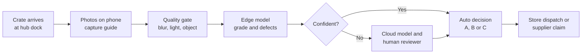
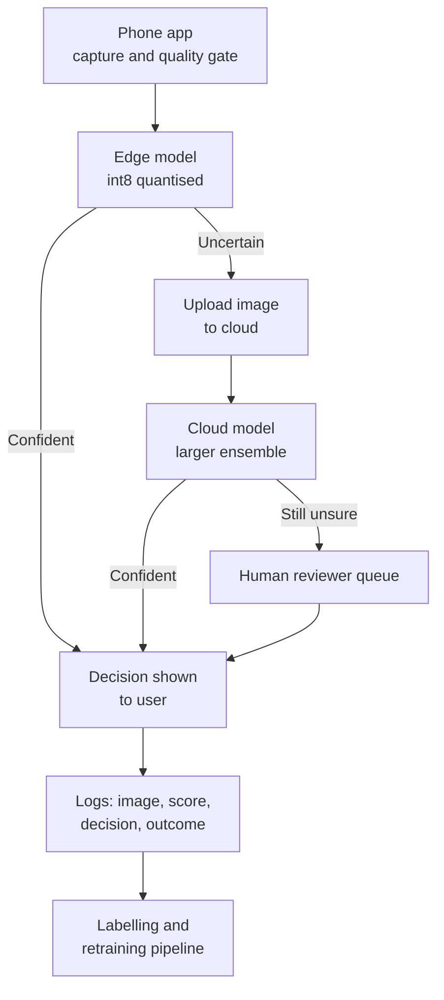

# Case Study 37: Fresh Produce Quality Grading (Computer Vision at Inbound and In-Store)

**Domain:** Quick Commerce | **Problem Type:** Image classification and defect detection | **Difficulty:** Intermediate

---

## 1. Business Context

### Company background

- Same company as earlier quick-commerce cases: **Jhatpat** (fictional), 320 dark stores in 9 cities, about 3 lakh orders a day, about 10.95 crore orders a year, about ₹480 basket, about ₹5,200 Cr GMV a year.
- Fruits and vegetables are about 14% of GMV, about ₹728 Cr a year. About 38% of orders carry at least one produce item, so about 4.2 crore orders a year, with about 2.5 produce lines each, about 10.4 crore produce lines a year.
- Produce moves in two steps. **Inbound:** crates arrive at the city hub (from mandis, farms and aggregators) and are re-packed and sent to stores. **In-store:** pickers choose items from the shelf for each order.
- Quality is judged today by **human graders** looking at a sample of crates, and by pickers glancing at items.

### The pain, with numbers

| Item | Value |
| --- | --- |
| Produce order lines a year | about 10.4 crore |
| Lines where the customer complains of a bad item (rotten, bruised, overripe, wilted) | 2.4%, about 25 lakh complaints a year |
| Refund and handling cost per complaint | about ₹62 |
| Estimated lost future margin per complaint (lower repeat) | about ₹40 |
| **Annual cost of produce quality complaints** | **about ₹25 Cr** (25 lakh x ₹102) |
| Produce purchase cost (about 78% of produce GMV) | about ₹568 Cr |
| Share of inbound lots that are partly bad but not caught at the hub | about 3% |
| Supplier credit recovered today for rejected lots | about 0.3% of purchase value |
| Grading method | Manual sampling of about 1 crate in 12 at hubs, and picker judgement in stores |

- Human graders are slow, tired by late shift, and inconsistent. One grader accepts a banana crate that another rejects.
- Targets: cut produce complaints from 2.4% to 1.7% of lines, and recover 0.4% more of purchase value as supplier credit through better evidence at inbound.

### Stakeholders and what each wants

| Stakeholder | What they want | What they fear |
| --- | --- | --- |
| Head of Fresh category | Fewer bad items reaching customers, stable supplier relations | Rejecting good lots and losing supply at peak season |
| Procurement and sourcing | Evidence to claim credit from suppliers | Fights with suppliers because the model says "reject" with no proof |
| Hub and store operations | A tool that is quick (a few seconds a crate) and works on a phone | Extra steps that slow the picking and unloading |
| Customer Experience | Fewer "rotten tomato" tickets | Complaints from a wrong "A grade" label |
| Finance | Lower refunds and wastage | Tool and device costs that exceed the saving |
| Graders and pickers | Help, not replacement. Fair use of their judgement | Being monitored or blamed for model errors |
| Suppliers and farmers | Fair, consistent grading | Rejections that look random or biased |

---

## 2. Translating Business to ML

### The business question vs the ML question

| Business question | ML question |
| --- | --- |
| "Should this crate be accepted at the hub?" | "From 3 to 5 photos of a crate, predict the grade (A fresh, B sell soon, C reject) and the defect types, with a confidence" |
| "Which items on the shelf should be pulled before a customer gets them?" | "From a shelf or tray photo, detect the share of items with rot, bruise, or wilt, and flag trays above a threshold" |

> **Mentor note:** The goal is not the most accurate classifier. The goal is to **stop bad items at the lowest cost**. A bad item reaching a customer costs about ₹102. A good item pulled by mistake costs about ₹14 in margin. So the model should lean cautious, and the right threshold is set by those two numbers, not by 0.5.

### Target definition

- **Crate-level grade (inbound):** A (fresh, sell at full price), B (usable, sell fast or mark "use today"), C (reject or return to supplier).
- **Defect labels (multi-label, per image or per item):** rot or mould, bruise, overripe, sprouting, wilt, pest damage, cut or crack, foreign matter.
- **Why two levels:** the grade drives the action. The defect type explains the reason, helps supplier talks, and tells the store what to do (for example, sprouting potatoes get a quick sale).

### Edge cases

| Edge case | Recommended treatment | Reason |
| --- | --- | --- |
| Item is naturally spotted (banana with brown spots when ripe, mango skin lenticels) | Define "ripeness stage" separately from "defect", per produce type | Ripe is not bad. Without this, the model rejects good bananas |
| Defect is hidden inside (inner rot of a tomato, worm inside a brinjal) | Accept that vision cannot see it. Use supplier history and complaint feedback as a separate signal | Do not promise what the camera cannot do |
| Crate packed with good items on top and bad below | Ask for a photo of the layer under the top, as part of the capture guide | A top-only photo is biased |
| Produce under plastic or netting | Treat as a different image domain, and hold out by packaging type in tests | Glare and colour changes confuse the model |
| Mixed crate (two varieties) | Flag as "mixed", send to human grading | Out of scope for version 1 |
| Image is blurry, dark, or the wrong object | A quality gate before grading: ask for a retake | Garbage in, garbage out |

### Unit of prediction

- **Inbound:** one crate (3 to 5 photos) per grade decision.
- **In-store:** one shelf tray or bin (1 to 2 photos) per check, three checks a day per store.
- **Item-level detection** is used only for training labels and for explanations.

### Prediction timing



- Inbound decision within about 20 seconds per crate, so the dock does not queue.
- In-store check within about 5 seconds per tray, on the picker's or store lead's phone.

### What success looks like

| Lens | Success |
| --- | --- |
| Business | Produce complaints from 2.4% to 1.7% of lines. Extra supplier credit of about 0.4% of purchase value. About ₹5.7 Cr net a year |
| Model | Recall of grade C and of rot at least 92%, at a precision above 70%. Calibrated confidence so that the "uncertain" band is useful |
| Operations | Human review on at most 8% of images, average decision under 20 seconds at inbound, no drop in dock throughput |

---

## 3. Data Understanding

### Data sources and key features

| Feature group | Source | Why it matters |
| --- | --- | --- |
| Raw images (hub dock and in-store phones) | App on Android phones and tablets | The main input |
| Produce type and variety, supplier, lot ID, harvest or arrival date | Procurement and WMS (warehouse management system) | The same defect looks different in different produce |
| Capture metadata (device model, time, store or hub, flash on or off, resolution) | App | Controls for lighting and camera differences |
| Grader labels (grade, defect tags, grader ID, time taken) | Grading app | Training labels |
| Downstream outcomes (complaints by produce, lot and store, discards at the store) | Customer support, store waste logs | Check whether the grade predicted real harm |
| Weather and season (monsoon, summer, harvest calendar) | Calendar and weather | Moisture and ripeness change with the season |
| Supplier history (past rejection rate, credit notes) | Procurement | A prior for how risky a lot is |

### Data volume, granularity and refresh

- **Training set:** about 1.2 lakh labelled images from 9 months, covering 14 produce types that make about 80% of produce GMV (tomato, onion, potato, banana, apple, coriander, and others).
- **Live volume:** about 600 crate photos a day per hub (9 hubs, about 5,400 images) and about 75 tray photos a day per store (320 stores, about 24,000 images). So about 29,400 images a day.
- **Class balance:** grade A about 83%, B about 13%, C about 4%. Rot is about 2.5% of images, and a rare pest defect on one vegetable is below 0.5%.
- **Refresh:** images stream in all day. The model is retrained every 4 to 6 weeks, and for season changes ahead of time.

### Common data issues

| Issue | How it shows up here |
| --- | --- |
| Label noise between graders | Two experienced graders agree on reject vs accept about 90% of the time, but on A vs B only about 75% (Cohen's kappa, which measures agreement beyond chance, is about 0.81 for C and about 0.62 for A vs B) |
| Class imbalance of defects | A model that says "all fresh" is 96% accurate, and useless |
| Lighting variation | Hub dock under bright white light, stores under warm LED, cold rooms with glare and fog |
| Phone camera variation | Cheap phones over-sharpen or compress. Each store uses different phones |
| Near-duplicate photos | Several photos of the same crate sit in train and test, which inflates results |
| Background and context bias | The model learns that "green crate" means fresh, not the item itself |
| Season drift | Mango season, monsoon moisture, and winter tomato colours change the look of produce |
| Grader fatigue and shortcuts | Labels late in the shift are less careful |

> **Mentor note: Where juniors usually go wrong here.**
>
> - They report accuracy on a random image split. Photos of the same crate land in both train and test, so the numbers look great and fall apart on a new supplier.
> - They try to remove all label noise, or worse, they ignore it. The ceiling of the model is the agreement between graders. If two humans agree 75% on A vs B, a model at 76% is already at the limit.
> - They tune for macro F1 and forget that missing a rotten item is 7 times as costly as pulling a good one.

---

## 4. Approach and Decision Points

### Baseline first

- **Baseline 1 (current):** manual sampling of 1 crate in 12 and picker judgement. Complaints 2.4% of lines.
- **Baseline 2:** simple colour and texture statistics (share of brown or dark pixels, edge density) with gradient boosting. Weak, but shows the lower bound and is easy to audit.
- **Baseline 3:** a pre-trained small CNN (EfficientNet-Lite or MobileNet) with a fresh head trained on our labels.
- **Why it matters:** if colour statistics solve 70% of the problem for tomatoes, you know where deep learning is needed (bruises, wilt) and where it is not.

### Candidate models

| Model | Pros | Cons | Verdict |
| --- | --- | --- | --- |
| Colour and texture features plus gradient boosting | Fast, transparent | Fails with lighting changes and subtle defects | Benchmark |
| **Fine-tuned pre-trained CNN (EfficientNet-Lite or MobileNetV3)** | Strong accuracy with 1 lakh images, runs on phones after quantisation | Needs augmentation and calibration | **Primary model** |
| Vision transformer (small) | Good accuracy with enough data | Heavier, slower on edge | Cloud second-opinion model |
| Object detection (YOLO-type) for item-level defects | Gives boxes and counts defects per item | Needs box labels, more expensive to label | Only for explanations and for the top produce types |
| Anomaly detection (learn "fresh", flag the rest) | Needs fewer defect labels | Flags ripeness changes and normal variation | Useful for rare defects as a helper |
| Self-supervised pre-training on unlabelled shelf images | Uses the huge pool of unlabelled photos | More engineering | Worth it when labels are the bottleneck |

### Decision scenarios

| What if... | Recommended action | Reasoning |
| --- | --- | --- |
| **Two graders disagree on A vs B for 25% of crates** | Get a third grader only on the disagreements, train on **soft labels** (for example 0.67 B) or the majority, and report model agreement against each grader. Do not spend effort to push A vs B above the human agreement | The ceiling is human consistency. The expensive decision is C vs not C, where graders agree 90% |
| **A rare pest defect appears in 0.4% of images** | Collect more positives on purpose (ask graders to tag and photograph them), use class weights or focal loss, and report recall for that class alone. Accept a human check for the rare class | One overall metric hides a 40% recall on the rare class |
| **Store phones show glare in the cold room and give false "wilt"** | Add a capture guide (no flash, tilt, distance), a quality gate, and augmentation with brightness, glare and white balance. Add 3 to 4 device models to the test set | Lighting is the biggest cause of drift. Fixing capture is cheaper than a bigger model |
| **A new supplier packs tomatoes in plastic wrap** | Treat as a new domain: send all of its images to human review for 2 weeks, label the first 3,000, fine-tune, then lower the review rate | A model must not be trusted on a domain it has not seen. Test by holding out suppliers |
| **Mango season starts and Alphonso and Kesar are ripe by design** | Add variety and ripeness stage as targets, grade only inside a variety, and plan a seasonal retrain with new labels before the season starts | Season change is predictable. Prepare the labels, do not wait for complaints |
| **A supplier disputes a "reject" decision** | Store the photos with a time and lot stamp, show the defect heat-map, and require a human to confirm rejects above a lot value of about ₹20,000 | Model output is a recommendation. A claim needs evidence a human has seen |
| **Graders start accepting every model suggestion** | Send 3% of images for blind grading (the grader does not see the model output) and track agreement | Automation bias silently destroys the labels needed to keep the model honest |
| **The store has no mobile data for 30 minutes** | Run the edge model on the device, cache results, and sync later. Cloud is used only for uncertain images | A tool that fails in a cold room will not be used |

---

## 5. Feature Engineering

For a CNN, "features" means the **image preparation, metadata and decision rules** around the model.

### Top 10 things to build

| # | Feature or step | Business logic |
| --- | --- | --- |
| 1 | Capture guide and quality gate (blur, brightness, object present) | Rejects bad photos before they cause wrong grades |
| 2 | Colour normalisation (white balance from a grey card in the frame or from the crate) | Reduces lighting variation |
| 3 | Augmentation: brightness, contrast, glare, rotation, partial occlusion | Simulates phone and light variation |
| 4 | Produce type and variety as an input or a separate head | Same defect looks different on different produce |
| 5 | Ripeness stage head (unripe, ripe, overripe) | Separates ripeness from defect |
| 6 | Multi-label defect head (rot, bruise, wilt, sprouting, pest) | Explains the reason for a grade |
| 7 | Soft labels from several graders | Handles label noise |
| 8 | Calibrated probabilities (temperature scaling) | Makes the uncertain band meaningful |
| 9 | Supplier risk prior (past rejection rate, shrunk towards the average) | Combines vision with history, adds signal on hidden defects |
| 10 | Share of images in a crate flagged, and worst image score | Aggregates 3 to 5 photos into a crate decision |

### Features to avoid (leakage and bias risks)

| Feature | Problem |
| --- | --- |
| Grader ID or shift time as input | The model learns the grader, not the produce |
| Crate colour, logo, or background (the supplier's crate marks) | Shortcut learning, fails with new crates |
| Customer complaint on the same lot as an input to the grade | Happens after the decision |
| Store ID | The model can memorise stores with good lighting |
| Image file name or timestamp patterns | Leaks labels through folder structure |
| Photos of the same crate in both train and test | Inflated metrics |

Choosing the review band from costs instead of 0.5:

```python
import numpy as np

COST_BAD_REACHES_CUSTOMER = 102   # refund and handling 62 plus lost repeat margin 40
COST_GOOD_PULLED = 14             # lost margin on a good item pulled by mistake

def decide(p_bad, low=None, high=None):
    # Pull an item if its expected loss from keeping it exceeds the loss from pulling it
    pull_threshold = COST_GOOD_PULLED / (COST_GOOD_PULLED + COST_BAD_REACHES_CUSTOMER)  # about 0.12
    low = low if low is not None else 0.5 * pull_threshold   # clearly fine
    high = high if high is not None else 3.0 * pull_threshold  # clearly bad
    return np.where(p_bad >= high, "reject",
           np.where(p_bad <= low, "accept", "human_review"))
```

---

## 6. Evaluation Strategy

### Metrics

| Metric | Role | Why |
| --- | --- | --- |
| **Recall for grade C and for rot** at a fixed precision | Primary | A bad item reaching a customer is the expensive error |
| Precision for C | Balance | False rejects hurt suppliers and supply |
| Per-class precision and recall (rot, bruise, wilt, pest, overripe) | Diagnosis | Classes differ in cost and in difficulty |
| Expected cost per 1,000 images (using the ₹102 and ₹14 costs) | Business | One rupee number that combines errors |
| Calibration (ECE, expected calibration error) and review rate | Human-in-the-loop | Tells whether the uncertain band holds the right images |
| Agreement with each grader, and between graders | Label noise | Sets the ceiling |
| Complaint rate on lots graded A vs B vs C | Ground truth check | Does the grade predict harm in the real world |

### Metrics that look good but are misleading here

- **Accuracy:** 96% by calling everything fresh. Useless.
- **Macro F1 alone:** treats the rare pest class and the common bruise class as equal, ignores cost.
- **Agreement with one grader only:** hides label noise, and rewards copying one person's style.
- **Random-split results:** inflated by near-duplicate photos of the same crate.
- **Average over all produce:** tomato and onion dominate the count. Report for each of the 14 produce types.

### Validation strategy

| Step | Design | Why |
| --- | --- | --- |
| Split by crate and lot, never by image | All photos of a crate sit in the same fold | Prevents near-duplicate leakage |
| Supplier-held-out test | 15% of suppliers excluded from training | Tests behaviour on a new supplier |
| Device-held-out test | 3 phone models excluded from training | Tests camera robustness |
| Time and season test | Train on 6 months, test on the following 6 weeks, plus a test on last year's mango season | Tests drift |
| Triple-labelled gold set | 5,000 images graded by 3 senior graders, with the disagreements reviewed | A clean test set, and a measure of the ceiling |
| Outcome check | Link grades to complaints by lot over 8 weeks | The label is only a proxy for real harm |
| Shadow mode | Model grades in the background for 3 weeks at 2 hubs and 20 stores | Real-world check with no risk |

### From model metric to business value

- **Complaints:** from 2.4% to 1.7% of 10.4 crore lines is 0.7% = about 7.3 lakh fewer complaints. At ₹102 each (₹62 refund and handling plus ₹40 lost repeat margin), about **₹7.4 Cr**.
- **Supplier credits:** 0.4% of ₹568 Cr purchase = about **₹2.3 Cr**.
- **Gross at full effect: about ₹9.7 Cr.** We plan on 70% = about ₹6.8 Cr, because the hidden-defect part cannot be caught by camera.
- **Running cost:** devices, cloud, labelling and 4 reviewers = about ₹1.1 Cr a year.
- **Net about ₹5.7 Cr a year.**

---

## 7. Deployment and Monitoring

### Edge vs cloud

| Option | Good for | Limits |
| --- | --- | --- |
| **Edge (quantised model on the phone)** | Fast answers, works offline, low cloud cost, images stay on the device unless uncertain | Smaller model, harder to update (app releases) |
| **Cloud** | Bigger model, quick updates, central logging, second opinion | Needs network, per-image cost, latency |
| **Hybrid (recommended)** | Edge for the first answer, cloud for uncertain images and for hubs with stable Wi-Fi | Two models to keep in sync |



### What to monitor

| Type | What to track | Alert trigger |
| --- | --- | --- |
| Model quality | Recall of C and rot on a weekly random audit (3% of images, blind graded) | Recall below 88% |
| Calibration | Share of images in the uncertain band, ECE | Review rate above 12% or below 4% |
| Input drift | Brightness, colour histogram and blur by device, hub and produce | PSI above 0.2 |
| Season and produce | Grade mix by produce and supplier, share of "unknown" produce | A shift of 5 points in grade C share |
| Outcomes | Complaint rate by grade, by lot, by store | A-grade lots with complaints above the baseline |
| Operations | Time per decision, retake rate, review queue wait | Dock delay above 30 seconds |
| Fairness to suppliers | Reject rate by supplier size and region, dispute rate | Gaps not explained by quality |
| Privacy | Photos with faces or documents, retention time | Any breach of the storage policy |

### Retraining

- **Scheduled:** every 4 to 6 weeks with newly labelled images, plus a pre-season retrain (mango, winter vegetables, monsoon).
- **Triggered:** new supplier packaging, a new phone model rollout, drift alert, or complaint spike on one produce.
- **Active learning:** the uncertain images that humans label are the most valuable new data. Always sample some confident images too, to avoid a blind spot.

### A/B test or champion-challenger design

- Randomise by **hub-day** at inbound (hub A uses the model on odd days) and by **store** for in-store checks, matched on city, size and produce mix.
- Primary: complaint rate per 1,000 produce lines. Guardrails: dock throughput, supplier disputes, wastage, and picker time per order.
- Run for 6 to 8 weeks, since complaints lag the grading by 1 to 3 days.

---

## 8. Stakeholder Communication

### Explain it to a non-technical leader

> "Today a person checks about 1 crate in 12 and judges by eye, and two people often disagree. The new tool takes a few photos on a phone and tells us in seconds whether the crate is fresh, sell-fast, or reject, and why.
> It is tuned to be careful, because a rotten item costs us about ₹102, while pulling a good one costs about ₹14. When it is unsure, a person decides.
> We expect complaints about produce to fall by about 30% and our supplier credits to rise, for about ₹6 Cr a year net."

### Questions leadership will ask

| Question | Suggested answer |
| --- | --- |
| "Will it replace our graders?" | "No. It handles the clear cases and sends the 8% that are unclear to a person. Graders also give us the labels the model needs" |
| "What about defects inside the item?" | "A camera cannot see them. We use supplier history and complaint feedback for that, and we will not claim to fix it" |
| "Why not accept 99% accuracy as the target?" | "Accuracy is misleading when 96% of items are fine. We track how many rotten items we catch, and the cost of wrong calls" |
| "What if suppliers dispute the rejects?" | "Each reject has time-stamped photos and the lot. Large rejects are confirmed by a person first" |
| "Is it safe with customer privacy?" | "Photos are of produce, not people. We block images with faces, keep them for a limited time, and follow our data-retention policy under the DPDP Act 2023" |
| "What happens in the mango season?" | "We retrain before the season with new labels. During the first 2 weeks, review rates are higher, by design" |

---

## 9. Common Pitfalls and Lessons

| Mistake | Why it happens | How to avoid it |
| --- | --- | --- |
| Splitting by image, not by crate or supplier | Random split is the default | Group splits by lot, supplier and device. Report each |
| Trusting one grader as ground truth | It is the quickest way to get labels | Use 2 to 3 graders on a gold set, measure the ceiling, and use soft labels |
| Optimising accuracy or macro F1 | They are standard metrics | Use the cost of each error and recall at fixed precision per class |
| Ignoring phone and light variation | The lab images look clean | Capture guide, quality gate, augmentation, device-held-out test |
| Confusing ripeness with defect | One label for "not perfect" | Separate ripeness stage and defect heads, per produce |
| No plan for drift by season | The model works in the first month | Seasonal retrains, monitoring by produce and a calendar of harvest changes |
| Not measuring downstream harm | The grade is treated as the truth | Link grades to complaints, and recalibrate the cost numbers |
| Automation bias in reviewers | Humans trust a confident model | Blind audits of 3% and a record of overrides |
| Fixing the model when the capture process is the problem | Modelling is more fun than process | Fix the photo guide first, then model |

---

## 10. Mentor's Focus Checklist

- ✅ **Where to spend 80% of the effort:**
  - A clean, triple-labelled gold set, and a measure of how much graders disagree.
  - Group-based splits (crate, supplier, device, season) so the numbers can be trusted.
  - Cost-based thresholds and the uncertain band, with a human review path that is fast.
  - Capture guide and quality gate, because lighting and phones cause most failures.
  - Linking grades to complaints and supplier credits, so the saving is proven.
- ❌ **What not to over-engineer:**
  - Giant models and object detection for all 14 produce types before a small CNN is tested.
  - Chasing a higher A vs B score when humans agree only 75% of the time.
  - Cloud-only inference for in-store checks, when the edge is enough for most cases.
- 💡 **Key takeaway:** **Grade for the cost of being wrong, and respect the human ceiling.** A model that leans cautious, knows when it is unsure, and is tested on new suppliers, phones and seasons is worth more than a model with the highest accuracy on a random split.
