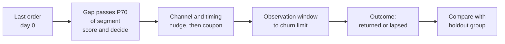
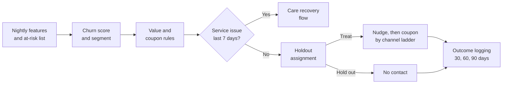

# Case Study 38: Customer Churn and Reactivation for Repeat Quick-Commerce Customers

**Domain:** Quick Commerce | **Problem Type:** Classification plus targeting | **Difficulty:** Intermediate

---

## 1. Business Context

### Company background

- Same company as earlier quick-commerce cases: **Jhatpat** (fictional), 320 dark stores in 9 cities, about 3 lakh orders a day, about 10.95 crore orders a year, about ₹480 basket, about ₹5,200 Cr GMV a year.
- About **38 lakh monthly transacting users** (MTU), placing about 2.4 orders a month on average (38 lakh x 2.4 x 12 = about 10.9 crore orders a year).
- Quick commerce is a **habit business**. A customer who orders 3 times a week for groceries and milk is worth far more than one who orders once a month.
- Today the CRM (customer relationship management) team sends a "We miss you, ₹100 off" coupon to every user after **30 days** without an order.

### The pain, with numbers

| Item | Value |
| --- | --- |
| Monthly transacting users | about 38 lakh |
| Users who lapse for good each month (no order for a long time, defined below) | about 2.28 lakh a month, about 27 lakh a year |
| Contribution margin per order (before acquisition cost, after delivery cost and discounts) | about ₹96 (20% of ₹480) |
| Users who get the "30 days quiet" coupon in a year | about 48 lakh events (many are light users whose normal gap is 30 days) |
| Redemption of the ₹100 coupon | about 33% |
| Coupon spend a year | about ₹15.8 Cr (48 lakh x 33% x ₹100) |
| Extra returners caused by the coupon (3.5 points above users with no coupon) | about 1.68 lakh |
| Value of a reactivated customer over the next 12 months | about 8 orders x ₹96 = about ₹768 |
| Extra margin from reactivation | about ₹12.9 Cr |
| **Net result of the blanket coupon** | **about minus ₹2.9 Cr a year** |

- The blanket coupon **loses money**. Most coupons go to people who would have returned anyway (they get a free discount), or to people who will never return.
- A second harm: users learn that going quiet for 30 days earns a coupon, so some **wait for the coupon** before ordering again.
- Targets: win back more of the right customers at a lower cost per returner, and stop paying people who would return anyway.

### Stakeholders and what each wants

| Stakeholder | What they want | What they fear |
| --- | --- | --- |
| Head of Growth and CRM | More reactivated customers per rupee | A smaller send-out that looks like lower activity |
| Finance | Coupon spend with a measurable return | Discount leakage and a rising cost per order |
| Head of Customer Experience | Customers who left after a bad experience handled with care | Marketing coupons sent to people who were let down by a late or missing order |
| Category teams | Return of the high-basket customers | Fewer orders in high-margin categories |
| Data privacy and legal | Messages sent only with consent, minimal data | DPDP Act 2023 issues and spam complaints |
| Engineering | A simple scoring and messaging flow | Heavy real-time pipelines |
| Customers | Useful reminders, not spam | Constant offers, and loss of trust in prices |

---

## 2. Translating Business to ML

### The business question vs the ML question

| Business question | ML question |
| --- | --- |
| "Who is about to stop ordering?" | "At the moment a customer's quiet period crosses a warning point, predict whether they will lapse for good (no order before their segment's churn limit)" |
| "Whom should we spend a coupon on?" | "Among at-risk users, who has the best expected net value: probability of lapse reduced by the offer, times future margin, minus coupon cost?" |
| "Which message, on which channel, when?" | "Choose between nudge only, nudge plus small coupon, and no action, per user, using a test-and-learn design" |

> **Mentor note:** Two models are hiding in this problem. The first (a **churn-risk classifier**) tells us who is drifting away. The second (**response to the offer**) tells us who changes behaviour because of it. A churn model alone gets you to the "sure losers" and "sure returners", and a coupon wasted on both. For the uplift method itself, see Case 3. Here we focus on how to define churn, how to build the risk model, and how to test with a holdout.

### Target definition: churn defined from the order-gap distribution

- **Inter-order gap:** days between two consecutive orders of a customer.
- A single "30 days" rule is wrong, because normal gaps differ a lot by segment. Define churn by the gap distribution of **each segment**.

| Segment (by orders in the previous 90 days) | Typical gap (median) | 95th percentile gap | Churn rule used |
| --- | --- | --- | --- |
| Heavy (8 or more orders a month) | 3 days | 17 days | No order for 21 days |
| Regular (2 to 7 orders a month) | 9 days | 33 days | No order for 35 days |
| Light (fewer than 2 orders a month) | 24 days | 72 days | No order for 75 days |

- **At-risk point:** the day the current gap passes the segment's 70th percentile gap (about 8 days for heavy, 15 days for regular, 40 days for light users). This is when we score and, if needed, act.
- **Label:** `lapsed = 1` if there is **no order** between the at-risk day and the segment's churn limit, else 0.
- About **4.2 lakh** users cross the at-risk point each month, and about **54%** of them lapse (about 2.27 lakh, matching the monthly figure above).

### Edge cases

| Edge case | Recommended treatment | Reason |
| --- | --- | --- |
| Customer moved to a city or area we do not serve | Exclude if the last address is unserviceable, or flag as "moved". Do not target | The customer did not churn, they left the service area |
| Customer had a bad last order (late, missing item, refund) | Route to a care-recovery flow (apology credit, call), not a marketing coupon | The cause is service, not interest |
| Seasonal gaps (students at hostels leave in May, festival travel, monsoon) | Use gap thresholds that vary by month for the segment, or a seasonality feature | A long gap may be expected |
| Customers who also order from a rival (multi-homing) | Treat as a normal pattern, aim at "share of wallet" for high-value customers | We will never own 100% of their orders |
| Customers who opted out of marketing | Score for analytics only, do not message | Consent is a legal requirement |
| New customers (fewer than 3 orders) | Out of scope, handled by the new-user flow (see Case 39) | Gap history is too short |

### Unit of prediction

- One **customer at an at-risk moment** (customer-event). A customer can appear more than once over a year, but not more than once in 60 days.

### Prediction timing



- Scoring runs once a day for users who crossed the at-risk point that day.
- Features use data up to the scoring day only.

### What success looks like

| Lens | Success |
| --- | --- |
| Business | Net margin from reactivation from about minus ₹2.9 Cr to about plus ₹6.5 Cr at full effect, about ₹7 Cr a year planned after a haircut. Cost per incremental returner under ₹300 |
| Model | Churn classifier AUC (how well it ranks lapsers above returners) about 0.80 and a lift of 1.4x in the top 40%. Calibrated risk by segment |
| Behaviour | No rise in "coupon-dependent" users (see section 7), and no increase in the share of users who delay orders after the programme starts |

---

## 3. Data Understanding

### Data sources and key features

| Feature group | Source | Why it matters |
| --- | --- | --- |
| Recency (days since last order), and gap vs own median gap | Order history | The strongest sign of drift |
| Frequency and its trend (orders in last 30, 60 and 90 days, slope) | Order history | Declining frequency comes before lapse |
| Basket (value, items, share of staples vs impulse, category mix) | Order lines | Staple buyers are habit customers |
| Service experience (late orders, missing items, refunds, rating in last 5 orders) | Delivery and support systems | Bad experiences cause quiet exits |
| App engagement (sessions without orders, searches with no result, cart abandons) | Clickstream | Still browsing means still interested |
| Price and promotion history (share of orders with a coupon, coupon-only orders) | Promo system | Separates habit from deal-seeking |
| Availability seen by the user (out-of-stock rate for their top items) | Catalogue and inventory | Missing favourite items can push users away |
| Location and store (area, store ID, new competitor launch, store changes) | Order and market data | Local effects |
| Marketing contact history (messages sent, opened, opt-in per channel) | CRM and messaging tools | Fatigue and consent |
| Customer tenure and acquisition channel | CRM | Long-tenure customers behave differently |

### Data volume, granularity and refresh

- **Volume:** about 4.2 lakh at-risk events a month, so about 50 lakh events a year. Use 12 to 18 months, about 60 to 75 lakh rows.
- **Granularity:** one row per customer-at-risk-event, with a snapshot of features on that day.
- **Refresh:** features refreshed nightly. Scoring daily. Model retrained monthly.

### Common data issues

| Issue | How it shows up here |
| --- | --- |
| Churn is defined by the absence of an event | The label is only known after the segment's limit (21 to 75 days later). Recent events are unlabelled |
| Segment boundaries move | A customer drifts from regular to light, so their limit changes during the window. Fix the segment at the at-risk day |
| Multiple accounts for the same person | A user orders from a second account for the coupon, and looks like a churner (see Case 40) |
| Coupon history confounded | Users who got coupons earlier are different from those who did not |
| Missing consent flags | Cannot message some users, and the share varies by channel |
| Survivorship | Looking only at active users hides those who left before the window |
| Seasonality | A May dip due to hostel exits looks like churn |

> **Mentor note: Where juniors usually go wrong here.**
>
> - They pick one churn rule (for example 30 days) for everyone. A heavy user is lost long before 30 days, and a light user is "churned" every month.
> - They train on all users and not on the at-risk moment, so the model learns the obvious (users who ordered yesterday will order again) and gives no help at the decision point.
> - They show a high AUC, then spend money on people who would have returned anyway, because the model has no idea about the effect of the coupon.

---

## 4. Approach and Decision Points

### Baseline first

- **Baseline 1 (current):** send the ₹100 coupon to every user with 30 days of silence. Net minus ₹2.9 Cr.
- **Baseline 2:** segment-aware rule: send at the segment's P70 gap to customers whose 90-day frequency is falling by 30% or more. No model.
- **Baseline 3:** a logistic regression on 10 to 15 recency, frequency and service features.
- **Why it matters:** the segment-aware rule alone fixes a large part of the waste. If a simple rule gets 60% of the gain, you know how much to expect from a boosted model.

### Candidate models

| Model | Pros | Cons | Verdict |
| --- | --- | --- | --- |
| Rule using gap vs own median gap | Transparent, fast to launch | Misses mixed signals | Baseline 2 and a fallback |
| Logistic regression | Interpretable, calibrated | Weak with interactions | Baseline 3 |
| **Gradient boosting (LightGBM) churn classifier** | Strong on tabular data, handles missing values, interactions (service x frequency trend) | Needs calibration | **Primary risk model** |
| Survival model (time until next order, with censoring) | Uses partial histories and gives "days until return" | More complex to explain | A good second view, and a candidate for the time-to-act |
| Sequence models on order gaps | Capture rhythm in detail | Heavy, hard to maintain | Only if tabular features plateau |
| Uplift or response model (see Case 3) | Targets those who change behaviour because of the offer | Needs randomised data | Use once a holdout test has produced the data |

### Decision scenarios

| What if... | Recommended action | Reasoning |
| --- | --- | --- |
| **Heavy users get a coupon after a late-delivery spike in their area** | Block marketing coupons for users with a bad order in the last 7 days, and send them to a care-recovery flow with a small apology credit | The cause is service. A discount sent to an upset customer feels like an insult, and fixes nothing |
| **After one month, the share of users who "wait for the coupon" rises** | Compare the time to next order for users who got a coupon last quarter with a matched group. Cap coupons at one per user per 60 days, make coupon value vary, and start with a free nudge before any coupon | Coupon-training is a real cost that A/B tests of one month cannot see |
| **A rival launches a 10-minute service in two of our cities** | Track churn by city separately. Do not retrain the model on the spike blindly, and test non-coupon actions (assortment, free delivery for the first week back) in those cities | The cause is a market shock, not customer behaviour. Coupons do not repair a missing advantage |
| **Light users have a P95 gap of 72 days and the model barely beats chance for them** | Use only low-cost channels (push, no coupon) for light users, and focus coupon money on regular and heavy users | The value per light user is small, the signal is weak, and it is not worth the coupon |
| **The model scores festival returners (Diwali visitors) as "high risk" every January** | Add a seasonal baseline (the segment's gap by month), and exclude one-off festival purchasers from the "regular" segment | The model confuses a seasonal pattern with churn |
| **Finance asks for a coupon cost cap of ₹4.5 Cr a year** | Rank at-risk users by expected net value (probability of being saved x 12-month margin minus coupon) and stop at the cap. Re-estimate the effect with the holdout | A cap forces a good rule: spend where the net value is highest |
| **A customer has two accounts, one of which stopped ordering** | Link accounts by device and phone (with the consent rules in Case 40), and treat them as one customer for churn | Otherwise the coupon is paid on an account that did not really churn |
| **Opt-in for WhatsApp is only 42% of users, push is 78%** | Plan channels as a ladder: push first, WhatsApp for opted-in, SMS only for the highest-value users | Channel reach limits the programme, and cost per message differs |

---

## 5. Feature Engineering

### Top 10 features to build

| # | Feature | Business logic |
| --- | --- | --- |
| 1 | Current gap divided by the customer's own median gap | Shows how unusual the silence is for this person |
| 2 | Orders in the last 30 days divided by orders in the 31 to 90 days before | Frequency trend, a falling ratio is a warning |
| 3 | Segment and gap percentile (P70, P95 position) | Anchors the label and the model to the segment |
| 4 | Staples share of the basket (milk, eggs, atta, vegetables) | Habit buyers are more valuable and stickier |
| 5 | Late or missing-item orders in the last 5 orders, and days since the last one | Service damage drives quiet exits |
| 6 | Sessions without an order in the last 14 days, and search misses | Still browsing means a chance to win back |
| 7 | Out-of-stock rate for the user's top 10 items in the last 14 days | Missing favourites push users to rivals |
| 8 | Share of past orders with a coupon, and gap after the last coupon | Distinguishes habit from deal-seeking, and flags coupon-training |
| 9 | Average basket value and margin per order, last 90 days | Used for the value side of the targeting decision |
| 10 | Marketing fatigue: messages sent and opened in the last 14 days, opt-in by channel | Limits spam and respects consent |

### Features to avoid (leakage and fairness risks)

| Feature | Problem |
| --- | --- |
| Anything after the at-risk day (orders, app opens, coupon redemptions) | Look-ahead leakage |
| "Order count in the next 30 days" used to define segment | Uses the future to define the segment |
| Uninstall events found after the fact | Known only later |
| Sensitive or proxy attributes (religion inferred from festival items, caste, health inferred from medicine purchases) | Legal risk under the DPDP Act, and unfair targeting |
| Precise location trail or contact-list data | More data than the purpose needs |
| Customer-care call content with personal details | Not needed, and sensitive |

A simple gap-based segment and at-risk flag:

```python
import pandas as pd

# orders: one row per order with columns customer_id, order_date
orders = orders.sort_values(["customer_id", "order_date"])
orders["gap_days"] = orders.groupby("customer_id")["order_date"].diff().dt.days

seg_limits = {"heavy": 21, "regular": 35, "light": 75}   # churn limits from P95 gaps
seg_p70 = {"heavy": 8, "regular": 15, "light": 40}       # at-risk points from P70 gaps

def label_event(row, next_order_date, segment):
    # lapsed = 1 if no order between the at-risk day and the segment limit
    window_end = row["at_risk_date"] + pd.Timedelta(days=seg_limits[segment] - seg_p70[segment])
    return int(next_order_date is pd.NaT or next_order_date > window_end)
```

---

## 6. Evaluation Strategy

### Metrics

| Metric | Role | Why |
| --- | --- | --- |
| **Incremental returners per 1,000 targeted** (vs holdout) | Primary business metric | The only real proof of reactivation |
| **Cost per incremental returner** | Primary business metric | Coupon spend divided by extra returners, target under ₹300 |
| AUC and lift in the top 20% and 40% | Model ranking quality | Tells how well the risk model concentrates real churners |
| Calibration of lapse probability by segment | Model reliability | The expected value maths needs honest probabilities |
| Net margin (extra orders x ₹96 minus coupon and messaging cost) | Finance | The full return |
| Delay in next order after a coupon, and repeat coupon use | Behaviour guardrail | Catches coupon-training |
| Complaint and unsubscribe rate | Customer guardrail | Spam and consent issues |

### Metrics that look good but are misleading here

- **Redemption rate of the coupon:** a high rate may mean we paid people who would have ordered anyway.
- **Overall AUC:** high because users who ordered yesterday are easy. Evaluate at the at-risk moment only.
- **Reactivation rate without a holdout:** 24% of silent users come back on their own, so a "31% reactivation" is a 7-point effect, not 31.
- **Churn accuracy:** 54% lapse, so a model that says "everyone lapses" is already 54% accurate.

### Validation strategy

| Step | Design | Why |
| --- | --- | --- |
| Time-based split | Train on months 1 to 12 events, validate on months 13 and 14, test on months 15 and 16, leaving a gap equal to the longest churn limit | Prevents the label from seeing the future |
| Per-segment evaluation | Report AUC, lift and calibration for heavy, regular and light | One overall number hides weak segments |
| City holdout | Check performance in the cities with a rival launch | Tests shocks |
| **Randomised holdout** | 10% of at-risk users (stratified by segment, city, channel) are never contacted. A further 10% get the nudge without a coupon | The only way to measure the real effect and the value of a coupon over a nudge |
| Long-window read | Measure at 30, 60 and 90 days after treatment, not only at 14 days | Pull-forward (the order would have happened anyway, just earlier) and coupon-training show up late |
| Rolling holdout | Keep a permanent 5% holdout after the launch | Allows continuous measurement |

### From model metric to business value

- **Targeting:** the top 40% of at-risk users by expected net value, about 1.68 lakh a month, so about 20.2 lakh a year.
- **Effect:** lapse rate for targeted users falls by about 7 points, about 11,760 extra retained customers a month, about 1.41 lakh a year.
- **Gross margin:** 1.41 lakh x ₹768 = about **₹10.8 Cr**.
- **Cost:** coupon ₹75, redeemed by about 27% = 5.44 lakh x ₹75 = about ₹4.1 Cr, plus messaging and tools about ₹0.2 Cr, so **about ₹4.3 Cr**.
- **Net at full effect:** about **₹6.5 Cr**, against minus ₹2.9 Cr today, a **swing of about ₹9.4 Cr a year**.
- **Plan on about ₹7 Cr (75%)**, to allow for coupon-training, fading effects and overlap with other CRM programmes.

---

## 7. Deployment and Monitoring

### Batch vs real time

- **Batch scoring daily** for users who crossed the at-risk point. There is no need for real time.
- **Message scheduling** by a campaign tool, with channel and time chosen by a simple rule set (see below).
- **Channel ladder:** push (free) first, then WhatsApp for opted-in users, then SMS for high-value users only (SMS carries a cost and needs registered templates under the telecom rules). Timing: just before the user's usual order hour, based on their history. For general push timing and volume, see Case 47.



### What to monitor

| Type | What to track | Alert trigger |
| --- | --- | --- |
| Model quality | AUC, lift and calibration by segment, monthly on labelled events | AUC below 0.75 or calibration off by 5 points |
| Effect | Incremental returners and cost per returner vs holdout | Cost above ₹400 or effect below 3 points |
| Coupon-training | Share of coupon-dependent users (more than 60% of orders with a coupon), time to next order after a coupon | A rise of 2 points in a month |
| Data | Feature null rates, share of users by segment, consent flags | Segment shares move by 3 points |
| Customer | Unsubscribe rate, complaints, opt-out of marketing | Above the baseline for 2 weeks |
| Fairness | Coupon allocation across cities and areas, with no use of sensitive attributes | A gap that quality or value cannot explain |
| Drift | PSI on gap and frequency features, churn rate by city | PSI above 0.2 |

### Retraining

- **Scheduled:** monthly, with labelled events that have passed their churn limit.
- **Triggered:** a new segment definition, a rival launch, a major pricing change, a change in the delivery fee (see Case 42).

### A/B test or champion-challenger design

- Randomise by **user** at the at-risk moment. Arms: control (no contact), nudge only, nudge plus coupon (model-selected), and the old blanket rule for a small share in month 1.
- Primary: incremental orders in 30 and 90 days, and net margin per targeted user. Guardrails: time to next order, repeat coupon use, unsubscribes.
- Because the effect of coupon-training builds slowly, keep the 5% holdout running for at least 6 months.

---

## 8. Stakeholder Communication

### Explain it to a non-technical leader

> "Today everyone who is quiet for 30 days gets ₹100 off. That is wasteful, because a daily-milk customer is lost after 3 weeks, while an occasional shopper is normal at 30 days. Many also would have come back anyway.
> The new approach sets the 'quiet' point for each customer based on their own habit. We message the ones at risk, start with a free nudge, and keep coupons for the customers who are worth it and likely to respond. A group we never contact tells us what really works.
> We expect to turn a loss of about ₹3 Cr into a gain of about ₹7 Cr a year."

### Questions leadership will ask

| Question | Suggested answer |
| --- | --- |
| "Why not just give everyone a coupon, it is only ₹100?" | "At 48 lakh sends and 33% redemption it is ₹15.8 Cr a year, and the extra orders are worth ₹12.9 Cr. We lose money, and we teach users to wait for coupons" |
| "How do we know who would have returned anyway?" | "We keep a 10% group that we never contact. The difference between the groups is the real effect" |
| "Will this make customers wait for discounts?" | "It is a risk, so we cap coupons to one per 60 days, start with a free nudge, and measure the delay in the next order against a matched group" |
| "Why different rules for different customers?" | "A customer who buys milk daily and one who buys once a month have very different normal gaps. A single rule will always be wrong for one of them" |
| "Is it fine under the privacy rules?" | "We use only order and app data we already hold for this purpose, message only opted-in users on each channel, and let users opt out. We do not use sensitive inferences" |
| "What about customers who had a bad delivery?" | "They go to a care-recovery flow with an apology, not a marketing coupon" |

---

## 9. Common Pitfalls and Lessons

| Mistake | Why it happens | How to avoid it |
| --- | --- | --- |
| One churn rule (30 days) for all customers | It is simple and matches the old policy | Define churn from each segment's gap distribution, and fix the segment at the at-risk day |
| Training on all users, not on the at-risk moment | Easier to build the dataset | Build an event dataset at the decision point |
| Using churn probability as the targeting score | It sounds right | Combine risk, value, cost and the expected response, ideally from a holdout (Case 3) |
| No randomised holdout | Teams feel it is wasteful to hold out | Hold out 10% at the start and keep 5% permanently |
| Measuring only the first 14 days | Early lift looks good | Read 30, 60 and 90 days, and compare time to next order |
| Training users to wait for coupons | Every programme gives a coupon | Cap frequency, vary the offer, nudge first, track coupon-dependent users |
| Sending a coupon to an unhappy customer | CRM and care run separately | Block marketing after a bad order, and send to the care flow |
| Ignoring consent and channel limits | The list looks like a free resource | Use opt-in flags per channel, respect the DPDP Act 2023, and keep message volume low |
| Treating a market shock as a model problem | Churn went up, so retrain | Look for cause (a rival, a price change, a stock-out) before blaming the model |

---

## 10. Mentor's Focus Checklist

- ✅ **Where to spend 80% of the effort:**
  - Defining churn from the segment's gap distribution, and building the event dataset at the at-risk moment.
  - Randomised holdout, long read windows and a permanent control group.
  - Expected net value (risk, response, value and cost) for allocation under a budget cap.
  - Guardrails for service issues, coupon-training, consent and message fatigue.
- ❌ **What not to over-engineer:**
  - Sequence deep learning on order gaps before a boosted tree with good recency and frequency features.
  - Fine optimisation of the send hour across millions of users. A rule on the usual order hour is enough.
  - A very complex coupon-value optimiser. Test three offer levels first.
- 💡 **Key takeaway:** **Define churn the way customers actually behave, and pay only for behaviour you change.** The test is not who comes back, but who comes back because of us, measured against a group we left alone.
