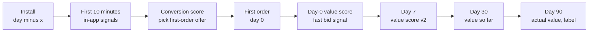
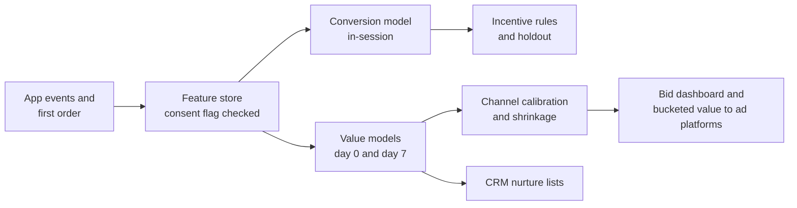

# Case Study 39: New-User First-Order Conversion and Early Lifetime-Value Prediction

**Domain:** Quick Commerce | **Problem Type:** Regression and classification for customer acquisition | **Difficulty:** Intermediate

---

## 1. Business Context

### Company background

- Same company as earlier quick-commerce cases: **Jhatpat** (fictional), 320 dark stores in 9 cities, about 3 lakh orders a day, about 10.95 crore orders a year, about ₹480 basket, about ₹5,200 Cr GMV a year.
- The app gets about **9 lakh new installs a month** (about 1.08 crore a year). About 55% come from paid channels (ads on social, search, video, influencers, app-store ads), and the rest from organic search, referrals and word of mouth.
- About **36% of installs place a first order within 7 days**, so about **3.2 lakh new customers a month**, about 38.9 lakh a year.
- New users get a **₹100 first-order incentive** on a minimum cart. Marketing buys installs from ad platforms at about ₹140 per paid install (CPI, cost per install).

### The pain, with numbers

| Item | Value |
| --- | --- |
| New installs a month | about 9 lakh |
| Installs to first order within 7 days | 36% |
| New first-order customers a year | about 38.9 lakh |
| Paid installs a year (55% of 1.08 crore) | about 59.4 lakh, at ₹140 = about ₹83 Cr |
| Marketing cost per new customer (₹83 Cr / 38.9 lakh) | about ₹214 |
| First-order incentive | ₹100 per new customer, about ₹39 Cr a year if all redeem |
| Total acquisition cost per new customer | about ₹314 |
| Mean 90-day orders per new customer | 3.1 |
| Mean 90-day contribution margin per new customer (3.1 orders x ₹480 x 20%) | about ₹298, about ₹300 |
| New-cohort 90-day contribution a year (38.9 lakh x ₹298) | about ₹116 Cr |
| Share of new customers who never reorder in 90 days | 45% |
| Share of 90-day value from the top 10% of customers | 52% |

- Every channel is bid on **installs**, not on value. A channel with cheap installs that never reorder looks good, while a channel with expensive installs that bring weekly shoppers looks bad.
- The same ₹100 incentive goes to every new user, including those who would have ordered anyway (for example a user who arrived by referral and added 8 items to the cart).
- Targets: bid on **predicted 90-day value**, and tune the first-order incentive by predicted conversion, to improve value per rupee of marketing spend.

### Stakeholders and what each wants

| Stakeholder | What they want | What they fear |
| --- | --- | --- |
| Head of Performance Marketing | Bids tied to value, a model they can feed into the ad platforms | A score that arrives too late, or that is too noisy to use |
| Head of Growth | More customers per rupee, a healthy payback period | Cutting incentives and losing volume |
| Finance | Payback within 4 months, fewer unprofitable channels | Optimistic LTV numbers used to justify spend |
| CRM team | Early identification of high-potential customers to nurture | Wasting offers on low-potential users |
| Product and Engineering | A clean feature pipeline, minimal tracking | Heavy SDKs and privacy trouble |
| Data privacy and legal | Clear purpose, consent, minimal data shared with ad platforms | DPDP Act 2023 violations from sending personal data to partners |
| Customers | Fair and simple offers | A feeling of being profiled |

---

## 2. Translating Business to ML

### The business question vs the ML question

| Business question | ML question |
| --- | --- |
| "Will this installer place a first order?" | "Predict the probability of a first order in 7 days from install-time and in-app signals, to decide the first-order incentive" |
| "How much is this new customer worth?" | "From the first order (day 0) and the first 7 days of behaviour, predict the 90-day contribution margin, and its uncertainty" |
| "How much can we pay to acquire a user like this?" | "Aggregate predicted value by channel, campaign and audience, and compare it to cost, to set bids" |

> **Mentor note:** There are three decisions and so three predictions: a **conversion score** for incentives, a **day-0 value score** for fast bids, and a **day-7 value score** for accurate reports and CRM. Do not try to make one model serve all three. The longer you wait, the better the prediction, but the later the decision. The craft is choosing the earliest moment at which the score is good enough to act on.

### Target definition

- **Conversion model:** `first_order_7d = 1` if the installer places an order within 7 days of install.
- **Value model:** `value_90d` = contribution margin from all orders in days 0 to 90 after the first order. Contribution is order margin minus discounts, delivery cost, refunds and payment fees, **not** GMV.
- **Two-part view:** `P(any repeat order in 90 days)` times `expected value given a repeat`, because 45% of customers are zero.
- **Interim target:** `value_30d`, used as a faster-learning proxy while 90-day labels mature.

### Edge cases

| Edge case | Recommended treatment | Reason |
| --- | --- | --- |
| Bulk buyers and resellers (a kirana shop buying at MRP, bulk orders over ₹3,000) | Flag by basket pattern, treat as a separate segment, and cap the value used for bids at the 99.5th percentile | A few huge customers distort averages and bids |
| Users who place the first order but cancel or return it | Count the net margin, and exclude fully refunded first orders | No real value |
| Referral users from existing customers | Treat as a channel with its own value and a referral cost | Often high value, but they also cost a reward |
| Multi-account users to get the first-order offer | Link accounts (see Case 40), keep the first account's history, and do not give a second incentive | Fraud and wrong LTV |
| New city launched this month | Use a prior from similar cities, widen uncertainty, and avoid high-confidence bids for 4 weeks | Launch offers inflate early orders |
| Users who decline marketing consent or ad tracking | Use only on-device and first-party aggregates, no individual signal to ad platforms | Legal and platform rules |
| Customers who return after 60 days | Keep as part of the value. A 90-day window is a choice, not a law | Long-horizon value matters for bids |

### Unit of prediction

- **Conversion:** one **install** (before the first order).
- **Value:** one **new customer** at day 0 and again at day 7.

### Prediction timing



- The conversion score must run in under 300 ms inside the app session.
- The day-0 and day-7 value scores run in a daily batch, and are sent as **bucketed values** to ad platforms where consent exists.

### What success looks like

| Lens | Success |
| --- | --- |
| Business | About 6% higher 90-day value per new customer at the same spend through better bids (about ₹7.0 Cr) and about ₹3.1 Cr net from smarter incentives. About ₹7 Cr a year after a haircut |
| Model | Day-7 value model: Spearman correlation about 0.55 with actual 90-day value, top-decile lift of about 3.5x, and **calibration within 5% by channel** |
| Governance | No sensitive attribute used, minimal data sent to partners, consent flag checked before any sharing |

---

## 3. Data Understanding

### Data sources and key features

| Feature group | Source | Why it matters |
| --- | --- | --- |
| Acquisition (channel, campaign, creative, device type, city, install hour, referral) | Attribution tool and app | Different channels bring different customers |
| First-order basket (value, items, staples share, fresh share, coupon used, add-on items) | Order system | The strongest early signal of habit |
| First 7 days behaviour (sessions, searches, carts, second-order intent, notification opens) | Clickstream | Intent for a second order |
| Service experience (delivery time vs promise, missing items, substitutions, refund) | Delivery and support systems | A bad first experience kills repeat |
| Availability and assortment seen (out-of-stock rate for items searched) | Catalogue | Missing items reduce repeat |
| Location context (store, area type, apartment or house, nearby store density) | Address and store data | Stores in dense areas lead to faster repeat |
| Marketing exposure (messages, offers, opt-ins) | CRM | Interactions with value |
| Consent flags and device permissions | Consent store | Controls what can be used and shared |
| Actual value labels (30-day and 90-day contribution) | Order, refund and finance data | Training targets |

### Data volume, granularity and refresh

- **Volume:** about 3.2 lakh new customers a month. With 12 cohorts that have matured (90 days of history), that is about 38 lakh labelled customers. Conversion model: about 1.08 crore installs a year.
- **Granularity:** one row per install and one per new customer, with feature snapshots at day 0 and day 7.
- **Refresh:** conversion features in real time in-session. Value scores daily. Models retrained monthly.

### Common data issues

| Issue | How it shows up here |
| --- | --- |
| The target arrives late | A customer acquired today has a 90-day label only in 3 months. The training data always lags the market |
| Heavy-tailed value | 45% have zero repeat, top 10% make 52% of the value, and a few bulk buyers sit far above |
| Cohort drift | A new channel (for example a cricket-season video campaign) brings users who look different from past cohorts |
| Attribution errors | Last-click wrongly credits channels. Some installs show as "organic" because tracking was blocked |
| Launch and festival distortions | A city launch or Diwali week lifts first orders and first-week orders |
| Selection through incentives | Users with a bigger first-order incentive behave differently, and the incentive affects the labels |
| Missing data from consent | Some users share no ad identifier, so channel data is blank |
| Seasonality of repeat | Monsoon lifts repeat, summer holidays lower it |

> **Mentor note: Where juniors usually go wrong here.**
>
> - They train a regression on mean squared error with raw value. The model chases a few huge buyers, and predicts about ₹300 for everyone else. The top and bottom customers look the same.
> - They use features from after day 7 (a second order on day 12) and get a lovely R-squared that cannot be used when the bid is placed.
> - They report one overall calibration number. The model is on average right, but 25% too high for the new influencer channel, and that is where money is being spent.

---

## 4. Approach and Decision Points

### Baseline first

- **Baseline 1 (current):** all channels valued by average 90-day value of the last cohort, and installs bought at the lowest CPI.
- **Baseline 2:** value by channel x city x first-order basket band (small, medium, large), using historical means. Transparent and very strong for a first version.
- **Baseline 3:** a regularised linear or logistic model on 20 features.
- **Why it matters:** a group-average table often gets 60% to 70% of the achievable lift in ranking. If the model does not beat it, do not ship it.

### Candidate models

| Model | Pros | Cons | Verdict |
| --- | --- | --- | --- |
| Group-mean table (channel x city x basket band) | Simple, stable, easy to audit | Misses behaviour within the group | Fallback and benchmark |
| Linear model on log value | Fast, interpretable | Weak on interactions | Baseline 3 |
| **Two-part model: classifier for repeat, regressor for value given repeat (LightGBM)** | Handles the 45% zeros and the skew naturally | Two models to calibrate | **Primary value model** |
| Tweedie or zero-inflated regression (single model) | One model for zeros plus a heavy tail | Harder to tune | Good alternative |
| Quantile models (P10, P50, P90 of value) | Gives risk for bids | More models | Useful for channels with high variance |
| BG/NBD and Gamma-Gamma (probabilistic LTV models) | Built for repeat purchase, work with little data | Do not use rich features | Strong benchmark for the repeat part |
| Neural nets on event sequences | Learn from raw sessions | Heavy, data hungry, hard to explain | Only if the tree models plateau |

### Decision scenarios

| What if... | Recommended action | Reasoning |
| --- | --- | --- |
| **45% of new customers have zero repeat and the top 10% hold 52% of value** | Use the two-part model, train the value part on log value or with a Tweedie loss, cap target values at the 99.5th percentile, and evaluate with decile gains and lift, not RMSE | Squared error on a heavy tail trains the model to chase outliers |
| **A new influencer campaign brings 40,000 users in a week with no history** | Start with a conservative value (the blended average shrunk towards the channel family), widen the uncertainty, and move to day-7 signals for that campaign after 2 weeks. Do not raise bids on a hunch | The model has never seen this cohort. Use shrinkage, and wait for fast evidence |
| **The 90-day label is 3 months late, and the channel mix changed last month** | Train on matured cohorts, add a **day-30 value model** as an interim proxy, and check how well day-30 predicts day-90 in older cohorts. Use the proxy for bids with an explicit discount | The long target cannot be fast. A proxy trades accuracy for timeliness, and we should measure that trade |
| **Predicted value is 20% too high for influencer installs but right for search** | Calibrate per channel (isotonic regression or a scale factor on the channel level), re-check monthly, and report calibration by channel in every dashboard | Bids are decided per channel, so errors by channel matter, not the overall average |
| **Ad platforms ask for a value signal for each install** | Send a **bucketed predicted value** (for example five tiers) with a delay, only for consented users, and without raw features or personal fields | Minimal data and reduced re-identification risk. The platform needs ranking, not exact numbers |
| **High predicted LTV users would have come anyway (referrals, organic search)** | Do not raise incentives or bids for them. Use incrementality tests (geo or audience holdout) before moving budget. See Case 59 for budget allocation | High value is not the same as high incrementality. Paying more for sure customers wastes money |
| **Users with a high conversion score get no incentive and conversion drops by 6 points in that group** | Cap the incentive cut to a smaller group (top 20%), randomise a holdout that keeps the incentive, and measure net of the saving | Withholding incentives has a real cost. Do it where the model is confident, and test it |
| **Bulk buyers (resellers) in the top 0.5% make up 9% of predicted value** | Create a separate segment, exclude them from consumer LTV models, and apply a separate policy (limits, B2B channel) | They mislead bids and break the model's calibration |
| **Low first-order basket users with a ₹100 coupon get flagged as "low LTV"** | Check whether the low value is caused by the coupon (coupon hunters), or by real low intent, using a small randomised test of a different incentive | Using the coupon as a feature can make the score punish the very incentive we gave |

---

## 5. Feature Engineering

### Top 10 features to build

| # | Feature | Business logic |
| --- | --- | --- |
| 1 | First-order basket value and number of lines | Bigger first baskets often mean stocking-up intent |
| 2 | Share of staples and fresh items in the first basket | Habit categories drive repeat |
| 3 | Sessions and searches in the first 7 days after the order | Return visits predict the second order |
| 4 | Whether a second cart was built within 72 hours | Strong early sign of repeat |
| 5 | Delivery time vs promise and any missing item in the first order | First experience, a main driver of repeat |
| 6 | Acquisition channel, campaign family and creative type (target-encoded with smoothing) | Channels carry different value |
| 7 | City, store and area density | Faster and cheaper delivery lifts repeat |
| 8 | First-order coupon dependence (order value without coupon vs with) | Signals deal-seeking vs real need |
| 9 | Notification opt-in and open rate in the first week | Reachability for later nurturing |
| 10 | Install-to-order delay and time of day | Fast converters tend to be more engaged |

### Features to avoid (leakage and ethics risks)

| Feature | Problem |
| --- | --- |
| Orders or sessions after day 7 | Not known when the score is needed |
| 90-day outcome used in channel encodings from the same cohort | Target leakage through the encoding. Use out-of-fold encodings |
| Raw contact lists, SMS content, or full location trail | More data than needed, high privacy risk under the DPDP Act |
| Inferred income, religion, health or family status from baskets | Sensitive, unfair, and may be illegal to act on |
| Device price as a proxy for wealth, used for price or incentive | Can lead to unfair treatment, and a bad customer experience |
| Cohort calendar features such as "month of install" without care | Teaches the model last year's seasonality as fact |

A two-part value model with an expected value:

```python
import lightgbm as lgb
import numpy as np

# X_train: day-7 features. repeat: 1 if any repeat order in 90 days. value: 90-day contribution
clf = lgb.LGBMClassifier(n_estimators=300, learning_rate=0.05)
clf.fit(X_train, repeat_train)

mask = repeat_train == 1
cap = np.quantile(value_train[mask], 0.995)             # cap the heavy tail
reg = lgb.LGBMRegressor(n_estimators=300, learning_rate=0.05)
reg.fit(X_train[mask], np.log1p(np.minimum(value_train[mask], cap)))

p_repeat = clf.predict_proba(X_new)[:, 1]
value_if_repeat = np.expm1(reg.predict(X_new))          # note: smearing correction is still needed
expected_value = p_repeat * value_if_repeat + (1 - p_repeat) * first_order_margin
```

---

## 6. Evaluation Strategy

### Metrics

| Metric | Role | Why |
| --- | --- | --- |
| **Calibration by channel** (sum of predicted vs sum of actual value, for each channel and campaign family) | Primary for bids | Bids work on channel totals, so channel bias costs money |
| Decile gains and top-decile lift | Primary for ranking | Shows whether the top 10% really holds about half of the value |
| Spearman rank correlation | Ranking | Robust to the heavy tail |
| Normalised Gini or cumulative gains curve | Ranking | A single number for ranking quality on skewed targets |
| MAE on log value, or pinball loss for quantiles | Model fit | Less affected by outliers than RMSE |
| AUC and calibration of the first-order conversion score | Conversion model | Drives the incentive decision |
| Value per rupee of marketing spend and payback days | Business | The final return |
| Incrementality (holdout lift on orders and value) | Causal check | Tells whether predicted value is also incremental |

### Metrics that look good but are misleading here

- **RMSE and R-squared on raw value:** dominated by a handful of big buyers, and hide the failure for 90% of customers.
- **Overall calibration:** may be perfect on average and wrong for the new channel that takes the budget.
- **Predicted LTV of the whole base:** useless without a comparison to acquisition cost by channel.
- **Conversion AUC alone:** a high AUC with a poor calibration leads to wrong incentive choices.

### Validation strategy

| Step | Design | Why |
| --- | --- | --- |
| Cohort-based time split | Train on cohorts 1 to 9, validate on cohort 10, test on cohorts 11 and 12 (each matured for 90 days) | Matches deployment and avoids future leakage |
| Channel-held-out test | Train without one channel, test on it | Estimates behaviour for a channel the model has not seen |
| City-held-out test | Hold out 1 or 2 cities | Tests new-city generalisation |
| Calibration by channel, city and week | Reliability tables with confidence bands | Finds hidden bias |
| Proxy test | Check how well day-7 and day-30 predictions match day-90 values on older cohorts | Measures the cost of acting early |
| Incrementality test | Geo or audience holdout for channels shifted by the model | Proves value is caused, not just selected |
| Online test | Randomise bid strategy by campaign pair, and incentive level by user | Measures the actual business effect |

### From model metric to business value

- **Bids:** shifting spend towards channels and audiences with higher predicted value, at the same total spend, lifts 90-day value per new customer by about 6%. Cohort 90-day contribution is about ₹116 Cr, so 6% = about **₹7.0 Cr**.
- **Incentives:** for the 20% of new users with the highest conversion score (about 7.8 lakh a year), cut the incentive from ₹100 to ₹50. Conversion in that group drops by 3 points, which loses about 23,000 customers x ₹300 = about ₹0.7 Cr. The saving is 7.8 lakh x 97% x ₹50 = about ₹3.8 Cr. Net **about ₹3.1 Cr**.
- **Gross: about ₹10 Cr a year.** We plan on **about ₹7 Cr (70%)**, because predicted value is not always incremental, and cohort drift erodes accuracy.

---

## 7. Deployment and Monitoring

### Batch vs real time

- **Real time** for the conversion score in the first session (under 300 ms), used to pick the first-order incentive.
- **Daily batch** for day-0 and day-7 value scores, aggregated by channel and campaign for the marketing team and the bidding tool.
- **Monthly** retraining and recalibration, with a weekly calibration check by channel.



### What to monitor

| Type | What to track | Alert trigger |
| --- | --- | --- |
| Calibration | Predicted vs actual value by channel, weekly for matured cohorts | Off by more than 8% for any channel with over 10% of spend |
| Ranking | Decile lift and Spearman on matured cohorts | Spearman below 0.45 |
| Cohort drift | Mix of channels, baskets and cities for new cohorts, PSI on top features | PSI above 0.2 or a new channel above 5% of installs |
| Proxy gap | Day-30 vs day-90 relation | Ratio shifts by 10% from history |
| Conversion model | AUC, calibration and incentive cost per converted user | Conversion in the "no big incentive" group below the test band |
| Business | Value per rupee of spend, payback days, CAC | Payback above 4 months |
| Privacy and consent | Share of records sent to partners with consent, fields shared, retention | Any record without consent, any extra field |
| Fairness | Incentives and offers by city and device tier, with no use of sensitive traits | Gaps that cannot be explained by behaviour |

### Retraining

- **Scheduled:** monthly, on the latest matured cohorts, with the proxy model retrained weekly.
- **Triggered:** a new channel or creative family above 5% of installs, a new city launch, a change in the first-order offer, or a change in ad-platform rules that affects attribution.

### A/B test or champion-challenger design

- **Bids:** paired campaigns or geo splits, with one half bid on installs (champion) and the other half on predicted value (challenger). Read at day 90 for value and day 30 for early signals.
- **Incentives:** randomise by user. Arms: ₹100 (control), ₹50 for model-selected high-conversion users, and a ₹50 holdout.
- Primary: 90-day contribution per rupee of marketing spend, and payback days. Guardrails: first-order conversion, refund rate, opt-outs.

---

## 8. Stakeholder Communication

### Explain it to a non-technical leader

> "We pay for installs, but what we really want is customers who keep ordering. About 45% of new customers never order again, and the top 10% bring about half of the value.
> The new model looks at the first order and the first week and estimates what each new customer will be worth in 90 days. Marketing can then pay more for channels that bring good customers and less for those that do not, and we can cut the first-order offer for people who will order anyway.
> We expect about ₹7 Cr a year at the same spend, and we share only grouped value scores with ad platforms, and only for users who agreed."

### Questions leadership will ask

| Question | Suggested answer |
| --- | --- |
| "Why not wait for the real 90-day number?" | "It arrives 3 months late, after the money is spent. The day-7 score is right about as often as it needs to be to rank channels, and we check it against the real number every month" |
| "Why is the average not enough?" | "The average hides that half of the value sits in 10% of customers. Two channels with the same average can have very different good customers" |
| "Is predicted value the same as the value we create by marketing?" | "No. Some high-value users would have come anyway. We test with holdouts before moving large budgets" |
| "What if a new channel behaves differently?" | "We start with a cautious value and wider uncertainty, and update after 2 weeks of real behaviour" |
| "What data do we share with ad platforms?" | "A bucketed value tier, only for users who consented, and nothing else. We do not send contacts, location trails or any sensitive information" |
| "Is it fair to give some new users a smaller offer?" | "The offer is based on how likely they are to order without it, not on who they are. We watch that no group is treated worse without a behavioural reason" |

---

## 9. Common Pitfalls and Lessons

| Mistake | Why it happens | How to avoid it |
| --- | --- | --- |
| Predicting raw value with squared error | It is the default regression | Two-part model, log or Tweedie loss, capped targets, and gain-based evaluation |
| Using post-day-7 features | The order history is available in the data warehouse | Tag each feature with its availability day, and cut at day 0 or day 7 |
| Judging only overall calibration | One number is simple | Calibrate and report by channel, city and week |
| Ignoring cohort drift | The model worked last quarter | Monitor channel mix and PSI, shrink new channels to a prior, retrain monthly |
| Treating predicted LTV as incrementality | High value feels like high return | Run holdouts and geo tests before shifting large budgets (see Case 59) |
| Using the coupon as a signal of low value | The data shows coupon users reorder less | Test whether low value is caused by the coupon, and avoid reinforcing it |
| Sending too much data to ad platforms | Platforms ask for rich signals | Bucketed values, consent checks, purpose limits, and no sensitive attributes |
| Mixing bulk buyers into consumer LTV | They are in the order data | Separate segment, cap the tail, and keep them out of training |
| Reporting predicted LTV as a fact in board packs | A model output looks like a number | Show ranges, calibration, and the proxy gap, and compare with matured actuals |

---

## 10. Mentor's Focus Checklist

- ✅ **Where to spend 80% of the effort:**
  - The target and the timing: contribution (not GMV), a two-part view, day-0 and day-7 scores, and a day-30 proxy.
  - Calibration by channel and a plan for new channels (shrinkage and fast evidence).
  - Heavy-tail handling: caps, log loss or Tweedie, and gain-based evaluation.
  - Holdout and incrementality tests, so that predicted value turns into real value.
  - Consent, data minimisation and what is shared with ad platforms.
- ❌ **What not to over-engineer:**
  - Deep sequence models on session data before a two-part boosted tree with good first-week features.
  - Exact 90-day value for each customer. A good ranking and honest channel totals are enough for bids.
  - Complex per-user incentive optimisation. Start with 2 or 3 offer levels by conversion band.
- 💡 **Key takeaway:** **Predict early, calibrate where the money is spent, and prove it is incremental.** An LTV score is useful only if it arrives in time to change a bid, is honest for each channel, and was built with the minimum data needed.
