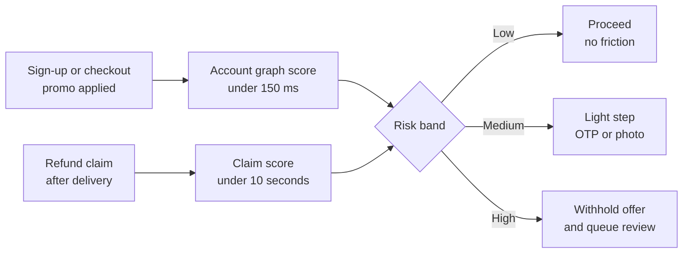
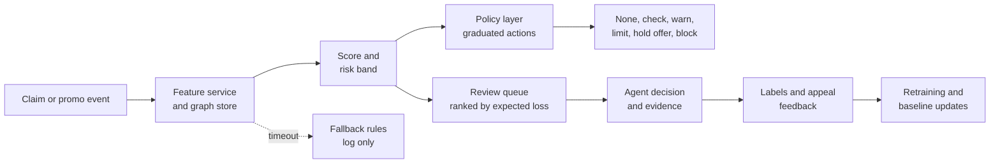

# Case Study 40: Promo and Coupon Abuse and Refund Fraud

**Domain:** Quick Commerce | **Problem Type:** Classification plus graph and behaviour anomaly detection | **Difficulty:** Advanced

---

## 1. Business Context

### Company background

- Same company as earlier quick-commerce cases: **Jhatpat** (fictional), 320 dark stores in 9 cities, about 3 lakh orders a day, about 10.95 crore orders a year, about ₹480 basket, about ₹5,200 Cr GMV a year.
- Two money leaks sit in the customer promise:
  - **Promo abuse:** new-user offers, referral rewards and free-delivery coupons used by people who create many accounts (multi-account abuse).
  - **Refund fraud:** "missing item" or "damaged item" claims that are false, and serial refunders who claim far more than normal.
- Refunds are instant for most claims. Customers like this. The speed that wins customers is the speed that abusers use.
- This case is about **customer-side abuse of promotions and refunds**. For payment fraud (UPI and cards), see Case 2. For rider-side GPS fraud, see Case 49.

### The pain, with numbers

| Item | Value |
| --- | --- |
| Refund claims a year (3.1% of 10.95 crore orders) | about 33.9 lakh |
| Claims approved (82%) | about 27.8 lakh, average about ₹150 each |
| Refund payout a year | about ₹41.7 Cr (about 0.8% of GMV) |
| Share of approved claims that are abusive (by count) | about 8% (about 2.2 lakh claims, about ₹225 each) |
| Refund abuse a year | about ₹5.0 Cr (about 12% of refund payout) |
| New-user and promo spend a year | about ₹58 Cr |
| Promo abuse (multi-account and coupon stacking), about 14% of that spend | about ₹8.1 Cr |
| **Total estimated abuse** | **about ₹13.1 Cr a year** |
| Current controls | Fixed rules (one new-user coupon per device, a cap of 3 refunds a month per account), and a manual review team of 40 agents |
| Honest customers wrongly blocked or limited by current rules | about 31,000 a year |
| Estimated harm per wrongly actioned honest customer (35% leave, about ₹450 of future margin at stake) | about ₹157 |

- The current rules catch about ₹3.2 Cr of abuse, but wrongly act on about 31,000 honest customers, which costs about ₹4.9 Cr in lost future margin. **The rules lose about ₹1.7 Cr a year** and create complaints.
- Abusers are a small group. About 0.4% of customers produce about 21% of refund value. But a **genuine store error** (picker forgot an item) produces the same "missing item" claim, so a high refund rate does not always mean fraud.
- Targets: prevent more of the abuse, and **reduce the number of honest customers who face friction**.

### Stakeholders and what each wants

| Stakeholder | What they want | What they fear |
| --- | --- | --- |
| Head of Risk | Lower abuse with measurable results | Abusers who adapt and move to the next gap |
| Head of Customer Experience | Fast, fair refunds, few angry honest customers | Social media posts about wrongly blocked accounts |
| Head of Growth | New-user offers that reach real new users | Tighter checks that cut sign-up conversion |
| Store and operations leaders | Credit for genuine store errors, not blame on customers | Customers being punished for the store's mistakes, and hidden store quality problems |
| Finance | Lower leakage in promo and refund lines | Savings that disappear in lost customers |
| Legal and compliance | Clear reasons for actions, a way to appeal, privacy care | DPDP Act 2023 issues, consumer complaints, unfair treatment |
| Review team | A short, ranked queue with evidence | An overloaded queue and blame for model errors |
| Honest customers | Quick refunds when something is really missing | Being treated as a cheat |

---

## 2. Translating Business to ML

### The business question vs the ML question

| Business question | ML question |
| --- | --- |
| "Is this a real new user, or one person with many accounts?" | "At sign-up and at checkout, score the chance that this account belongs to a linked group that already took the new-user offer" |
| "Is this refund claim genuine?" | "At claim time, predict the probability that the claim is abusive, given the claim, the order, the customer's history and the store's normal error rate" |
| "Is this customer a serial refunder?" | "Compare the customer's claim count with what is expected for their orders, items and stores, and flag a large unexplained excess" |
| "What should we do about it?" | "Choose the mildest effective action (none, check, warn, limit, block) by risk and by the cost of a mistake" |

> **Mentor note:** This is not a plain fraud classifier. The metric that matters is the **total cost of friction plus loss**. A model that stops 90% of abuse but upsets 60,000 honest customers loses money. So the design starts with graduated actions and the cost of each error, and the model comes second.

### Target definition

- **Promo abuse (account-level):** `abusive_account = 1` if the account is confirmed (by review or strong rules) to belong to a group of accounts created to take the same offer repeatedly.
- **Refund abuse (claim-level):** `abusive_claim = 1` if the claim is confirmed false by evidence (the delivery photo, packed-item weight, picker scan log, repeat pattern, or customer admission).
- **Serial refunder (account-level):** a risk score based on excess claims against an expected rate.
- **Labels come from two sources:** manual review of flagged cases, and a **random audit** of 1% of claims that were not flagged. Without the random audit, the model only learns what the old rules already flagged.

### Edge cases

| Edge case | Recommended treatment | Reason |
| --- | --- | --- |
| Family members or flatmates who share a device, Wi-Fi, address or UPI handle | Do not link on one weak signal. Require two or more strong signals, and weigh shared nodes by how rare they are | Many honest households look like "linked accounts" |
| Large address with many customers (hostel, PG, office, gated society) | Treat the address as a hub. Down-weight it, and use flat or tower level only with extra signals | One address with 400 accounts is normal, not fraud |
| Genuine store error (picker missed an item, wrong substitute) | Use store-level and picker-level error rates as a baseline. Auto-approve claims for items with high store error rates | Genuine errors cluster by store and by hour |
| New customer's first claim | Approve by default for small amounts, review only on strong signals | Wrongly blocking new customers is the most expensive error |

### Unit of prediction

- **Promo abuse:** one **account** at sign-up and at each promo use.
- **Refund abuse:** one **claim** at claim time, and one **account** (rolling) for the serial pattern.

### Prediction timing



- The **promo score** sits on the checkout path, so it must be fast (under 150 ms).
- The **refund score** can take a few seconds, but instant refunds are a customer promise, so low-risk claims are approved at once.

### What success looks like

| Lens | Success |
| --- | --- |
| Business | Prevented abuse up from about ₹3.2 Cr to about ₹7.0 Cr a year. Honest customers wrongly actioned down from about 31,000 to about 18,000. Net gain swing of about ₹5.0 Cr, plan on about ₹3.5 Cr |
| Model | Precision above 70% at the action thresholds for "limit" and "block", recall of about 50% of abusive value, and stable precision across areas |
| Customer | No rise in complaints about refunds, share of reviews overturned on appeal under 15%, claim approval time unchanged for low-risk customers |

---

## 3. Data Understanding

### Data sources and key features

| Feature group | Source | Why it matters |
| --- | --- | --- |
| Account identity signals (phone number, email pattern, sign-up time, referral code used) | Account system | Links and bursts of sign-ups |
| Device signals (device ID, app install ID, OS, emulator flags, SIM changes) | App SDK | Strong link between accounts |
| Address signals (normalised address, building, flat, pin code, geo-hash of delivery point) | Order system | Delivery to the same flat from many accounts |
| Payment signals (UPI handle hash, card token fingerprint, wallet) | Payment gateway, NPCI rails and tokens | Shared instruments link accounts. Use tokens and hashes, not raw numbers |
| Order and item details (items, weights, fragile flags, substitutions, picker scan log, packing photo if any) | Order and store systems | Evidence for or against a missing item |
| Claim behaviour (claim count, share of orders claimed, time from delivery to claim, claim channel, amount) | Support and refund systems | Pattern of use |
| Store and area baselines (refund rate by store, hour, item, picker; late-delivery rate) | Operations data | Separates genuine errors from abuse |
| Promo history (offers used, stacking, redemption speed, referral chains) | Promo engine | Promo abuse patterns |

### Data volume, granularity and refresh

- **Volume:** about 33.9 lakh claims a year, about 2.8 lakh a month. Confirmed abusive claims are about 8% of approved claims, so about 22,000 a month, but only the reviewed ones carry a reliable label. Accounts: about 1.2 crore registered, with about 38 lakh active in a month.
- **Granularity:** claim-level and account-level tables, and an **edge list** (account to device, address, payment, referral) for the graph.
- **Refresh:** graph updated every few minutes, claim features in real time, labels weekly after reviews, model refreshed every 2 to 4 weeks.

### Common data issues

| Issue | How it shows up here |
| --- | --- |
| Label bias | Reviewers only see flagged cases, so the labels reflect what the old rules caught |
| Confirmed-fraud delay | Some abuse is found weeks later, when the account has stopped |
| Weak identifiers | Device IDs can be reset, SIMs change, and addresses are typed in many ways |
| Giant connected components | One shared building address connects thousands of honest accounts into a single cluster |
| Store-error contamination | A store with a bad picker produces many true claims, and they look like abuse |

> **Mentor note: Where juniors usually go wrong here.**
>
> - They link accounts by any shared field, get one huge cluster, and call it a "fraud ring". Shared building addresses and family devices produce this every time.
> - They compute the refund rate of a customer without comparing it to the store, the item and the hour. The customer in a store with a 6% picker error rate is not a fraudster.
> - They train only on reviewed flags, then are surprised the model catches only what the rules caught. The random audit is how you see the truth.

---

## 4. Approach and Decision Points

### Baseline first

- **Baseline 1 (current):** one new-user coupon per device, a cap of 3 refunds a month per account, manual review. Prevents ₹3.2 Cr, acts wrongly on 31,000 honest customers.
- **Baseline 2:** an **expected-claims** model (Poisson-style rate given orders, items, store and hour), with a shrinkage estimate of each customer's excess claims. No machine learning on labels, and very transparent.
- **Baseline 3:** account-linking by strong keys only (device plus payment, or device plus address plus phone prefix), with weighted component size.
- **Why it matters:** baselines 2 and 3 are explainable, and they fix a large part of the false positives in the current rules.

### Candidate models

| Model | Pros | Cons | Verdict |
| --- | --- | --- | --- |
| Expected-claims baseline with empirical Bayes shrinkage | Fair to customers in high-error stores, transparent | Needs good store and item baselines | Core feature for refund scoring |
| **Gradient boosting classifier on claim and account features** | Accurate, handles mixed features, fast | Needs labels and a random audit | **Primary supervised model** |
| Graph features (component size, degree, weighted shared nodes, graph embeddings) | Finds coordinated multi-account behaviour | Risk of giant components and mislinks | Add as features, with weights |
| Community detection or graph neural network | Finds rings with little labelled data | Heavy, hard to explain, risk of false links | Only for investigation tools first |
| Unsupervised anomaly detection (isolation forest on behaviour) | Works with no labels, finds new patterns | Noisy, many false alerts | Use for discovery and for review queues |

### Decision scenarios

| What if... | Recommended action | Reasoning |
| --- | --- | --- |
| **A store has a picker-error rate of 6.5% on eggs last week, and customers claim missing items at twice the normal rate** | Compute expected claims by store, item and hour, and approve claims with no friction when the store baseline is high. Send the store-level problem to operations. Score customers only on excess over the local baseline | The refund spike is the store's fault. Treating customers as suspects creates both a loss and a complaint |
| **Two hundred accounts share one hostel address, and 40 of them use the same Wi-Fi-linked device ID** | Down-weight the shared address (weight inversely to its degree), require device plus payment or referral chain for a link, and cap the cluster size before any action | A hostel is not a fraud ring. The device share is the only strong signal here |
| **The review team can handle only 1,500 cases a day, but the model flags 4,000** | Rank by expected loss (probability x amount x repeat chance), and send the middle band for light friction (photo upload, OTP) instead of manual review | Review capacity is a hard limit. The best use is high-value, high-uncertainty cases |
| **A customer with 14 claims in 40 orders is also a genuine heavy user of fragile items in one flaky store** | Compare with expected claims by item and store, then check the evidence (photos, weights). Act with a warning or a refund-to-wallet policy, not a block | Rate alone is not proof. The mildest action that works comes first |
| **After we cap refunds at 3 a month, abuse moves to many accounts with 2 small claims each** | Treat it as adaptation. Move from account caps to graph-level and device-level patterns, randomise some thresholds and checks, and do not publish rules. Track displacement (new accounts per blocked group) | A single rule is learned in weeks. A mix of signals and unpredictable checks is harder to avoid. For general rules vs model adaptation, see Case 2 |
| **A model flags a pin code area as high-risk, and customers there are mostly low-income households** | Do not use pin code or neighbourhood as a direct feature. Test whether flag rates differ by area after controlling for store error rates, and review disparities | Area-based treatment can punish genuine customers who have worse service. It is also a fairness and reputation risk |
| **A blocked customer posts on social media and files a consumer complaint** | Offer an appeal path with a reason code, a 48-hour review by a human, and restore the account fast if the appeal is valid. Track overturn rates by reason | Honest customers will be wrongly flagged. The appeal path is the safety net, and it creates labels |

---

## 5. Feature Engineering

### Top 10 features to build

| # | Feature | Business logic |
| --- | --- | --- |
| 1 | Excess claims: actual claims minus expected claims (by store, item mix, hour), shrunk towards zero for new customers | Separates unusual customers from unlucky ones |
| 2 | Share of orders claimed in the last 30, 90 and 180 days, and time from delivery to claim | Serial claim patterns, and "claim in 2 minutes" scripts |
| 3 | Claimed amount vs basket value, and share of claims on the highest-priced item | Targeting valuable items |
| 4 | Weighted account-link strength: shared device, payment token, phone prefix, referral chain, with weights by rarity of the shared node | Links accounts without over-linking hostels |
| 5 | Size of the weighted connected group and number of members who took the same offer | Multi-account offer use |
| 6 | Account age, sign-up burst (accounts created from the same device or flat in the last 24 hours) | Fresh clusters |
| 7 | Evidence match: delivered weight vs expected packed weight, picker scan log, rider handover photo | Strong objective evidence for a missing item |
| 8 | Store and picker error rate for the order (last 14 days) | Genuine error baseline |
| 9 | Order and claim timing (night, claim after cancellation window, claim just before offer expiry) | Behaviour shape |
| 10 | Past review outcomes and appeal results for the account and its group | Confirmed history |

### Features to avoid (leakage, fairness and privacy risks)

| Feature | Problem |
| --- | --- |
| Final review decision on the same claim | Target leakage |
| Pin code or area as a direct risk feature | Proxy for income or community, unfair and risky |
| Inferred religion, caste, language or gender from names and baskets | Sensitive and not acceptable for action |

Expected claims and a shrunk excess score:

```python
import numpy as np

def excess_claim_score(orders, claims, expected_rate, prior_orders=20):
    """orders, claims: counts for the customer. expected_rate: mean claim probability
    for the same stores, items and hours (the genuine-error baseline)."""
    expected = orders * expected_rate
    # Empirical Bayes style shrinkage: few orders means we trust the baseline more
    weight = orders / (orders + prior_orders)
    shrunk_rate = weight * (claims / max(orders, 1)) + (1 - weight) * expected_rate
    z = (claims - expected) / np.sqrt(max(expected, 0.5))   # simple Poisson z-score
    return {"shrunk_rate": shrunk_rate, "excess_z": z}
```

---

## 6. Evaluation Strategy

### Metrics

| Metric | Role | Why |
| --- | --- | --- |
| **Net benefit** = abuse prevented minus harm to honest customers minus review cost | Primary | The thing the business gains |
| Precision at the "limit" and "block" thresholds | Primary | Tells how many honest customers are hit |
| Recall by value (share of abusive rupees caught) | Primary | Shows how much loss is stopped |
| False-positive rate among honest customers by area, store and tenure | Fairness | Detects unfair treatment |
| Share of actions overturned on appeal and time to resolve | Customer | A proxy for wrong decisions |
| Displacement rate (new linked accounts after a block) | Adversarial | Tells whether abusers adapt |

### Metrics that look good but are misleading here

- **AUC:** can be high while the top-ranked 0.1% includes many genuine heavy claimers. Use precision at the action threshold.
- **Overall false-positive rate:** looks tiny (0.1%) but is 31,000 customers, and concentrated in some areas.
- **Abuse rupees prevented alone:** ignores the honest customers lost, which can wipe out the gain.
- **Recall measured only on reviewed cases:** inherits the bias of the old rules. Use the random audit.
- **Accuracy:** with 8% abuse the answer "no abuse" is already 92% right.

### Validation strategy

| Step | Design | Why |
| --- | --- | --- |
| Time-based split | Train on months 1 to 9, validate on month 10, test on months 11 to 12, with a gap for label delay | Matches deployment |
| Account-grouped split | Keep all accounts of a linked group in the same fold | Prevents leakage through links |
| Random audit sample | 1% of unflagged claims (about 2,800 a month) reviewed by two agents with evidence | Unbiased estimate of prevalence and recall |
| Store-and-area slices | Precision and false-positive rate by store, city, tenure band | Finds unfair or noisy areas |
| Cost-based threshold search | Choose thresholds that maximise net benefit using the cost per action | Aligns the model with money |
| Online test | Randomise by account group, with a graduated action policy vs the old rules | Measures real net benefit and complaints |

### From model metric to business value

- **Baseline (current rules):** abuse prevented about ₹3.2 Cr. Honest customers wrongly actioned about 31,000 x ₹157 = about ₹4.9 Cr. **Net about minus ₹1.7 Cr**.
- **New system:**
  - Promo abuse prevented: about 55% of ₹8.1 Cr = about ₹4.5 Cr.
  - Refund abuse prevented: about 50% of ₹5.0 Cr = about ₹2.5 Cr (including deterrence from friction).
  - Total prevented: **about ₹7.0 Cr**.
  - Honest customers wrongly actioned about 18,000 x ₹157 = about ₹2.8 Cr.
  - Extra review and tooling cost about ₹0.9 Cr.
  - **Net about ₹3.3 Cr**.
- **Swing versus today: about ₹5.0 Cr a year** (from minus ₹1.7 Cr to plus ₹3.3 Cr). We plan on **about ₹3.5 Cr (70%)**, because abusers adapt and the effect fades over time.

---

## 7. Deployment and Monitoring

### Batch vs real time

- **Real time** for the promo score at sign-up and checkout (under 150 ms), and for the claim score (a few seconds).
- **Near real time** for graph updates (minutes), and **batch** nightly for serial-refunder scores and group-level views.
- **Design for failure:** if the service is slow, fall back to a light rule set that never blocks, only logs. A fraud tool that breaks checkout is worse than abuse.



### Graduated actions

| Level | Action | Typical use |
| --- | --- | --- |
| 0 | Approve instantly, no friction | Low risk, or high store-error baseline |
| 1 | Light check (photo of the item or packaging, OTP at delivery for later orders) | Medium risk, small amount |
| 2 | Warn (a friendly note that repeated claims will be reviewed) | A mild excess over the baseline |
| 3 | Limit (refund to wallet credit, a monthly claim cap, offer withheld) | High risk with evidence |
| 4 | Block offers or suspend the account, after human review | Confirmed abuse or a verified ring |
| 5 | Appeal and restore | Any level 3 or 4 action, within 48 hours |

### What to monitor

| Type | What to track | Alert trigger |
| --- | --- | --- |
| Model quality | Precision at each action level, recall on the random audit, monthly | Precision below 65% for "limit" or "block" |
| Customer harm | Wrongly actioned honest customers (from appeals), complaint rate, consumer helpline cases | Overturn rate above 15% or complaints above baseline |
| Fairness | Action rates and false-positive rates by city, area type, tenure, language setting | Gaps that store error rates cannot explain |
| Baselines | Store and item error rates, share of claims auto-approved because of high store error | A store with a rising baseline for over 2 weeks (send to operations) |
| Adversarial | Displacement rate, new accounts per blocked group, rule hit decay | Hit rate of a signal drops by 40% in a month |

### Retraining

- **Scheduled:** every 2 to 4 weeks, with new review labels and the random audit.
- **Triggered:** a new promo type, a new city launch, a sharp drop in a signal's hit rate, or a change in the refund policy.
- **Baseline refresh:** store, item and hour error rates updated daily.

### A/B test or champion-challenger design

- Randomise at the **account-group** level (not by claim), so linked accounts get the same policy.
- Arms: old rules (control), new model with graduated actions (treatment). Keep 5% of low-risk claims in a "no friction" arm to measure the cost of friction.
- Primary: net benefit per 1,000 claims. Guardrails: complaint rate, overturn rate, claim approval time, new-user conversion.
- Because abusers adapt, read results at 2, 6 and 12 weeks, and keep a small holdout under the old rules for a long period.

---

## 8. Stakeholder Communication

### Explain it to a non-technical leader

> "About ₹13 Cr a year leaks through fake missing-item claims and people who sign up many times for the new-user offer. Our current rules catch part of it, but also upset about 31,000 honest customers a year, which costs more than we save.
> The new system compares every claim with what is normal for that store and item, so a store mistake is never blamed on a customer. It looks for linked accounts using strong signals such as the same device and payment, not shared building addresses. It then picks the mildest step that works: a photo, a warning, a refund to the wallet, and only in clear cases a block. Anyone can appeal.
> We expect about ₹3.5 Cr a year in net gain, with fewer wrongly blocked customers."

### Questions leadership will ask

| Question | Suggested answer |
| --- | --- |
| "Why not block everyone with many refunds?" | "Many of them are in stores with picker errors, or buy fragile items. Blocking them costs us good customers and goodwill. We compare each person with what is normal for their store and items" |
| "How do you avoid unfairness?" | "We do not use area, language or any sensitive trait. We check action and error rates by area and tenure, and correct the store baseline. Every action can be appealed" |
| "What if abusers just move to another trick?" | "They will. That is why we use several signals, change thresholds, and watch for displacement. We plan for a fading effect, and we count only 70% of the gain" |
| "How do you know the model is not catching only what old rules caught?" | "A random audit of 1% of unflagged claims gives us an unbiased view of the real abuse rate" |
| "What about customer data and privacy?" | "We use hashed device, payment and address keys only, keep them for a limited time, and do not use contacts or messages. We follow the DPDP Act 2023 on purpose and retention" |
| "Will refunds become slower for honest users?" | "No. Low-risk claims are still instant. Friction is applied only to a small share of claims, and we track approval time" |

---

## 9. Common Pitfalls and Lessons

| Mistake | Why it happens | How to avoid it |
| --- | --- | --- |
| Treating every high refund rate as fraud | Rates are easy to compute | Compare with expected claims by store, item and hour, and shrink for small counts |
| Linking accounts on any shared field | More links look like better coverage | Strong-signal links, weights by rarity of the shared node, component size caps, and hubs down-weighted |
| Training only on reviewed flags | Labels come from the review tool | Add a random audit sample and correct for selection bias |
| Optimising precision and recall without friction cost | Data science metrics are the habit | Measure net benefit including the cost of wrongly actioned customers |
| One hard block as the only action | It is easy to implement | Graduated actions with an appeal path |
| Using area or pin code as a feature | It improves the offline score | Remove it, test for disparities, and control for store error |
| Publishing rules, or using static thresholds | Teams want clarity and predictability | Mix signals, vary thresholds, keep the details internal, and watch displacement |
| No appeal and no customer communication | Fraud tools are built as back-end systems | Clear reason codes, a 48-hour human review and a quick restore |

---

## 10. Mentor's Focus Checklist

- ✅ **Where to spend 80% of the effort:**
  - Baselines for genuine store, item and hour error, so customers are compared with the right normal.
  - Account-linking rules that avoid giant false clusters, and weights by rarity of shared nodes.
  - Label quality: review guidelines, double review on samples, a random audit, and appeal outcomes.
  - Graduated actions, cost-based thresholds and a fast appeal path.
  - Fairness slices and displacement monitoring.
- ❌ **What not to over-engineer:**
  - Graph neural networks before weighted linking and expected-claims features are working.
  - Blocking logic for tiny amounts. Light friction or acceptance is cheaper.
  - A perfect ring-detection tool, when 80% of the value is in simple repeated patterns.
- 💡 **Key takeaway:** **The goal is lower total cost, not more blocked accounts.** Compare each customer with what is normal for their store, link accounts only on strong evidence, act with the mildest step that works, and always keep a way back for the honest customer.
