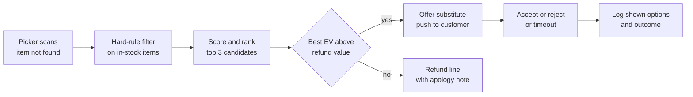
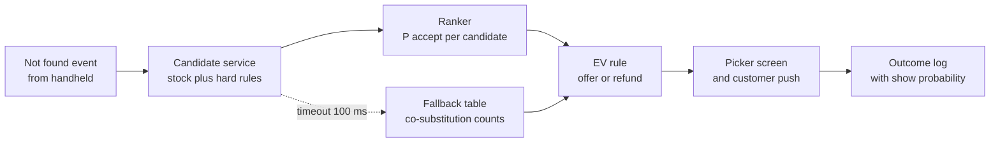

# Case Study 41: Item Substitution Recommendation (When the Packet Is Not on the Shelf)

**Domain:** Quick Commerce | **Problem Type:** Ranking and similarity with acceptance prediction | **Difficulty:** Intermediate

---

## 1. Business Context

### Company background

- Same company as Case 6: **Jhatpat** (fictional), 320 dark stores in 9 cities, about 3 lakh orders a day, about 10.95 crore orders a year, average basket about ₹480.
- A dark store holds about 5,500 SKUs. The app shows an item as available based on system stock, but the shelf does not always agree (damaged packs, mis-slotted stock, an item picked by the previous order).
- When a picker cannot find an item, the order is already paid for and the customer is already waiting. Someone must decide within seconds: substitute, or remove the item and refund.
- Today a simple rule suggests a substitute: same category, same brand if possible, nearest price. The picker taps "substitute" on a handheld, and the customer gets a push message to approve or reject. If the customer does not respond in 60 seconds, the item is refunded.

### The pain, with numbers

| Item | Value |
| --- | --- |
| Orders with at least one item missing at picking | about 5% (about 15,000 orders a day, about 54.75 lakh a year) |
| Missing line items a year | about 65.7 lakh (about 18,000 a day) |
| Missing lines where a substitute is offered today | about 70% (about 46 lakh a year). The rest are refunded straight away because the rule finds no candidate |
| Customer accepts the offered substitute | 38% (about 17.5 lakh lines) |
| Customer rejects the offered substitute | 27% (about 12.4 lakh lines) |
| Customer does not respond in 60 seconds (auto-refund) | 35% (about 16.1 lakh lines) |
| Average value of a missing line | about ₹110, contribution margin about 20% (about ₹22) |
| Cost of a rejected substitution (refund handling, support contact, a delayed order) | about ₹40 |
| 30-day repeat rate after an order that ended in a refund with no accepted substitute | about 3 points lower than after a clean order |

- The rule is blunt. It once suggested a 1 litre full-cream milk for a missing 500 ml toned milk, and a sugar-free biscuit for a regular one.
- Targets: acceptance from 38% to about 50%, rejection from 27% to about 18%, with zero hard-rule violations (for example a non-veg item for a veg item).

### Stakeholders and what each wants

| Stakeholder | What they want | What they fear |
| --- | --- | --- |
| Head of Category | Higher accepted substitutions, protected margin | The model pushes only high-margin items and customers notice |
| Head of Customer Experience | Fewer angry reviews and support tickets | Wrong substitutions such as the wrong size or dietary type |
| Head of Operations | A suggestion that needs no thinking from the picker | Extra taps that slow picking (see Case 43) |
| Head of Growth | Retention after a missing item | Customers leaving after a bad experience |
| Engineering | Suggestions in under 150 ms on a shared handheld | Latency at the picking screen, and a model that depends on many services |
| Legal and policy | Honest handling of the customer's consent, correct MRP billing | Charging more than the MRP, or substituting without consent |
| Customers | The thing they actually wanted, or a quick refund | Getting something they did not order and cannot use |

---

## 2. Translating Business to ML

### The business question vs the ML question

| Business question | ML question |
| --- | --- |
| "What should we offer when item X is missing?" | "Among the items in stock in this store right now, rank the candidates by the probability that this customer accepts and stays happy" |
| "Should we offer anything at all?" | "Estimate the best candidate's acceptance probability and compare its expected value to a straight refund" |
| "Which substitutes are safe?" | "Apply hard rules (diet, allergen, size, brand tier) as filters before any scoring" |

> **Mentor note:** This is a two-stage problem, not one model. Stage 1 is **candidate generation with hard rules** (what is allowed). Stage 2 is **ranking by expected value** (what is best among the allowed). Juniors put everything in one model and hope it learns "never offer non-veg for veg". It will not learn it reliably, and a single violation is a trust problem, not a metric problem.

### Target variable definition

- **Target for the ranker:** `accepted = 1` if the customer approved the offered substitute, `0` if rejected.
- **Secondary target:** `happy = 1` if the substituted item was accepted and there was no complaint, return or rating below 3 within 24 hours.
- **Expected value of offering candidate c:**
  - `EV(c) = P(accept) x (margin(c) + retention_value) - (1 - P(accept)) x rejection_cost`
  - Compare with the value of an immediate refund, which is about ₹0 margin and a small retention penalty.

### Edge cases

| Edge case | Recommended treatment | Reason |
| --- | --- | --- |
| No response in 60 seconds | Treat as "no signal", not as "reject". Train a separate model on responders, and use a weaker label for non-responders | The customer may be busy, not unhappy |
| Customer set a preference (always replace, never replace) | Honour it as a hard rule and skip the model | Explicit consent beats prediction |
| Substitute costs more than the original | Bill at the original price, or ask for consent. Never charge above the MRP | Consumer trust and MRP rules |
| Substitute costs less | Refund the difference automatically | Avoids a complaint |
| Item with a dietary mark (veg, vegan, gluten-free, no added sugar) | Candidate must carry the same mark | Hard rule |
| Baby products and medicines (OTC) | Never substitute unless the same brand and variant | Safety |
| Gifts or party orders with a time tag | Raise the bar for substitution, prefer refund plus a note | The exact item matters |
| Two items missing in one order | Rank jointly, do not offer two similar substitutes that duplicate each other | Basket coherence |

### Unit of prediction

- One **(order line, candidate item)** pair, scored at the moment the picker marks the item "not found".

### Prediction timing



- The picker sees the top suggestion on the handheld within 150 ms of tapping "not found".
- The customer gets the push in the next 2 seconds, with a countdown of 60 seconds.

### What success looks like

| Lens | Success |
| --- | --- |
| Business | Acceptance 38% to 50%, rejection 27% to 18%, about ₹5.4 Cr a year |
| Model | Top-1 acceptance AUC of 0.78 or more on responders, calibrated probabilities, zero hard-rule violations in logs |
| Experience | Complaints about substitutions down by one third, no fall in picking speed |

---

## 3. Data Understanding

### Data sources and key features

| Feature group | Source | Why it matters |
| --- | --- | --- |
| Missing item attributes (brand, size, variant, price, dietary mark, category tree) | Catalogue (see Case 44 for quality issues) | Defines what a "like for like" item is |
| Candidate attributes (same fields) and in-store stock | Catalogue and live store inventory | A candidate must be physically present |
| Similarity signals (text embedding of title, image embedding, shared brand, shared size, price ratio) | Derived | Core of the ranking |
| Co-purchase and co-substitution history (items that customers have accepted as replacements for each other) | Past substitution logs | The best signal of real equivalence |
| Customer history (brand loyalty, price tier, diet pattern, past accept and reject) | Order history | Some customers are brand-loyal, some price-led |
| Order context (basket value, other items in the cart, time of day, delivery promise) | Order system | A "cooking tonight" cart is stricter than a snack cart |
| Margin and stock depth of the candidate | Pricing and inventory | Needed for the value calculation and to avoid pushing the last unit |

### Data volume, granularity and refresh

- **Volume:** about 46 lakh offered substitutions a year, so about 12,600 a day. Last 12 months gives about 46 lakh rows of (line, shown candidate, outcome).
- **Granularity:** one row per shown candidate. Only the top candidate is shown to the customer today, so most rows have exactly one candidate.
- **Refresh:** candidate stock refreshed every minute, similarity tables weekly, model weekly.

### Common data issues

| Issue | How it shows up here |
| --- | --- |
| **Selection bias** | We only observe feedback on what the old rule chose to show. The model never sees how a customer would react to an item the rule never offered |
| Catalogue noise | The same product listed twice, wrong pack size, missing diet mark |
| Non-response | 35% of offers get no reply, and the reason is unknown |
| Position and presentation effect | Acceptance depends on the push text and the picture shown, not only on the item |
| Stock volatility | A candidate that was in stock when scored may be missing when the picker walks to it |
| Picker overrides | Pickers sometimes substitute by hand, bypassing the suggestion, which creates unlogged outcomes |

> **Mentor note: Where juniors usually go wrong here.**
>
> - They train a classifier on accepted vs rejected, rank by score, and call it done. The training set only contains what the old rule showed, so the model learns to agree with the old rule.
> - They treat non-response as rejection, which teaches the model that all busy customers dislike substitutes.
> - They optimise acceptance alone, and the model quietly learns to offer cheaper, near-expiry or higher-margin items that get accepted once and cost trust later.

---

## 4. Approach and Decision Points

### Baseline first

- **Baseline 1 (current):** same category, same brand if possible, nearest price. Acceptance 38%.
- **Baseline 2:** rank candidates by historical "accepted as replacement for X" counts, falling back to same brand and size. Often gets halfway with no ML.
- **Why it matters:** a co-substitution table is cheap, explainable, and the safe fallback when the model service is slow.

### Candidate models

| Model | Pros | Cons | Verdict |
| --- | --- | --- | --- |
| Hard rules plus nearest price | Simple, safe | Ignores customer taste and real equivalence | Keep the rules, replace the ranking |
| Embedding similarity (text plus image) with brand and size filters | Good for candidate generation, handles new SKUs | Similar is not the same as accepted | Use for stage 1 |
| **Gradient boosted ranker (LightGBM lambdarank or binary acceptance)** on pair features | Accurate, fast, handles mixed features | Needs bias handling | **Primary model** for stage 2 |
| Two-tower neural model on customers and items | Learns taste from large history | Heavier to serve, harder to explain | Later, if the gains are proven |
| Contextual bandit (explore a few alternative candidates) | Fixes selection bias at the source | Needs care so that bad offers are not shown | Add as a small exploration slice |
| LLM to judge "is this a sensible replacement" | Good on tricky cases like "Hing powder vs Hing cube" | Slow, costly, hard to test | Offline labelling and audit only |

### Decision scenarios

| What if... | Recommended action | Reasoning |
| --- | --- | --- |
| **The best-accepted candidate has a margin of ₹4 and another has ₹14 with 3 points lower acceptance** | Compute EV with a retention term and cap how far the margin can pull the ranking. Use margin only to break ties within about 3 points of acceptance | Margin-led ranking wins this week and loses the customer next month. Acceptance and happiness come first |
| **A veg customer is offered a candidate whose diet mark is missing in the catalogue** | Treat a missing diet mark as a failure of the hard rule for diet-sensitive categories (food, snacks, personal care with animal-derived items). Do not offer | The cost of a wrong guess is far above the benefit. Report the catalogue gap to the Case 44 pipeline |
| **Only the top-1 candidate was ever shown, so the model cannot tell if the 2nd was better** | Run an exploration slice: for about 5% of offers, show a randomly chosen candidate from the top 3 that passes the hard rules. Log the propensity (probability of being shown). Use inverse-propensity weights when training | This is the cleanest way to break the loop. A small cost buys unbiased data |
| **The customer does not reply within 60 seconds** | Do not train it as a reject. Build a responder model (P(reply)) and train acceptance on responders with weights, then score "no reply" as a separate outcome. Test a 90-second window in an A/B | Many busy customers would accept. Auto-refund then loses margin that was never rejected |
| **Best candidate has an acceptance probability of 0.12** | Refund immediately with a clear message and a small coupon if the line value is high. Do not offer a bad substitute just because one exists | A low-probability offer costs ₹40 on rejection and an annoyed customer. The refund path has a lower cost than a coin flip. Use the EV rule |
| **The candidate is in the system but the picker cannot find it** | Offer the top 3 as a list on the handheld, and send only the one the picker confirms. Log both | Stock mismatch is the root cause of the original problem. Do not repeat it |
| **A high-value order (basket above ₹1,500) has a missing premium item** | Prefer calling or an in-app chat for a decision, or refund, rather than auto-substituting. Raise the acceptance threshold to 0.7 | Large baskets have more at stake per mistake |
| **A new SKU has no accept history** | Fall back to embedding similarity plus category priors, and flag it for the exploration slice | Cold items need a path to learn |

---

## 5. Feature Engineering

### Top 10 features to build

| # | Feature | Business logic |
| --- | --- | --- |
| 1 | Brand match (same brand, same parent company, premium to economy tier jump) | Brand loyalty is the first thing customers check |
| 2 | Pack-size ratio (candidate size over original size, after unit normalising) | 400 g for 500 g is fine, 1 kg for 500 g is not |
| 3 | Price ratio (candidate over original) and absolute rupee difference | Customers tolerate small increases rarely, and decreases easily |
| 4 | Variant match (flavour, fat level, sugar-free, colour) | Variant is the second reason for rejection |
| 5 | Historical co-substitution acceptance rate for the pair (smoothed) | Direct evidence of what customers treat as equal |
| 6 | Text and image embedding cosine similarity | Handles new items and brand synonyms |
| 7 | Customer brand loyalty score (share of past purchases in this brand for this category) | Loyal customers reject other brands |
| 8 | Customer price tier and past substitution accept rate | Separates tolerant and strict customers |
| 9 | Other items in the cart (for example noodles in the cart suggests the missing sauce matters) | The cart shows the purpose |
| 10 | Candidate stock depth and shelf-confidence (picker find rate for this SKU in this store in the last 7 days) | Avoids offering an item that is also often missing |

### Features to avoid (leakage risks)

| Feature | Problem |
| --- | --- |
| Whether the customer later complained or asked for a refund | Happens after the decision |
| The picker's final choice of item when the picker overrode the suggestion | Reflects what was offered, not what was best, and can leak the outcome |
| Delivered-item rating | Outcome |
| Candidate acceptance rate computed over a window that includes this order | Target leakage |
| Time to customer response | Known only after the offer |
| Customer age or gender | Not needed, and a fairness and privacy risk under the DPDP Act 2023 |

Candidate ranking with hard rules first, then a model score:

```python
import lightgbm as lgb

# Stage 1: hard rules (never learnt, always enforced)
def allowed(orig, cand, cust):
    if cand.diet_mark != orig.diet_mark:
        return False
    if cand.allergen_tags - orig.allergen_tags:
        return False
    if not 0.8 <= cand.size_ratio(orig) <= 1.25:
        return False
    return cand.in_stock and cand.price <= 1.3 * orig.price

# Stage 2: acceptance model, trained with propensity weights
ranker = lgb.LGBMClassifier(n_estimators=400, learning_rate=0.05, num_leaves=31)
ranker.fit(X_train, y_accept, sample_weight=ipw_weights)
```

---

## 6. Evaluation Strategy

### Metrics

| Metric | Role | Why |
| --- | --- | --- |
| **Acceptance rate of the offered substitute** | Primary online metric | The direct outcome |
| **Happy substitution rate** (accepted and no complaint or return in 24 hours) | Primary guardrail | Acceptance alone can reward pushy offers |
| Hard-rule violation count | Safety, must be zero | One veg or non-veg error is a headline |
| Rejection rate and refund cost | Business | Each rejection costs about ₹40 |
| Calibration of P(accept) by segment | Model quality | The EV rule needs probabilities, not just a ranking |
| Offer rate (share of missing lines where we choose to offer) | Policy | Shows the refund vs substitute balance |
| **Offline ranking metric (NDCG at 3 or top-1 hit rate) using propensity weights** | Model comparison | Needs weighting because of selection bias |
| 30-day repeat rate of affected orders | Long-term | The real retention outcome |

### Metrics that look good but are misleading here

- **Plain AUC on logged data:** it measures agreement with the old rule on the items the old rule showed.
- **Acceptance rate alone:** can be pushed up by offering fewer, safer substitutes, or items so cheap that no one rejects them.
- **Offer rate going up:** more offers are not better if their quality is low.
- **Accuracy on responders only:** ignores the 35% who do not reply.

### Validation strategy

| Step | Design | Why |
| --- | --- | --- |
| Time-based split | Train on months 1 to 10, validate on month 11, test on month 12 | Matches deployment |
| Item-group holdout | Hold out 10% of the original SKUs entirely | Tests behaviour on new items |
| Propensity-weighted offline evaluation | Evaluate on exploration-slice rows, which have known show probabilities | Removes the old rule's bias |
| Hard-rule audit | Run all rows through the rule checker and manually review 300 random offers per category | Zero violations must be proven |
| Shadow mode | Log the model's pick next to the rule's pick for 2 weeks | No customer risk |
| Online A/B test | Randomise by order, stratified by store, two weeks, 50-50 | Final proof |

### From model metric to business value

- Offered substitutions: about 46 lakh lines a year.
- Acceptance up 12 points (38% to 50%): 5.5 lakh extra accepted lines at about ₹22 margin, about **₹1.2 Cr**.
- Rejection down 9 points (27% to 18%): about 4.1 lakh fewer rejected lines at ₹40, about **₹1.7 Cr**.
- Retention: about 21.9 lakh affected orders see a better outcome, 3 points higher repeat gives about 65,700 retained customers. At 4 further orders each and about ₹96 contribution (20% of ₹480), about **₹2.5 Cr**.
- **Total about ₹5.4 Cr a year.**

---

## 7. Deployment and Monitoring

### Batch vs real time

- **Real-time scoring** at the picking screen. The candidate set is small (10 to 30 items after hard rules), so scoring is cheap.
- **Batch jobs:** nightly refresh of co-substitution tables and embeddings, weekly retraining.
- Design for failure: if the model times out, serve the Baseline 2 table, and if that fails, refund directly (never serve an unchecked rule).



### What to monitor

| Type | What to track | Alert trigger |
| --- | --- | --- |
| Outcome | Acceptance, rejection, happy rate, by city and category | Acceptance down 3 points for 3 days |
| Safety | Hard-rule violations, diet or allergen complaints | Any violation |
| Calibration | Predicted vs actual acceptance by decile | Gap above 4 points |
| Selection bias | Share of offers from the exploration slice, propensity distribution | Slice below 3% |
| Latency | p99 of the scoring call, fallback rate | p99 above 150 ms, fallback above 2% |
| Margin guard | Average margin of offered substitutes vs the original | Margin drift above 2 points, a sign of pushy ranking |
| Catalogue health | Share of candidates with missing attributes | Rising trend |
| Picker behaviour | Override rate, extra seconds at the picking screen | Override above 15% |

### Retraining

- **Scheduled:** weekly on a rolling 6 to 9 month window.
- **Triggered:** a catalogue re-organisation, a big festival (Diwali sweets, Ramzan dates), a new store format.

### A/B test or champion-challenger design

- Randomise at the **order** level, since each substitution event is a separate decision, with stratification by store.
- Primary: happy substitution rate and net margin. Guardrails: hard-rule violations (must be zero), support contacts, repeat rate at 30 days.
- Keep a 5% **exploration slice** running permanently, as it feeds the next model.

---

## 8. Stakeholder Communication

### Explain it to a non-technical leader

> "When we cannot find an item, today we guess a replacement using price and category. The new system first removes any replacement that breaks a hard rule, such as veg or non-veg, size or allergen. Then it picks the one this customer is most likely to accept, and if no replacement is good enough, it refunds immediately instead of offering a poor one.
> We expect acceptance to rise from 38% to about 50%, with fewer rejections and complaints.
> About ₹5.4 Cr a year, and, more importantly, fewer customers lost after a bad experience."

### Questions leadership will ask

| Question | Suggested answer |
| --- | --- |
| "Why not always offer the highest-margin substitute?" | "It would win this week and lose customers next month. We rank by acceptance first, and use margin only as a tie-breaker within a small band" |
| "Why refund sometimes instead of substituting?" | "A bad offer costs about ₹40 and a frustrated customer. If the best option is unlikely to be accepted, a quick refund is cheaper and kinder" |
| "Can the model make a veg or allergen mistake?" | "No. Those are hard rules enforced in code, not learnt. The model only ranks items that already passed them" |
| "How do you know it is better, if you only see what we showed?" | "A small random exploration slice tells us how customers react to items we would not normally show. That is what makes the comparison fair" |
| "Does this slow our pickers?" | "No. The picker sees one suggestion on the handheld in under 150 ms. We watch picking time as a guardrail (see Case 43)" |
| "What about customers who do not answer?" | "We treat silence as unknown, not as no. We are testing a longer window and a default preference, so that silence is not an automatic refund" |

---

## 9. Common Pitfalls and Lessons

| Mistake | Why it happens | How to avoid it |
| --- | --- | --- |
| Learning hard rules from data | The model is expected to do everything | Enforce diet, allergen and size as filters in code and audit them |
| Training only on what the old rule showed | Logs are the only data | Run an exploration slice, log propensities, use inverse-propensity weights |
| Treating no response as rejection | It makes labelling easy | Model responders separately, test the response window |
| Ranking by margin | Category teams ask for it | Rank by acceptance and happiness, use margin as a capped tie-breaker |
| Ignoring the refund option | The task is framed as "pick a substitute" | Compare EV against the refund path and allow "offer nothing" |
| Candidate not on the shelf | Inventory data is stale | Use pick-find rate per SKU and store, and show the top 3 to the picker |
| Wrong units across pack sizes | Messy catalogue | Normalise units and fix the catalogue with Case 44 methods |
| Measuring acceptance alone | It is the easy online metric | Track happy rate, returns and repeat as guardrails |

---

## 10. Mentor's Focus Checklist

- ✅ **Where to spend 80% of the effort:**
  - Hard rules for diet, allergen, size and brand tier, with a zero-violation audit.
  - Breaking the selection bias with an exploration slice and propensity weights.
  - The EV rule that decides between offering and refunding.
  - Honest evaluation: happy rate and repeat rate, not acceptance alone.
- ❌ **What not to over-engineer:**
  - Deep two-tower models before a boosted ranker with good pair features.
  - LLM calls on the live path.
  - Perfect similarity embeddings, when brand, size and variant matches carry most of the signal.
- 💡 **Key takeaway:** **Rules decide what is allowed, a model decides what is best, and the refund is a valid answer.** The old data only shows what we chose to show, so a little deliberate exploration is the price of learning anything new.
