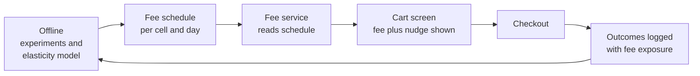
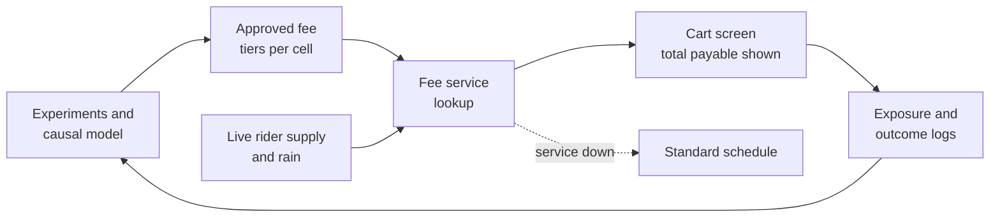

# Case Study 42: Delivery, Handling and Small-Cart Fee Optimisation (The "Add ₹30 for Free Delivery" Banner)

**Domain:** Quick Commerce | **Problem Type:** Pricing optimisation with causal estimation | **Difficulty:** Advanced

---

## 1. Business Context

### Company background

- Same company as Case 6: **Jhatpat** (fictional), 320 dark stores in 9 cities, about 3 lakh orders a day, about 10.95 crore orders a year, about ₹480 average basket, about ₹5,200 Cr GMV a year.
- Item discounts and coupons are covered in Case 7. This case is about the **fees on top of the basket**, which are a separate lever with a different customer reaction.
- Today's fee schedule:
  - **Small-cart fee** of ₹20 on carts below ₹99.
  - **Delivery fee** of ₹25 on carts below ₹199 (free above).
  - **Handling fee** of ₹5 on every order.
  - **Rain and peak fee** of ₹12 on about 12% of orders, switched on by city by operations on a fixed rule.
- The fees are set by a pricing committee once a quarter, the same for all customers in all cities.

### The pain, with numbers

| Item | Value |
| --- | --- |
| Orders below ₹99 (pay ₹45, small-cart plus delivery) | 3% (about 32.85 lakh a year) |
| Orders from ₹99 to ₹199 (pay ₹25 delivery) | 11% (about 120.45 lakh a year) |
| Orders above ₹199 (delivery free) | 86% |
| Orders from ₹199 to ₹249 | about 8% (about 87.6 lakh a year) |
| Annual fee revenue | about ₹115 Cr (₹14.8 Cr small-cart bundle, ₹30.1 Cr delivery, ₹54.75 Cr handling, ₹15.8 Cr rain and peak) |
| Variable cost to serve one order (rider, packing, store variable cost) | about ₹70 |
| Gross margin on items | about 22% of basket, about ₹105 on an average order |
| Share of orders bunched just above ₹199 | about 2.1 times what a smooth basket curve would predict |
| Fee complaints in app reviews | rising, mostly about "fees appearing at the last step" |

- The ₹199 line distorts behaviour. Many customers add a ₹10 item to reach it, and many abandon at the payment screen when fees appear.
- The rain and peak fee is a blunt switch: it is on in the whole city or off, even when only a few zones are short of riders.
- Targets: raise net contribution from fees and basket effects by about ₹11 Cr a year, without a measurable fall in 90-day retention, and with full fee disclosure before checkout.

### Stakeholders and what each wants

| Stakeholder | What they want | What they fear |
| --- | --- | --- |
| CFO and Head of Pricing | Higher contribution per order | Fee income that hides lost customers |
| Head of Growth | Conversion and new-user trial | A visible fee that drives the first order away |
| Head of Operations | Fewer late orders in rain and peak | A fee that is too low to shape demand |
| Head of Customer Experience | No surprise charges | Reviews saying "hidden fees" |
| Legal and policy | Clear price display, no manipulative design | Action under consumer-protection rules on dark patterns, such as fees revealed late |
| Competitor watchers | Fees in line with the market | A price war on delivery fees |
| Engineering | A fee service with strict latency | A model on the checkout path with no fallback |

---

## 2. Translating Business to ML

### The business question vs the ML question

| Business question | ML question |
| --- | --- |
| "What fee should we charge?" | "For this customer segment, city and hour, what is the effect of a change in fee on conversion, basket size and later retention, and which fee maximises net contribution?" |
| "Does a free-delivery threshold raise baskets?" | "What is the causal effect of showing a gap-to-threshold nudge on the final basket value, for customers near the threshold?" |
| "Should the rain fee be higher?" | "How much does the fee shift demand away from rider-short zones, and what does it save in late orders?" |

> **Mentor note:** This is a **causal** problem first and a prediction problem second. Observed data cannot tell you the elasticity, because fees were set by rules that correlate with weather, time and city. A model that predicts conversion from the fee shown will find that higher fees go with *higher* conversion (fees are high in peak hours, when people are desperate). Reading that as "customers love higher fees" is the classic mistake. Use experiments or quasi-experiments, then fit the models on top.

### Target variable definition

- **Primary outcomes (per session reaching the cart):**
  - `converted` (order placed), and `basket_value` (items only, before fees).
- **Net contribution per cart session** (the objective):
  - `items margin + fees collected - cost to serve - late-order cost`, counted as zero if no order.
- **Long-run outcome:** 28-day and 90-day order count of the customer after exposure.
- **Treatment:** the fee amount and structure shown at cart (and the threshold gap message).

### Edge cases

| Edge case | Recommended treatment | Reason |
| --- | --- | --- |
| Members or subscribers with free delivery | Model separately, fees do not apply | Different mechanism |
| Carts that change after the fee is shown | Keep the fee exposure at the moment of the change, using exposure logs | Avoids mixing before and after |
| Customers with a coupon covering the fee | Mark as a separate segment, effect is not clean | Overlap with Case 7 |
| Users who see two different fees on two devices | Randomise by user ID and keep exposure sticky | Cross-contamination |
| Very small carts with a single item | Treat as top-up demand, often urgent | Low elasticity for medicine or milk |
| A rain event with a fee increase and a supply shortage at once | Use pre-defined cells and do not compare to sunny hours | Confounding |

### Unit of prediction

- One **cart session** (customer, store, time) at the moment the fee is displayed. The decision is a fee schedule for a (segment, city, hour band) cell, and the model estimates the **effect of the fee** for each cell.

### Prediction timing



- Fees are **not** computed from a heavy model at checkout. The model sets a schedule; the fee service looks it up in under 20 ms, and live signals (rider supply) only choose between pre-approved fee tiers.

### What success looks like

| Lens | Success |
| --- | --- |
| Business | About ₹11 Cr a year of extra net contribution, with 90-day retention in treated segments within 0.5 points of control |
| Model | Elasticity estimates with confidence intervals that hold up when re-tested in a new experiment (predicted vs measured effect within one standard error) |
| Compliance | All fees shown before the payment step, and the total payable shown on the cart screen |

---

## 3. Data Understanding

### Data sources and key features

| Feature group | Source | Why it matters |
| --- | --- | --- |
| Fee exposure (fee shown, threshold gap message, experiment arm) | Pricing service logs | The treatment |
| Cart outcomes (converted, basket value, items added after the nudge) | Order and event stream | The response |
| Customer history (order count, average basket, fee sensitivity in the past, tenure) | Order history | Elasticity varies by customer |
| Context (hour, day, rain intensity, rider supply ratio, store queue) | Dispatch and weather | Fees interact with congestion |
| Geography (city, zone, income proxy by pincode, competitor presence) | Internal and market data | Local price tolerance |
| Cart composition (essentials vs impulse, category mix, share of fresh) | Cart | Urgent carts are less elastic |
| Long-run outcome (orders in the next 28 and 90 days) | Order history | The price of a fee is partly paid later |

### Data volume, granularity and refresh

- **Volume:** about 10.95 crore orders a year, and about 3 to 4 times that many cart views. Fee tests use user-level samples, so a 2-week test on 5% of users covers about 15 lakh cart sessions.
- **Granularity:** one row per cart session with the fee actually shown.
- **Refresh:** exposure logs real-time, elasticity models monthly, rain and peak tiers by the hour.

### Common data issues

| Issue | How it shows up here |
| --- | --- |
| **Confounded fee history** | Fees changed when weather, demand and supply changed, so observational elasticity is biased |
| Little fee variation | One schedule for all users means no variation to learn from |
| Bunching at thresholds | Basket values pile up just above ₹199, which breaks smooth demand assumptions |
| Interference | A high fee in one zone pushes customers to another store or app |
| Long-run effects | A fee shock may lower orders next month, which a 2-week test misses |
| Multiple fee components | Delivery, handling and small-cart fees move together, so their separate effects are hard to separate |

> **Mentor note: Where juniors usually go wrong here.**
>
> - They fit a regression of conversion on fee and call the coefficient an elasticity. It is a correlation with weather and time.
> - They measure the effect on the order and forget the effect on the *next* orders.
> - They optimise fee revenue directly, and the model finds the fee that squeezes the least elastic customers right up to the point where they leave, one month later.

---

## 4. Approach and Decision Points

### Baseline first

- **Baseline 1 (current):** one schedule for all, reviewed quarterly.
- **Baseline 2:** the same schedule with a simple city-level adjustment from past A/B tests.
- **Why it matters:** many pricing gains come from a few well-run experiments on structure (threshold and bundle) and not from a fancy model.

### Candidate approaches

| Approach | Pros | Cons | Verdict |
| --- | --- | --- | --- |
| Randomised fee tests per segment and city | Clean causal answers | Slow, costs revenue during the test, small samples per cell | Foundation, always |
| Regression discontinuity around a threshold (customers just below vs just above ₹199) | Uses existing variation | Customers can manipulate their basket, so bunching breaks the assumption | Use with a bunching test, only for local effects |
| **Heterogeneous treatment effects (causal forest or double machine learning) on experiment data** | Estimates elasticity by segment | Needs enough randomised data | **Primary** for the schedule |
| Difference-in-differences across zones | Works for rain or city-level changes | Needs parallel trends | Use for geography changes |
| Contextual bandit over a few fee tiers | Learns continuously | Risk of low fees being tried on a loss-making segment, and a regulatory view of "personalised pricing" | Only within a narrow, approved band |
| Reinforcement learning for dynamic fees | Theoretically ideal | Long-horizon effects are hard to learn and the risk is high | Not at this stage |

### Decision scenarios

| What if... | Recommended action | Reasoning |
| --- | --- | --- |
| **A raised delivery fee lifts revenue per order but the next-month orders fall** | Make the long-run outcome (28 and 90-day orders) a pre-declared metric. Keep a long-term holdout of 3% of users on the old schedule for 90 days. Decide on contribution including future orders | A 2-week test rewards short-term squeezing. The holdout is the only way to see the cost |
| **A "add ₹X more for free delivery" nudge makes customers add items, but the margin on the added items is lower than the fee waived** | Compute the break-even: item margin added must exceed the fee waived (for a ₹25 fee and 22% margin, customers must add more than about ₹114 of items). Show the nudge only when the gap is small and the item recommendations are high-margin | A nudge can raise basket and lower profit. It is a pricing action, not a free win |
| **Basket values pile up at ₹199 to ₹205** | Test moving the threshold to ₹249 in a few cities and look at the full basket curve and the retention of near-threshold customers, not just the pile | The pile shows that the line has power. Moving it moves the pile, and the question is net contribution |
| **Rain starts and the city fee goes from ₹12 to ₹15** | Use zone-level supply ratio to choose a tier (none, ₹10, ₹15) and measure the demand shifted and the late-order cost saved. Cap the fee and display it before checkout | The point of the surge fee is to balance supply and demand. The fee should be on where riders are short, not city-wide |
| **A competitor offers free delivery with no minimum for a week** | Do not react by cutting all fees. Look at the segment-level conversion drop and use a time-limited targeted waiver only for the segments with high lost conversion and high lifetime value | A blanket response gives away ₹115 Cr of fees. The model shows where the leak actually is |
| **Fees are tested in a city and customers use another store of ours or another app** | Randomise at user level inside each city, and also measure spillover at zone level | Interference biases the effect upward |
| **Legal says the fee must be shown before the cart and not changed at payment** | Show an all-in "total payable" at cart, run the test on the displayed total, and exclude any design that reveals fees only at the last step | Fee transparency is a design constraint. A pattern that hides fees may raise short-run conversion but risks a regulatory view of it as a dark pattern |
| **The model suggests higher fees for lower-income pincodes because they are less elastic** | Do not use income-based fee discrimination. Restrict the model to non-sensitive cart and context features and review fee outcomes by city tier | Reputation and fairness. Charging more to those with fewer options is hard to defend |

---

## 5. Feature Engineering

### Top 10 features to build

| # | Feature | Business logic |
| --- | --- | --- |
| 1 | Fee total displayed (delivery, handling, small-cart, rain and peak, summed) and its share of the basket | The perceived cost is the total, as a share of the basket |
| 2 | Gap to the free-delivery threshold (₹199 minus cart value) | Distance to the line drives the nudge response |
| 3 | Customer's past fee exposure and past conversion at similar fee levels | Learned sensitivity, with care about confounding |
| 4 | Cart urgency score (medicine, milk, baby items, late-night hour) | Urgent carts have low elasticity |
| 5 | Items in cart that can be added cheaply (low-price add-ons in the same store) | Whether a nudge can be satisfied easily |
| 6 | Rider supply ratio in the zone and store queue now | Where a surge fee has demand-shaping value |
| 7 | Rain intensity and event flags | Demand and supply both shift |
| 8 | Customer tenure and order count (first three orders vs old) | New users are more fee-sensitive, and first-order fee is a trial barrier |
| 9 | Order frequency in the last 30 days and days since last order | Heavy users have higher long-run cost from a fee shock |
| 10 | City tier and market competitiveness (competitor fee at the same time, when known) | Local price tolerance |

### Features to avoid (leakage risks)

| Feature | Problem |
| --- | --- |
| Final basket value after the nudge, used to predict conversion | Outcome of the treatment |
| Fee actually charged at the end of the checkout | Post-treatment, may include later adjustments |
| Items added after fee exposure | Mediator, not a covariate |
| Income, religion, language or caste proxies for individual-level fees | Fairness, reputation and regulatory risk |
| Whether the customer opened the support chat about fees | Outcome |
| Competitor price scraped after the test window | Look-ahead |

Estimating segment-level fee effects from randomised data with a causal forest:

```python
from econml.dml import CausalForestDML
from sklearn.ensemble import GradientBoostingRegressor

# Y: net contribution per cart session, T: fee shown (continuous or tier),
# X: effect modifiers (urgency, tenure, city, hour), W: other controls
est = CausalForestDML(
    model_y=GradientBoostingRegressor(),
    model_t=GradientBoostingRegressor(),
    n_estimators=500, min_samples_leaf=200,
)
est.fit(Y, T, X=X, W=W)
effect = est.effect(X_new)            # change in contribution per extra rupee of fee
low, high = est.effect_interval(X_new, alpha=0.1)
```

---

## 6. Evaluation Strategy

### Metrics

| Metric | Role | Why |
| --- | --- | --- |
| **Net contribution per cart session** (items margin plus fees minus cost to serve, with zero for no order) | Primary | Combines conversion, basket and fees in one rupee number |
| Conversion rate at cart | Guardrail | Shows the visible response |
| Basket value of converted orders | Diagnostic | Shows nudge and threshold effects |
| 28-day and 90-day orders per user (long holdout) | Primary for retention | Fee shocks show up late |
| Late-order rate in rain and peak hours | Operations | The value of the surge fee |
| Fee complaints and support contacts | Experience | Transparency signal |
| Uplift calibration (predicted vs measured effect by decile) | Model quality | Elasticity models fail quietly |
| Price display compliance checks | Compliance | Total payable shown before payment |

### Metrics that look good but are misleading here

- **Fee revenue per order:** it always rises when the fee rises, even when total contribution falls.
- **Conversion alone:** a lower fee lifts conversion on orders that lose money after cost to serve.
- **Average basket value:** can rise from a nudge while margin per order falls.
- **Predictive R-squared of a fee-to-conversion model:** high because fees follow weather and time, and says nothing about causal effect.

### Validation strategy

| Step | Design | Why |
| --- | --- | --- |
| Randomised pilot | User-level randomisation within city, 2 to 4 weeks, 3 to 5 fee arms, pre-registered metrics | Clean elasticity |
| Sample size check | At 3% baseline difference in conversion detection and about 60% baseline conversion, plan for about 1.5 lakh users per arm | Avoids under-powered tests |
| Bunching analysis | Compare basket distributions near ₹199 before and after any threshold move | Reveals gaming |
| Long holdout | 3% of users kept on the old schedule for 90 days | Long-run effect |
| Spillover check | Zone-level randomisation in a few zones, compared with user-level | Measures interference |
| Placebo test | Estimate "effects" on a period with no fee change | Checks the pipeline |
| Fairness and compliance review | Fee outcomes by city tier, and a legal sign-off on displays | Reputation and law |

### From model metric to business value

- **Re-tier the ₹99 to ₹199 fee for low-elasticity segments** (40% of 120.45 lakh orders, about 48.2 lakh): fee up ₹5, conversion down 1.4%. Fee gain 48.2 lakh x 0.986 x ₹5 = about ₹2.4 Cr. Lost orders (about 0.68 lakh) contribute about ₹3 each, so the loss is about ₹0.02 Cr. Net about **₹2.4 Cr**.
- **Targeted rain and peak fee:** ₹15 on 10% of orders (109.5 lakh) gives ₹16.4 Cr against ₹15.8 Cr today, about ₹0.6 Cr more. About 5% of orders in surge hours (about 6.6 lakh) shift or drop, avoiding late orders at ₹35 (from Case 6), about ₹2.3 Cr. Total about **₹2.9 Cr**.
- **Threshold test, ₹199 to ₹249, in 3 cities (about 40% of orders):** orders in the new band about 35 lakh. 70% pay ₹25, 30% add about ₹50 of items at 22% margin (about ₹11): 35 lakh x (0.7 x 25 + 0.3 x 11) = about ₹7.3 Cr. Less lost orders and retention offset (about 4% fewer orders in the band, and 3% fewer orders from affected customers) of about ₹1.3 Cr. Net about **₹6.0 Cr**.
- **Total about ₹11.3 Cr a year**, with a wide band. Only the long-run holdout will confirm the retention offset.

---

## 7. Deployment and Monitoring

### Batch vs real time

- **Batch:** monthly elasticity re-estimation, a daily fee schedule per segment and cell, and a weekly review of fee outcomes.
- **Real time:** a lookup in the fee service (under 20 ms), with live rider supply selecting between approved tiers for the rain and peak fee.
- Design for failure: if the fee service is down, charge the standard schedule (the legal baseline).



### What to monitor

| Type | What to track | Alert trigger |
| --- | --- | --- |
| Conversion | Cart-to-order rate by city, cell and arm | Drop above 2 points vs control for 2 days |
| Contribution | Net contribution per cart session | Below control for 7 days |
| Retention | 28-day orders per user in the long holdout | 1.5% below holdout |
| Fee display | Share of sessions where total payable is shown before payment | Anything below 100% |
| Complaints | Fee-related support tickets and app review mentions | 30% above baseline |
| Fairness | Fee levels by city tier and new vs old users | Gap beyond approved band |
| Competitor | Competitor fee and delivery promise, when observable | Large move |
| Drift | Elasticity estimates by month | Shift beyond the confidence interval |

### Retraining

- **Scheduled:** monthly re-estimation using the last 3 to 6 months of experiment data.
- **Triggered:** a competitor fee change, a festival season, a change to the rider payment model, a new city launch.

### A/B test or champion-challenger design

- Randomise by **user**, sticky for the length of the test, within each city. Do not randomise by session.
- Use a pre-registered plan with primary (net contribution), guardrails (conversion, complaints, display compliance), and a long holdout.
- Roll out in steps: 5% of users, 25%, 50%, with a hold at each step to read retention. For geography changes (rain tiers), use a zone-level switchback.

---

## 8. Stakeholder Communication

### Explain it to a non-technical leader

> "Fees are one of the few levers that raise profit per order directly, but they also change who orders and how often. We will run controlled tests to learn how different customers react, and set fees only where the effect is clear and the customer is not driven away.
> The model helps us place the free-delivery line, and switch the rain and peak fee on only in zones that are short of riders.
> We expect about ₹11 Cr a year, and we will keep a small group of customers on the old fees for 90 days to see the long-run cost honestly.
> All fees will be shown before the customer pays."

### Questions leadership will ask

| Question | Suggested answer |
| --- | --- |
| "Why not just raise all fees by ₹5?" | "Some customers would barely notice and some would leave. A flat rise gives about ₹55 Cr in the best case and risks retention. Tests tell us where it is safe, so we keep the gain and avoid the damage" |
| "Can we show the fee only at the last step to avoid abandonment?" | "No. Showing fees late is the kind of design that consumer-protection guidelines call a dark pattern, and it hurts trust. We show the total at cart" |
| "Does a free-delivery banner always raise profit?" | "No. If customers add items with less margin than the fee we waive, we lose money. We show it only where the added margin pays for it" |
| "Why a 90-day holdout, when the test is two weeks?" | "A fee shock can reduce orders next month. The holdout shows that cost, which a 2-week test misses" |
| "Can we charge more where people can afford it?" | "We will not use income or similar signals to set fees. We vary fees by cart type, time and supply, and we review outcomes by city tier" |
| "Is this the same as the discount model?" | "No. Case 7 is about item discounts. Fees behave differently, because customers see them as a penalty and compare them across apps" |

---

## 9. Common Pitfalls and Lessons

| Mistake | Why it happens | How to avoid it |
| --- | --- | --- |
| Reading elasticity from observational data | Fees follow weather and time | Randomise, or use quasi-experiments with checks |
| Optimising fee revenue | It is easy to measure | Optimise net contribution including conversion, cost to serve and retention |
| Ignoring the long-run effect | Tests last two weeks | Keep a 90-day holdout and report 28-day orders |
| Treating the free-delivery nudge as free | Higher basket looks good | Check that added margin exceeds the fee waived |
| Hiding fees until checkout | It lifts short-run conversion | Show the total at cart and meet display rules |
| City-wide surge fees | Operations flips a switch | Use zone-level supply to choose tiers |
| Personalising on sensitive proxies | Models find low-elasticity groups | Restrict features and audit fee gaps |
| Underpowered fee tests | Effects are small, a 1% change in conversion | Compute sample size up front and use pre-registered metrics |

---

## 10. Mentor's Focus Checklist

- ✅ **Where to spend 80% of the effort:**
  - Experiment design: user-level randomisation, pre-registered metrics, adequate power.
  - A net contribution metric, with a long-run holdout for retention.
  - Threshold and bundle structure (the ₹99 and ₹199 lines), which usually matter more than the model.
  - Transparency and fairness rules agreed with legal before any test.
- ❌ **What not to over-engineer:**
  - Reinforcement learning for dynamic fees.
  - Individual-level fees when segment-level tiers capture most of the gain.
  - Elasticity estimates for tiny cells with too little data.
- 💡 **Key takeaway:** **A fee is a price the customer feels as a penalty, so measure its effect with experiments and judge it by net contribution plus retention.** If the number only rises because customers cannot see the fee until the last step, it is a liability, not a gain.
