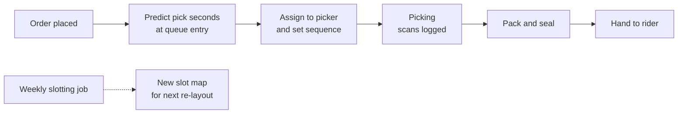
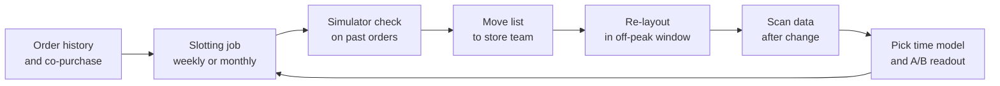

# Case Study 43: Picker Productivity and Pick-Path Optimisation (Every Metre Counts in a 3,500 Square Foot Store)

**Domain:** Quick Commerce | **Problem Type:** Regression plus layout optimisation | **Difficulty:** Intermediate

---

## 1. Business Context

### Company background

- Same company as Case 6: **Jhatpat** (fictional), 320 dark stores in 9 cities, about 3 lakh orders a day, about 10.95 crore orders a year, average basket about ₹480 (about 6.5 items).
- A dark store is a small warehouse, about 3,500 square feet, with about 5,500 SKUs, narrow aisles (about 1.2 metres), chillers and a frozen section. There is no customer inside.
- Each order is picked by a **picker** (an employee, not a gig rider) using a handheld that shows the items in a suggested sequence. A packer seals the bag, and a rider collects it. The picker's time sits directly inside the delivery promise in Case 6.
- A store handles about 940 orders a day (3 lakh divided by 320), with 6 to 8 pickers on the floor at peak.

### The pain, with numbers

| Item | Value |
| --- | --- |
| Average pick-and-pack time per order (first scan to bag sealed) | 3.4 minutes |
| Target | 3.0 minutes |
| Productive picker hours a day (3 lakh orders x 3.4 minutes) | about 17,000 hours |
| Picker utilisation (productive time over paid time) | about 55% |
| Paid picker shifts a day (17,000 / 0.55 / 8 hours) | about 3,860 |
| Pickers on the payroll (with weekly offs) | about 4,500 |
| Loaded cost per picker | about ₹22,000 a month |
| **Annual picker cost** | **about ₹119 Cr** (4,500 x ₹22,000 x 12) |
| Picking cost per order | about ₹10.9 |
| Median walking distance per order | 62 metres |
| Orders where two or more pickers are in the same aisle (congestion) | about 18% at peak |
| Slotting last reviewed | At store launch, and a manual tweak each quarter |

- Layouts follow category logic (all dairy together, all snacks together). That is neat for restocking, but a typical order (milk, bread, eggs, onions, chips) crosses four zones.
- Pick time is also driven by things the layout does not control: items per order, heavy items, cold items and the picker's experience.
- Targets: pick time from 3.4 to 3.0 minutes (about 12%), walking distance from 62 to about 48 metres, with no rise in picking errors.

### Stakeholders and what each wants

| Stakeholder | What they want | What they fear |
| --- | --- | --- |
| Head of Operations | Faster picks, fewer pickers per order | A big re-layout that disrupts a store for a week |
| Store managers | A layout that works and stays simple | Re-slotting every few days, so staff never learn where things are |
| Pickers and their supervisors | Clear targets, safe aisles | Speed targets that create pressure, unfair per-person ranking |
| Head of Customer Experience | Orders ready in time, no wrong items | Errors rising when speed rises |
| Head of Supply Chain | Efficient replenishment | Fast movers placed where restocking is hard |
| Finance | Lower picking cost per order | Gains claimed but not measured |
| Legal and HR | Fair treatment, DPDP-compliant handling of worker tracking data | Productivity tracking that feels like surveillance |

---

## 2. Translating Business to ML

### The business question vs the ML question

| Business question | ML question |
| --- | --- |
| "How long will this order take to pick?" | "Predict pick-and-pack seconds from the items, their locations, the picker and the live store load" |
| "Where should each item sit?" | "Choose a slot for each SKU to minimise expected walking and congestion, given order co-occurrence and physical limits" |
| "Which pickers need help?" | "Estimate each picker's pick time after adjusting for order mix and layout, so that comparisons are fair" |

> **Mentor note:** Two models, one purpose. The **pick time model** predicts the time per order and is used for staffing, promise time and evaluation. The **slotting optimiser** is not a predictor at all, it is a layout search that uses the pick time model as its scorer. A junior who builds only the predictor never changes the layout. A junior who builds only the optimiser cannot prove it worked.

### Target variable definition

- **Target for the regression:** `pick_seconds = bag_sealed_time minus first_item_scan_time`, for orders picked by one picker.
- **Component targets:** walking seconds between consecutive scans, search seconds at the shelf (find and pick), and packing seconds (bagging, cold items).
- **Optimiser objective:** the expected sum of walking distance plus congestion penalty over the order mix, subject to physical rules.

### Edge cases

| Edge case | Recommended treatment | Reason |
| --- | --- | --- |
| Picker pauses for a break or a restock task mid-order | Detect long gaps (above 90 seconds between scans) and flag, drop from training | Not picking time |
| Item not found (see Case 41) | Separate the search time as a feature and the order as a different class | Long, unpredictable delay |
| One picker picks two orders together (batching) | Model per order with a batching flag, or at the batch level | Strong change in distance per order |
| Very large orders (above 25 items, bulk) | Cap in training, evaluate separately | Different process |
| Heavy items (a 25 kg rice bag, water cans) | Feature for weight, may need two trips | Slower per item |
| Frozen and chilled items | Picked last, packed in a separate bag | A fixed time cost |
| New pickers in their first two weeks | Add tenure as a feature and exclude from layout comparisons | They are slower for reasons the layout does not change |

### Unit of prediction

- One **order picking task**, predicted when the order drops into the store queue. The slotting decision is made at the **SKU** level, every few weeks.

### Prediction timing



- The pick time prediction feeds the promise time (Case 6) and the staffing plan.
- The slotting job runs offline every 2 to 4 weeks and produces a list of moves for the store team.

### What success looks like

| Lens | Success |
| --- | --- |
| Business | Pick time from 3.4 to 3.0 minutes, labour saving of about 8% (about ₹9.5 Cr), plus a better ETA (about ₹5.0 Cr). Cautious total about ₹11 Cr a year |
| Model | Pick time MAE under 35 seconds, with no bias across store size, hour and order size |
| Layout | Median walking distance from 62 to about 48 metres, congested orders at peak from 18% to under 10% |
| Safety and fairness | No rise in picking errors or injuries, no individual ranking used for penalties |

---

## 3. Data Understanding

### Data sources and key features

| Feature group | Source | Why it matters |
| --- | --- | --- |
| Order contents (item count, weight, cold or frozen items, fragile items, categories) | Order system | The base driver of time |
| Item locations (aisle, bay, shelf height, distance from the packing bench) | Store map and slot master | Defines walking and reach |
| Scan events (timestamp, item, picker ID, handheld position when available) | Handheld app | The picking path and time per step |
| Store state (open orders per picker, pickers on shift, number of pickers in the same aisle) | Store operations | Congestion and queueing |
| Picker attributes (tenure, average speed over last month, shift hour) | HR and scan history | Experience matters, but use carefully |
| Item properties (shelf height, pack size, handling) | Catalogue | Heavy and low-shelf items are slower |
| Co-purchase history (items bought together) | Order history | The input to slotting |
| Time-and-motion study data | Manual observation | The ground truth for components |

### Data volume, granularity and refresh

- **Volume:** about 3 lakh orders a day and about 6.5 scans each, so about 20 lakh scan events a day. Ninety days is about 2.7 crore orders and about 17.5 crore scans. Co-purchase counts use 6 to 12 months.
- **Granularity:** one row per order for the regression, one row per scan for path analysis, one row per SKU for slotting.
- **Refresh:** order and scan data in real time, slot map updated on re-layout, model refreshed weekly.

### Common data issues

| Issue | How it shows up here |
| --- | --- |
| Scan time is not item-found time | A picker may pick two items and scan them together, hiding the real walking |
| No indoor positioning | Distance is computed from the slot map and a path graph, not measured |
| Out-of-date slot map | Items move informally and the system map is wrong |
| Pickers game the sequence | They pick in their own order, so the suggested path is not what was walked |
| Hidden congestion | Waiting time is merged into search time in the logs |
| Layouts differ by store | The same SKU is in a different bay in each store, so "store" is a confounder |
| Peak vs off-peak mix | Peak orders are larger, so time per order rises for reasons unrelated to layout |

> **Mentor note: Where juniors usually go wrong here.**
>
> - They trust scan timestamps as the truth, without a stopwatch sample. A time-and-motion study on 600 orders is cheap and tells you where scans lie.
> - They compare pickers on raw time per order, and penalise the ones who got big or cold orders.
> - They run a re-layout in a few stores, see a gain, and forget that those stores were also the ones with a new manager.

---

## 4. Approach and Decision Points

### Baseline first

- **Baseline 1:** pick time equals a constant plus seconds per item (about 28 seconds an item plus 40 seconds for packing). MAE about 52 seconds.
- **Baseline 2:** the same, with separate values for cold items, heavy items and store.
- **Why it matters:** the baseline shows how much of the variance is just item count, and a defensible way to compare layouts.

### Candidate models and methods

| Model or method | Pros | Cons | Verdict |
| --- | --- | --- | --- |
| Linear regression on items, weight, cold flag | Transparent, fast | Misses interactions with congestion and distance | Benchmark |
| **Gradient boosted regression (LightGBM) with distance and load features** | Accurate, handles interactions | Needs good distance features | **Primary pick time model** |
| Mixed-effects model (store and picker random effects) | Separates layout from picker and store | Slower, less flexible | Use for fair comparison and the effect of layout |
| Path model (travelling salesman on the aisle graph) | Gives the shortest walk for a set of items | Needs a map, pickers do not follow it exactly | For sequence suggestions |
| **Association rules or co-purchase graph and heuristic slotting (greedy or simulated annealing)** | Fits the problem, easy to explain | Search is approximate | **Primary slotting method** |
| Integer programming for slotting | Optimal under constraints | Slow for 5,500 SKUs, and the model is hard to explain | For a small set of high-value slots |
| Reinforcement learning for dynamic slotting | Theoretical appeal | Re-layouts are slow and physical, so there is no fast feedback | Not worth it |

### Decision scenarios

| What if... | Recommended action | Reasoning |
| --- | --- | --- |
| **Milk and bread are bought together in 31% of orders but milk is in the chiller at the back and bread is at the front** | Do not move the chiller. Slot bread in a bay near the chiller access aisle and add a bread rack there, then check the effect on the pick time model | Physical constraints decide what can move. Co-purchase tells you which light items to bring close to the fixed ones |
| **Top 100 fast movers are 38% of all picks** | Put them in the "golden zone": waist-height bays within the shortest path to the packing bench. Keep them in 2 to 3 bays, with enough restock capacity | Frequency-weighted distance has the highest return. Check restock cost, because a fast mover that runs out hourly needs a deep slot |
| **Moving fast movers forward creates a queue of pickers in one aisle** | Add a congestion term to the objective: spread fast movers across two aisles and measure the aisle-occupancy time. Split co-purchase pairs only where the congestion penalty exceeds the distance saving | A short path that everyone shares is slower than a longer path that is free |
| **Store layouts are different, so one slot plan does not fit all stores** | Create a small number of layout templates by store size and shape (for example 4), and optimise within each. Allow store-level overrides for local demand | Per-store plans mean 320 plans to maintain and no learning transfer |
| **A heavy item (25 kg rice) is a fast mover in one region** | Slot it on the ground level near the exit or packing, not in the golden zone at waist height. Count it as a distance and ergonomic constraint | Safety and injury risk override the speed benefit |
| **The re-layout works in the test stores but picking errors rise** | Track wrong-item and missing-item rates by SKU, add a "look-alike" rule (do not slot similar packs adjacent), and re-test | Speed gains that increase errors cost more than they save |
| **Pickers are slower in week 1 after the re-layout** | Use a learning-curve term and measure the effect after 3 weeks. Give a map and move changes in small batches | The layout effect is mixed with learning. Judging in week 1 kills a good layout |
| **Management wants a per-picker leaderboard** | Use the adjusted pick time (actual minus predicted for that order) for coaching only, and aggregate to team level for targets. Avoid ranking individuals | Raw rankings are unfair and pushes speed over accuracy, with HR and DPDP implications for tracking data |

---

## 5. Feature Engineering

### Top 10 features to build

| # | Feature | Business logic |
| --- | --- | --- |
| 1 | Number of items and number of distinct SKUs | Base picking effort |
| 2 | Planned path length in metres through the aisle graph for this order's items | The main driver of walking time |
| 3 | Number of distinct zones and aisles visited | Each zone change adds turns and waiting |
| 4 | Weight and presence of heavy items, with shelf-height counts (floor, waist, high) | Ergonomics, slower picks |
| 5 | Cold or frozen item count and distance of the chiller from the packing bench | Fixed handling time |
| 6 | Pickers currently in the same aisles as this order's items | Congestion |
| 7 | Open orders per picker at queue entry | Load, and the picker's urgency |
| 8 | Fast-mover share of the order (items in the top 100 SKUs) | Short, easy picks |
| 9 | Picker tenure band and average speed over the last 20 orders, relative to expected | Experience, used only for prediction and coaching |
| 10 | Hour band and day type (peak, off-peak, festival) | Peak orders have a different mix and more congestion |

### Features to avoid (leakage risks)

| Feature | Problem |
| --- | --- |
| Actual path taken (scan sequence) for the same order | Only known after picking |
| Time stamps of later scans in the same order | Outcome |
| Rider arrival time or delivery time | After the picking step |
| Whether an item was missing (Case 41), if known only after the search | Known after the delay starts |
| Picker's later performance rating | Outcome |
| Individual worker identity features that proxy gender or age | Fairness and legal risk |

Frequency-weighted slotting with a congestion penalty (greedy sketch):

```python
import numpy as np

def slot_cost(sku_freq, dist_to_bench, aisle_load):
    # expected walking: how often an item is picked x distance to the packing bench
    walk = sku_freq * dist_to_bench
    # congestion: penalise adding more traffic to an already busy aisle
    congestion = 0.4 * sku_freq * np.maximum(aisle_load - 3.0, 0.0)
    return walk + congestion

# greedy: place the most frequent SKUs in the lowest-cost open slots,
# then adjust slots so that top co-purchase pairs sit in adjacent bays
order = np.argsort(-sku_freq)
for sku in order:
    best = min(open_slots, key=lambda s: slot_cost(sku_freq[sku], dist[s], load[s]))
    assign(sku, best)
```

---

## 6. Evaluation Strategy

### Metrics

| Metric | Role | Why |
| --- | --- | --- |
| **MAE of pick time per order (seconds)** | Model accuracy | Easy to explain to operations |
| **Bias by order size, hour band and store** | Model quality | An average error hides a miss at peak |
| **Median pick time and P90 pick time per order** | Primary business outcome | The tail drives late orders |
| **Walking distance per order (metres)** | Layout metric | Direct effect of slotting |
| Share of orders with congestion (two or more pickers in the same aisle) | Layout metric | Shows if fast-mover placement backfires |
| Picking error rate (wrong or missing items per 1,000 lines) | Guardrail | Speed must not cost accuracy |
| Picker utilisation and orders per picker hour | Cost | Converts time into labour |
| Injury and strain reports | Guardrail | Ergonomic side effect |

### Metrics that look good but are misleading here

- **Average pick time across all orders:** falls when order mix shifts to small orders on a quiet day.
- **R-squared of the pick time model:** high because item count explains most of the variance.
- **Orders per picker per hour:** depends on order mix, and can be improved by assigning easy orders to fast pickers.
- **Walking distance from the system map alone:** if pickers do not follow the suggested path, the measured benefit is overstated.

### Validation strategy

| Step | Design | Why |
| --- | --- | --- |
| Time-and-motion study | Observers with stopwatches on 600 orders in 6 stores over 3 days, recording walk, search, pack and wait | Ground truth for components and for scan-time bias |
| Time-based split | Train on weeks 1 to 10, validate on weeks 11 to 12, test on weeks 13 to 14 | Matches deployment |
| Store-group holdout | Hold out 15% of stores | Tests transfer to new layouts |
| Slotting simulation | Replay 2 weeks of real orders on the new slot map in a simulator that uses the pick time model | Cheap screen before any physical move |
| Store-level A/B (matched pairs) | 24 stores in 12 matched pairs by size, volume and city. Re-layout one of each pair, compare to the other over 6 weeks, with a pre-period for difference-in-differences | A layout cannot be switched per order |
| Learning curve check | Exclude week 1 after re-layout, compare weeks 3 to 6 | Avoids a transient |

### From model metric to business value

- Pick time 3.4 to 3.0 minutes: a 0.4 minute (about 12%) gain per order. At 3 lakh orders a day, this releases about 2,000 productive hours a day (3 lakh x 0.4 / 60).
- That is about 12% of productive time (2,000 of 17,000 hours). Shifts are fixed blocks, so we assume about two thirds of it turns into fewer paid hours, about 8%, through shift planning and attrition and not by cutting people suddenly. 8% of ₹119 Cr is about **₹9.5 Cr**.
- A shorter pick means about 0.4 minute off the shown ETA. Using about 1.2% conversion per minute (Case 6), about 0.48% of GMV, 0.48% x ₹5,200 Cr = about ₹25 Cr GMV, at 20% contribution about **₹5.0 Cr**.
- Combined about ₹14.5 Cr. We take a **cautious ₹11 Cr** because the gain is partly realised and the re-layout has an upfront cost.

---

## 7. Deployment and Monitoring

### Batch vs real time

- **Real time:** pick time prediction at queue entry (under 50 ms), used for staffing and the promise.
- **Batch:** weekly slotting analysis, a monthly list of moves for each template, and a nightly refresh of co-purchase counts.
- Design for failure: if the model is down, use the constant-per-item baseline.



### What to monitor

| Type | What to track | Alert trigger |
| --- | --- | --- |
| Accuracy | MAE and bias of pick time by store and hour | MAE above 45 seconds, bias above 10 seconds |
| Layout outcome | Median and P90 pick time, walking distance | P90 rises 10% over 2 weeks |
| Congestion | Aisle occupancy, share of congested orders | Above 15% at peak |
| Quality | Picking error per 1,000 lines | 15% above baseline |
| Slot map accuracy | Mismatch between map and the picker's scan location (spot audits) | Above 5% of SKUs |
| Restock | Out-of-slot events for golden-zone items per day | Above agreed level |
| Worker welfare | Injury and strain reports, overtime | Any rise |
| Data | Scan gaps, missing picker IDs | Above 2% |

### Retraining

- **Scheduled:** weekly for the pick time model on a rolling 8 to 12 week window.
- **Triggered:** a re-layout in a store (reset the store's baseline), a new handheld app version, a large assortment change, a festival season with very different baskets.
- **Slotting:** reviewed every 4 weeks, with changes limited to a few bays at a time so staff can adjust.

### A/B test or champion-challenger design

- A layout cannot change by order, so use **store-level matched pairs** or a **stepped rollout** across stores, with difference-in-differences.
- Primary: P90 pick time and walking distance. Guardrails: error rate, injuries, restock load, orders per hour at peak.
- For the pick time model, run **champion-challenger** in shadow for 2 weeks and compare MAE and bias by segment.

---

## 8. Stakeholder Communication

### Explain it to a non-technical leader

> "Our pickers spend about a third of every order walking, because items that are bought together sit in different parts of the store. We will use order history to move a limited set of fast movers and common pairs closer to the packing bench, and we will predict pick time so staffing matches the real load.
> Pick time per order falls from about 3.4 to 3.0 minutes, which saves about ₹9.5 Cr in labour and shortens the delivery promise.
> We will prove it in matched pairs of stores before the full rollout, and we watch picking errors and safety at every step."

### Questions leadership will ask

| Question | Suggested answer |
| --- | --- |
| "Why not just hire more pickers at peak?" | "That raises cost per order. Shorter pick time raises capacity without extra people, and helps the ETA as well" |
| "Will pickers have to learn a new layout every week?" | "No. We cap moves to a few bays at a time, and re-slot every 4 weeks at most. Learning time is part of the test" |
| "How do you know the gain is from the layout and not the store manager?" | "We use matched store pairs and a before-and-after comparison, and exclude the first week after a change" |
| "Is this tracking individual pickers?" | "The model uses orders and layout, not individual ranking. We use adjusted times for coaching, we aggregate to team level for targets, and we follow data-protection rules for worker data" |
| "What if a fast mover runs out all day?" | "We give it a deeper slot, and check the restock load in the test. Speed at the shelf is no good if the shelf is empty" |
| "Does a faster pick mean more mistakes?" | "We track errors per 1,000 lines as a guardrail. If errors rise, we roll back the move" |

---

## 9. Common Pitfalls and Lessons

| Mistake | Why it happens | How to avoid it |
| --- | --- | --- |
| Trusting scan timestamps as truth | They are the only data | Calibrate with a time-and-motion study and report the scan bias |
| Slotting by category only | It is tidy for restocking | Use co-purchase and frequency, within physical rules |
| Ignoring congestion | Distance is easy to compute | Add an aisle-occupancy term and test at peak |
| Judging a re-layout in week 1 | Results are wanted fast | Allow a learning period and use weeks 3 to 6 |
| Comparing pickers on raw time | Leaderboards are easy | Adjust for order mix and use for coaching only |
| One plan for all stores | Simple to roll out | Use a few templates by store shape and allow local overrides |
| Fast movers slotted without restock thought | Distance is the only objective | Include restock load and shelf depth in the cost |
| Measuring with a naive before-and-after | A store-level test is hard | Use matched pairs and difference-in-differences |

---

## 10. Mentor's Focus Checklist

- ✅ **Where to spend 80% of the effort:**
  - A trustworthy measurement: time-and-motion study, scan-bias check, matched-pair store tests.
  - Frequency and co-purchase weighted slotting, with ergonomic and restock constraints.
  - Congestion in the objective, tested at peak hours.
  - Guardrails for errors, injuries and fair use of worker data.
- ❌ **What not to over-engineer:**
  - Reinforcement learning or integer programs for all 5,500 SKUs.
  - A different layout for each of the 320 stores.
  - Ranking individual pickers on a leaderboard.
- 💡 **Key takeaway:** **In a small store, the shortest path is shared by everyone, so slot for distance and congestion together.** And do not claim a gain until a stopwatch and a matched-pair test agree with the scan logs.
