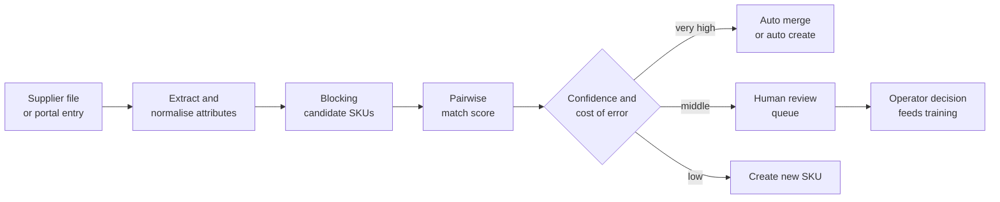
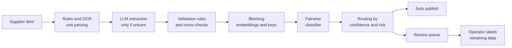

# Case Study 44: Catalogue Duplicate Matching and Attribute Extraction (Is "Amul Taza 500 ml" the Same as "Taza Toned Milk 0.5 L")

**Domain:** Quick Commerce | **Problem Type:** NLP and computer vision, entity matching and information extraction | **Difficulty:** Intermediate

---

## 1. Business Context

### Company background

- Same company as Case 6: **Jhatpat** (fictional), 320 dark stores in 9 cities, about 3 lakh orders a day, about 10.95 crore orders a year, about ₹5,200 Cr GMV a year.
- The live catalogue has about 28,000 SKUs (a single store carries about 5,500 of them). Suppliers, brands and distributors send product data in their own formats: spreadsheets, PDFs, portal forms, and pack photos.
- About 14,000 new or changed supplier items arrive every month. A catalogue team of about 80 operators checks each one: is it already in our catalogue, and are the title, brand, pack size, MRP, diet mark and category right?
- Mistakes in the catalogue spread to search (Case 31), substitution (Case 41), inventory (Case 8), pricing and the picking screen.

### The pain, with numbers

| Item | Value |
| --- | --- |
| Live SKUs | about 28,000 |
| Duplicate listings (same product under two or more SKU IDs) | about 6% (about 1,680 SKUs) |
| GMV share of the affected long-tail SKUs | about 3% (about ₹156 Cr) |
| GMV lost to split demand, split stock and split reviews on those SKUs | about 8% (about ₹12.5 Cr), which is about ₹2.5 Cr of contribution at 20% |
| SKUs with a missing or wrong key attribute (pack size, unit, variant, diet mark) | about 22% |
| GMV share of those SKUs | about 20% (about ₹1,040 Cr) |
| Search conversion lift if attributes are fixed (assumed on those SKUs) | about 1% (about ₹10.4 Cr GMV, about ₹2.1 Cr contribution) |
| Catalogue team cost | 80 operators x ₹35,000 x 12 = about ₹3.4 Cr a year |
| Time from supplier file to live listing | about 6 days |
| Refunds and complaints from MRP or unit-price errors, and wrong pack size | about ₹1.0 Cr a year |

- Real examples of the mess: "Aashirvaad Atta 5kg", "Ashirvad Whole Wheat Flour 5 Kg" and "AASHIRVAAD SELECT ATTA 5000g" in the same category. Or "Maggi 70 g" and "Maggi Masala 280 g (4 x 70 g)", which look similar but are different products.
- Targets: cut duplicates from 6% to 1.5%, raise the share of SKUs with all key attributes correct from 78% to 95%, and halve the manual review workload without more false merges.

### Stakeholders and what each wants

| Stakeholder | What they want | What they fear |
| --- | --- | --- |
| Head of Category | Fast onboarding of new items, clean ranges | Good items stuck in review for a week |
| Catalogue operations | A smaller queue and clear reasons for each flag | A model that floods them with doubtful cases |
| Head of Search and Discovery | Clean titles and attributes for ranking and filters | Duplicates splitting clicks and reviews |
| Head of Supply Chain | One SKU per product for stock and replenishment | Phantom stock-outs because stock sits in the "other" SKU |
| Pricing team | One MRP per product and correct unit prices | A wrong merge that prices a 1 kg pack at a 500 g price |
| Legal and compliance | Correct MRP, net quantity, veg and non-veg mark | Mislabelled declarations, which are covered by packaged-commodity and food labelling rules |
| Suppliers and brands | Fast listing, correct brand display | Their item merged with a competitor's |

---

## 2. Translating Business to ML

### The business question vs the ML question

| Business question | ML question |
| --- | --- |
| "Is this new supplier item already in our catalogue?" | "For a new item and each plausible existing SKU, estimate the probability that they are the same product (entity matching)" |
| "Can we fill the missing fields automatically?" | "Extract brand, pack size, unit, variant, diet mark, MRP and category from the title, description and pack images, with a confidence for each field" |
| "What can go live without a human?" | "Route each item by confidence and by the cost of error for that attribute" |

> **Mentor note:** There are three separate jobs: **blocking** (pick a small set of plausible candidates), **matching** (decide same or different), and **extraction** (fill and normalise attributes). Extraction comes first in practice, because matching depends on a clean brand, size and unit. And the costs are not symmetric: merging two different products is much worse than leaving a duplicate for another day.

### Target variable definition

- **Matching target:** `is_same = 1` if two supplier items or SKUs are the same sellable product (same brand, product line, variant, and pack size, and the same barcode when present), `0` otherwise. Labels come from past merges, operator decisions, and barcode (EAN or GTIN) agreement.
- **Extraction target:** the correct value of each attribute (brand, net quantity, unit, variant, diet mark, MRP, shelf life), compared with operator-verified values.
- **Routing target:** `auto_approve` if the predicted error rate for the item is below a threshold set from the cost of error.

### Edge cases

| Edge case | Recommended treatment | Reason |
| --- | --- | --- |
| Same product, pack size written as 500 g, 0.5 kg or 500 gm | Normalise units to a canonical form before matching | The same product, written differently |
| Multi-pack (4 x 70 g) vs single pack (70 g) vs one bigger pack (280 g) | Parse count and unit size separately, treat count as a key attribute | Different SKUs, different price and picking |
| Same brand, different variant (Masala, Atta, Chicken) | Variant is a hard key for matching | The most common false merge |
| Seasonal or limited edition packs with a new design | Review by humans if the barcode is new and the text is identical | May or may not be a new SKU |
| Same barcode, different titles | High-confidence match unless sizes disagree | Barcodes are reliable but can be reused or mis-entered |
| Missing or invalid barcode | Fall back to text and image | Common for local and unbranded items |
| Loose items (onion, tomato, per kg) | Different logic, with no pack size to match | Weight is variable |
| Regional language labels (Hindi, Tamil, Kannada) | Use multilingual models and images with OCR | Brands print local names |

### Unit of prediction

- A **candidate pair** (incoming item, existing SKU) for matching. A **(item, attribute)** pair for extraction.

### Prediction timing



- This runs in **batch** when files arrive, with a low latency need (minutes are fine), and also on-demand when an operator opens an item.

### What success looks like

| Lens | Success |
| --- | --- |
| Business | Duplicates down to 1.5%, attributes correct on 95% of SKUs, about ₹7.6 Cr a year |
| Model | Auto-merge precision of 99.5% or better, recall of true duplicates of 90% or better at the review threshold, per-attribute accuracy at or above the targets in the metrics table |
| Operations | Manual review volume down by 60%, time to live listing from 6 days to under 2 days |

---

## 3. Data Understanding

### Data sources and key features

| Feature group | Source | Why it matters |
| --- | --- | --- |
| Supplier titles and descriptions | Supplier files and portal | The main text signal, often noisy |
| Pack images (front, back, nutrition panel) | Supplier uploads | Source of brand, size, MRP, diet mark, batch and shelf life |
| Barcode (EAN or GTIN), HSN code | Supplier data and pack scan | The strongest key when present |
| Existing catalogue (titles, attributes, images, category tree) | Catalogue database | The target set to match against |
| Past operator decisions (merge, split, edit) | Catalogue tool logs | Labelled training data |
| Brand and product dictionary | Master data and past catalogues | Fast rules and lookup for known brands |
| Sales and returns by SKU | Order history | Detect merged SKUs that return a lot after a merge |
| Customer complaints mentioning "wrong size", "not what I ordered" | Support tickets | Finds hidden false merges and bad attributes |

### Data volume, granularity and refresh

- **Volume:** 28,000 live SKUs and 14,000 new or changed items a month. Naive pairing would compare 14,000 x 28,000 = about 39.2 crore pairs a month. After blocking, about 60 candidates per item, so about 8.4 lakh pairs a month.
- **Training data:** about 3 lakh labelled pairs from past operator decisions, plus barcode-agreement pairs, with hard negatives (same brand, different variant).
- **Refresh:** a daily job for new items, a weekly retrain, and a quarterly full-catalogue de-duplication sweep.

### Common data issues

| Issue | How it shows up here |
| --- | --- |
| Inconsistent units and abbreviations | 500 g, 500gm, 0.5kg, 500 GMS, half kg |
| Titles with marketing text | "NEW! Fresh and Tasty Biscuits Pack of 4 Buy Now" |
| Wrong or reused barcodes | Two products on the same code, or a typed code with a digit error |
| Language and script mix | English, Hindi in Latin letters, regional script |
| Label noise | Past operators merged items that should not have been, and the model learns it |
| Very imbalanced pairs | Among 60 candidates, usually 0 or 1 is a true match |
| Image quality | Glare, angled pictures, low resolution |
| Drift in supplier formats | A big supplier changes its spreadsheet columns |

> **Mentor note: Where juniors usually go wrong here.**
>
> - They tune the matcher for F1 and treat a false merge and a missed merge as equal. They are not. A false merge sends the wrong item to customers.
> - They compare raw strings and skip unit parsing. "500 g" and "0.5 kg" look nothing alike to a character model, and a very similar title with "250 g" looks almost identical.
> - They compute blocking recall too late. If the true match is not in the candidate list, no matcher can find it.

---

## 4. Approach and Decision Points

### Baseline first

- **Baseline 1 (current):** exact barcode match, otherwise operators search the catalogue by title. About 6% duplicates, 6 days to onboard.
- **Baseline 2:** rules: normalise units, extract brand from a dictionary, block by brand and category, then fuzzy title similarity (token set ratio) with a high threshold.
- **Why it matters:** a rules plus fuzzy-match baseline often resolves 50 to 60% of items safely, and gives you labelled data and a fallback.

### Candidate models

| Model | Pros | Cons | Verdict |
| --- | --- | --- | --- |
| Rules and regular expressions for units and pack counts | Precise, explainable, free | Brittle for new formats | Use for unit parsing and pack counts |
| Fuzzy string matching (token set, Jaro-Winkler) | Quick, no training | Misses brand synonyms and variants | Feature and baseline |
| Blocking by brand, category, size, plus approximate nearest neighbour search on text and image embeddings | Cuts pairs from 39 crore to under 10 lakh | Needs recall monitoring | **Required first step** |
| **Gradient boosted pairwise classifier on engineered pair features** (size match, variant match, text similarity, image similarity, barcode agreement) | Accurate, fast, explainable | Needs hard-negative training pairs | **Primary matcher** |
| Fine-tuned transformer cross-encoder (a text pair model) | Best on messy text | Slower, GPU, harder to debug | Use on the middle band only |
| Vision-language or OCR models for pack images | Reads pack text, MRP, diet mark | Slower, quality varies | For extraction when text is missing |
| **LLM-assisted extraction** (structured output with a schema and confidence) | Handles odd formats and mixed languages with few examples | Cost, hallucination, inconsistency | Use with validation rules and as a second opinion, not as the only judge |
| Clustering of the entire catalogue | Finds groups | Hard to control false merges | For the quarterly sweep, with review |

### Decision scenarios

| What if... | Recommended action | Reasoning |
| --- | --- | --- |
| **A false merge costs about ₹45,000 per incident a year and a missed merge about ₹15,000 a year** | Merge automatically only when the match probability is above 0.99, and send the 0.7 to 0.99 band to review. Reason: a false merge also carries safety, legal and reversal costs, so the effective cost ratio is about 100 to 1, not 3 to 1 | Decision-theory threshold is cost of false merge over the sum of both costs. The more irreversible the action, the higher the bar |
| **Titles say "500 g" and "0.5 kg" and the model sees them as different** | Parse every size into (count, unit size, unit) with a canonical unit (grams, millilitres, pieces) before matching, and make "size equal after normalisation" a hard feature. Test with a unit-conversion unit test suite | Unit mismatches are a rules problem, not a learning problem |
| **Two SKUs have the same barcode but different pack sizes** | Do not auto-merge. Send to review with the reason "barcode conflict", and check the pack image | Barcodes can be reused or mistyped. A wrong merge here is a high-cost one |
| **The LLM extracts "Veg" for an item whose image shows a non-veg symbol** | Treat diet mark and allergen as **high-risk attributes**: require agreement of text, image OCR and the supplier field, otherwise send to review. Never take the LLM output alone | Hallucinations are costly for safety attributes. Use rules and cross-checks |
| **Blocking by brand misses a match because the brand is spelled differently (Ashirvad vs Aashirvaad)** | Add a second blocking key (embedding nearest neighbours on title, and the barcode prefix), and monitor blocking recall on a labelled set. Add a brand alias table from operator corrections | Recall of the candidate set caps overall recall |
| **A huge supplier file arrives with 20,000 rows in one night** | Process in a queue with priority for items with sales potential (a top brand, a requested item). Rate limit LLM calls and cache by normalised text | Cost and operator capacity must be managed |
| **Operators complain the review queue is full of obvious items** | Show the top reason for each flag, auto-approve groups of identical rule outcomes, and sort the queue by expected value (GMV potential x uncertainty). Track the share of reviews where the model was right | A queue must be small and useful or it will be ignored |
| **A merge goes live and complaints rise for "wrong size delivered"** | Add a post-merge watch: complaint and return rate per merged SKU for 14 days, and auto-split alert above a threshold | Catches errors that got through, and creates new training labels |

---

## 5. Feature Engineering

### Top 10 features to build

| # | Feature | Business logic |
| --- | --- | --- |
| 1 | Barcode agreement (exact, same prefix, conflict, missing) | Strongest evidence, and a conflict is a red flag |
| 2 | Normalised pack size equality (count x unit size in grams, ml or pieces) | Same product must have the same quantity |
| 3 | Brand match (exact, alias, parent brand, different) | Brands rarely change for the same product |
| 4 | Variant token match (flavour, fat level, type, colour) | The most common false-merge cause |
| 5 | Title similarity (token set ratio and embedding cosine) | Captures wording differences |
| 6 | Image embedding similarity of the front of the pack | Helps when text is poor |
| 7 | MRP ratio between the two items | A big gap suggests a different size or a different product |
| 8 | Category and sub-category agreement | Matching across different categories is suspicious |
| 9 | Multi-pack flag agreement (single vs pack of N) | Separates single and bundle |
| 10 | Supplier reliability score (share of past items from this supplier that needed correction) | Dirty suppliers deserve more review |

### Features to avoid (leakage risks)

| Feature | Problem |
| --- | --- |
| Whether the item was later merged (from the final catalogue) | It is the label |
| SKU ID order or creation date proxies that reflect past operator choices | Leaks old decisions |
| Sales of the SKU after the merge | Outcome |
| Operator ID | Learns individual habits and not product facts |
| Complaint counts after going live | Post-decision |
| Supplier name as a strong feature for the match decision | The same supplier sells different products |

Normalising pack sizes into a canonical unit, with a check for unknown units:

```python
import re

UNIT_TO_BASE = {"g": 1, "gm": 1, "gms": 1, "kg": 1000, "ml": 1, "l": 1000, "ltr": 1000, "litre": 1000}
PATTERN = re.compile(r"(?:(\d+)\s*[xX]\s*)?(\d+(?:\.\d+)?)\s*(kg|gms|gm|g|ml|ltr|litre|l)\b", re.I)

def parse_pack(title: str):
    m = PATTERN.search(title)
    if not m:
        return None  # send to the LLM or the review queue, never guess
    count = int(m.group(1) or 1)
    size = float(m.group(2)) * UNIT_TO_BASE[m.group(3).lower()]
    return {"count": count, "unit_size": size, "total": count * size}

# parse_pack("Aashirvaad Atta 0.5 kg")  -> total 500
# parse_pack("Maggi Masala 4 x 70 g")   -> count 4, unit_size 70, total 280
```

---

## 6. Evaluation Strategy

### Metrics

| Metric | Role | Why |
| --- | --- | --- |
| **Precision of auto-merges** (share of auto-merged pairs that are truly the same) | Primary, with a floor of 99.5% | A false merge is the costly error |
| Recall of true duplicates at the review threshold | Primary | Duplicates that the pipeline never surfaces stay in the catalogue |
| **Blocking recall** (true match present in the candidate list) | Pipeline health | Caps the recall of everything after it |
| Candidates per item after blocking | Efficiency | Compute and review cost |
| **Per-attribute accuracy** (brand, pack size, unit, variant, diet mark, MRP, category) | Extraction quality | Each attribute has its own cost of error |
| Auto-approve rate and review queue size | Operations | The labour saving |
| Post-go-live correction rate (items edited by operators or flagged by complaints within 14 days) | Real-world quality | The final test |
| Effect on search click-through and conversion for affected SKUs | Business | Why we do this |

Target accuracy per attribute (on an operator-verified sample of 5,000 items):

| Attribute | Target accuracy | Reason for the bar |
| --- | --- | --- |
| Diet mark (veg, non-veg) and allergen | 99.8% | Safety and legal |
| MRP | 99.5% | Billing and MRP rules |
| Pack size and unit | 98% | Picking, price per unit, substitution |
| Brand | 98% | Search and merge |
| Variant | 96% | Merge and search |
| Category | 95% | Navigation and filters |

### Metrics that look good but are misleading here

- **Overall pairwise accuracy:** with about 1 true match in 60 candidates, saying "no match" always gives 98% accuracy.
- **F1 at a single threshold:** hides that false merges and missed merges have different costs.
- **Average accuracy across attributes:** a good category score can hide a bad diet mark score.
- **LLM agreement with an LLM judge:** both can be wrong in the same way. Use operator-verified data.

### Validation strategy

| Step | Design | Why |
| --- | --- | --- |
| Gold set | 5,000 items and 20,000 candidate pairs labelled by two operators, with disagreements settled by a senior | A trustworthy label set, including hard negatives |
| Supplier-grouped split | Hold out whole suppliers for testing | Tests new formats, as suppliers differ a lot |
| Time-based split | Train on older onboarding batches, test on the latest | Matches deployment |
| Blocking recall test | Check that every true pair in the gold set is in the candidate list | Catches the silent cap on recall |
| Hard-negative audit | Review all high-score false pairs (same brand, different variant or size) | Where false merges come from |
| Shadow mode | Run for 4 weeks next to operators, compare decisions, do not publish | Safe real-world test |
| Online test | Auto-approve for a set of suppliers and categories, compare correction rate and search conversion with a control set | Final proof |

### From model metric to business value

- **Duplicates:** 6% to 1.5%. The affected long-tail GMV of about ₹156 Cr loses about 8% (about ₹12.5 Cr GMV), and at 20% contribution that is about **₹2.5 Cr**, which is recovered in large part.
- **Attributes:** 20% of GMV (₹1,040 Cr) sits on SKUs with weak attributes. A 1% conversion lift on that is about ₹10.4 Cr GMV, at 20% about **₹2.1 Cr**.
- **Operations:** the review load down by 60%. 60% of ₹3.4 Cr is about **₹2.0 Cr** (the staff are redeployed to range quality and supplier work, not necessarily removed).
- **Fewer pricing and size errors** (refunds, complaints, MRP corrections): about **₹1.0 Cr**.
- **Total about ₹7.6 Cr a year.** A single large false merge on a top SKU could cancel a month of gains, which is why the precision floor matters more than the headline recall.

---

## 7. Deployment and Monitoring

### Batch vs real time

- **Batch:** daily processing of new supplier items, a weekly retrain, and a quarterly de-duplication sweep of the live catalogue.
- **Near real time:** an operator tool that shows the candidate matches, extracted attributes and reasons while the item is open.
- **Cost:** LLM extraction on about 14,000 items a month at about ₹1.5 an item is about ₹21,000 a month. Cache by normalised text, and call the LLM only where rules and OCR are not confident.



### What to monitor

| Type | What to track | Alert trigger |
| --- | --- | --- |
| Auto-merge precision | Sampled audit of 200 auto-merges a week | Below 99.5% |
| Blocking recall | Gold set check, weekly | Below 98% |
| Per-attribute accuracy | Audit sample by attribute | Below the target for any attribute |
| Post-go-live corrections | Edits and complaints within 14 days | Above 3% of items |
| Queue health | Review queue size, age, operator override rate | Queue above 2 days of work, or override above 20% |
| Supplier drift | New columns, new formats, null rates | Sudden change |
| LLM behaviour | Schema failures, cost, disagreement with rules | Disagreement above 10% |
| Business | Duplicate share, search conversion on cleaned SKUs | No improvement after 8 weeks |

### Retraining

- **Scheduled:** weekly update using the latest operator decisions, with a monthly review of the hard-negative set.
- **Triggered:** a new supplier format, a new category (for example electronics accessories), an LLM version change (re-run the gold set before switching).

### A/B test or champion-challenger design

- **Item-level or supplier-level split:** for a set of suppliers, route items through the new pipeline vs the old process, compare correction rate, time to list and downstream conversion.
- **Champion-challenger on the matcher:** the new model scores next to the old one in shadow for 4 weeks. Switch only if precision at the auto-merge threshold is at least as high.
- Check search and pricing effects at the SKU level, using a difference-in-differences on cleaned SKUs vs similar uncleaned ones.

---

## 8. Stakeholder Communication

### Explain it to a non-technical leader

> "Suppliers describe the same product in many ways, and we have about 6% duplicate listings and one in five products with missing or wrong details. The new system reads the title and the pack photo, writes the size and type in one standard format, and finds likely matches in our catalogue.
> It only merges automatically when it is almost certain, because merging two different products is much worse than leaving two listings of the same one. Everything doubtful goes to a person, with the reason shown.
> That halves the review work, speeds up listing, and cleans search and pricing, worth about ₹7.6 Cr a year."

### Questions leadership will ask

| Question | Suggested answer |
| --- | --- |
| "Why not merge when the model is 90% sure?" | "A wrong merge delivers the wrong item and may be a safety or legal issue. A missed merge costs us a small amount for a few days. So the bar for merging is above 99%" |
| "Can an AI model just do all of this?" | "A language model helps with messy text, but it can invent details. We use rules for sizes and units, and we cross-check risky fields like veg or non-veg against the pack image" |
| "How do you know it is accurate?" | "We keep a set of 5,000 items checked by two operators and measure each field separately, with separate targets for risky fields" |
| "What happens to the catalogue team?" | "Their work shifts from checking obvious items to handling hard cases, supplier quality and range gaps" |
| "Will this change how products show in search?" | "Yes, for the better. One listing per product means reviews, stock and clicks are not split, and filters like size and diet work" |
| "What if a supplier changes its file format?" | "We monitor for format drift, and items that do not parse go to review instead of being guessed" |

---

## 9. Common Pitfalls and Lessons

| Mistake | Why it happens | How to avoid it |
| --- | --- | --- |
| Treating false merges and missed merges as equal | F1 is the default metric | Set the threshold from the cost of each error, and report precision at the auto-merge threshold |
| Comparing raw strings with units | Titles look similar | Parse and normalise pack size, count and unit first, and test the parser |
| Skipping blocking recall | The matcher gets all the attention | Measure how often the true match is in the candidate list |
| Training on past operator merges without checking | They look like ground truth | Audit labels, find noisy merges, and use hard negatives |
| Using an LLM output without checks | It looks fluent | Validate with rules, OCR and cross-source agreement, mainly for safety fields |
| Only reporting overall accuracy | One number is easy | Report per-attribute accuracy against attribute-specific targets |
| Ignoring the review queue design | The model is the project | Provide reasons, sort by value, and measure queue usefulness |
| No watch after going live | The task seems done at merge | Track complaints and returns per merged SKU and allow auto-split |

---

## 10. Mentor's Focus Checklist

- ✅ **Where to spend 80% of the effort:**
  - Unit and pack parsing, and hard keys (brand, variant, size, count).
  - A cost-aware merge threshold with a precision floor, and a useful review queue.
  - Blocking recall and a high-quality gold set with hard negatives.
  - Per-attribute evaluation, with extra care for diet mark, allergen and MRP.
- ❌ **What not to over-engineer:**
  - A large transformer for every pair when blocking plus a boosted classifier resolves most of them.
  - LLM calls for every item, when rules and OCR handle the clean majority.
  - A perfect brand dictionary on day one, since operator corrections will grow it.
- 💡 **Key takeaway:** **A wrong merge is worse than a missed one, so build for precision first and let humans handle the grey zone.** Normalise the units before anything else, because "500 g" and "0.5 kg" are the same product only if your pipeline knows it.
