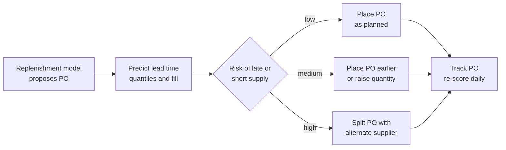
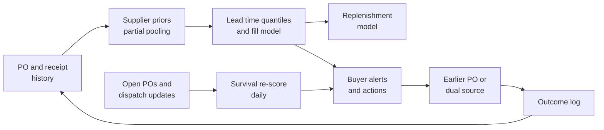

# Case Study 45: Supplier Lead-Time and Fill-Rate Prediction (The Truck That Said "Tomorrow")

**Domain:** Quick Commerce | **Problem Type:** Regression plus classification of supplier risk | **Difficulty:** Intermediate

---

## 1. Business Context

### Company background

- Same company as Case 6: **Jhatpat** (fictional), 320 dark stores in 9 cities, about 3 lakh orders a day, about 10.95 crore orders a year, about ₹5,200 Cr GMV a year.
- Dark stores are refilled from **11 mother hubs** (regional warehouses), which buy from about 420 active suppliers: brand distributors, FMCG companies, farm aggregators and mandi traders.
- Procurement raises about 2,400 purchase orders (POs) a day, about 8.76 lakh a year, each with several SKU lines. A PO has a promised delivery date from the supplier.
- Reorder points and order quantities come from the replenishment model (Case 36 and Case 5). That model assumes a **lead time** (days from PO to goods received) and a **fill rate** (share of ordered units actually delivered). Today it uses one number per supplier.
- Cost of goods is about 78% of GMV, so about ₹4,056 Cr a year flows through POs.

### The pain, with numbers

| Item | Value |
| --- | --- |
| Planned lead time (average of supplier promises) | 2.0 days |
| Actual average lead time | 2.6 days, standard deviation about 1.1 days |
| PO lines delivered more than 1 day late | about 14% |
| Average fill rate (units received over units ordered) | 86% |
| Target fill rate | 90% or better |
| Units short on POs (14% of COGS) | about ₹568 Cr a year at cost |
| Share of short supply that turns into lost sales (no spot buy, no alternate) | about 15% |
| Lost sales from short supply | about ₹85 Cr at cost, about ₹109 Cr GMV |
| Average inventory value across hubs and stores | about ₹260 Cr |
| Share of it held as safety stock | about 30% (about ₹78 Cr) |
| Carrying cost of inventory (capital, shrink, space) | about 14% a year |
| Time spent by buyers chasing suppliers | about 35% of the buying team's time |

- Suppliers behave very differently. A national FMCG company delivers on time with 96% fill. A local dairy aggregator may deliver on time but with a 75% fill in summer. A farm aggregator may be 2 days late in the monsoon.
- Today the buyers rely on memory ("this supplier is always late on Mondays") and a single average per supplier.
- Targets: raise effective fill rate by about 3 points through earlier POs and dual sourcing for risky suppliers, and cut safety stock by about 10% through better lead-time variance estimates.

### Stakeholders and what each wants

| Stakeholder | What they want | What they fear |
| --- | --- | --- |
| Head of Procurement | Fewer stock-outs, fewer buyer escalations | Shifting orders to a weaker supplier on a model's word |
| Category buyers | Early warnings, with reasons | Alerts that cry wolf on every PO |
| Head of Supply Chain | Accurate lead times in the replenishment model | Variance estimates that are too narrow |
| Finance | Lower working capital in safety stock | More stock-outs as a result |
| Head of Customer Experience | In-stock items | Missing items and substitutions (Case 41) |
| Suppliers | Fair treatment, clear rules | Being blacklisted from a single bad week |
| Legal and compliance | Fair and documented supplier selection | Unequal terms, and favouritism |

---

## 2. Translating Business to ML

### The business question vs the ML question

| Business question | ML question |
| --- | --- |
| "When will this PO arrive?" | "Predict the distribution of lead time (days) for this PO, at PO creation, with a high quantile for planning" |
| "How much will we actually get?" | "Predict the fill rate (received over ordered) for each line, with its uncertainty" |
| "Which suppliers are risky for this SKU this month?" | "Classify the chance that a PO line is late by more than 1 day, or filled below 80%" |
| "How much safety stock do we need?" | "Provide the standard deviation (or quantiles) of lead time and the mean fill rate to the replenishment model" |

> **Mentor note:** Do not predict "the lead time" as one number. The replenishment model needs two things: a **central estimate** (when to place the PO) and a **variance** (how much safety stock to hold). Safety stock grows with the standard deviation of lead time, so a model that gets the mean right and the spread wrong still leaves you with the wrong buffer. And remember: with only 420 suppliers, you have little data on each. That is a statistical problem before it is a modelling one.

### Target variable definition

- **Lead time:** `lead_days = goods_received_date minus PO_date`, from PO creation to goods received note (GRN) at the hub.
- **Fill rate:** `fill = received_units / ordered_units`, by PO line, capped at 1 (over-delivery is rare and ignored).
- **Risk labels:** `late = lead_days > promised_days + 1`, and `short = fill < 0.8`.

### Edge cases

| Edge case | Recommended treatment | Reason |
| --- | --- | --- |
| **Open POs** (not yet received, so the lead time is unknown) | Treat as **censored** observations: we know the lead time is at least the days elapsed. Use survival models or at least do not drop them | Dropping open POs removes the worst delays and makes suppliers look better than they are |
| PO cancelled by Jhatpat | Exclude, but record the reason | Not a supplier failure |
| PO cancelled by the supplier | Count as fill = 0 and late | A real supply failure |
| Partial deliveries over several days | Model fill at a cut-off (for example 3 days after promised date) and track the delivery pattern | Prevents confusing delay with short supply |
| Reschedules agreed by both | Keep the original promised date and add a reschedule flag | Reflects the first promise |
| Planned shutdowns, strikes, floods, state border holds | Add as event features, keep in the data | They happen again |
| Supplier changes depot or distributor | Treat as a new supplier-depot pair, borrow strength from the old | Behaviour shifts |

### Unit of prediction

- A **PO line** (supplier, SKU, hub, quantity, date) at PO creation. Supplier-level scores are an aggregation of these, used for sourcing decisions.

### Prediction timing



- A first prediction at PO creation, and a **daily update** for open POs using news such as a dispatch confirmation or a missed pickup.

### What success looks like

| Lens | Success |
| --- | --- |
| Business | Effective fill rate up by about 3 points, safety stock down about 10%, about ₹6.4 Cr a year |
| Model | Lead time P90 calibrated within 5 points (90% of POs arrive within the predicted P90), fill rate MAE under 6 points, late-risk AUC of 0.75 or more |
| Decision | Buyers act on at least 60% of high-risk alerts, and at least half of alerts turn out to be useful |

---

## 3. Data Understanding

### Data sources and key features

| Feature group | Source | Why it matters |
| --- | --- | --- |
| PO header and lines (supplier, hub, SKU, quantity, promised date, PO day of week) | Procurement system | The base record |
| Receipt data (GRN date, units received, rejected units, short-dated units) | Warehouse system | The outcomes |
| Supplier history (on-time share, fill rate in the last 4, 12 and 52 weeks, trend) | Derived | Core of the prediction |
| SKU features (category, perishability, pack type, seasonality, share of supplier volume) | Catalogue and sales | Some SKUs are harder to supply |
| Supplier capacity signals (their stock status if shared, minimum order quantity, production days) | Supplier portal | Directly tied to shortages |
| Calendar and events (festival demand, harvest season, monsoon, strikes, GST filing dates, fuel price shocks) | Calendar and news | Seasonal shortfalls |
| Distance and lane (supplier to hub, route type, toll or border crossing) | Logistics data | Transit time and variance |
| Order pressure (our order size vs the supplier's usual size, other buyers' demand) | Derived | Large PO relative to capacity means shorts |
| Dispatch updates (confirmed, picked up, in transit) | Supplier or transporter API | The best live signal for open POs |

### Data volume, granularity and refresh

- **Volume:** about 8.76 lakh POs a year, about 40 lakh PO lines. Per supplier, that is about 2,000 POs a year on average, but the spread is huge: the top 40 suppliers have 70% of volume, while about 150 suppliers have fewer than 100 POs a year, and many have fewer than 20 for a given SKU group.
- **Granularity:** PO line for fill, PO for lead time, supplier-SKU-hub for aggregation.
- **Refresh:** receipts daily, dispatch status as it arrives, supplier scores weekly, model weekly.

### Common data issues

| Issue | How it shows up here |
| --- | --- |
| **Censoring** | Open POs and POs that were cancelled because they were too late hide the longest delays |
| **Small data per supplier** | A supplier with 12 POs in a season has noisy averages |
| Promised date is not a real promise | Suppliers give optimistic dates, and a "promised date" differs by who typed it |
| GRN dates lag reality | A truck arrives on Monday and GRN is posted on Wednesday |
| Our own actions change outcomes | We chase suppliers on late POs, and that speeds some deliveries |
| Reschedules overwrite history | The system keeps only the latest date |
| Seasonality and non-stationarity | Mango season, festival sweets, monsoon roads |
| Partial deliveries | Hard to tell if a second truck will arrive |

> **Mentor note: Where juniors usually go wrong here.**
>
> - They drop the open POs and compute an average on the completed ones. Open POs are the late ones. The model then thinks suppliers are better than they are.
> - They fit one model per supplier, and get wild estimates for the small suppliers. Or they fit one global model and ignore the supplier effect entirely.
> - They predict the average lead time and pass it to the replenishment model, which needs the variance.

---

## 4. Approach and Decision Points

### Baseline first

- **Baseline 1 (current):** a single average lead time and fill rate per supplier over the past 6 months.
- **Baseline 2:** an average by supplier x category x month-of-year with a shrinkage to the supplier average when the count is small.
- **Why it matters:** if a shrunk average captures most of the signal, you know that the extra features add modest value, and you have a safe fallback.

### Candidate models

| Model | Pros | Cons | Verdict |
| --- | --- | --- | --- |
| Supplier average (current) | Simple | Ignores SKU, season, PO size, and the spread | Baseline |
| Hierarchical (mixed-effects or Bayesian) model with supplier and SKU-group effects | Shares strength across suppliers, honest uncertainty for small suppliers | More work to build and explain | **Primary for the supplier effect** |
| **Gradient boosted quantile regression (LightGBM) with supplier history features** | Handles interactions, gives P50 and P90 | Weak for brand-new suppliers unless they have shrunk features | **Primary for lead time quantiles** |
| Survival models (accelerated failure time, Cox, or a discrete-time hazard model) | Uses open POs correctly, gives a full lead-time curve | Needs careful set-up | **Use to handle censoring and daily re-scoring** |
| Beta regression or boosted regression on fill rate | Fill is bounded between 0 and 1 | Needs a two-part model (zero fills and short fills) | For fill rate |
| Classifier for "late" and "short" risk | Easy to turn into alerts | Needs a good threshold | For the buyer workflow |
| Deep sequence models on supplier history | Can see patterns over time | Too little data per supplier | Not worth it |

### Decision scenarios

| What if... | Recommended action | Reasoning |
| --- | --- | --- |
| **A supplier has only 14 POs in the data and 3 were very late** | Use partial pooling: estimate the supplier's effect as a weighted mix of its own average and the average of similar suppliers (same category, size, region), with the weight growing with the number of POs. Show the uncertainty band to the buyer | Three late POs out of 14 may be bad luck. Treating it as truth wrongly blacklists a supplier, and ignoring it is also wrong |
| **There are 3,100 open POs and 240 of them are already past the promised date** | Include them as censored records in a survival model, and use their elapsed days as a lower bound. Re-score every day | These are the most informative cases for risk, and dropping them biases the lead time downwards |
| **The model gives a lead time of 2.6 days on average, but the replenishment team needs safety stock** | Provide P50 and P90 (or mean and standard deviation) of lead time by supplier-SKU-hub, and test that safety stock based on the P90 gives the target in-stock rate in a simulation | Safety stock depends on the spread, not just the mean |
| **A mango supplier is reliable in April and short in June** | Add seasonal features (month, crop cycle, rainfall index) and interact them with the supplier. Check calibration by month | Supply risk is seasonal, and a yearly average hides it |
| **A PO is predicted to be short by 30%** | Match the action to the cost: place the PO 1 day earlier if the SKU has time, raise the quantity by the expected shortfall, or split with a second supplier if the SKU is a top seller. Do not blindly double the order, because that hurts the supplier and adds stock | The model supports a decision. The right action depends on stock cover and alternatives |
| **Dual sourcing a SKU costs about 4% more in price** | Dual source only when expected lost margin from shortage exceeds the price premium. For a SKU with ₹1 lakh weekly sales, 20% risk of a 30% shortage, and 22% margin, the loss is about ₹1,320 a week, and the premium on half the volume must be below that | Dual sourcing is an insurance, so price it as one |
| **Supplier scores trigger penalties, and suppliers start to hide delays by under-promising dates** | Score against a standard promise (the quoted lead time at PO), not on the supplier's own revised dates, and use the scores for planning first, not penalties. Check supplier fairness and keep an appeals route | Metrics used for penalties get gamed. Procurement must treat suppliers fairly |
| **A strike or flood hits a region** | Switch to event-driven rules from the news and logistics feed for 1 to 2 weeks, widen the P90, and trigger early POs. Do not retrain on this period without a flag | Rare shocks should be handled by operations, not learned as normal behaviour |

---

## 5. Feature Engineering

### Top 10 features to build

| # | Feature | Business logic |
| --- | --- | --- |
| 1 | Supplier on-time share and fill rate over the last 4, 12 and 52 weeks, shrunk toward the peer group | Core reliability signal with small-sample protection |
| 2 | Supplier-SKU-group fill rate in the same month last year | Seasonal supply pattern |
| 3 | PO quantity relative to the supplier's usual quantity for this SKU | Big orders are more often short |
| 4 | Promised lead time and PO weekday (a Friday PO crossing a weekend) | Promised dates differ in reliability by weekday |
| 5 | Number of our open POs with the same supplier right now | Capacity pressure |
| 6 | Supplier minimum order quantity and production days (if known) | Shows when stock is made |
| 7 | Lane features (distance, route type, border crossings) and recent transit time | Transit variance |
| 8 | Category and perishability, crop cycle and rainfall index | Farm and dairy suppliers swing with weather |
| 9 | Days since the supplier's last short delivery and trend in fill | Recent behaviour matters most |
| 10 | Dispatch status for open POs (confirmed, picked up, in transit) and hours since the last update | The best live signal after PO creation |

### Features to avoid (leakage risks)

| Feature | Problem |
| --- | --- |
| GRN date or received quantity of this PO | The target |
| The supplier's final reschedule date, if known only later | Look-ahead |
| Whether the buyer cancelled or chased the PO | Reaction to the outcome |
| Rejection and short-dated flags after receipt | After the target |
| Supplier-level averages computed over a window that includes this PO | Target leakage |
| Number of stock-outs that this PO later caused | Outcome |

Partial pooling for a supplier's late rate, with a Bayesian-style shrinkage (empirical Bayes):

```python
import numpy as np

# late_i ~ Binomial(n_i, p_i), p_i ~ Beta(a, b) fitted on all suppliers
def shrunk_late_rate(late_count, n_po, a, b):
    # posterior mean: pulls small suppliers toward the group, leaves big ones alone
    return (late_count + a) / (n_po + a + b)

# group prior from method of moments over suppliers with n_po >= 30
m, v = rate_all.mean(), rate_all.var()
k = m * (1 - m) / v - 1
a, b = m * k, (1 - m) * k

p_hat = shrunk_late_rate(late_count, n_po, a, b)
# 3 late of 14 POs (raw 21%) moves toward the group rate of about 14%
```

---

## 6. Evaluation Strategy

### Metrics

| Metric | Role | Why |
| --- | --- | --- |
| **Calibration of lead time quantiles** (share of POs arriving within predicted P50 and P90) | Primary for lead time | Safety stock relies on the tail being right |
| Pinball loss at P50 and P90 | Model comparison | The right loss for quantile prediction |
| **MAE of fill rate (percentage points)** and bias by supplier size | Primary for fill | Used to inflate order quantities |
| AUC and precision at the top 10% of risk for "late" and "short" | Alert quality | Buyers can act on a few alerts |
| Share of alerts judged useful by buyers | Workflow | Adoption depends on it |
| Effective fill rate and in-stock rate | Business outcome | The reason for the project |
| Safety stock value and in-stock rate together | Business outcome | Shows no free lunch |
| Concordance index with censored data | Survival model quality | Handles open POs |

### Metrics that look good but are misleading here

- **MAE of lead time on completed POs only:** ignores censored POs and flatters the model.
- **Overall AUC:** driven by a few suppliers with extreme behaviour. Check within the 150 small suppliers.
- **Average fill rate:** can sit at 86% while some SKUs are consistently at 60%.
- **Supplier ranking accuracy:** a ranking of suppliers may be stable and yet useless for choosing an action on a specific PO.

### Validation strategy

| Step | Design | Why |
| --- | --- | --- |
| Time-based split with a rolling origin | Train on weeks 1 to 78, test on 79 to 90, then shift forward | Matches deployment and respects seasonality |
| Censoring-aware evaluation | At each test date, include POs that were still open at that date as censored | Avoids look-ahead and survivor bias |
| Supplier-size strata | Report metrics separately for large (more than 500 POs), medium and small suppliers | Shows if shrinkage helps small ones |
| New supplier holdout | Hold out 10% of suppliers entirely | Tests the cold start |
| Same-season test | Test on the same months as the previous year (monsoon, festivals) | Tests seasonal features |
| Backtest of safety stock | Simulate the replenishment policy with predicted vs actual lead times, measure in-stock rate and stock value | Converts the model into rupees |
| Pilot | A few categories at 2 hubs for 8 weeks versus the other hubs | Real behaviour, including buyer actions |

### From model metric to business value

- **Fill rate +3 points.** COGS through POs is about ₹4,056 Cr. 3% of that is about ₹121.7 Cr of extra goods received. About 15% of the shortfall would have been lost sales, so ₹121.7 Cr x 15% = ₹18.3 Cr at cost, about ₹23.4 Cr of GMV (divide by 0.78), at 20% contribution, about **₹4.7 Cr**.
- **Safety stock -10%.** Safety stock of about ₹78 Cr falls by about ₹7.8 Cr. At 14% carrying cost, about **₹1.1 Cr**.
- **Less spoilage and short-dated stock on perishables** from better-timed POs, about **₹0.6 Cr**.
- **Total about ₹6.4 Cr a year.** The buying team also frees up time (about 35% is spent chasing suppliers), which is not counted above.

---

## 7. Deployment and Monitoring

### Batch vs real time

- **Batch:** a nightly scoring of all open and planned POs, a weekly refresh of supplier scores and shrinkage priors, a weekly model retrain.
- **Near real time:** re-scoring when a dispatch update arrives, and on-demand scores when the replenishment model proposes a PO.
- Design for failure: if the service is down, use the shrunk supplier-SKU average and a fixed safety multiplier.



### What to monitor

| Type | What to track | Alert trigger |
| --- | --- | --- |
| Calibration | Share of POs within predicted P90, by supplier size and category | Below 85% or above 95% |
| Fill accuracy | MAE and bias of predicted fill by category | MAE above 8 points |
| Alert quality | Precision of top-risk alerts, share acted on by buyers | Precision below 40%, action below 50% |
| Business | Effective fill rate, in-stock rate, safety stock value | Fill rate drop of 2 points for 2 weeks |
| Data | GRN posting delay, missing dispatch updates, share of open POs | GRN delay above 2 days |
| Supplier concentration | Share of volume on suppliers with high risk | Rising trend |
| Fairness and documentation | Reasons logged for each switch of supplier | Missing reasons |
| Drift | Change in supplier effect and seasonal pattern | Large shift versus the last year |

### Retraining

- **Scheduled:** weekly, using a 2-year window to capture two seasons. Supplier priors refreshed weekly.
- **Triggered:** a big supplier onboarding or exit, a change in our PO rules, a regional disruption (flag and exclude from normal fit), a new hub.

### A/B test or champion-challenger design

- Randomise at **supplier-SKU level** or at the **hub level**, as buyers and hubs share suppliers. A hub-level pilot (2 hubs with alerts and actions against matched hubs) for 8 weeks is simpler.
- Primary: effective fill rate and in-stock rate. Guardrails: purchase price paid (dual sourcing premium), stock value, supplier complaints.
- Run the model in shadow first. Compare predicted to actual lead time for 4 weeks before any buyer sees an alert.

---

## 8. Stakeholder Communication

### Explain it to a non-technical leader

> "Today we plan with one average delivery time per supplier, but suppliers vary by product, by season and by how big our order is. The new model gives each purchase order a likely arrival window and an expected quantity, and warns buyers when an order is likely to be late or short.
> For small suppliers with little history, it borrows strength from similar suppliers, so we do not judge them on a few bad days.
> The buyer then orders earlier, adjusts the quantity or splits the order, and the replenishment model holds the right safety stock.
> We expect about 3 points better fill rate and about 10% less safety stock, worth about ₹6.4 Cr a year."

### Questions leadership will ask

| Question | Suggested answer |
| --- | --- |
| "Why not just ask suppliers to be more reliable?" | "We do, and the scores help that conversation. But today's fill rate costs us about ₹85 Cr in lost sales at cost. We need to plan around the risk we cannot remove" |
| "How can you score a supplier with only 15 orders?" | "We blend its record with similar suppliers, so a few bad weeks do not wrongly label it. The score shows an uncertainty range, and buyers see it" |
| "What about orders that have not arrived yet?" | "We count them as late-so-far, not as missing. Leaving them out would make everyone look better than they are" |
| "Will this lead us to drop suppliers?" | "It is used first to plan orders and safety stock. Any change in supplier needs buyer review, documented reasons, and fair treatment" |
| "Why hold less safety stock if the risk is higher?" | "We hold it where the variance is high and release it where suppliers are steady. Today we spread it evenly, which is wasteful" |
| "How is this different from demand forecasting?" | "Case 5 predicts what customers will buy. This case predicts whether the supplier will deliver it in time. Both feed the replenishment decision" |

---

## 9. Common Pitfalls and Lessons

| Mistake | Why it happens | How to avoid it |
| --- | --- | --- |
| Dropping open POs | Only completed POs have a target | Use survival models or censoring-aware features, and re-score daily |
| Treating small-supplier averages as true | Averages are easy to compute | Use partial pooling and show uncertainty |
| Predicting only the mean lead time | It is the obvious target | Provide quantiles or variance for safety stock |
| One model per supplier | It feels tailored | Use a hierarchical model with shared effects |
| Using the supplier's revised date as the promise | It is the only date in the system | Keep the original promise and log reschedules |
| Ignoring that our own PO size affects fill | The supplier is blamed for everything | Include PO size relative to the supplier's normal |
| Alerts without actions or reasons | Models stop at prediction | Link each risk band to an action and show the top drivers |
| Using scores to penalise suppliers immediately | It seems like an easy lever | Use for planning first, review for fairness, keep an appeals route |

---

## 10. Mentor's Focus Checklist

- ✅ **Where to spend 80% of the effort:**
  - Handling censoring correctly, with open POs and cancelled POs in the data.
  - Partial pooling across suppliers and SKU groups, with uncertainty shown.
  - Lead time spread and fill estimates that feed the replenishment model.
  - Linking each risk level to a buyer action, and measuring it in a pilot.
- ❌ **What not to over-engineer:**
  - Deep sequence models per supplier with only a few hundred POs.
  - Perfect supplier rankings, when the action is per PO.
  - Real-time scoring of POs that arrive in 2 days anyway.
- 💡 **Key takeaway:** **Little data per supplier means you must borrow strength, and unfinished POs are data too.** Predict the spread as carefully as the average, because safety stock pays for the spread.
