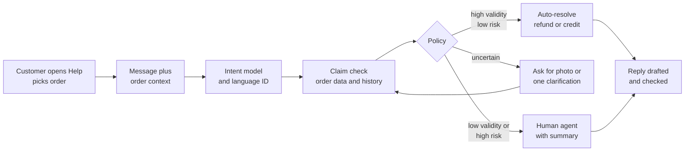
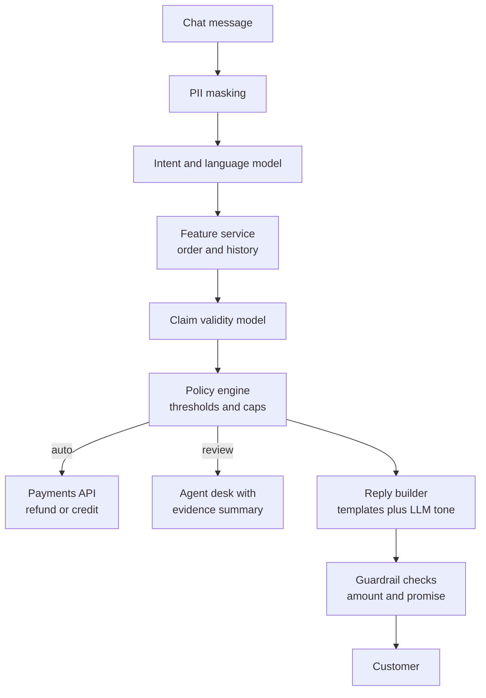

# Case Study 46: Support Ticket Triage and Auto-Resolution (The "Item Missing" Refund Desk)

**Domain:** Quick Commerce | **Problem Type:** NLP classification plus a decision policy for refunds | **Difficulty:** Intermediate

---

## 1. Business Context

### Company background

- **Jhatpat** (fictional): 320 dark stores, 9 cities, about 3 lakh orders a day, about 10.95 crore orders a year, average basket about ₹480.
- Customers raise issues from the order screen ("Help") in chat. Most write in **Hinglish** (Hindi written in English letters, often mixed with English words), for example "mera order late aaya aur chips ka packet missing hai".
- Today every ticket goes to a human agent in an outsourced support centre. Simple refunds wait in the same queue as angry, complex cases.
- Jhatpat has a good data source that most support teams lack: the **order record itself** (picker scan logs, packing weight, rider GPS, handover time).

### The pain, with numbers

| Item | Value |
| --- | --- |
| Tickets per order | about 6% (about 18,000 tickets a day, about 65.7 lakh a year) |
| Cost per human-handled ticket (agent time, tools, QA, vendor margin) | about ₹38 |
| **Annual cost of ticket handling** | **about ₹25 Cr** |
| Median time to resolution | 5.5 hours (first reply in about 9 minutes, but the refund waits in a queue) |
| Tickets ending in a refund or credit | about 45% (about 29.6 lakh a year) |
| Average refund per such ticket | about ₹95 |
| **Annual refund payout through tickets** | **about ₹28 Cr** |
| Refunds judged invalid in audits (item was delivered, or the claim was exaggerated) | about 8% (about ₹2.2 Cr a year) |
| CSAT (customer satisfaction, 1 to 5) after support | 3.9 |

- Agents spend most time on easy cases: "missing item", "where is my order", "refund status". These are predictable and checkable from data.
- The risk is on the other side: **a generous bot trains customers to claim refunds** and the leakage grows.

### Stakeholders and what each wants

| Stakeholder | What they want | What they fear |
| --- | --- | --- |
| Head of Customer Experience | Higher CSAT, instant resolution of simple issues | A bot that wrongly rejects genuine customers on social media |
| Finance and Fraud team | Refund leakage flat or lower | Auto-refund becoming a free-money button |
| Support vendor operations | Agents focused on hard cases, fair productivity targets | Headcount cuts and noisy escalations |
| Store and Picker Operations | Fewer blame-driven tickets, useful feedback on missing items | Pickers wrongly blamed from a single complaint |
| Engineering and Data Privacy | A safe pipeline, no personal data leaking into prompts | Customer details sent to an external LLM without control |
| Customers | Fast refund, no arguing | Being treated like a fraudster |

---

## 2. Translating Business to ML

### The business question vs the ML question

| Business question | ML question |
| --- | --- |
| "What is this customer complaining about?" | "Classify the message and order context into an intent taxonomy (about 14 leaf intents)" |
| "Is the claim true?" | "Estimate the probability that the claim is valid, using order data (picker log, weight, GPS, delivery time), not only the text" |
| "Should we refund now, ask for a photo, or send to a human?" | "A decision policy on top of the two models, with thresholds set from costs" |
| "What do we tell the customer?" | "Draft a reply from approved templates, with an LLM only for tone and Hinglish" |

> **Mentor note:** This is two models and a policy, not one classifier. The text model says what the customer is asking. The order-data model says whether it is probably true. The policy says what we do. Most teams build only the text model and then discover that the money is in the other two.

### Target variable definition

- **Intent model target:** the intent label assigned by a trained agent after resolution (not the customer's drop-down choice, which is noisy).
- **Claim-validity target:** `claim_valid = 1` if a trained agent or an audit decided the claim was genuine (for missing item: the item was really not delivered). Taken from agent decisions on past tickets, corrected using the audit sample.
- **Resolution outcome (for the policy):** refund amount, whether the ticket was reopened within 7 days, and the next-30-day repeat order.

### Edge cases

| Edge case | Recommended treatment | Reason |
| --- | --- | --- |
| One message, several issues ("late and one item missing and milk leaked") | Multi-label intent, resolve each part separately | Single-label models drop half the complaint |
| Message is only a photo or a voice note | OCR or speech-to-text first, else route to a human | Avoid guessing |
| Customer writes in Hindi script, Tamil, Bengali, or mixes them | Language ID, then a multilingual model, with a human fallback for low confidence | Metro and Tier-2 customers differ |
| Customer already refunded for this order | Block a second auto-refund, show the earlier refund | Double refunds are a common leak |
| Order has an open late-delivery auto-credit | Merge the two so the customer is not paid twice | Policy consistency |
| Abusive or threatening language, safety complaint (food spoilage with illness) | Always escalate to a human, skip automation | Reputation and safety risk |
| Customer disputes the bot's rejection | Always a human review path, with no second bot loop | Dignity and recourse |

### Unit of prediction

- One **ticket** (a conversation thread about one order). Predictions are refreshed at each customer message, because the first message is often vague.

### Prediction timing



- The full path must answer within 3 seconds in chat. A refund call to payments can be asynchronous (UPI or wallet credit takes seconds to minutes).

### What success looks like

| Lens | Success |
| --- | --- |
| Business | About 55% of tickets resolved without a human, cost per ticket from about ₹38 to about ₹19 blended, CSAT from 3.9 to 4.2 or better, refund leakage not higher than today |
| Model | Intent macro-F1 of 0.88 or more on the 14 leaf intents (including Hinglish), claim-validity AUC about 0.85, and the wrong-refund rate among auto-refunds at or below 5% |
| Customer | Resolution in under 2 minutes for auto cases, and a reopen rate within 7 days no worse than the human baseline (about 9%) |

---

## 3. Data Understanding

### Data sources and key features

| Feature group | Source | Why it matters |
| --- | --- | --- |
| Message text (customer and agent), language, script, length, emoji | Chat system | The intent and the customer's urgency |
| Order basket and item values | Order system | Refund amount, item type (fresh, packaged, high value) |
| Picker log (item scanned or not, scan time, substitutions, bag count) | Warehouse app | The strongest evidence for "missing item" claims |
| Packing check (bag weight versus expected weight, photo if available) | Pack station | A bag lighter than expected supports the claim |
| Delivery event data (rider GPS at handover, dwell time, OTP or photo proof) | Dispatch and rider app | Supports "not received" and "late" claims |
| Promised vs actual delivery time | ETA service (see Case 6) | Late claims are easy to verify |
| Cold-chain and handling flags (ice cream, eggs, glass) | Catalogue | Damage claims concentrate here |
| Customer history (past tickets, refund rate, tenure, order count, account age) | CRM | Trust level, and unusual claim frequency |
| Store and picker history (missing-item rate by store and shift) | Operations data | Some stores really do have packing issues |
| Past agent decisions and audit outcomes | Support tool and QA team | Labels |

### Data volume, granularity and refresh

- **Volume:** about 65.7 lakh tickets a year. Use the last 9 months (about 49 lakh tickets). Labels exist for all of them, with only about 15,000 audited.
- **Granularity:** one row per ticket for the policy, one row per message for the intent model.
- **Refresh:** the order context is available in real time. Intent model retrained monthly, claim model weekly, thresholds reviewed weekly.

### Common data issues

| Issue | How it shows up here |
| --- | --- |
| Hinglish spelling variety | "missing", "mising", "nahi aaya", "ni mila" and "no mila" all mean the same |
| Noisy intent labels | Customers pick "Other" in the drop-down, agents reclassify inconsistently |
| Agent decisions are not ground truth | Tired agents approve quickly, so labels carry a generosity bias |
| Selection bias in photos | Only customers asked for a photo have one |
| Picker log gaps | Pickers sometimes scan in bulk, so a scan does not prove the item is in the bag |
| Seasonal spikes | A festival sale or a monsoon week changes the mix of late and damage tickets |
| Personal data in text | Phone numbers, addresses and names appear in free text and must be masked before any model call |

> **Mentor note: Where juniors usually go wrong here.**
>
> - They train only on the message text and get 90% intent accuracy, then wonder why refunds leak. "Item missing" is a one-line sentence. Whether it is true lives in the picker log.
> - They treat agent decisions as truth. If agents approved 92% of missing-item claims, the model learns to approve 92%. Audit a sample to find out how many were right.
> - They test only on clean English messages and ship a bot that fails on exactly the Hinglish messages that make up most of the traffic.

---

## 4. Approach and Decision Points

### Baseline first

- **Baseline 1 (current):** keyword rules on the drop-down, then a human. 0% auto-resolution.
- **Baseline 2:** a rules-only auto-refund for small orders: if order value is under ₹150, the customer has fewer than 2 refunds in 90 days, and the claim is "missing item", then refund. Typically resolves 18% to 22% of tickets with little tuning.
- **Why it matters:** this simple rule shows how much of the prize needs no ML at all, and it is the safe fallback when models are down.

### Candidate models

| Model | Pros | Cons | Verdict |
| --- | --- | --- | --- |
| TF-IDF (character n-grams) with logistic regression | Fast, strong on spelling variants, explainable | Misses context and negation | Baseline for intent |
| **Small multilingual transformer, fine-tuned** (for example a MuRIL or IndicBERT-sized model) | Handles Hinglish and code-mixing, runs in about 20 to 40 ms on CPU or a small GPU | Needs about 30,000 labelled messages, needs error analysis | **Primary intent model** |
| Large LLM zero-shot classifier | No training data needed | Cost per call, latency, unstable outputs, privacy | Use only for cold-start intents and labelling help |
| **Gradient boosting on order and history features** (LightGBM) | Strong on tabular signals, fast, easy to threshold | Needs good labels | **Primary claim-validity model** |
| Rules plus model hybrid | Hard rules for safety (never auto-refund above ₹1,000) | Rules drift over time | Keep as a guardrail layer |
| LLM for reply drafting | Natural tone in the customer's language | Can promise refunds it cannot give, can leak data | Constrained templates only, see below |

### Decision scenarios

| What if... | Recommended action | Reasoning |
| --- | --- | --- |
| **The customer says an item is missing, but the picker log shows it was scanned and the bag weight matched** | Do not auto-refund. Ask for a photo of the bag contents, or route to a human with the evidence summary | The claim contradicts the data, but the data is not perfect (bulk scanning). A human decides, the customer is not accused |
| **The customer says the order never arrived, but rider GPS shows a 40-second stop at the address** | Ask a clarifying question (wrong building? security desk?) before deciding | GPS accuracy in tall buildings is poor. A fast question resolves most genuine misdelivery cases and discourages false ones |
| **The auto-refund threshold must be chosen** | Refund automatically when P(valid) is at least about 0.83 for orders under ₹300 (derivation below), and use a higher bar for high-value orders | The threshold is a cost question, not an accuracy question |
| **A customer files 5 missing-item claims in 6 weeks, each one individually plausible** | Cap auto-refunds per customer per month (for example 2), then route to a human who looks at the pattern | Each claim looks fine, the pattern is the signal. Do not accuse. Offer a call-back |
| **Intent confidence is low on a Hinglish message full of slang** | Send a one-tap clarification ("Is it a missing item, a damaged item, or a late order?") instead of guessing | A button costs 5 seconds. A wrong intent costs a wrong reply and a reopened ticket |
| **A store has 3x the average missing-item rate this week** | Raise the validity prior for that store's claims and alert store operations, not the customer | A genuine packing problem should make the bot kinder, and the store should fix it |
| **The LLM drafts "We will refund your full order" for a ₹40 item claim** | The reply must be filled from a template where the amount and action are written by the policy engine, and the LLM may only rephrase tone | The model must never decide money. It decides words |
| **After launch, refund requests rise 20% in two weeks** | Check whether genuine volume (a real store problem) or learned behaviour (customers noticing the instant refund) is behind it, by looking at claim rate for customers who were refunded before | A sudden rise after launch is the classic sign of gaming. Hold-out groups tell the two apart |

### Deriving the auto-refund threshold (worked example)

- Let `p` be the probability the claim is valid. Average refund is ₹95.
- **Auto-refund** costs `(1 - p) x 95` in invalid payout. Because customers learn from instant refunds, we count the invalid payout at 3 times its face value: `3 x 95 x (1 - p)`.
- **Send to a human** costs ₹38 for the agent, plus about ₹12 of dissatisfaction from the wait for a genuine customer: `38 + 12p`.
- Break-even: `285 - 285p = 38 + 12p`, so `p = 247 / 297 = 0.83`.
- Without the 3x learning penalty the threshold would be about 0.53. This is why leakage grows quietly in teams that ignore behaviour change.

---

## 5. Feature Engineering

### Top 10 features to build

| # | Feature | Business logic |
| --- | --- | --- |
| 1 | Item scanned flag for the claimed item, plus scan-time gap from the previous scan | A bulk scan within 1 second of others is weak evidence |
| 2 | Bag weight minus expected weight (grams), at the pack station | A lighter bag supports "missing" |
| 3 | Minutes late versus promise, and rider wait at store | Verifies "late" claims directly |
| 4 | Rider dwell time inside 100 m of the address, and distance of the "delivered" tap from the address | Supports or contradicts "not received" |
| 5 | Customer's refund count and refund rate over 30 and 90 days, relative to their order count | Trust and pattern |
| 6 | Item category risk (frozen, fresh, glass, eggs) | Damage claims are more common and often real |
| 7 | Store and shift missing-item rate over the last 7 days | A real store issue raises validity |
| 8 | Intent model confidence and number of intents detected | Low confidence means clarify first |
| 9 | Order value, item value and share of the basket claimed | Large share claimed is more suspicious |
| 10 | Time from delivery to ticket creation (minutes) | Very fast claims are usually genuine. Claims after 20 hours are weaker |

### Features to avoid (leakage risks)

| Feature | Problem |
| --- | --- |
| Final agent decision, refund amount, or ticket status | The outcome itself |
| Later messages in the same ticket when scoring the first message | Look-ahead in the conversation |
| Audit outcome or fraud-team flags added after the fact | Not available at ticket time, inflates validation |
| Customer demographics, gender, religion inferred from name, locality as a proxy | Fairness and DPDP concerns, and not needed |
| Raw phone number, address, or name as text features | Privacy, and memorises individuals |
| "Agent who handled" as a feature for the validity model | The model learns an agent's habits, not the truth |

Using order data in a claim-validity model (sketch):

```python
import lightgbm as lgb

claim_model = lgb.LGBMClassifier(n_estimators=400, learning_rate=0.05,
                                 num_leaves=31, min_child_samples=200)
# y = 1 if the claim was later confirmed valid by an audit or a trained agent
claim_model.fit(X_order_features, y_valid, sample_weight=w_audit_corrected)

p_valid = claim_model.predict_proba(X_new)[:, 1]
# Policy thresholds come from the cost derivation, not from the model
action = "auto_refund" if (p_valid >= 0.83 and order_value <= 300) else "review"
```

---

## 6. Evaluation Strategy

### Metrics

| Metric | Role | Why |
| --- | --- | --- |
| **Intent macro-F1** (average over the 14 intents, with Hinglish split reported separately) | Primary for the text model | Rare intents (safety, damaged cold items) matter more than their volume |
| **Auto-resolution rate** | Primary business metric | The share of tickets closed without a human |
| **Wrong-refund rate among auto-refunds** (measured on an audited sample) | Primary guardrail | The cost of generosity |
| **Reopen rate within 7 days** | Primary quality metric | A closed ticket that returns was not solved |
| CSAT, by auto vs human path | Customer outcome | Auto must not be below human |
| **Cost per ticket** (blended) and refund leakage (₹ per 1,000 orders) | Business | The final return |
| Time to resolution (median and p90) | Customer experience | Speed is the selling point |
| False-denial rate (genuine claims routed to a human or rejected) | Fairness to customers | The hidden harm of caution |

### Metrics that look good but are misleading here

- **Overall intent accuracy:** the top 3 intents are 70% of the volume, so accuracy can be 93% while safety complaints are missed.
- **Auto-resolution rate alone:** can be pushed up by lowering the threshold. Always show it next to the wrong-refund rate.
- **CSAT after auto-refund:** customers who got a refund are happy, so CSAT rises even when the bot was too generous. Look at leakage in the same table.
- **Agent agreement with the model:** agents were the source of the labels, so agreement only shows copying.

### Validation strategy

| Step | Design | Why |
| --- | --- | --- |
| Time-based split | Train on months 1 to 7, validate month 8, test month 9 | Matches deployment and catches seasonal change |
| Hinglish slice | Separate test set of 3,000 messages hand-labelled by two annotators, with agreement checked | Most traffic is code-mixed |
| Audit sample for the claim model | 15,000 tickets re-checked by QA with order evidence | Corrects the generosity bias of agent labels |
| Threshold simulation | Replay last month's tickets under each threshold, count payouts, wrong refunds and agent hours | Threshold choice before any customer sees it |
| Shadow mode | Model recommends, agents decide, for 3 weeks | Measures agreement and finds failure cases safely |
| Gradual rollout with a holdout | 20% of eligible tickets auto-resolved, then 50%, with 10% always human as a control | Measures the behaviour change |

### From model metric to business value

- Tickets: 10.95 crore orders x 6% = about 65.7 lakh a year.
- Auto-resolved at 55%: about 36.1 lakh tickets. Saving per ticket about ₹34 (₹38 human cost minus about ₹4 automated). Saving about **₹12.3 Cr**.
- Refund leakage: refunds about 29.6 lakh x ₹95 = about ₹28 Cr. Invalid share falls from 8% to 5%, saving about 3% of ₹28 Cr = about **₹0.8 Cr**.
- Faster resolution lifts 30-day repeat by about 5 points among 36.1 lakh auto-resolved tickets: about 1.8 lakh extra orders at about ₹38 margin = about **₹0.7 Cr**.
- Run cost (inference, labelling, team) about ₹1.8 Cr.
- **Net about ₹12 Cr a year** at full effect. Plan on about ₹9 Cr in year one while auto-resolution climbs from 25% to 55%.

---

## 7. Deployment and Monitoring

### Batch vs real time

- **Real time:** intent, claim check, policy and reply happen inside the chat session in under 3 seconds.
- **Batch:** nightly store and customer risk features, weekly retraining, monthly intent model refresh.
- **Fallback:** if a model times out, route to a human. Never fall back to "refund everything".



### Guardrails on the LLM reply

- The refund amount, the action and the timeline come from the policy engine, written into a template. The LLM may only adjust wording, language and tone.
- Output is checked for any rupee amount or promise that does not match the policy result. If it differs, the plain template goes out.
- Personal data is masked before any external call, and logs are retained only as long as the policy says (DPDP Act 2023 principles of purpose limitation and data minimisation).
- Every automated message carries "talk to an agent" in one tap.

### What to monitor

| Type | What to track | Alert trigger |
| --- | --- | --- |
| Intent quality | Weekly audited macro-F1, share of low-confidence messages, unseen words | Macro-F1 below 0.85, or low-confidence above 15% |
| Money | Auto-refund count and payout per 1,000 orders, wrong-refund rate on audits | Wrong-refund rate above 6%, or payout up 15% week on week |
| Customer | CSAT split by auto and human, reopen rate, escalation to social media | Auto CSAT 0.2 below human |
| Fairness | False-denial rate by city, language and customer tenure | Any group 1.5x worse than average |
| Behaviour change | Claim rate among customers refunded before, versus never refunded | Ratio rising for 3 weeks |
| Latency and reliability | p95 latency, timeouts, fallbacks to human | p95 above 3 s, or fallback above 2% |
| Operations | Store missing-item rate, agent queue length | Store above 3x the average |

### Retraining

- **Scheduled:** claim model weekly, intent model monthly with a fresh labelled batch of 3,000 hard cases.
- **Triggered:** a new product line (for example electronics), a new city language, a refund policy change, or a drop in audit precision.

### A/B test or champion-challenger design

- Randomise by **customer**, 50-50 between "bot plus human" and "human only" for eligible intents, for 3 weeks.
- Primary: cost per ticket and refund leakage. Guardrails: CSAT, reopen rate, social complaints.
- Keep a **permanent 5% human-only holdout** to track behaviour change in the long run.

---

## 8. Stakeholder Communication

### Explain it to a non-technical leader

> "Today every complaint waits for a human, even when we already know the answer from our own records. The new system reads the complaint, checks what our packing and rider data say, and refunds instantly when it is very likely true.
> When the data disagrees with the customer, it asks a quick question or sends the case to a person with the evidence ready, and it never accuses anyone.
> We expect about half of tickets to close in under 2 minutes, saving about ₹12 Cr a year, with refund leakage not higher than today.
> The AI writes the words. Our rules decide the money."

### Questions leadership will ask

| Question | Suggested answer |
| --- | --- |
| "Will customers abuse an instant refund?" | "Some will try, which is why we cap auto-refunds per customer, use packing and GPS evidence, and keep a permanent holdout to see whether claims rise. The threshold already includes a penalty for learning behaviour" |
| "Why not refund every claim under ₹100, it is cheaper than an agent?" | "At ₹38 an agent versus ₹95 refunded, it looks cheaper, but if the claim rate doubles we lose far more. The 3x penalty in our maths shows where it breaks" |
| "Can we trust a large language model with customer chats?" | "It only rephrases a message the rules already approved, personal data is masked first, and any message with a wrong amount is blocked" |
| "What happens to the support agents?" | "They handle the hard cases, which now arrive with a summary. We expect lower repetitive load, not an unmanaged cut, and the vendor contract needs to reflect that" |
| "Will it work in Tamil or Bengali?" | "Hinglish and English first, then each language added after a labelled test set passes. Until then those chats go to a human" |
| "What if the bot is wrong about a genuine customer?" | "A single tap reaches a human, and false denials are on the weekly dashboard by city and language" |

---

## 9. Common Pitfalls and Lessons

| Mistake | Why it happens | How to avoid it |
| --- | --- | --- |
| Building only a text classifier | Support is seen as an NLP problem | Add the claim-validity model on order data, and a cost-based policy |
| Treating agent decisions as ground truth | They are the only labels in the system | Audit a sample, reweight, and measure agent generosity |
| Setting the threshold by accuracy or by gut | Accuracy is the default metric | Derive it from payout cost, agent cost and the behaviour-change penalty |
| Ignoring Hinglish and spelling variants | Test data is clean English from the team | Build a code-mixed test set, and report results separately |
| Letting the LLM state money or promises | LLM replies sound confident | Slot-fill from the policy engine, then check the output |
| Measuring CSAT but not leakage | CSAT is easy to report | Put payout per 1,000 orders and wrong-refund rate in the same table |
| Blaming pickers or riders from one complaint | The ticket is the only evidence at hand | Aggregate by store and shift, and share patterns, never single cases |
| No human exit for a rejected customer | Automation target is chased | One tap to an agent, and track false denials by group |
| Never checking for gaming after launch | Launch is treated as the finish | Keep a human-only holdout and watch claim rates by refund history |

---

## 10. Mentor's Focus Checklist

- ✅ **Where to spend 80% of the effort:**
  - The claim-validity model using picker, weight and GPS data, with audit-corrected labels.
  - The cost-based refund policy and its caps, simulated on last month's tickets.
  - A hand-labelled Hinglish test set and honest slice reporting.
  - Guardrails around the LLM reply, and a permanent holdout to see behaviour change.
- ❌ **What not to over-engineer:**
  - A custom large language model when a small fine-tuned multilingual model handles intent well.
  - Fine-grained intent trees beyond what the policy can act on differently.
  - Sentiment scoring, which rarely changes the action.
- 💡 **Key takeaway:** **The ticket text tells you what the customer wants. Your own order data tells you whether to give it.** Set the refund threshold from the cost of being wrong, including how customers will react to a generous bot.
