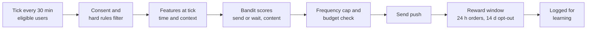
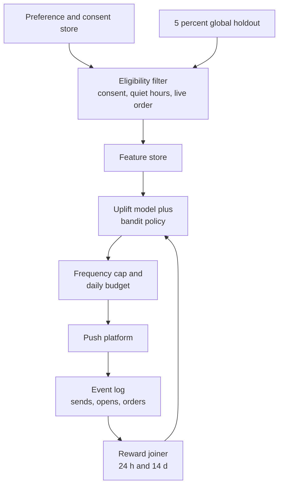

# Case Study 47: Push-Notification Timing, Content and Volume Optimisation (The "Too Many Pings" Problem)

**Domain:** Quick Commerce | **Problem Type:** Contextual bandit and uplift modelling | **Difficulty:** Intermediate

---

## 1. Business Context

### Company background

- **Jhatpat** (fictional): 320 dark stores, 9 cities, about 3 lakh orders a day, about 10.95 crore orders a year, average basket about ₹480.
- About 90 lakh monthly active app users. About 55% (about 49.5 lakh) have push notifications switched on.
- Marketing sends two kinds of pushes: **transactional** (order status, rider arriving) and **promotional** (offers, "your usual milk is back", "rain tonight, order snacks").
- Promotional pushes are scheduled by campaign managers in batches. Most users get the same blast at 7 pm because "that is when people order".

### The pain, with numbers

| Item | Value |
| --- | --- |
| Promotional pushes per push-enabled user per day (average) | about 3.2 |
| Promotional pushes a day | about 1.58 crore |
| Click rate | about 2.1% (about 33,000 clicks a day) |
| Click-to-order conversion | about 35%, so about 11,600 **attributed** orders a day (last-touch) |
| Share of attributed orders that are truly incremental (from a past holdout) | about 38%, so about 4,400 orders a day |
| Contribution margin per order | about ₹38 (about 8% of ₹480) |
| **Annual margin from incremental push orders** | **about ₹6.1 Cr** (4,400 x 365 x ₹38) |
| Orders with a push coupon | about 4,200 a day at about ₹30 each |
| **Coupon spend on non-incremental orders** (62% of 4,200 = 2,600 x ₹30) | **about ₹2.85 Cr a year** |
| Users who turn off push each month | about 0.9% (about 44,500 users) |
| Estimated long-term value of a push channel per user (3 years, discounted) | about ₹40 |
| **Annual cost of opt-outs** (44,500 x 12 x ₹40) | **about ₹2.1 Cr** |

- The dashboard says push drives about 11,600 orders a day. The holdout says about 4,400 truly came because of it. The rest would have ordered anyway, often after we gave them a coupon.
- Opting out is permanent for practical purposes. A user who disables push is almost never won back, so **we lose the channel, not just one message**.

### Stakeholders and what each wants

| Stakeholder | What they want | What they fear |
| --- | --- | --- |
| Head of Growth and CRM | More orders from the channel, flexibility for campaigns | A black box that blocks their offers |
| Head of Finance | Lower coupon waste, honest ROI | Paying coupons to people who would order anyway |
| Product team | Fewer annoyed users, higher app ratings | Uninstalls and Play Store reviews about spam |
| Legal and Privacy | Valid consent, easy opt-out, DPDP Act 2023 compliance | Pushing to users who withdrew consent, or misuse of location data |
| Category managers | Their promotions shown to the right users | Their category losing slots to "the algorithm" |
| Engineering | A decision service that works at peak, in seconds | Sending millions of pushes with a stale model |

---

## 2. Translating Business to ML

### The business question vs the ML question

| Business question | ML question |
| --- | --- |
| "Who should we ping, and when?" | "For each user and each decision point, pick the action (send now, send later, content variant, or do not send) that maximises long-term incremental value" |
| "Did the push work?" | "Estimate the **incremental** effect of a push on 24-hour orders, versus not sending" |
| "How many pings are too many?" | "Learn the user-level cost of an extra push (fatigue and opt-out risk), and cap frequency by that cost" |

> **Mentor note:** This is not "predict who clicks". A user who clicks was often going to order anyway, and sending to them wastes a coupon and one unit of their patience. For the uplift theory behind this (persuadables, sure things, sleeping dogs), see Case 3, which we do not repeat. Here the new ingredients are **timing**, **repeated decisions over days**, and a **cost that arrives months later** (opt-out).

### Target variable definition

- **Reward for one send:** `incremental margin in the next 24 hours` (estimated through uplift models and a holdout), minus coupon cost, minus an **opt-out and fatigue cost**.
- **Opt-out cost:** probability that the user disables push in the next 14 days, times ₹40 (channel value). Learned from users who got different frequencies.
- **Action space:** about 5 content templates, 6 send windows (morning, late morning, afternoon, evening peak, late evening, night, with night restricted), and "do not send". About 30 actions per decision.

### Edge cases

| Edge case | Recommended treatment | Reason |
| --- | --- | --- |
| User has a live order or cart already open | Suppress promotional pushes, send only transactional ones | A promo during an order is noise and cannibalises |
| User withdrew consent or switched off promotional pushes in settings | Hard exclusion, enforced in the sending service, not in the model | Legal requirement, never a modelled choice |
| Do-not-disturb hours (late night) | Hard rule: no promotional push, for example 10 pm to 8 am local time | Hurts trust and may violate policy |
| New user in first 7 days | Use a separate onboarding journey with simple rules | No history to personalise |
| Users with no orders for 60 days | Separate re-activation logic (see Case 38) | Different goal |
| Category stock-out at the user's nearest store | Do not push the item, or substitute | Pushing an unavailable item is a guaranteed bad experience |
| Festival or big sale day | Cap by global limits first, bandit second | Campaign teams will otherwise override the model |

### Unit of prediction

- One **user-decision-point**: a user at a moment where we could send a push. The decision is made at fixed ticks (for example every 30 minutes within allowed hours), not for a whole day at once.

### Prediction timing



- The decision takes under 200 ms per user, run in batches for the eligible set at each tick.
- The **reward is delayed**: orders within 24 hours, opt-out within 14 days. The learning loop must wait for it.

### What success looks like

| Lens | Success |
| --- | --- |
| Business | Same or higher incremental orders with 35% fewer pushes (3.2 down to about 2.1 per user per day), coupon waste down by 60% (about ₹1.7 Cr), opt-outs from 0.9% to 0.6% a month. About ₹3 Cr a year |
| Model | Uplift ranking quality (Qini curve) clearly better than random and than the click model, and calibrated incremental-order estimates by decile |
| Customer | No rise in uninstalls or app-store complaints, and no drop in the organic order rate of the treated group |

---

## 3. Data Understanding

### Data sources and key features

| Feature group | Source | Why it matters |
| --- | --- | --- |
| Push history (sent time, template, opened, clicked, dismissed) | Push platform | Fatigue, preferred time |
| Order history (recency, frequency, time-of-day pattern, categories) | Order system | Natural ordering rhythm, which defines "organic" |
| App sessions (opens, time of day, cart adds without checkout) | Event stream | Intent and best time to reach |
| Opt-out and settings (push on, promotional on, language, quiet hours) | Preference store | Consent and constraints |
| Context at the tick (rain, store busy or closed, ETA, item availability) | Weather API, store systems | Relevance and the ability to deliver |
| Coupon history (coupons received, redeemed, depth) | Promotion engine | Coupon dependence |
| Device (OS, push permission status, battery saver) | App telemetry | Delivery reliability |
| Past holdout assignments | Experiment platform | Unbiased causal training data |

### Data volume, granularity and refresh

- **Volume:** about 1.58 crore promotional pushes a day. A month is about 47 crore send records. A **global holdout** of 5% of users, never sent promotional pushes, gives about 2.5 lakh users as the clean control group.
- **Granularity:** one row per (user, tick, action taken) with outcomes joined later.
- **Refresh:** features updated hourly (sessions in near real time), model scores refreshed daily, policy updated weekly.

### Common data issues

| Issue | How it shows up here |
| --- | --- |
| Selection bias in history | The old blast schedule sent to loyal users more often, so "sent" and "ordered" correlate for the wrong reason |
| Delivered is not seen | Android battery savers and OEM settings drop pushes, so "not clicked" often means "not shown" |
| Attribution double counting | A user opens the app from an email and a push within an hour, both claim the order |
| Delayed reward | Opt-outs show up days later, so training on 24-hour reward alone teaches the model to spam |
| Time zones and daylight | All of India is one time zone, but habits differ by city and by metro vs Tier-2 |
| iOS and Android differences | Different permission flows and opt-out visibility |
| Positivity problem | Some user types were never given a push in some windows, so there is no data on them |

> **Mentor note: Where juniors usually go wrong here.**
>
> - They optimise click rate. Click rate is highest when you send a big coupon to someone about to order anyway, which is the worst use of a push.
> - They do not keep a global holdout, so they have no honest baseline and cannot prove the system works.
> - They count only the first 24 hours of reward. The cost of an annoyed user shows up in 2 weeks, when it is too late to blame the push.

---

## 4. Approach and Decision Points

### Baseline first

- **Baseline 1 (current):** blast campaigns at fixed times (7 pm), about 3.2 pushes a user a day.
- **Baseline 2:** a simple rule set. Maximum 2 promotional pushes a day, none within 2 hours of an order, per-user best hour from past opens (mode of open hour), no coupons for users with a recent order.
- **Why it matters:** rules usually remove 20% to 30% of the waste on their own. Measure that first so you know what machine learning adds on top.

### Candidate models

| Model | Pros | Cons | Verdict |
| --- | --- | --- | --- |
| Click or open propensity model | Easy, lots of data | Predicts engagement, not incremental value, rewards sure things | Do not use as the objective |
| **Uplift T-learner or X-learner with gradient boosting** | Estimates incremental effect per user, uses the holdout | Needs randomised data, noisy | **Primary causal layer** (see Case 3) |
| **Contextual bandit (Thompson sampling or linear upper confidence bound)** | Learns while serving, handles many actions, adapts to change | Needs careful logging, delayed reward handling | **Primary decision layer** |
| Send-time model (distribution over order and open hours per user) | Simple, interpretable | Ignores incremental value | A feature and a prior for the bandit |
| Full reinforcement learning (sequences of days) | Models long-term fatigue | Hard to evaluate, risky, slow to train | Only after the bandit works |
| Rules plus campaign calendar | Safe, transparent | No personalisation | Keep as guardrails and for big events |

### Decision scenarios

| What if... | Recommended action | Reasoning |
| --- | --- | --- |
| **The push goes to a user who would have ordered anyway** (cannibalisation) | Make "no send" an explicit action with its own expected value. Send only when the estimated uplift in margin exceeds coupon cost plus fatigue cost | Without "do not send", the bandit has no way to learn that silence is often best |
| **A user opens the app within 5 minutes of the tick** | Suppress or delay the push by 30 minutes | They are already there. The push adds nothing and costs patience |
| **Opt-outs rise 0.3 points after a new content template goes live** | Roll back to the earlier template for that arm, include opt-out in the reward, and test the template only on a small share of users | Short-term clicks hid a long-term cost. The reward must contain it |
| **The reward arrives in 24 hours but the opt-out in 14 days** | Update arms daily using the fast reward, and apply a delayed correction for fatigue from a separate opt-out model using the number of pushes in the last 7 days | Waiting 14 days for everything slows learning. A fast reward plus a slow penalty keeps both |
| **The model sends to the same 10 lakh heavy users all the time** (rich-get-richer) | Add exploration (about 5% random sends within safe limits) and a per-user daily cap, and look at the share of users who ever receive a push | The bandit exploits the easy users. New and light users never get a chance to be learned |
| **Rain starts and the campaign team wants a rain push to everyone** | Allow it, but within the global cap, and only to users in the affected zones with the store open and ETA under 20 minutes | Contextual pushes are good, if the service can actually deliver |
| **A user on a payday evening (end of month) responds more** | Add calendar features (salary week, weekend, match day) and compare bandit arms by context, not only overall | Context shifts the best action, which is what a contextual bandit is for |
| **Legal says a user who withdrew consent must stop within hours** | Consent filter is enforced in the sending service from the preference store, with no model in the path, and test it daily | A compliance rule is never a probability |
| **The old logs were all from blasts, so the model has no data for 11 pm sends** | Do not extrapolate. Keep those windows closed by rule, or explore them only with small randomised tests | No data means no estimate |

---

## 5. Feature Engineering

### Top 10 features to build

| # | Feature | Business logic |
| --- | --- | --- |
| 1 | Hour-of-day distribution of the user's past orders (smoothed, 24 bins) | The natural rhythm. Pushes just before it are often cannibalising, those in quiet hours may create new orders |
| 2 | Hour-of-day distribution of the user's past app opens | Best time to be seen |
| 3 | Pushes received in the last 1, 3 and 7 days | Fatigue |
| 4 | Click and dismiss ratio over the last 10 pushes | Responsiveness vs irritation |
| 5 | Days since last order and typical gap between orders | Overdue users have more room for uplift |
| 6 | Minutes since last app session, and cart-not-checked-out flag | Intent now |
| 7 | Coupon dependence: share of past orders that used a coupon | High means sensitive to price, and also tends to wait for coupons |
| 8 | Category affinity (top 3 categories) and in-stock status nearby | Relevance and ability to deliver |
| 9 | Context at the tick (rain forecast, store load, ETA) | Pushing when ETA is 25 minutes is a bad experience |
| 10 | Tenure, city, platform (Android or iOS), and engagement segment | Shared priors for sparse users |

### Features to avoid (leakage risks)

| Feature | Problem |
| --- | --- |
| Whether the user ordered in the 24 hours after the tick | The reward itself |
| Attributed-order count computed on the same day | Includes post-send information |
| Opt-out date or later push-setting changes | Future information |
| Features computed from data after the decision time (for example hourly averages that include the future) | Look-ahead leakage in training |
| Precise location history beyond what consent covers, health or sensitive inferences from purchases | DPDP Act 2023 purpose limitation and sensitivity concerns |
| Gender or religion inferred from names or categories | Fairness and legal risk, and not needed |

Thompson sampling with a "do not send" arm and a fatigue penalty (sketch):

```python
import numpy as np

def choose_action(posteriors, fatigue_pen, coupon_cost):
    # posteriors[a] = (mean_uplift_margin, std) for each arm, learned from
    # holdout-anchored uplift; arm 0 means "do not send"
    draws = np.array([np.random.normal(m, s) for m, s in posteriors])
    value = draws - coupon_cost - fatigue_pen   # arrays of length n_arms
    value[0] = 0.0                              # staying silent costs nothing
    return int(np.argmax(value))
```

---

## 6. Evaluation Strategy

### Metrics

| Metric | Role | Why |
| --- | --- | --- |
| **Incremental orders and margin per 1,000 users**, versus the global holdout | Primary | The only honest measure of value |
| **Opt-out rate** (push disabled) and uninstall rate per month | Primary guardrail | The long-term cost |
| Pushes per user per day | Volume guardrail | Must come down, not hide inside higher click rates |
| Coupon cost per incremental order | Efficiency | Shows waste |
| Qini or uplift-at-top-k, by decile | Model diagnostic | Does the ranking separate persuadables from sure things |
| Organic order rate of treated users in the next 7 days | Cannibalisation check | Pushes can pull orders forward without adding any |
| Open rate and click rate | Diagnostic only | Easy to game and not causal |

### Metrics that look good but are misleading here

- **Click rate or open rate:** goes up when you send fewer, bigger-coupon messages to loyal users. It says nothing about extra orders.
- **Attributed orders (last-touch):** counts sure things. Jhatpat's own data shows 11,600 attributed against 4,400 incremental.
- **24-hour reward only:** blind to opt-out and fatigue.
- **Offline replay without propensity correction:** old blast logs were not randomised, so naive replay credits the model for loyal users.

### Validation strategy

| Step | Design | Why |
| --- | --- | --- |
| Global holdout | 5% of users never receive promotional pushes, for 90 days at a time, re-randomised each quarter | Honest incremental baseline and long-term fatigue measure |
| Randomised exploration data | 5% of sends are random actions within safe limits | Gives unbiased data for uplift models and off-policy checks |
| Off-policy evaluation | Inverse propensity weighting or doubly robust estimates on logged data | A fast filter before live testing |
| Time-based split | Train on weeks 1 to 8, test weeks 9 to 10 | Matches deployment |
| Online A/B test | User-level randomisation: new policy vs current blast schedule, 4 weeks | A push test needs time for fatigue to appear |
| Long-run check | Compare opt-out and 60-day order rate at 8 and 12 weeks | The cost arrives late |

### From model metric to business value

- Incremental orders: keep the same 4,400 a day, plus an assumed 10% from better timing: +440 a day x 365 x ₹38 = about **₹0.6 Cr**.
- Coupon waste: ₹2.85 Cr on non-incremental orders, cut by 60% = about **₹1.7 Cr**.
- Opt-outs: from 0.9% to 0.6% a month on 49.5 lakh = about 14,850 fewer a month, 1.78 lakh a year x ₹40 = about **₹0.7 Cr**.
- Volume reduction also reduces vendor cost per message, a small additional saving.
- **Total about ₹3 Cr a year.** This is a modest prize with a large risk if done badly. A careless push policy can cost more in opt-outs than it earns, so it earns its place as a guardrail as much as a growth tool.

---

## 7. Deployment and Monitoring

### Batch vs real time

- **Batch scoring** at every 30-minute tick for eligible users. Not per-click real time.
- **Daily jobs:** feature refresh, uplift model scoring, bandit posterior updates from fast rewards.
- **Weekly jobs:** opt-out and fatigue model retrain, policy review.
- The sending service enforces consent, quiet hours and caps independently of the model.



### What to monitor

| Type | What to track | Alert trigger |
| --- | --- | --- |
| Incrementality | Orders per 1,000 users, treated vs global holdout, weekly | Gap shrinking for 3 weeks |
| Fatigue | Opt-out and uninstall rate, by pushes received band | Opt-out above 0.8% a month |
| Volume | Average and 95th percentile pushes per user per day | 95th percentile above cap |
| Consent compliance | Sends to users with promotional consent off | Any single occurrence is an incident |
| Delivery | Delivered vs sent, by device brand | Delivery below 90% |
| Model | Calibration of uplift estimates by decile, share of "no send" decisions | "No send" share outside 30% to 55% |
| Fairness and coverage | Share of light and new users ever reached, spread across cities | A segment never reached |
| Drift | Hour-of-order distribution, PSI on key features | PSI above 0.2 |

### Retraining

- **Scheduled:** uplift model monthly, opt-out model monthly, bandit posteriors continuously with a decay so old behaviour fades.
- **Triggered:** a new app version that changes notification handling, a festival-season shift, a policy change from the operating system vendors, or a holdout gap that shrinks.

### A/B test or champion-challenger design

- Randomise by **user** at the start, 50-50 for 4 weeks, with the global holdout untouched.
- Primary: incremental margin per user. Guardrails: opt-out rate, uninstall rate, app rating, organic order rate.
- Because a push affects the user's later behaviour, **run the first 2 weeks at 10% exposure** and extend only if fatigue metrics are flat.

---

## 8. Stakeholder Communication

### Explain it to a non-technical leader

> "Right now we message nearly everyone at the same time, and most people we reach would have ordered anyway. We pay coupons to them and wear out their patience.
> The new system decides, for each person, whether to send at all, when, and what, based on whether the message will really add an order.
> We send about a third fewer messages, spend less on needless coupons, and lose fewer users to the 'turn off notifications' button.
> A small group of users never gets promotional pushes, so we can prove what is working with real numbers."

### Questions leadership will ask

| Question | Suggested answer |
| --- | --- |
| "Fewer pushes means fewer orders, no?" | "Only if the pushes were working. Our own holdout shows only 4 in 10 attributed orders are truly caused by push. The rest we pay coupons for. We cut those" |
| "Why keep 5% of users with no promotions, is that not lost revenue?" | "It is the price of a real baseline. 5% of users for 90 days costs less than the money we would waste not knowing the true effect" |
| "How do we know opt-outs are caused by pushes?" | "We compare opt-out rates for users at different frequencies in randomised groups, not by looking at who left" |
| "What about the DPDP Act and consent?" | "Consent and withdrawal are enforced in the sending system, outside the model, and logged. We use only data needed for the purpose, and no sensitive inferences. SMS and WhatsApp fallbacks need separate registered templates and preference checks" |
| "Can campaign managers still run their own offers?" | "Yes, within a shared budget and frequency cap. Their campaigns become options for the model, so their reach goes to people who respond" |
| "What if the algorithm pings someone at 2 am?" | "It cannot. Quiet hours are hard rules enforced outside the model" |

---

## 9. Common Pitfalls and Lessons

| Mistake | Why it happens | How to avoid it |
| --- | --- | --- |
| Optimising click or open rate | They are easy to measure and show up in minutes | Optimise incremental margin, and use clicks only as diagnostics |
| No global holdout | Holdouts feel like lost sales | Keep a standing 5% holdout, rotate it, and report on it every month |
| Ignoring the delayed cost of opt-outs | The reward window stops at 24 hours | Add an opt-out model and a fatigue penalty to the reward |
| No "do not send" action | Teams think the job is to send | Include silence as an arm with its own value |
| Training on blast history without correcting the bias | Logs are all that exist | Use randomised exploration data and propensity correction |
| Letting the model override consent or quiet hours | One service does everything | Hard rules in the sending layer, tested daily |
| Counting pulled-forward orders as wins | Daily totals look higher | Check the organic order rate in the following 7 days |
| Rich-get-richer bandit | The model keeps exploiting the easy users | Reserve exploration, cap per user, monitor coverage |
| Running the test for 1 week | Impatience | Fatigue appears in 2 to 4 weeks, so test longer |

---

## 10. Mentor's Focus Checklist

- ✅ **Where to spend 80% of the effort:**
  - A clean global holdout and randomised exploration data, which every later step depends on.
  - A reward that includes coupon cost, fatigue and opt-out, not only clicks.
  - Hard consent, quiet-hour and frequency rules in the sending layer, outside the model.
  - Delayed-reward handling and a test long enough to see fatigue.
- ❌ **What not to over-engineer:**
  - Deep reinforcement learning across days, before a simple bandit plus uplift works.
  - Fancy text generation for push copy, before fixing when and whether to send.
  - Per-minute send-time optimisation, when 6 windows capture most of the gain.
- 💡 **Key takeaway:** **A push is a withdrawal from a limited bank of user patience.** Send only when the extra order it creates is worth more than the coupon and the permanent risk of losing the channel, and keep a holdout so you can prove it.
