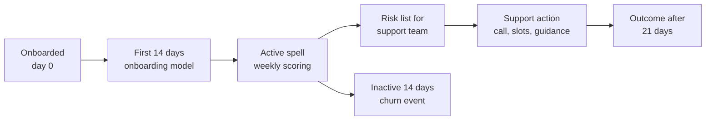
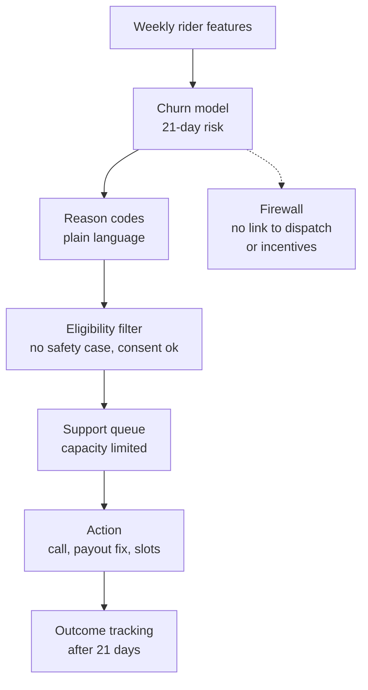

# Case Study 48: Rider Attrition Prediction and Retention (The "Quiet Quitters" Problem)

**Domain:** Quick Commerce | **Problem Type:** Survival analysis and classification | **Difficulty:** Intermediate

---

## 1. Business Context

### Company background

- **Jhatpat** (fictional): 320 dark stores, 9 cities, about 3 lakh orders a day, about 10.95 crore orders a year.
- Deliveries are done by riders (delivery partners), mostly gig workers who choose their own shifts, with some on fixed-hours contracts. They are not salaried employees. They are paid per order plus incentives (peak-hour bonus, weekly milestone bonus, rain bonus).
- About 48,000 riders are active in a month, and about 21,000 are active on a typical day (each doing about 14 deliveries).
- Riders can work for several apps at once. Jhatpat competes with other quick-commerce, food and e-commerce apps for the same people.

### The pain, with numbers

| Item | Value |
| --- | --- |
| Monthly active riders | about 48,000 |
| Monthly attrition (an active rider who becomes inactive for 14 days) | about 11% (about 5,280 riders a month, about 63,400 a year) |
| Share of attrition in the first 30 days after onboarding | about 38% |
| Cost to replace one rider (onboarding, KYC and verification, bag and uniform, training, first-week guarantee, ramp-up inefficiency) | about ₹7,000 |
| **Annual cost of replacing riders** | **about ₹44 Cr** (63,360 x ₹7,000) |
| Order-time impact | Stores short of riders see ETA slippage and lost orders in peak hours |
| Rider earnings volatility (typical weekly earnings spread, week to week) | about 28% coefficient of variation |

- Attrition is not only a cost. New riders are slower (about 12% more minutes per order in the first month) and cause more late orders.
- The unhelpful reflex in many companies is to use a "who will leave" list to **punish** or de-prioritise people. We will explicitly design against that.

### Stakeholders and what each wants

| Stakeholder | What they want | What they fear |
| --- | --- | --- |
| Head of Rider Operations | Enough riders at every store at peak, lower hiring spend | Constant firefighting and hiring queues |
| City and store managers | Early notice of which riders are slipping | Being asked to run another dashboard with no actions |
| Finance | Retention cheaper than replacement | Bonuses paid to riders who would have stayed anyway |
| Rider support and community teams | Useful, humane reasons to call a rider | The model being used as a blacklist |
| Legal, policy and public affairs | Fair treatment of gig workers, no surveillance headlines | Allegations of algorithmic control over workers |
| Riders | Predictable earnings, respect, no hidden scoring | Being penalised or given fewer orders for "risk of leaving" |

---

## 2. Translating Business to ML

### The business question vs the ML question

| Business question | ML question |
| --- | --- |
| "Which riders are going to leave?" | "For each active rider, estimate the probability of becoming inactive in the next 21 days (and the hazard curve over time)" |
| "When do new riders leave?" | "Estimate the survival curve of an onboarding cohort, and the days of highest hazard" |
| "Who is worth supporting?" | "Among at-risk riders, estimate who is likely to respond to support (uplift), and what the support costs" |

> **Mentor note:** A rider who is quiet for 10 days might have gone home for a wedding, fallen ill, or joined a competitor. The model should separate "will drop out for good" from "temporary break". The business use is to offer **support**, for example an earnings guidance call or a shift-slot change. It must never be used to cut order allocation, incentives, or ratings. Put that rule in writing before the model is built.

### Target variable definition

- **Active rider:** at least 1 delivery in the last 30 days.
- **Churn (attrition) event:** an active rider has **no delivery for 14 consecutive days** (the event date is the last delivery date). 14 days was chosen from the data: 85% of riders who pause for 14 days do not return in the next 60 days.
- **Target for the classifier:** churn event within the next 21 days from the scoring date.
- **Target for survival:** time since onboarding (or since the start of the current active spell) until churn, with riders still active treated as censored.
- **Voluntary vs involuntary:** only voluntary exits are modelled. Riders deactivated by Jhatpat for fraud or safety (see Case 49) are removed from the target.

### Edge cases

| Edge case | Recommended treatment | Reason |
| --- | --- | --- |
| Rider goes to their village for a festival (Diwali, Holi, harvest) and returns | Use a 14-day window with a festival calendar, and treat approved leave as censored | Else the model learns the festival season, not attrition |
| Rider is injured or ill and logged an incident | Remove from attrition scoring and route to the care team | Not a retention problem, a welfare one |
| Rider works at 2 stores or 2 cities | Define activity at the rider level, not store level | Moving stores is not churn |
| Rider switches from full-time to occasional | Track as a "reduced activity" state, not churn | Different business meaning |
| Rider deactivated by the company | Excluded (involuntary) | Different cause and different handling |
| Rider returns after 20 days | Counts as churn then re-activation, and the return is a new spell | Keeps the definition clean |
| Brand-new riders with 2 days of data | Separate onboarding model using cohort and first-week signals | Not enough history |

### Unit of prediction

- One **rider-week**: each active rider scored every week (every Monday), with features computed up to Sunday.

### Prediction timing



- Scores are used by the rider support team on Monday morning, in time for a week of action before the next score.

### What success looks like

| Lens | Success |
| --- | --- |
| Business | Monthly attrition from 11% to about 10.2% (about 400 riders a month retained), net saving about ₹2.5 Cr a year after support costs (see section 6) |
| Model | AUC about 0.78 on the 21-day target, and the top 10% of scores capturing about 35% of churners (lift 3.5) |
| Fairness and ethics | No group of riders (by city, vehicle ownership, language, gender, tenure) receives systematically worse treatment, and the list is used only for support actions |

---

## 3. Data Understanding

### Data sources and key features

| Feature group | Source | Why it matters |
| --- | --- | --- |
| Earnings (weekly total, per hour, per order, trend, volatility) | Payout system | Earnings drop or instability is the main driver |
| Incentive structure (milestone reached, missed by how much, bonus share of earnings) | Incentive engine | Missed milestones push people to leave |
| Work pattern (days active, hours online, idle hours, peak-hour share) | Rider app logs | Shrinking engagement |
| Order experience (assignment rejections, long waits at store, cancelled orders, distance per order) | Dispatch and store data | Bad store experiences push riders away |
| Onboarding cohort (date, city, source channel, training completed, first-week orders) | Onboarding system | Cohorts behave differently |
| Support interactions (payout disputes, delays, tickets, resolution time) | Support system | Unresolved payment issues are a strong exit signal |
| Safety and welfare (incidents, accident reports, weather exposure) | Incident system | Context, and a welfare route |
| App behaviour (opens without going online, login drops) | Rider app | Possible sign of exploring other apps |
| Vehicle and account basics (own or rented vehicle, language) | Rider profile | Use with care. For fairness analysis rather than as a driver of decisions |

### Data volume, granularity and refresh

- **Volume:** about 48,000 active riders a month, and about 1.2 lakh riders onboarded in the last 12 months. With weekly rows over 18 months, about 40 lakh rider-week rows.
- **Granularity:** rider-week rows with daily activity logs behind them.
- **Refresh:** features updated weekly. Payout and incident data update daily.

### Common data issues

| Issue | How it shows up here |
| --- | --- |
| Competitor activity is invisible | A rider who leaves for another app looks the same as one who left the city |
| Censoring | Riders who are still active have unknown final tenure, so naive averages understate tenure |
| Earnings change with demand, not effort | Rain and festivals lift earnings for everyone, which hides individual trends |
| Incentive rule changes | A change in bonus slabs shifts behaviour across the board |
| Churn definition sensitivity | 7 days gives noisy results, 30 days is too slow to act on |
| Few labels per new cohort | Recent cohorts have not had time to churn |
| Survivor bias in tenure features | Long-tenure riders are the ones who stayed |

> **Mentor note: Where juniors usually go wrong here.**
>
> - They score the same rider-weeks they trained on, with a random split, and the model "knows" the cohort. Split by time, and check by onboarding cohort.
> - They use "days since last delivery" as a feature for a target that is defined as 14 days since last delivery. That is the label leaking into the input.
> - They treat low earnings as the only cause. Often it is volatility and unpaid disputes, not the average.

---

## 4. Approach and Decision Points

### Baseline first

- **Baseline 1:** a recency rule. Flag riders whose deliveries dropped by more than 40% versus their own 4-week average. Easy and explainable.
- **Baseline 2:** a Kaplan-Meier survival curve by onboarding cohort and city. It shows where the cliff is (for example day 9 to 14).
- **Why it matters:** if a drop-in-activity rule already catches half the churners, the model is mostly an improvement on ranking. If the cliff is at day 12, an onboarding fix may beat any model.

### Candidate models

| Model | Pros | Cons | Verdict |
| --- | --- | --- | --- |
| Rule-based activity drop | Transparent, easy to act on | Misses payout or experience-driven churn | Baseline |
| Kaplan-Meier curves by cohort | Great for understanding, no features | No individual risk | Diagnosis tool |
| **Cox proportional hazards model** | Handles censoring, gives hazard ratios (which drivers raise risk) | Assumes constant effect over time | Good for explanation and the onboarding period |
| **Gradient boosting (LightGBM) on rider-week rows, target 21-day churn** | Accurate, handles interactions and missing values | Does not handle censoring on its own, needs care in the cut-off | **Primary operational model** |
| Discrete-time survival model (hazard by week using boosting) | Combines both views, gives a risk curve over weeks | More work to build | Use if timing of risk matters to actions |
| Uplift model for support actions | Targets those who respond to help | Needs randomised support data | Phase 2 (see Case 3) |
| Deep sequence models on daily activity | Capture patterns | Hard to explain to field staff | Not justified at this data size |

### Decision scenarios

| What if... | Recommended action | Reasoning |
| --- | --- | --- |
| **A rider's inactivity coincides with Diwali week** | Use a festival calendar, extend the window for known travel weeks, and include a "returned after previous festival" feature | Otherwise the model flags 20% of the base each festival and the support team stops trusting the list |
| **Earnings are flat but volatility is high** (one week ₹4,200, next ₹2,300) | Include volatility (coefficient of variation) and the number of weeks below a personal floor, not just average earnings | Unpredictable income, not low income, is often what breaks a gig worker's household budget |
| **A rider missed the weekly bonus milestone by 2 orders, three weeks in a row** | Add "near-miss" features, and test a support action such as showing remaining orders and a one-time catch-up slot | Near misses feel unfair. This is a design problem in the incentive, so also feed it back to the incentive team |
| **The onboarding cohort from one city's hiring camp churns twice as fast** | Do cohort analysis first. Look at source channel, training completion and the first 10 shifts, and fix the process, not just the scores | A cohort effect is a process failure, and the individual model cannot fix a bad hiring promise |
| **The model flags riders who recently had a payout dispute** | Route the list first to payout support to resolve the dispute, not to a retention bonus | The cheapest retention action is fixing the money problem |
| **Retention bonus costs ₹600 and replacement costs ₹7,000** | Treat a rider only if the expected retention uplift x ₹7,000 exceeds the cost. For ₹600 you need at least 8.6 points of reduced churn probability | The model's job is not to find all churners, it is to find those who are saveable at a low cost |
| **Managers want to give high-risk riders fewer peak-hour orders to "save" good riders** | Refuse. The score is only for support offers. Document this rule, and audit the allocation system for any link to the score | Using risk to cut work is punitive, destroys trust and can invite regulatory attention on algorithmic control of gig workers |
| **A rider asks "Why was I called?"** | Support staff see only the top reasons in plain words (earnings dropped, payout issue open), never the score, and the rider can say no | Transparency and consent. A score nobody can explain is surveillance |
| **The model performs 8 points worse for riders in the newest city** | Report by city and cohort, retrain with city as a stratum, and use a simpler rule there until 12 weeks of data exist | New markets have different churn drivers |

---

## 5. Feature Engineering

### Top 10 features to build

| # | Feature | Business logic |
| --- | --- | --- |
| 1 | Weekly earnings trend (slope over the last 4 weeks) and change versus the rider's own median | A falling trend is a classic precursor |
| 2 | Earnings volatility (coefficient of variation over 6 weeks) | Instability breaks household planning |
| 3 | Hourly earnings (₹ per online hour) and idle share of online time | Waiting in the dark store without orders is the hidden cost |
| 4 | Incentive attainment: milestones hit in the last 4 weeks, and near misses | Perceived fairness of the incentive |
| 5 | Days active in the last 14 days versus the prior 14 days | Engagement drop |
| 6 | Tenure in days and the onboarding cohort ID (city, month, channel) | Cohort effects and early-tenure hazard |
| 7 | Open payout disputes, days unresolved, past support tickets | Money issues drive exits |
| 8 | Assignment rejections and long store wait times in the last 14 days | Bad shift experience |
| 9 | Share of peak-hour work, share of night shifts, rain exposure | Workload and safety strain |
| 10 | App opens without going online in the last 7 days | Possible exploration of other options, treated as a weak signal only |

### Features to avoid (leakage risks)

| Feature | Problem |
| --- | --- |
| Days since last delivery on the scoring day | Directly tied to the label definition |
| Deactivation by Jhatpat or fraud flags | Involuntary exit, mixes two problems (see Case 49) |
| Any activity after the scoring date | Look-ahead in the weekly aggregates |
| Age, gender, religion, caste proxies (surname, native place), disability | Fairness and legal risk, and not needed for a support use case |
| Continuous phone location or off-duty tracking | Privacy intrusion. DPDP Act 2023 requires purpose limitation and data minimisation |
| Social media or contact-list data | Not justified, and a trust breach |
| Rating given by customers (if used to rank riders) | Biased by factors a rider cannot control |

Building a rider-week table with a safe cut-off (sketch):

```sql
SELECT r.rider_id, w.week_start,
       AVG(e.earnings_inr)           AS earn_mean_4w,
       STDDEV(e.earnings_inr) / NULLIF(AVG(e.earnings_inr), 0) AS earn_cv_6w,
       MAX(CASE WHEN c.churn_date BETWEEN w.week_end + 1
                                      AND w.week_end + 21
                THEN 1 ELSE 0 END)   AS churn_next_21d
FROM riders r
JOIN rider_weeks w   ON w.rider_id = r.rider_id
JOIN weekly_earnings e ON e.rider_id = r.rider_id
                      AND e.week_start <= w.week_start   -- no future weeks
LEFT JOIN voluntary_churn c ON c.rider_id = r.rider_id
GROUP BY r.rider_id, w.week_start;
```

---

## 6. Evaluation Strategy

### Metrics

| Metric | Role | Why |
| --- | --- | --- |
| **Precision and recall at the top 10% of scores** (lift) | Primary for the model | Support capacity is limited, so the top of the list matters |
| **Concordance index (C-index)** for the survival model | Ranking of who leaves first, with censoring handled | The right metric for time-to-event |
| **Calibration** of risk by decile | Primary | The business compares ₹ cost with probability |
| Net saving per 1,000 flagged riders, after support cost | Business | Value after intervention |
| Churn rate of treated vs control (randomised) | Intervention effect | Proves the actions work |
| Metric parity across groups (city, vehicle ownership, language, tenure band) | Fairness | Check that false flags and misses do not cluster |
| Rider-reported satisfaction with the support call | Ethical guardrail | A retention call should feel like help |

### Metrics that look good but are misleading here

- **Accuracy:** with 11% a month attrition, a "no one leaves" model is 89% accurate.
- **AUC alone:** a high AUC can come from easy cases (riders already inactive 12 days). Check at the top decile and at 7 days before the event.
- **Retention rate after an offer:** riders who take offers are often the ones who would have stayed. Compare with a randomised control.
- **Overall churn reduction:** seasonality (rain, festivals) moves it more than the programme does.

### Validation strategy

| Step | Design | Why |
| --- | --- | --- |
| Time-based split | Train on weeks 1 to 40, validate weeks 41 to 46, test weeks 47 to 52 | Matches deployment |
| Cohort holdout | Hold out one entire onboarding month | Checks generalisation to new cohorts |
| City holdout | Hold out one city for a trial | Checks portability to a new market |
| Fairness slices | Metrics and flag rates by city, vehicle ownership, language, gender (collected for audit only), tenure | Find systematic gaps |
| Support-action experiment | Randomise flagged riders to support or no-contact (after consent checks and ethical review) | Measures true effect on churn |
| Shadow period | Scores shared only with the analytics team for 4 weeks | Sanity check before field use |

### From model metric to business value

- Flag the top 5,000 riders a month. Baseline churn in this group about 40% (2,000 riders).
- Support (call, earnings guidance, slot flexibility, a small bonus for a few) averages about ₹150 a flagged rider: 5,000 x ₹150 = **₹7.5 lakh a month**.
- Assume the support reduces churn in the group by 8 points: 400 riders a month retained. At ₹7,000 each = **₹28 lakh a month**.
- Net **₹20.5 lakh a month, about ₹2.5 Cr a year**, plus about ₹0.9 Cr from reduced slow-ramp new-rider inefficiency. The model is useful, but fixing the first-14-day experience (the cohort finding) can be worth as much.
- Attrition moves from 11% to about 10.2% (400 of 48,000 is 0.83 points).

---

## 7. Deployment and Monitoring

### Batch vs real time

- **Weekly batch scoring** on Monday morning. Real time is not needed, because retention actions take days.
- Output is a **risk reason list** for support, with consent-aware contact rules, not a score visible to store managers.
- Access is logged. Scores are not sent to dispatch or incentive systems.



### What to monitor

| Type | What to track | Alert trigger |
| --- | --- | --- |
| Model quality | Weekly lift in top decile, calibration by decile | Lift below 2.5 |
| Business | Monthly attrition, early-tenure survival at day 30, support cost per rider saved | Cost per saved rider above ₹2,000 |
| Fairness | Flag rate and false-flag rate by city, vehicle ownership, language, gender | Any group 1.3x the average |
| Ethical firewall | Any use of the score outside support (audit of dispatch and incentive code) | Any occurrence |
| Rider experience | Support call satisfaction, opt-out from calls, complaints | Satisfaction below 4 of 5 |
| Data | Missing payout data, weekly feature distribution | PSI above 0.2 |
| Drift | Changes in incentive slabs or city launches | Any rule change triggers a review |

### Retraining

- **Scheduled:** monthly, on a rolling 12-month window with weekly rows.
- **Triggered:** an incentive structure change, a new city, a policy change in the gig-worker rules, or a drop in calibration.

### A/B test or champion-challenger design

- Randomise **flagged riders** into support vs no-contact, after the ethical review and with an approved script. Keep the control small (15%) and time-limited.
- Primary: 30-day retention and earnings of treated vs control. Guardrail: rider satisfaction and complaint rate.
- Also test the non-model fix (first-14-day onboarding support) at the **cohort** level, with city-level rollout.

---

## 8. Stakeholder Communication

### Explain it to a non-technical leader

> "About 11% of our active riders drop out every month, and each one costs about ₹7,000 to replace. The model looks at earnings swings, missed bonuses, payout problems and early-tenure patterns to spot riders who may leave in the next three weeks.
> We use the list only to offer help: fix a payment issue, suggest better shifts, a call from the support team. It is never used to give anyone fewer orders or lower incentives.
> If we keep about 400 more riders a month, we save about ₹2.5 Cr a year, and our stores have fewer late orders."

### Questions leadership will ask

| Question | Suggested answer |
| --- | --- |
| "Why not just raise incentives for everyone?" | "That costs far more, and most riders would have stayed. The model points us to those who are at risk, and often the cheapest fix is a payout dispute or a slot change, not cash" |
| "Can store managers see the scores?" | "No. They see reasons and actions for riders who are being supported, not scores. Scores stay with the support team under access control" |
| "Could this be seen as controlling gig workers?" | "That is why we separated it from dispatch and incentives, wrote the rule down, and audit it. The only use is help the rider can decline" |
| "What about fairness across cities and groups?" | "We check flag rates and error rates by city, vehicle ownership, language and tenure every month, and we pause if a group is treated differently" |
| "What data do we use?" | "Work data inside the app (earnings, shifts, payouts). No off-duty location, no contacts, no social media. We follow DPDP Act principles of purpose limitation and minimisation, and riders can ask what we keep" |
| "Is replacing a rider really ₹7,000?" | "It includes verification, kit, training, first-week guarantee and slower early deliveries. Finance should validate it, because the retention break-even depends on it" |

---

## 9. Common Pitfalls and Lessons

| Mistake | Why it happens | How to avoid it |
| --- | --- | --- |
| Defining churn loosely (7 days, 30 days) without checking | The first rule that comes to mind | Test thresholds on return rates and pick the window where 85% do not return |
| Mixing voluntary and involuntary exits | One "inactive" flag is easier | Separate them, and send fraud and safety cases to their own process |
| Ignoring censoring and cohorts | Standard classification ignores time | Use survival tools for diagnosis, and split by time and cohort |
| Using the score to penalise riders | Operations want leverage | Firewall the score, document the purpose, audit regularly |
| Treating all at-risk riders with cash | Bonus is the obvious lever | Fix payouts, slots and onboarding first, and cash only where uplift is proven |
| Ignoring the festival and weather calendar | Model sees "inactive" and nothing else | Add leave and festival features, extend windows for known travel weeks |
| Not testing fairness | Overall AUC looks fine | Report by city, vehicle ownership, language and tenure |
| Collecting too much personal data | More data seems better | Use work data only, with a clear purpose and retention limit |
| Judging success by raw churn change | Easy to compute | Use a randomised control and account for seasonality |

---

## 10. Mentor's Focus Checklist

- ✅ **Where to spend 80% of the effort:**
  - A defensible churn definition, with voluntary and involuntary exits separated.
  - Earnings volatility, incentive near-miss and payout dispute features.
  - Cohort analysis of the first 14 days, which may beat any individual model.
  - The ethical firewall (support only), fairness slices and a randomised test of support actions.
- ❌ **What not to over-engineer:**
  - Deep sequence models on daily logs, before boosting on weekly features.
  - Predicting the exact day of exit.
  - Chasing 0.85 AUC by adding intrusive data.
- 💡 **Key takeaway:** **Predict who needs help, not who deserves punishment.** The value of the model is the support it triggers, and the trust of riders is the asset that decides whether it works.
