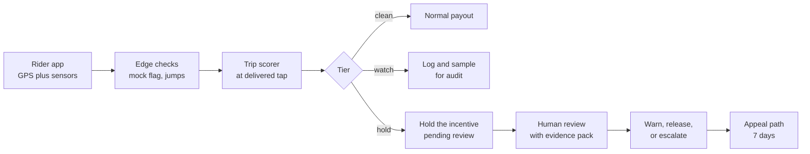
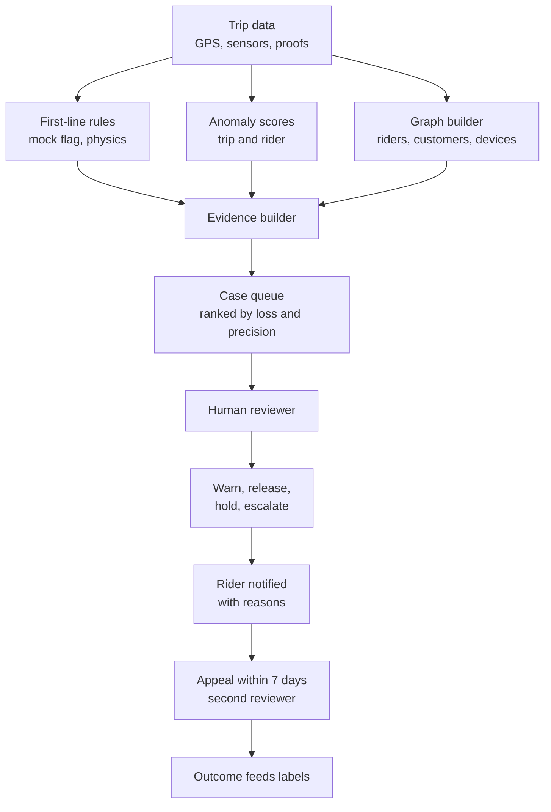

# Case Study 49: Rider GPS Spoofing, Fake Delivery Confirmation and Incentive Gaming Detection

**Domain:** Quick Commerce | **Problem Type:** Anomaly detection plus rules on trajectory data | **Difficulty:** Advanced

---

## 1. Business Context

### Company background

- **Jhatpat** (fictional): 320 dark stores, 9 cities, about 3 lakh orders a day, about 10.95 crore orders a year, average basket about ₹480.
- About 48,000 riders are active in a month. They use the Jhatpat rider app, which records GPS, taps ("picked up", "reached", "delivered"), and an optional OTP or photo at handover.
- Riders are paid per order plus incentives: a peak-hour bonus, a weekly milestone bonus (for example 90 orders), and higher rates in "hot zones" with rider shortage.
- Where money depends on location and counts, some people cheat. Almost all riders are honest. A small fraction accounts for most of the loss, and a few cases are organised.

### The pain, with numbers

| Fraud type | How it works | Estimated annual loss |
| --- | --- | --- |
| **Fake delivery confirmation** | Rider taps "delivered" without delivering (or leaves the bag at a wrong place). Customer reports "not received". Jhatpat refunds the basket and loses the goods | about 540 orders a day (0.18% of orders), about 1.97 lakh a year x ₹480 = **₹9.5 Cr** |
| **Incentive gaming by GPS spoofing** | A mock-location app makes the rider appear inside a hot zone or near a store, to get orders or bonus slabs | about 190 riders (0.4%) x ₹6,500 a month x 12 = **₹1.5 Cr** |
| **Collusion rings with customers** | A rider and accomplice customers place small fake orders that the rider "delivers" (no real handover) to hit the milestone and share a refund or coupon | about 40 rings, about **₹2 Cr** |
| **Total** | | **about ₹13 Cr a year** |

- Besides the direct loss, fake confirmations damage honest customers (food and medicines arrive late), and other riders get fewer orders when a spoofer steals the nearby assignment.
- **False accusations cause real harm.** A wrongly blocked rider loses roughly ₹18,000 a month in earnings, for a family that often has no other income. The cost of a false positive is far above its ₹ amount.

### Stakeholders and what each wants

| Stakeholder | What they want | What they fear |
| --- | --- | --- |
| Head of Fraud and Risk | Lower loss, fewer fake deliveries | Missing organised rings |
| Head of Rider Operations | Honest riders protected, no mass blocking | A wave of angry riders, strikes and city-level supply loss |
| Rider support and appeals team | Clear evidence and fair process | Overloaded appeals queue |
| Customer Experience | Fewer "not received" tickets | Customers blamed for fraud they did not commit |
| Legal, policy and public affairs | Fair, explainable, appealable decisions | Headlines about an algorithm firing gig workers |
| Finance | Recover losses, cap review cost | Review costs larger than the fraud avoided |
| Riders (honest majority) | Not to be suspected because of a bad GPS signal | Being treated as guilty by default |

---

## 2. Translating Business to ML

### The business question vs the ML question

| Business question | ML question |
| --- | --- |
| "Is this rider's location real?" | "Does the trajectory look physically possible, and is it consistent with the phone's motion sensors and network data?" |
| "Was this order really delivered?" | "Did the rider actually travel to the customer's address, stay for a plausible time, and does the evidence agree?" |
| "Is this account part of a ring?" | "Do rider and customer accounts form an unusual dense cluster, with shared devices, addresses or payment instruments?" |
| "Who do we act on, and how?" | "A tiered policy from 'watch' to 'hold payout pending review', with human review for anything that touches a livelihood" |

> **Mentor note:** There are three different problems wearing one name. Spoofed GPS is a **sensor integrity** problem (physics and device signals). Fake delivery is a **behaviour** problem (did the trip happen). Collusion is a **graph** problem (who orders with whom). Rules catch the first one cheaply. Anomaly models help with the second. Graph features are needed for the third. Do not build one grand model for all three.

### Target variable definition

- **There is no clean label.** We have weak labels from several sources:
  - A random **audit sample** (about 1,500 deliveries a week): a caller phones the customer and the audit team checks GPS evidence.
  - Confirmed cases from past investigations.
  - Customer "not received" complaints that were checked and upheld.
- **Working targets:**
  - Trip-level: `suspicious_delivery` (probability the "delivered" event was not a real delivery).
  - Rider-level: `gaming_score` over a 14-day window, built from trip signals and incentive patterns.
- Because labels are few, start with **rules and anomaly scores**, and use a supervised model later as audits accumulate.

### Edge cases

| Edge case | Recommended treatment | Reason |
| --- | --- | --- |
| Tall buildings, basements and tunnels give poor GPS | Use accuracy-aware checks (the phone's reported accuracy radius), and compare with the rider's own history at that address | Genuine GPS jumps of 100 m to 300 m are normal in cities |
| Customer asks the rider to leave the parcel at the gate or with a security guard | Allow "leave at door" and "security desk" modes, with the right evidence (photo, OTP not needed) | A short stop is not fraud |
| Rider's phone is old or battery saver is on | Compare with the phone model's usual quality before flagging | Weak hardware looks like a bad trajectory |
| Two riders use the same phone legitimately (family) | A device linked to 2 accounts is a flag, not a verdict | Humans verify |
| Rider takes a shortcut that looks like a jump on a road map | Use a map-matching tolerance, and compare to other riders' paths | Map data is imperfect |
| Customer is the fraudster (false "not received") | Always check the rider's evidence first | Do not blame the rider by default |
| Rider with legitimate mock-location settings (developer options on for testing) | Developer options alone is a weak signal | Tech-savvy riders exist |

### Unit of prediction

- **Trip** (one delivery leg), for the confirmation check, and **rider-day and rider-fortnight** for incentive gaming and rings.

### Prediction timing



- Trip checks run at the "delivered" tap (within 2 seconds). Ring detection runs nightly in batch.
- No permanent block is ever triggered by a trip-level score.

### What success looks like

| Lens | Success |
| --- | --- |
| Business | Cut fake-delivery refunds by 45% and incentive gaming by 60%, and break at least 15 of 40 rings in a year. Recovery about ₹7 Cr a year (section 6) |
| Model | Precision of at least 90% among cases that reach "hold" (judged by reviewers), recall of audited fraud at about 55% in year one |
| Rider fairness | Appeal overturn rate below 5%, no group of riders with a flag rate above 1.5x the average, and no rider loses earnings without a human review |

---

## 3. Data Understanding

### Data sources and key features

| Feature group | Source | Why it matters |
| --- | --- | --- |
| GPS trajectory (lat, long, timestamp every 3 to 5 seconds, accuracy radius, speed) | Rider app | The basis for speed, jump and path checks |
| Mock-location and device integrity flags (isMock, developer options, rooted or emulator, known spoofing app packages) | Device attestation | Cheap, strong first-line signals |
| Motion sensors (accelerometer, gyroscope, step count) | Phone sensors, with consent and in-shift only | Real riding shows vibration. A "moving" GPS with a still phone is suspicious |
| Network context (cell tower ID, Wi-Fi SSID hash, IP region) | App telemetry | A GPS location contradicting the network location |
| Geofence events (entry and exit around the store and the address) | Derived | Did the rider come near the customer |
| Delivery proof (OTP match, photo, customer confirmation, handover duration) | Order system | Independent evidence |
| Order and customer data (order value, new customer, repeated customer-rider pairs) | Order system | Collusion signals |
| Incentive and payout data | Incentive engine | Behaviour around slab thresholds |
| Device and account graph (shared device, SIM, address, payment instrument, referral links) | Identity data | Ring detection |
| Audit and investigation outcomes | Fraud team | Weak labels and evaluation |

### Data volume, granularity and refresh

- **Volume:** about 3 lakh trips a day. Each trip has 100 to 250 GPS points, so about 5 to 7 crore location points a day.
- **Granularity:** point level (GPS), trip level (features), rider-day (incentive) and graph (accounts and devices).
- **Refresh:** trip features within seconds, rider and graph features nightly.
- **Labels:** about 1,500 audited trips a week (about 78,000 a year), plus about 9,000 customer-complaint checks a year. With a base rate near 0.2%, an audit sample of 78,000 contains only about 150 positives.

### Common data issues

| Issue | How it shows up here |
| --- | --- |
| Genuine GPS noise looks like spoofing | Urban canyons give 100 m to 300 m jumps without any cheating |
| Very low base rate | 0.18% of orders. Even good models give mostly false alarms if thresholds are loose |
| Weak and biased labels | Audits are random, but complaint-based labels depend on the customer reporting |
| Fraud evolves | Spoofers learn which rule catches them and adapt (for example smooth fake paths) |
| Sensors on or off | Sensor data only exists when permission is on, and phones differ |
| Privacy limits | Location use is limited to working hours, and sensor data must be minimised |
| Rider app version differences | Older versions lack integrity signals |

> **Mentor note: Where juniors usually go wrong here.**
>
> - They flag everyone with a jump of more than 100 m. In a dense city, most delivery trips contain one, and the false accusations fall mainly on riders in tall-building areas.
> - They train a classifier on a few confirmed fraud cases, which only represent fraud that was already caught. The model learns yesterday's tricks.
> - They connect the model straight to "deactivate". A model with 90% precision still wrongly accuses 1 in 10, which means hundreds of livelihoods a year.

---

## 4. Approach and Decision Points

### Baseline first

- **Baseline 1:** hard, cheap rules at the edge: mock-location flag on, developer options plus a known spoofing app installed, speed above 90 km/h on a two-wheeler, "delivered" tap more than 500 m from the address with a good accuracy reading.
- **Baseline 2:** a rider-level rate rule: fraction of orders where the customer says "not received" and the rider's trip evidence is weak, compared with peers at the same store.
- **Why it matters:** in similar companies, rules on the first signals catch a large share of the obvious cases at nearly zero cost, with explanations a reviewer and a rider can both understand.

### Candidate models

| Model | Pros | Cons | Verdict |
| --- | --- | --- | --- |
| **Rules on physics and device flags** | Transparent, instant, easy to defend in an appeal | Easy to evade over time, needs regular updates | **First line. Always** |
| **Isolation forest or autoencoder on trajectory features** | Needs no labels, finds unusual trips | Flags unusual, not fraudulent (a long detour for a good reason) | Second line for the watch list |
| Per-rider baseline (z-score against own history and peers at the same store) | Fair, accounts for local conditions | Needs history | Strong complement |
| **Supervised gradient boosting on audit labels** | Improves with labels, combines signals | Few labels, drifts, biased | Phase 2 as audits grow |
| **Graph features and community detection** (connected components, repeated pairs, shared devices) | Finds rings no single-trip model can see | Needs clean identity data, risk of guilt by association | Primary for collusion |
| Sequence or deep trajectory models | Capture subtle fake paths | Hard to explain, heavy | Only for spoof detection after rules saturate |

### Decision scenarios

| What if... | Recommended action | Reasoning |
| --- | --- | --- |
| **GPS shows a 600 m jump in 2 seconds in a dense area** | Check the phone's accuracy radius and the previous and next points. If accuracy was poor and the path returns, treat as noise. Flag only when the jump is with good accuracy, repeated, and without a plausible route | A single jump is usually a sensor event. The pattern is what matters |
| **GPS says 28 km/h on a road, but the accelerometer is flat and step count is zero** | Count this as a strong spoofing signal when it repeats on several trips | Real riding has vibration. A flat sensor with moving GPS means fake movement or a phone placed on a moving carrier, and repeated cases settle it |
| **A rider has 0 'delivered' taps outside the geofence but a customer complaint rate 5x the store average** | Pull 10 recent trips and check handover proof, dwell time and customer calls. Look for a pattern before any action | The complaint rate may reflect the customer base. Evidence on the trips decides |
| **A rider and one customer account share 14 orders of ₹60 to ₹90 each in 3 weeks, all delivered in under 40 seconds after "reached"** | Escalate to the collusion review queue, not an automatic block. Check shared device, address, payment instrument | A repeated pair with tiny orders and instant handover is a ring pattern, but family households also order repeatedly |
| **A rider's weekly orders cluster at exactly 89 and 90, with a bonus at 90** | Examine the last 10 orders before each milestone for short-distance, low-value, same-address patterns | Milestone bunching is normal. Fake milestone orders are the issue |
| **Reviewers can handle only 250 cases a day but the model flags 900** | Raise the threshold, rank by expected loss prevented times precision, and require 2 independent signals (for example a device flag plus a trajectory anomaly) for review | An unreviewed flag is useless. Capacity is a hard constraint |
| **A rider appeals and shows the phone was in a basement car park** | Reviewer checks accuracy, tower data and a call to the customer. If the evidence is weak, release the payout and record the model's false positive | Appeals are labelled data too, and a high overturn rate means the rule is too aggressive |
| **Fraudsters switch to smoother, slower fake paths after the first rules go live** | Add detection on "too perfect" paths (constant speed, no stops, no road noise), rotate rule parameters, and keep some detection signals unannounced | Adversaries adapt. A fixed rule set decays |
| **A new Android version stops exposing the mock-location flag** | Fall back on indirect signals (sensor mismatch, network location conflict) and update app attestation | Do not depend on one signal. Redundancy is part of design |

---

## 5. Feature Engineering

### Top 10 features to build

| # | Feature | Business logic |
| --- | --- | --- |
| 1 | Mock-location flag, developer options, rooted device, known spoofing package present | Cheapest, strongest first-line signal |
| 2 | Max and 95th percentile speed per trip, and count of impossible speeds (above 90 km/h for a bike) | Physics violation |
| 3 | Number and size of jumps (above 150 m in under 5 seconds) with accuracy above 30 m excluded | Teleporting, with noise controlled |
| 4 | Accelerometer variance versus GPS speed (correlation and mismatch share) | Moving GPS with a still phone |
| 5 | Distance from "delivered" tap to the address, and time inside 100 m of the address | Did the rider really arrive and stay |
| 6 | Time from "reached" to "delivered", and OTP or photo presence | Instant confirmations without proof |
| 7 | Network location vs GPS location disagreement (km) | A phone on a Mumbai tower reporting a Pune GPS |
| 8 | Route efficiency: actual path length divided by map route length, and path straightness | Fake paths are suspiciously straight or smooth |
| 9 | Rider-customer pair repeat count, order value, and device or address overlap | Collusion |
| 10 | Rider's deviation from peers at the same store and hour (z-score of "not received" rate, speed pattern) | Fair local comparison |

### Features to avoid (leakage risks)

| Feature | Problem |
| --- | --- |
| Final investigation result or deactivation flag | The label |
| Customer "not received" complaint when scoring at the delivered tap | Arrives after the event, but is fine for a later rider-level review |
| Whether the rider was previously blocked or warned (for a supervised model) | Can learn "past suspicion" instead of behaviour |
| Home location, residential area, caste or religion proxies (surnames, locality) | Unfair and legally risky |
| Rider's rating or tenure as a direct driver of suspicion | Penalises newcomers and creates bias |
| Off-shift location or sensor data | Not needed, and a privacy breach under DPDP Act 2023 principles |

A first-line trip check combining physics and sensors (sketch):

```python
import numpy as np

def trip_flags(speed_kmh, acc_radius_m, jump_m, accel_var, mock_flag):
    good_fix = acc_radius_m < 30
    impossible_speed = (speed_kmh > 90) & good_fix
    teleports = ((jump_m > 150) & good_fix).sum()
    # GPS says moving above 10 km/h while the accelerometer barely moves
    sensor_mismatch = ((speed_kmh > 10) & (accel_var < 0.02)).mean()
    return {
        "mock": bool(mock_flag),
        "impossible_speed": int(impossible_speed.sum()),
        "teleports": int(teleports),
        "sensor_mismatch_share": float(sensor_mismatch),
    }
```

---

## 6. Evaluation Strategy

### Metrics

| Metric | Role | Why |
| --- | --- | --- |
| **Precision at the action level** (share of "hold" cases confirmed by a reviewer) | Primary | A wrong hold harms a person's income |
| **Recall on a random audit sample** (estimated with confidence intervals) | Primary | Tells us how much fraud we still miss |
| **Appeal overturn rate** | Fairness and quality | A direct count of false accusations |
| Loss prevented per reviewer-hour | Business efficiency | Review is the scarce resource |
| Time from flag to decision (hours) | Rider impact | A held payout is an income delay |
| Flag rate by city, area type, device tier, tenure | Fairness | Catches the tall-building and low-end-phone problem |
| Ring detection yield (rings confirmed per 100 flagged clusters) | Collusion | A measure for the graph layer |

### Metrics that look good but are misleading here

- **Accuracy and AUC on audit labels:** with 0.2% positives, a model that flags nothing is 99.8% accurate. A high AUC can mean good ranking and still poor precision at the volumes reviewers can handle.
- **Number of riders flagged or blocked:** more flags do not mean more fraud caught.
- **Complaint-based recall:** only measures fraud that customers noticed.
- **Training-set agreement with past investigations:** fraud already caught is not the fraud that remains.

### Validation strategy

| Step | Design | Why |
| --- | --- | --- |
| Random audit sample | 1,500 trips a week, stratified by city and device tier, labelled by calls and evidence | The only unbiased measure of prevalence and recall |
| Precision from reviewer decisions | Reviewers label every "hold" case, and a second reviewer re-checks 10% | Checks precision and reviewer consistency |
| Time-based split | Train on months 1 to 6, test months 7 and 8 | Fraud tactics shift over time |
| Group slices | Flag rate and appeal overturns by city, building density, phone price band, tenure | Find systematic unfairness |
| Red-team test | The fraud team tries to evade the rules in a sandbox | Reveals blind spots before the fraudsters do |
| Shadow mode | Scores logged, no action, for 4 weeks | Estimate volumes and false positive load |

### From model metric to business value

- Fake-delivery refunds: ₹9.5 Cr. Catching 45% (with evidence to refuse refunds or recover): about **₹4.3 Cr**.
- Incentive gaming: ₹1.5 Cr. Stopping 60%: about **₹0.9 Cr**.
- Rings: ₹2 Cr. Breaking 15 of 40 rings (about 38%): about **₹0.8 Cr**.
- Gross recovery about ₹6.0 Cr. Add about ₹1.0 Cr of avoided downstream cost (support, rider supply from honest riders who lose orders to spoofers). Total benefit about **₹7 Cr**.
- Costs: reviewers (about 12 FTE at about ₹6 lakh a year = ₹0.7 Cr), appeals team and engineering about ₹0.8 Cr. **Net about ₹5.5 Cr a year.**
- False positive budget: at a 5% overturn rate on about 4,000 held cases a year, about 200 wrongly held payouts of about ₹6,500 each (₹13 lakh), all released after review. **No one is deactivated without human review.**

---

## 7. Deployment and Monitoring

### Batch vs real time

- **Real time (edge and server):** device flags and trip checks at the delivered tap. Fast rules, under 50 ms.
- **Near real time:** trip anomaly scoring within a minute, for a "watch" or an "evidence pack" request.
- **Batch (nightly):** rider-level scores, peer comparisons, graph and ring detection.
- **Human review** for every action that affects a rider's income.



### Evidence standards and rider process

- **Two independent signals** (for example device flag plus trajectory anomaly, or sensor mismatch plus failed geofence) are needed for a hold.
- **Evidence pack** for reviewer and rider: the map with trajectory, speed chart, device flags, delivery proofs, in plain language.
- **Escalation ladder:** monitor, then a warning with explanation, then hold on the specific incentive pending review, then suspension review. Permanent removal requires a senior reviewer and a record of the evidence.
- **Appeal:** rider can respond within 7 days, a different reviewer decides, and wrongly held earnings are paid in full with an apology.
- **Data use:** location and sensor data are used only during shifts, retained for a limited period, and not shared outside the fraud team (DPDP Act 2023 principles). Riders are told in the app what is checked.

### What to monitor

| Type | What to track | Alert trigger |
| --- | --- | --- |
| Precision | Share of holds confirmed by reviewers, weekly | Below 88% |
| Fairness | Flag rate and appeal overturn rate by city, density, phone tier, tenure | Any group above 1.5x the average |
| Recall | Fraud found in random audits not flagged | Recall estimate below 45% |
| Coverage | Share of trips with integrity flags available (app version) | Below 90% |
| Reviewer load | Cases per reviewer a day, backlog age | Backlog above 48 hours |
| Evasion | Share of trips with "too perfect" paths, spoof package list changes | A sudden rise |
| Rider impact | Held earnings, time to decision, appeal outcomes | Median decision time above 3 days |
| Drift | Changes in speed, accuracy and jump distributions by city | PSI above 0.2 |

### Retraining

- **Rules:** reviewed every 2 weeks by the fraud team. Parameters are rotated.
- **Anomaly model:** monthly, on recent clean data only.
- **Supervised model (once labels exist):** quarterly, with audit-labelled data and reviewer outcomes.
- **Triggered:** new device OS versions, a new city, a new incentive slab design, and a rise in appeals.

### A/B test or champion-challenger design

- Rules and models are tested in **shadow mode** first.
- Then randomise at the **store level** (to avoid spillover between riders in the same area): treatment stores get "hold and review", control stores stay with the old complaint-driven process, for 6 weeks.
- Primary: refunds for "not received" per 1,000 orders. Guardrails: appeal overturn rate, rider supply in treated stores, rider complaints.

---

## 8. Stakeholder Communication

### Explain it to a non-technical leader

> "Some deliveries are marked complete when the rider never went to the customer, and a few riders fake their location to earn bonuses. We now check three things: whether the phone's movement is physically possible, whether the rider really reached the address, and whether the same rider and customer keep appearing together.
> Obvious cases are caught by simple rules. Suspicious ones go to a trained reviewer with a clear evidence pack, and a rider can appeal.
> We expect to recover about ₹7 Cr a year at about ₹1.5 Cr of cost, and no rider is removed by a machine alone."

### Questions leadership will ask

| Question | Suggested answer |
| --- | --- |
| "Why not block everyone the model flags?" | "At 90% precision, 1 in 10 would be an honest rider losing about ₹18,000 a month. That is a human harm and a public relations risk. A short human review costs far less" |
| "How sure are we that this is fraud and not bad GPS?" | "We need two independent signals, we account for GPS accuracy, and we compare each rider to peers in the same area. Single jumps are ignored" |
| "Can fraudsters learn the rules?" | "Yes, over time. That is why the rules are cheap, regularly changed, backed by sensor and graph signals, and tested by an internal red team" |
| "How do we know how much fraud we miss?" | "From random audits that do not depend on complaints. They give us the prevalence and the recall with a confidence range" |
| "Is collecting sensor data legal and fair?" | "We collect it only during shifts, for fraud checks, with notice in the app and limited retention, under the DPDP Act principles. We do not use off-duty data" |
| "What about ring members who are customers?" | "Customers are also checked, but with the same care. Action on a customer account goes through a separate review" |

---

## 9. Common Pitfalls and Lessons

| Mistake | Why it happens | How to avoid it |
| --- | --- | --- |
| Treating GPS noise as fraud | Raw jumps look dramatic | Use accuracy-aware checks, peer comparison and repeated patterns |
| Training a supervised model on confirmed cases only | Labels are scarce and biased towards caught fraud | Start with rules and anomaly scores, use random audits for evaluation, grow labels slowly |
| Automatic blocking | Pressure to cut losses fast | Tiered actions, human review, two independent signals, an appeals process |
| One model for all three fraud types | A single "fraud" label is tempting | Separate sensor integrity, trip behaviour and graph detection |
| Ignoring fairness slices | Overall metrics look good | Check flag and overturn rates by city, density, phone tier and tenure |
| Reading complaints as ground truth | Complaints are available at scale | Complaints are a lead, with the rider's evidence checked before blame |
| Static rules that fraudsters learn | Rules are set and forgotten | Rotate, red-team and keep some signals unannounced |
| Ignoring review capacity | Models are tuned for recall | Rank by expected loss prevented, cap by reviewer hours |
| Collecting more personal data than needed | More data feels safer | Limit to on-shift data with a clear purpose, and publish what is collected |
| Skipping the evidence pack | Focus on the score | Reviewers and riders need maps, signals and reasons in plain words |

---

## 10. Mentor's Focus Checklist

- ✅ **Where to spend 80% of the effort:**
  - First-line rules on device and physics signals, which are cheap and explainable.
  - A random audit programme that gives honest prevalence and recall.
  - Evidence standards, human review, an appeals process and rider-fair thresholds.
  - Graph features for collusion rings, with care about guilt by association.
- ❌ **What not to over-engineer:**
  - Deep trajectory models before rules and per-rider baselines saturate.
  - A single score for "fraudulence" that nobody can explain to a rider.
  - Chasing 100% recall at the cost of wrongly accusing honest riders.
- 💡 **Key takeaway:** **In fraud against workers, a false accusation is not a rounding error, it is someone's income.** Use cheap rules first, require independent evidence, keep humans and an appeal in every action, and measure fairness as carefully as recall.
