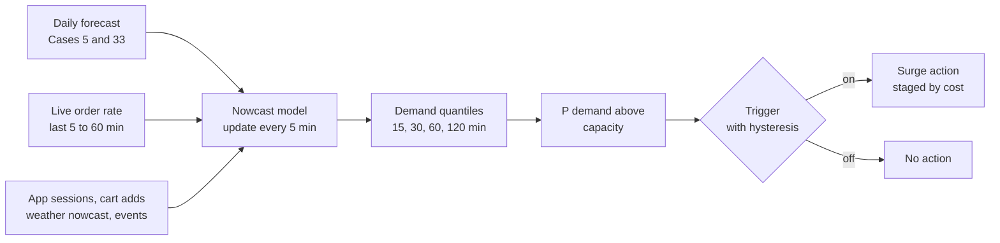
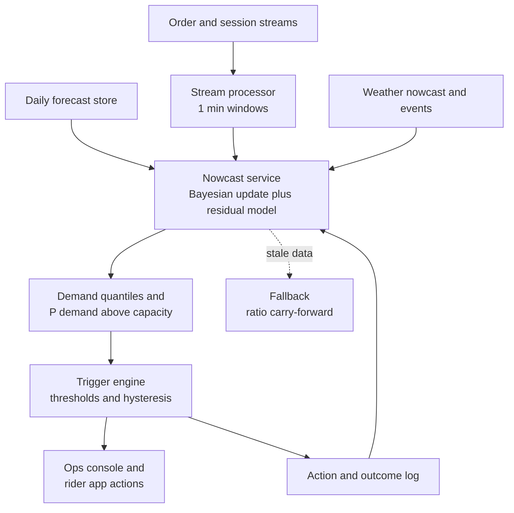

# Case Study 50: Intraday Demand Nowcasting and Surge Staffing Triggers (The "Next 30 Minutes" Problem)

**Domain:** Quick Commerce | **Problem Type:** Short-horizon forecasting (nowcasting) and decision triggers | **Difficulty:** Advanced

---

## 1. Business Context

### Company background

- **Jhatpat** (fictional): 320 dark stores, 9 cities, about 3 lakh orders a day, about 10.95 crore orders a year, average basket about ₹480.
- Planning happens at two levels already:
  - **SKU demand** by store and day (see Case 5): what to stock.
  - **Rider demand** by zone and shift (see Case 33): how many riders to roster.
- This case is the third layer, the **live layer**. On the day, reality departs from the plan: a sudden shower, a cricket match ending, a salary-day rush, a competitor outage. Operations need to know in the next 15 to 120 minutes whether a store will be overloaded, and act.

### The pain, with numbers

| Item | Value |
| --- | --- |
| Average orders per store per day | about 940 (3 lakh over 320 stores) |
| Peak-hour orders per store (7 pm to 9 pm) | about 90 an hour, about 22 per 15 minutes |
| True surge events a day (a store-zone going over pick or rider capacity for about an hour) | about 256 (0.8 per store per day) |
| Current surge rule | "Orders per 10 minutes above same time yesterday plus 30%" |
| Current rule performance | catches about 55% of true surges (about 141 a day), with a mean 25-minute delay, and 40% of its alerts are false (about 94 a day) |
| Missed surges a day | about 115 |
| **Cost of a missed surge** (about 120 orders, 40% more lateness, about 15 abandoned orders: 48 x ₹35 + 15 x ₹38, plus refunds) | **about ₹2,400** |
| **Cost of a false surge** (standby for about an hour: 3 riders x ₹150 guaranteed pay, plus ₹8 extra on about 80 orders) | **about ₹1,100** (3 x ₹150 + 80 x ₹8 = ₹450 + ₹640) |
| **Daily surge cost today** (115 x ₹2,400 + 94 x ₹1,100) | **about ₹3.79 lakh, about ₹13.8 Cr a year** |

- Surge actions are things like: paging standby riders, paying a temporary per-order incentive in a zone, adding a picker, pausing low-priority orders, or widening the shown ETA for 30 minutes.
- Each action has a cost and takes time to work. Calling riders takes 10 to 20 minutes, so we must predict **before** the surge.

### Stakeholders and what each wants

| Stakeholder | What they want | What they fear |
| --- | --- | --- |
| Head of Operations and Dispatch | Early warning with few false alarms | Alert fatigue, the team ignoring the system |
| City and store managers | A clear "do this now" instruction | Another dashboard with no action |
| Finance | Lower incentive burn | Incentives paid for surges that do not happen |
| Rider community team | Fair, predictable incentives | Riders learning to wait for surge pay and ignoring base pay |
| Customer Experience | On-time orders in rain and match nights | Late orders on the worst nights |
| Engineering | A stable streaming service with low latency | Stale features and a model that stalls at peak |
| Planning team (Cases 5 and 33) | Their daily forecast respected, not replaced | Two conflicting forecasts |

---

## 2. Translating Business to ML

### The business question vs the ML question

| Business question | ML question |
| --- | --- |
| "How many orders will this store get in the next 15, 30, 60, 120 minutes?" | "Produce a probabilistic forecast of order counts per store-zone for horizons up to 120 minutes, updated every 5 minutes" |
| "Will we exceed capacity?" | "Estimate P(demand above capacity in the next 30 to 60 minutes), using demand quantiles and live capacity" |
| "Should we trigger surge now?" | "A decision rule on that probability, with thresholds set from the cost of a false surge vs a missed surge, and hysteresis to avoid flip-flopping" |

> **Mentor note:** The daily forecast from Cases 5 and 33 is not wrong. It is **a prior**. The job here is to **update** it with what has happened in the last 30 to 60 minutes and with leading signals (app sessions, weather), not to build a new model from scratch. Think of the daily forecast as the plan, and the nowcast as a correction with uncertainty. The business decision needs a probability, not a point forecast.

### Target variable definition

- **Demand target:** number of orders **placed** (not delivered) in the store-zone in the next `h` minutes, for `h` in 15, 30, 60, 120. Use order **placed** time so that capacity limits do not censor demand.
- **Surge target for the trigger:** `surge = 1` if, in the next 60 minutes, the store-zone's order arrivals exceeds a capacity threshold (for example 1.15 times the picker plus rider throughput available) for at least 20 minutes.
- **Censoring caution:** at a store that was throttled or showed "high demand", observed orders are lower than demand. Use app sessions and cart-adds as additional signals.

### Edge cases

| Edge case | Recommended treatment | Reason |
| --- | --- | --- |
| Store closes temporarily (power cut, stock-out) | Mark as unavailable, exclude from training, and reroute demand logic | Zero orders are not zero demand |
| Demand is throttled by a "store busy" message | Use sessions and cart adds as demand proxies | Orders understate demand |
| Public holiday or a festival day with no history | Use event features and the closest historical analogue | Rare events dominate the error |
| IPL or a big cricket match | Add match schedule and end-time features (orders spike during breaks and after the match) | Predictable but sharp |
| Sudden rain at 6:40 pm | Weather nowcast (minutes-ahead radar) as a feature | Demand and rider supply move in opposite directions |
| Competitor outage (lots of new customers suddenly) | Detect through session spikes with no weather or event reason, and flag as an unexplained surge | Rare but costly |
| New store with 3 weeks of history | Use cluster priors from similar stores | Not enough data to learn |

### Unit of prediction

- One **store-zone and time window**: for each of about 320 stores (or about 500 store-zones if large stores are split), forecast every 5 minutes for horizons up to 120 minutes.

### Prediction timing



- Scoring runs every 5 minutes for all stores, and the end-to-end delay from event to decision must be under 60 seconds.

### What success looks like

| Lens | Success |
| --- | --- |
| Business | Surge catch rate from 55% to 80%, false alerts reduced so that precision rises from 60% to 70%, daily surge cost down by about ₹1.6 lakh, about **₹5.8 Cr a year** (section 6). Plan on about ₹4 Cr |
| Model | 30-minute store-level WAPE of about 24% against 31% for the same-time-yesterday rule, and calibrated 80% intervals (they contain the truth about 80% of the time, by hour band and weather) |
| Operations | Median lead time from alert to surge start of at least 20 minutes, and alert acceptance by store managers above 70% |

---

## 3. Data Understanding

### Data sources and key features

| Feature group | Source | Why it matters |
| --- | --- | --- |
| Daily forecast (store, hour) | Planning system (Cases 5 and 33) | The prior |
| Live order counts (last 5, 15, 30, 60 minutes) | Order stream | The primary signal |
| App sessions, searches and cart adds (by store catchment) | Event stream | A leading indicator, typically 4 to 10 minutes ahead of orders |
| Weather nowcast (rain start and intensity in the next 30 to 60 minutes), temperature | Weather API with radar | Rain raises orders and cuts rider supply |
| Events (matches, holidays, salary days, local festivals) | Calendar and manual input | Predictable spikes |
| Capacity (pickers on shift, riders online and idle, average pick time) | Store and dispatch systems | Needed to turn demand into a surge decision |
| Store state (open, throttled, stock-outs of top items) | Store systems | Interprets the observed orders |
| Past surge actions and outcomes | Operations log | Effectiveness of actions |
| Push-notification schedule (see Case 47) | CRM | Marketing sends cause deliberate spikes |

### Data volume, granularity and refresh

- **Volume:** about 3 lakh orders a day and several times that in sessions. At 5-minute resolution per store, there are about 288 rows a day per store, about 92,000 rows a day across 320 stores, about 3 crore rows a year.
- **Granularity:** store (or store-zone) by 5-minute bucket.
- **Refresh:** live order and session features every 1 minute, weather nowcast every 5 to 10 minutes, daily forecast every morning (and intra-day if a plan changes).

### Common data issues

| Issue | How it shows up here |
| --- | --- |
| Poisson noise | At 22 orders per 15 minutes, pure randomness gives a standard deviation of about 4.7, so a floor of about 21% error even with a perfect model |
| Late and out-of-order events | Orders arrive in the stream slightly late, so the last minute looks quiet |
| Session data is noisy | Bots, browsing without intent and app crashes distort sessions |
| Weather nowcast errors | Radar timing is off by 10 to 20 minutes, and drizzle in one pin code and dry in the next |
| Marketing-caused spikes | Push campaigns create demand not seen in normal patterns |
| Throttling hides demand | Orders stop growing when the app shows "high demand" |
| Mixed capacity definitions | Pickers and riders each limit throughput differently |

> **Mentor note: Where juniors usually go wrong here.**
>
> - They compare models on per-store, 15-minute accuracy and get frustrated at 24% error, not realising that most of it is irreducible noise. Compare to a baseline and to the noise floor.
> - They fit a fresh model to the last hour of orders and throw away the daily plan, so the model chases noise.
> - They trigger surge on a point forecast crossing a line, which produces alert flip-flop every 5 minutes.

---

## 4. Approach and Decision Points

### Baseline first

- **Baseline 1 (current rule):** same time yesterday plus 30%. 55% catch rate, 25-minute delay.
- **Baseline 2:** the daily forecast phased by an hourly profile, scaled by the ratio of the last 30 minutes' actual to forecast ("ratio carry-forward").
- **Baseline 3:** same time last week and the last 4 weeks' median.
- **Why it matters:** the ratio carry-forward is the simplest form of Bayesian updating, and it is often 70% of the achievable gain. Measure it before building anything heavier.

### Candidate models

| Model | Pros | Cons | Verdict |
| --- | --- | --- | --- |
| Ratio carry-forward on the daily plan | Simple, robust, no training | Overreacts to noise at low counts | Baseline and fallback |
| **Gamma-Poisson Bayesian update** (the daily forecast as prior, live counts as evidence) | Gives a proper probability, shrinks noisy counts towards the plan, cheap | Assumes a simple noise model, needs a prior strength per store | **Core for the live correction** |
| **Residual model on the daily forecast** (LightGBM predicting actual minus plan, using lagged residuals, sessions, weather) | Learns patterns such as rain, matches and session lead times | Needs good training windows | **Second layer for leading indicators** |
| State-space or Kalman-type model | Smooth tracking of level changes | Harder to add many covariates | Optional |
| Deep sequence models (LSTM, temporal fusion transformers) across stores | Capture shared patterns | Latency, heavy retraining, little gain at this noise level | Only if gains are proven |
| Quantile regression or conformal intervals | Direct uncertainty | Needs calibration | Use for the probability of exceeding capacity |
| Hierarchical pooling (zone to city) | More stable estimates at low counts | More engineering | Use for new or small stores |

### Decision scenarios

| What if... | Recommended action | Reasoning |
| --- | --- | --- |
| **Rain starts at 6:40 pm and the live order rate has only moved 6% in 10 minutes** | Trust the weather nowcast and sessions more than the last 10 minutes of orders. Raise the 30-minute demand quantiles by the historical rain uplift (for example 15% to 25%) and cut expected rider supply | Orders lag sessions and weather. Waiting for orders to prove the surge means acting too late |
| **A store's last 5-minute count is 3x the plan, but sessions are flat** | Treat as a noise or batch effect (a large order cluster from one society). Shrink the correction heavily | Pure order spikes without sessions are often a one-off |
| **The live rate is 25% above plan for 10 minutes at a low-volume store** (6 orders instead of 4.8) | Do not trigger. Use a Gamma-Poisson update so a count of 6 against a plan of 4.8 shifts the estimate only slightly | At low counts, a 25% excess is well inside normal noise |
| **The probability crosses the trigger threshold at 6:55, drops below at 7:00, then up again at 7:05** | Use **hysteresis**: turn on at probability 0.35, turn off only when below 0.20 for two consecutive checks, with a minimum on-time of 30 minutes | Flip-flopping surge status confuses riders, wastes incentive and makes operations ignore the system |
| **The cost of a false surge is ₹1,100 and a missed one is ₹2,400** | Trigger when P(surge) is above about 0.31 (1,100 divided by 3,500), and stage the actions: low-cost action at 0.25 (alert standby riders), high-cost at 0.5 (pay incentive) | Thresholds come from costs. Cheap reversible actions can use low thresholds |
| **A big match ends and demand jumps after the final ball** | Use the match schedule with a conditional end-time estimate, and update when the match state shows a super over or a delay | A known event with an uncertain end time is a time-shift problem |
| **Marketing sends a push to 2 lakh users at 7:00 pm** | Include the planned send schedule (Case 47) as a known future driver, and expect a 10-minute lagged spike | A planned spike should not be a surprise to operations |
| **The nowcast service is 3 minutes stale** | Detect staleness, fall back to the ratio carry-forward on the last good data, and flag the dashboard | A stale model that looks live is worse than a simple, honest one |
| **Surge actions work, so the next day's demand history looks calmer** | Log actions and use the demand measured before the action, plus sessions, as the target | Otherwise the model learns that surges never happen, because we kept stopping them |

---

## 5. Feature Engineering

### Top 10 features to build

| # | Feature | Business logic |
| --- | --- | --- |
| 1 | Daily forecast for the target window (from Cases 5 and 33) | The prior, and the largest single driver |
| 2 | Ratio of actual to plan over the last 15 and 30 minutes, with a count-based shrinkage | The live correction |
| 3 | Orders in the last 5, 10 and 30 minutes, and the slope | Momentum |
| 4 | Sessions and cart-adds per minute in the catchment, and the ratio of cart adds to checkouts | Leads orders by about 4 to 10 minutes |
| 5 | Weather nowcast: minutes until rain, intensity, and whether rain is already falling | Rain raises demand and reduces rider supply |
| 6 | Event flags: match in progress, minutes to end, holiday, salary day | Predictable spikes |
| 7 | Planned push sends in the next 30 minutes (Case 47) | Deliberate demand shocks |
| 8 | Idle riders divided by open orders, pickers on shift, average pick time | Capacity side of the surge decision |
| 9 | Store throttling or stock-out status | Interprets under-observed demand |
| 10 | Hour of week, store cluster, and residuals from the same time last week | Seasonal pattern and store type |

### Features to avoid (leakage risks)

| Feature | Problem |
| --- | --- |
| Orders delivered in the window (instead of placed) | Mixes demand with capacity and delivery speed |
| Any data after the forecast origin time | Look-ahead, especially in aggregates computed on the full hour |
| Final daily totals or end-of-day corrected data | Not available at the origin |
| The surge action taken later in the window | Outcome of the decision |
| Weather observations (actual) used as if they were forecasts | Overstates the benefit, since real forecasts have lead-time error |
| Features computed with a different late-event rule in training vs live | Training-serving skew |

A Gamma-Poisson correction of the daily plan (sketch):

```python
# plan_rate: planned orders per minute for this store-window (the prior mean)
# k: prior strength, in "minutes of evidence"; larger k trusts the plan more
# n_obs, t_obs: orders and minutes observed in the recent window
def posterior_rate(plan_rate, n_obs, t_obs, k=30.0):
    alpha0, beta0 = plan_rate * k, k           # Gamma prior with mean plan_rate
    alpha, beta = alpha0 + n_obs, beta0 + t_obs
    return alpha / beta                        # posterior mean orders per minute

# Plan 4.8 orders per 15 min = 0.32 per min. Observed 6 orders in 15 min
# gives (0.32*30 + 6) / (30 + 15) = 0.347 per min, up only 8%, not 25%.
```

---

## 6. Evaluation Strategy

### Metrics

| Metric | Role | Why |
| --- | --- | --- |
| **WAPE by horizon** (15, 30, 60, 120 minutes) and by volume band | Primary for the demand forecast | Errors grow with the horizon, and low-volume stores have more noise. Report separately |
| **Bias by hour band and weather** | Primary | A model that under-forecasts at peak is dangerous |
| **Interval coverage** (do 80% intervals contain the truth about 80% of the time) | Primary for the trigger | The surge probability depends on the tails |
| **Surge catch rate (recall), precision, and lead time** | Primary for the decision | Business results |
| Expected cost of the trigger policy (₹ per day) | Business | False vs missed surge costs |
| Alert flip-flop rate (on-off-on within 30 minutes) | Operational | Checks hysteresis |
| Latency from event to alert (seconds) | Engineering | The surge window is short |
| Skill score versus the baseline (1 minus model error over baseline error) | Model quality | Directly shows value added over a simple rule |

### Metrics that look good but are misleading here

- **MAPE on small counts:** at 3 orders in a window, a miss of 1 is 33%. Use WAPE with volume weighting, or evaluate at the zone-hour level.
- **Overall daily accuracy:** a day-level error of 4% can hide 30% errors at the 7 pm peak, when it matters.
- **R-squared on counts:** very high because the daily pattern is regular. It does not show skill over the plan.
- **Accuracy of a surge classifier:** surges are about 20% of store-hours at peak, and a rule that says "no surge" scores well.

### Validation strategy

| Step | Design | Why |
| --- | --- | --- |
| Rolling-origin evaluation | Replay history at every 5-minute origin, forecast 15 to 120 minutes ahead, using only data available then | Matches live use and gives error by horizon |
| Evaluation by horizon | Report WAPE, bias and coverage at 15, 30, 60 and 120 minutes separately, with the baseline alongside | Skill falls with horizon. Short horizons rely on live rates, long ones on the daily plan |
| Event slices | Include at least 5 rain onsets, 3 match nights, 2 salary days, and 1 festival in the test period | Tests the hard cases that actually trigger surge |
| Store-group holdout | Hold out 10% of stores to test new-store behaviour | Prior pooling must work |
| Replay with a cost model | Run the trigger policy on 8 weeks of history and compute daily cost from the cost table | Choose thresholds and hysteresis by money, not by AUC |
| Shadow mode and live pilot | 3 weeks of silent alerts, then a 40-store pilot against control stores | Operational acceptance and real action effects |

### From model metric to business value

- Today: 256 surges a day, caught 55% (141), missed 115, false alerts 94. Cost = 115 x ₹2,400 + 94 x ₹1,100 = ₹2.76 lakh + ₹1.03 lakh = **₹3.79 lakh a day**.
- With the nowcast: catch 80% (205), missed 51, precision 70% so false alerts = 205 x 0.3 / 0.7 = about 88. Cost = 51 x ₹2,400 + 88 x ₹1,100 = ₹1.22 lakh + ₹0.97 lakh = **₹2.19 lakh a day**.
- Saving = ₹1.60 lakh a day, about **₹5.8 Cr a year**.
- Earlier warnings (a median lead time of 20 minutes instead of a 25-minute delay) make each action more effective, which is not counted here.
- **Plan on about ₹4 Cr** because action effectiveness, store compliance and overlap with Case 33 rostering reduce the realised benefit.
- Check against the noise floor: a 24% WAPE at the store-15-minute level is already close to the floor of about 21%. Do not promise much more.

---

## 7. Deployment and Monitoring

### Batch vs real time

- **Streaming:** live order and session features, with a 1-minute window.
- **Scoring every 5 minutes** for all stores. This is micro-batch, not per request. The target end-to-end latency is under 60 seconds.
- **Batch:** the daily forecast (earlier cases), nightly parameter fitting (prior strength per store, residual model), weekly retraining.
- A fallback chain: full model, then Gamma-Poisson correction only, then ratio carry-forward, then the old rule.



### What to monitor

| Type | What to track | Alert trigger |
| --- | --- | --- |
| Accuracy by horizon | WAPE and bias at 15, 30, 60, 120 minutes, by hour band | WAPE 20% worse than the trailing 4 weeks |
| Calibration | Coverage of 80% intervals, by store volume band and weather | Coverage outside 72% to 88% |
| Trigger quality | Weekly surge catch rate, precision, false-alert cost | Precision below 60%, or recall below 70% |
| Flip-flop | Alerts that turn on and off within 30 minutes | Above 5% of alerts |
| Latency and freshness | Event-to-alert time, stream lag, data staleness | Lag above 2 minutes, or fallback above 3% of runs |
| Action effectiveness | Late-order rate in surge vs similar non-treated windows | No improvement over 4 weeks |
| Operator trust | Share of alerts acted on, manual overrides | Acceptance below 60% |
| Drift | Order mix, session-to-order lag, weather response | PSI above 0.2, or lag shifts by 3 minutes |

### Retraining

- **Scheduled:** residual model weekly, prior strength and shrinkage parameters nightly, session lead-time parameters monthly.
- **Triggered:** a new city launch, the festival season (use a special model for two weeks), an app redesign (sessions change meaning), or a change in rider incentive structure.

### A/B test or champion-challenger design

- Because surge actions affect neighbouring stores that share riders, use a **store-cluster switchback or geographic split**: treatment clusters use the nowcast trigger, control clusters use the old rule, for 4 weeks, with clusters balanced by size and weather exposure.
- Primary: expected cost per store-day and late-order rate at peak. Guardrails: rider incentive spend, rider earnings stability, abandoned-order rate.
- Run champion-challenger in shadow on every store, logging what the new trigger would have done.

---

## 8. Stakeholder Communication

### Explain it to a non-technical leader

> "Our morning plan tells us how busy each store should be. On the day, rain, a match or a salary-day rush changes things within minutes. The current rule reacts too late and often cries wolf.
> The new system starts with the plan, then updates it every 5 minutes using the latest orders, app activity and the weather forecast, and tells us how likely a store is to be overloaded in the next half hour.
> We act early only when the odds justify the cost. We expect to cut surge-related losses by about ₹4 to ₹6 Cr a year, with about 20 minutes of lead time instead of reacting late."

### Questions leadership will ask

| Question | Suggested answer |
| --- | --- |
| "Why not just roster more riders every evening?" | "That costs about as much as the whole surge bill, every day, including the many nights it is not needed. Targeted standby only when the odds justify it is cheaper" |
| "How is this different from the rider forecast?" | "The shift forecast decides who is rostered tomorrow. This corrects the plan during the day, in minutes, for the actions that are still possible: standby calls, incentives, pickers" |
| "Why do you show a probability and not a number?" | "Because the decision depends on how risky a miss is, compared with a false alarm. Two stores with the same forecast can need different actions, depending on how likely they are to exceed capacity" |
| "Will surge pay become expected by riders?" | "It could. We cap the frequency, use staged actions with cheap options first, and monitor base-pay earnings, so riders do not learn to wait for surge" |
| "Can it handle a day we have never seen?" | "It reacts quickly through live orders and app activity, and when it is unsure it widens the interval and prefers cheap actions. Extreme days will still need human judgement" |
| "What if the system is slow or down?" | "A simple chain of fallbacks ends at the old rule, and the console shows when data is stale" |

---

## 9. Common Pitfalls and Lessons

| Mistake | Why it happens | How to avoid it |
| --- | --- | --- |
| Replacing the daily forecast with a fresh short-term model | It feels more modern | Use the daily forecast as a prior and correct it, with shrinkage by volume |
| Chasing accuracy below the noise floor | Per-store 15-minute counts are tiny | Compute the Poisson floor, evaluate at multiple aggregation levels, and compare to baselines |
| Triggering on a point forecast | It is simple | Use probabilities of exceeding capacity and a cost-based threshold |
| No hysteresis | The model is re-scored every 5 minutes | Separate on and off thresholds, minimum on-time, and monitor flip-flop |
| Training on delivered orders or throttled orders | Delivered orders are the clean data | Use placed orders, with sessions as demand proxies |
| Evaluating at one horizon | One number is easy to report | Report by horizon, with the baseline and by volume band |
| Ignoring latency and staleness | Offline accuracy looks fine | Measure event-to-alert time, and add staleness fallbacks |
| Forgetting action feedback | Interventions change future data | Log actions, and train on pre-action demand and sessions |
| Not planning for marketing-driven spikes | Teams work in silos | Feed the push schedule (Case 47) into the nowcast |
| Using actual weather in training and forecasts live | Actual weather is the data that exists | Train on archived forecasts with the same lead times |

---

## 10. Mentor's Focus Checklist

- ✅ **Where to spend 80% of the effort:**
  - The Bayesian correction of the daily forecast, with sensible shrinkage at low counts.
  - Leading indicators (sessions, cart adds, weather nowcast) and honest lead-time analysis.
  - A cost-based trigger with hysteresis and staged actions.
  - Evaluation by horizon, calibration of intervals, and a replay of the cost model.
  - Latency, staleness handling and fallbacks.
- ❌ **What not to over-engineer:**
  - Deep sequence models for per-store 15-minute counts, where noise dominates.
  - Forecast horizons beyond 120 minutes, which belong to Case 33.
  - Perfect weather integration before a basic rain-onset feature works.
- 💡 **Key takeaway:** **The daily plan is your prior, the last hour is your evidence, and the cost of a false alarm versus a miss sets the trigger.** Judge the system by horizon-wise skill over a simple baseline and by rupees saved per day, not by one accuracy number.
