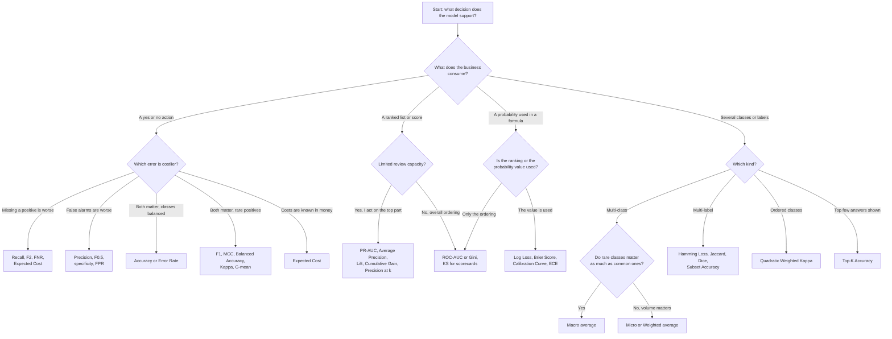

# Classification Metrics: Case Studies and Selection Guide

## Table of Contents

- [Metric Coverage and Self-Check](#metric-coverage-and-self-check)
- [Metric Group Index](#metric-group-index)
- [Metric Comparison Matrix](#metric-comparison-matrix)
- [Decision Flowchart](#decision-flowchart)
- [Common Mistakes](#common-mistakes)
- [Business-to-Metric Cheat Sheet](#business-to-metric-cheat-sheet)
- Part files, by metric group:
  - [Classification Case Studies, Part 1: Confusion Matrix and Cell-Ratio Metrics](classification_part1_basic_and_cell_ratio.md)
  - [Classification Case Studies, Part 2: Combined and Imbalance-Aware Metrics](classification_part2_combined_and_imbalance.md)
  - [Classification Case Studies, Part 3: Probability, Loss and Calibration Metrics](classification_part3_probability_and_calibration.md)
  - [Classification Case Studies, Part 4: Ranking and Curve-Based Metrics](classification_part4_ranking_and_curves.md)
  - [Classification Case Studies, Part 5: Multi-Class, Multi-Label and Other Metrics](classification_part5_multiclass_multilabel_and_other.md)

This library explains, for every classification metric, when it is the right choice and when it is the wrong choice, using 5 realistic case studies per metric.

- **Written for:** non-technical managers who need to pick or question a metric; each term is explained in plain English the first time it appears in a part file.
- **How it is organised:** this file is the index. The case studies live in five part files, one per metric group, each with its own table of contents.
- **Source:** the metric list comes from `1_classification metrics.md`, which is left unchanged.
- **Vocabulary:** TP, FP, FN and TN are true positives, false positives, false negatives and true negatives; the positive class is the one the business is hunting for (fraud, disease, churn).

## Metric Coverage and Self-Check

Every metric below has exactly 5 case studies. 4 metrics were added because they are widely used but have no dedicated section in the source file; they carry the tag `[Added – not in source file]` in their part file.

| Metric | # Case Studies | # Good | # Bad | Source (File / Added) |
|---|---|---|---|---|
| [Confusion Matrix](classification_part1_basic_and_cell_ratio.md#confusion-matrix) | 5 | 3 | 2 | File |
| [Accuracy](classification_part1_basic_and_cell_ratio.md#accuracy) | 5 | 2 | 3 | File |
| [Error Rate](classification_part1_basic_and_cell_ratio.md#error-rate) | 5 | 2 | 3 | File |
| [Precision (PPV)](classification_part1_basic_and_cell_ratio.md#precision-ppv) | 5 | 3 | 2 | File |
| [Recall (Sensitivity, TPR)](classification_part1_basic_and_cell_ratio.md#recall-sensitivity-tpr) | 5 | 3 | 2 | File |
| [Specificity (TNR)](classification_part1_basic_and_cell_ratio.md#specificity-tnr) | 5 | 3 | 2 | File |
| [False Positive Rate (FPR)](classification_part1_basic_and_cell_ratio.md#false-positive-rate-fpr) | 5 | 3 | 2 | File |
| [False Negative Rate (FNR)](classification_part1_basic_and_cell_ratio.md#false-negative-rate-fnr) | 5 | 3 | 2 | File |
| [Negative Predictive Value (NPV)](classification_part1_basic_and_cell_ratio.md#negative-predictive-value-npv) | 5 | 3 | 2 | File |
| [F1 Score](classification_part2_combined_and_imbalance.md#f1-score) | 5 | 3 | 2 | File |
| [F-beta Score (general beta)](classification_part2_combined_and_imbalance.md#f-beta-score-general-beta) | 5 | 3 | 2 | File |
| [F0.5 Score](classification_part2_combined_and_imbalance.md#f05-score) | 5 | 2 | 3 | File |
| [F2 Score](classification_part2_combined_and_imbalance.md#f2-score) | 5 | 3 | 2 | File |
| [G-mean](classification_part2_combined_and_imbalance.md#g-mean) | 5 | 3 | 2 | File |
| [Balanced Accuracy](classification_part2_combined_and_imbalance.md#balanced-accuracy) | 5 | 3 | 2 | File |
| [Matthews Correlation Coefficient (MCC)](classification_part2_combined_and_imbalance.md#matthews-correlation-coefficient-mcc) | 5 | 3 | 2 | File |
| [Cohen's Kappa](classification_part2_combined_and_imbalance.md#cohens-kappa) | 5 | 3 | 2 | File |
| [Quadratic Weighted Kappa (QWK)](classification_part2_combined_and_imbalance.md#quadratic-weighted-kappa-qwk-added--not-in-source-file) | 5 | 3 | 2 | Added |
| [Log Loss (Cross-Entropy Loss, Negative Log-Likelihood)](classification_part3_probability_and_calibration.md#log-loss-cross-entropy-loss-negative-log-likelihood) | 5 | 3 | 2 | File |
| [Binary Cross-Entropy (BCE)](classification_part3_probability_and_calibration.md#binary-cross-entropy-bce) | 5 | 3 | 2 | File |
| [Categorical Cross-Entropy (CCE)](classification_part3_probability_and_calibration.md#categorical-cross-entropy-cce) | 5 | 3 | 2 | File |
| [Hinge Loss](classification_part3_probability_and_calibration.md#hinge-loss) | 5 | 2 | 3 | File |
| [Calibration Curve (Reliability Diagram)](classification_part3_probability_and_calibration.md#calibration-curve-reliability-diagram) | 5 | 3 | 2 | File |
| [Calibration Error (ECE and MCE)](classification_part3_probability_and_calibration.md#calibration-error-ece-and-mce) | 5 | 3 | 2 | File |
| [Brier Score](classification_part3_probability_and_calibration.md#brier-score) | 5 | 3 | 2 | File |
| [Expected Cost (Cost-Weighted Error)](classification_part3_probability_and_calibration.md#expected-cost-cost-weighted-error-added--not-in-source-file) | 5 | 3 | 2 | Added |
| [ROC Curve](classification_part4_ranking_and_curves.md#roc-curve) | 5 | 3 | 2 | File |
| [ROC-AUC](classification_part4_ranking_and_curves.md#roc-auc) | 5 | 2 | 3 | File |
| [Precision-Recall Curve](classification_part4_ranking_and_curves.md#precision-recall-curve) | 5 | 3 | 2 | File |
| [PR-AUC](classification_part4_ranking_and_curves.md#pr-auc) | 5 | 3 | 2 | File |
| [Average Precision (AP)](classification_part4_ranking_and_curves.md#average-precision-ap) | 5 | 3 | 2 | File |
| [Lift (Lift Curve and Lift at Decile)](classification_part4_ranking_and_curves.md#lift-lift-curve-and-lift-at-decile) | 5 | 3 | 2 | File |
| [Cumulative Gain (Gains Chart)](classification_part4_ranking_and_curves.md#cumulative-gain-gains-chart) | 5 | 3 | 2 | File |
| [KS Statistic](classification_part4_ranking_and_curves.md#ks-statistic) | 5 | 2 | 3 | File |
| [Gini Coefficient](classification_part4_ranking_and_curves.md#gini-coefficient-added--not-in-source-file) | 5 | 3 | 2 | Added |
| [Macro Average](classification_part5_multiclass_multilabel_and_other.md#macro-average) | 5 | 3 | 2 | File |
| [Micro Average](classification_part5_multiclass_multilabel_and_other.md#micro-average) | 5 | 3 | 2 | File |
| [Weighted Average](classification_part5_multiclass_multilabel_and_other.md#weighted-average) | 5 | 3 | 2 | File |
| [Hamming Loss](classification_part5_multiclass_multilabel_and_other.md#hamming-loss) | 5 | 3 | 2 | File |
| [Jaccard Score (also called Jaccard Index or IoU)](classification_part5_multiclass_multilabel_and_other.md#jaccard-score-also-called-jaccard-index-or-iou) | 5 | 3 | 2 | File |
| [Subset Accuracy (exact match ratio)](classification_part5_multiclass_multilabel_and_other.md#subset-accuracy-exact-match-ratio) | 5 | 2 | 3 | File |
| [Youden's J Statistic](classification_part5_multiclass_multilabel_and_other.md#youdens-j-statistic) | 5 | 2 | 3 | File |
| [Diagnostic Odds Ratio (DOR)](classification_part5_multiclass_multilabel_and_other.md#diagnostic-odds-ratio-dor) | 5 | 2 | 3 | File |
| [Dice Coefficient (Sørensen-Dice)](classification_part5_multiclass_multilabel_and_other.md#dice-coefficient-sørensen-dice) | 5 | 3 | 2 | File |
| [Top-K Accuracy](classification_part5_multiclass_multilabel_and_other.md#top-k-accuracy-added--not-in-source-file) | 5 | 3 | 2 | Added |
| **Total (45 metrics)** | **225** | **126** | **99** | 4 Added |

Aliases covered inside the entry named in the right column:

| Alias or variant in the source | Covered in |
|---|---|
| Sensitivity, TPR, hit rate | Recall (Sensitivity, TPR) |
| PPV | Precision (PPV) |
| Cross-Entropy Loss, Negative Log-Likelihood | Log Loss (Cross-Entropy Loss, Negative Log-Likelihood) |
| Type I error rate, fall-out | False Positive Rate (FPR) |
| Type II error rate, miss rate | False Negative Rate (FNR) |
| Misclassification rate, 0-1 loss | Error Rate |
| TNR, selectivity | Specificity (TNR) |
| Jaccard Index, IoU (section 10.7 repeats 9.3) | Jaccard Score (also called Jaccard Index or IoU) |
| Exact match ratio | Subset Accuracy (exact match ratio) |
| Average Precision | Average Precision (AP) and PR-AUC |
| MCE (maximum calibration error) | Calibration Error (ECE and MCE) |

Techniques in the source file that are not metrics and so have no case studies: threshold selection procedures (the four ways to choose a cut-off), the multi-class and multi-label running examples, and the interview and cheat-sheet parts. The threshold-dependent metrics are covered in the part files; where a case turns on the cut-off, the case says so.

Self-check results:

| Check | Result |
|---|---|
| 1. Every metric from the source file is covered (plus the tagged additions) | Pass: 45 entries, listed in the coverage table |
| 2. Each metric has at least 5 case studies | Pass: every metric has exactly 5 |
| 3. Each metric has at least 2 GOOD-fit and 2 BAD-fit cases | Pass: every metric is 3 GOOD + 2 BAD or 2 GOOD + 3 BAD |
| 4. Every case study has a Why other metrics are NOT suitable row | Pass: 225 of 225 cases have it filled in |

## Metric Group Index

### Classification Case Studies, Part 1: Confusion Matrix and Cell-Ratio Metrics

- [Confusion Matrix](classification_part1_basic_and_cell_ratio.md#confusion-matrix)
- [Accuracy](classification_part1_basic_and_cell_ratio.md#accuracy)
- [Error Rate](classification_part1_basic_and_cell_ratio.md#error-rate)
- [Precision (PPV)](classification_part1_basic_and_cell_ratio.md#precision-ppv)
- [Recall (Sensitivity, TPR)](classification_part1_basic_and_cell_ratio.md#recall-sensitivity-tpr)
- [Specificity (TNR)](classification_part1_basic_and_cell_ratio.md#specificity-tnr)
- [False Positive Rate (FPR)](classification_part1_basic_and_cell_ratio.md#false-positive-rate-fpr)
- [False Negative Rate (FNR)](classification_part1_basic_and_cell_ratio.md#false-negative-rate-fnr)
- [Negative Predictive Value (NPV)](classification_part1_basic_and_cell_ratio.md#negative-predictive-value-npv)

### Classification Case Studies, Part 2: Combined and Imbalance-Aware Metrics

- [F1 Score](classification_part2_combined_and_imbalance.md#f1-score)
- [F-beta Score (general beta)](classification_part2_combined_and_imbalance.md#f-beta-score-general-beta)
- [F0.5 Score](classification_part2_combined_and_imbalance.md#f05-score)
- [F2 Score](classification_part2_combined_and_imbalance.md#f2-score)
- [G-mean](classification_part2_combined_and_imbalance.md#g-mean)
- [Balanced Accuracy](classification_part2_combined_and_imbalance.md#balanced-accuracy)
- [Matthews Correlation Coefficient (MCC)](classification_part2_combined_and_imbalance.md#matthews-correlation-coefficient-mcc)
- [Cohen's Kappa](classification_part2_combined_and_imbalance.md#cohens-kappa)
- [Quadratic Weighted Kappa (QWK) [Added – not in source file]](classification_part2_combined_and_imbalance.md#quadratic-weighted-kappa-qwk-added--not-in-source-file)

### Classification Case Studies, Part 3: Probability, Loss and Calibration Metrics

- [Log Loss (Cross-Entropy Loss, Negative Log-Likelihood)](classification_part3_probability_and_calibration.md#log-loss-cross-entropy-loss-negative-log-likelihood)
- [Binary Cross-Entropy (BCE)](classification_part3_probability_and_calibration.md#binary-cross-entropy-bce)
- [Categorical Cross-Entropy (CCE)](classification_part3_probability_and_calibration.md#categorical-cross-entropy-cce)
- [Hinge Loss](classification_part3_probability_and_calibration.md#hinge-loss)
- [Calibration Curve (Reliability Diagram)](classification_part3_probability_and_calibration.md#calibration-curve-reliability-diagram)
- [Calibration Error (ECE and MCE)](classification_part3_probability_and_calibration.md#calibration-error-ece-and-mce)
- [Brier Score](classification_part3_probability_and_calibration.md#brier-score)
- [Expected Cost (Cost-Weighted Error) [Added – not in source file]](classification_part3_probability_and_calibration.md#expected-cost-cost-weighted-error-added--not-in-source-file)

### Classification Case Studies, Part 4: Ranking and Curve-Based Metrics

- [ROC Curve](classification_part4_ranking_and_curves.md#roc-curve)
- [ROC-AUC](classification_part4_ranking_and_curves.md#roc-auc)
- [Precision-Recall Curve](classification_part4_ranking_and_curves.md#precision-recall-curve)
- [PR-AUC](classification_part4_ranking_and_curves.md#pr-auc)
- [Average Precision (AP)](classification_part4_ranking_and_curves.md#average-precision-ap)
- [Lift (Lift Curve and Lift at Decile)](classification_part4_ranking_and_curves.md#lift-lift-curve-and-lift-at-decile)
- [Cumulative Gain (Gains Chart)](classification_part4_ranking_and_curves.md#cumulative-gain-gains-chart)
- [KS Statistic](classification_part4_ranking_and_curves.md#ks-statistic)
- [Gini Coefficient [Added – not in source file]](classification_part4_ranking_and_curves.md#gini-coefficient-added--not-in-source-file)

### Classification Case Studies, Part 5: Multi-Class, Multi-Label and Other Metrics

- [Macro Average](classification_part5_multiclass_multilabel_and_other.md#macro-average)
- [Micro Average](classification_part5_multiclass_multilabel_and_other.md#micro-average)
- [Weighted Average](classification_part5_multiclass_multilabel_and_other.md#weighted-average)
- [Hamming Loss](classification_part5_multiclass_multilabel_and_other.md#hamming-loss)
- [Jaccard Score (also called Jaccard Index or IoU)](classification_part5_multiclass_multilabel_and_other.md#jaccard-score-also-called-jaccard-index-or-iou)
- [Subset Accuracy (exact match ratio)](classification_part5_multiclass_multilabel_and_other.md#subset-accuracy-exact-match-ratio)
- [Youden's J Statistic](classification_part5_multiclass_multilabel_and_other.md#youdens-j-statistic)
- [Diagnostic Odds Ratio (DOR)](classification_part5_multiclass_multilabel_and_other.md#diagnostic-odds-ratio-dor)
- [Dice Coefficient (Sørensen-Dice)](classification_part5_multiclass_multilabel_and_other.md#dice-coefficient-sørensen-dice)
- [Top-K Accuracy [Added – not in source file]](classification_part5_multiclass_multilabel_and_other.md#top-k-accuracy-added--not-in-source-file)

## Metric Comparison Matrix

Read each cell as a rule of thumb, not a law. Details and exceptions are in each metric's limitations list.

| Metric | Sensitive to extreme errors | Scale-dependent | Handles imbalance | Needs probabilities or scores | Threshold-dependent | Interpretable to business |
|---|---|---|---|---|---|---|
| Confusion Matrix | No | Counts grow with volume | Yes (shows every cell) | No | Yes | High |
| Accuracy | No | No | No | No | Yes | High |
| Error Rate | No | No | No | No | Yes | High |
| Precision (PPV) | No | No | Partly (ignores TN) | No | Yes | High |
| Recall (Sensitivity, TPR) | No | No | Yes | No | Yes | High |
| Specificity (TNR) | No | No | Partly | No | Yes | High |
| False Positive Rate (FPR) | No | No | Yes | No | Yes | High |
| False Negative Rate (FNR) | No | No | Yes | No | Yes | High |
| Negative Predictive Value (NPV) | No | No | No (moves with prevalence) | No | Yes | Medium |
| F1 Score | No | No | Yes (positive class) | No | Yes | Medium |
| F-beta Score (general beta) | No | No | Yes (positive class) | No | Yes | Medium |
| F0.5 Score | No | No | Yes (favours precision) | No | Yes | Medium |
| F2 Score | No | No | Yes (favours recall) | No | Yes | Medium |
| G-mean | No | No | Yes | No | Yes | Medium |
| Balanced Accuracy | No | No | Yes | No | Yes | High |
| Matthews Correlation Coefficient (MCC) | No | No | Yes | No | Yes | Medium |
| Cohen's Kappa | No | No | Partly | No | Yes | Medium |
| Quadratic Weighted Kappa (QWK) | Bigger misses cost more | No | Partly | No | Yes | Medium |
| Log Loss (Cross-Entropy Loss, Negative Log-Likelihood) | Yes (confident mistakes) | Unbounded | Partly | Yes | No | Low |
| Binary Cross-Entropy (BCE) | Yes (confident mistakes) | Unbounded | Partly | Yes | No | Low |
| Categorical Cross-Entropy (CCE) | Yes (confident mistakes) | Unbounded | Partly | Yes | No | Low |
| Hinge Loss | Moderate | Unbounded | Partly | Yes (raw scores) | No | Low |
| Calibration Curve (Reliability Diagram) | No | No | Partly (sparse bins) | Yes | No | High |
| Calibration Error (ECE and MCE) | MCE yes, ECE no | No | Partly (sparse bins) | Yes | No | High |
| Brier Score | Low (bounded) | No (0 to 1) | Partly | Yes | No | Medium |
| Expected Cost (Cost-Weighted Error) | No | Yes (money units) | Yes (if costs are set) | Optional | Yes | High |
| ROC Curve | No | No | Partly (can look rosy) | Yes (scores) | No (shows all) | Medium |
| ROC-AUC | No | No | Partly (can look rosy) | Yes (scores) | No | Medium |
| Precision-Recall Curve | No | No | Yes | Yes (scores) | No (shows all) | Medium |
| PR-AUC | No | No | Yes (baseline is prevalence) | Yes (scores) | No | Medium |
| Average Precision (AP) | No | No | Yes | Yes (scores) | No | Medium |
| Lift (Lift Curve and Lift at Decile) | No | No | Yes | Yes (scores) | Yes (chosen depth) | High |
| Cumulative Gain (Gains Chart) | No | No | Yes | Yes (scores) | Yes (chosen depth) | High |
| KS Statistic | No | No | Partly | Yes (scores) | No (best over cut-offs) | Medium |
| Gini Coefficient | No | No | Partly (like ROC-AUC) | Yes (scores) | No | Medium |
| Macro Average | No | No | Yes (rare classes count equally) | No | Yes | Medium |
| Micro Average | No | No | No (big classes dominate) | No | Yes | High |
| Weighted Average | No | No | Partly (follows class sizes) | No | Yes | High |
| Hamming Loss | No | No | No | No | Yes | High |
| Jaccard Score (also called Jaccard Index or IoU) | No | No | Yes (ignores TN) | No | Yes | Medium |
| Subset Accuracy (exact match ratio) | No | No | No | No | Yes | High |
| Youden's J Statistic | No | No | Yes | Yes (picks a cut-off) | It chooses the threshold | Medium |
| Diagnostic Odds Ratio (DOR) | Yes (blows up with an empty cell) | Unbounded | Yes (not affected by prevalence) | No | Yes | Low |
| Dice Coefficient (Sørensen-Dice) | No | No | Yes (ignores TN) | No | Yes | Medium |
| Top-K Accuracy | No | No | No | Yes (ranked scores) | Yes (value of K) | High |

## Decision Flowchart

## Common Mistakes

1. **Reporting accuracy on imbalanced data.** A model that flags nothing scores 99% when only 1% of cases are positive. Use recall, precision, PR-AUC or MCC.
2. **Picking ROC-AUC for rare events and stopping there.** ROC-AUC can look excellent while most alerts are false. Add PR-AUC or precision at the review capacity.
3. **Optimising F1 when the two errors have different costs.** F1 treats a miss and a false alarm as equally bad. Use F2, F0.5, or expected cost in money.
4. **Using a default threshold of 0.5.** The right cut-off depends on costs and prevalence. Choose it from the cost curve, not from habit.
5. **Judging probabilities by accuracy or AUC.** These ignore whether a stated 30% really means 30%. If probabilities feed pricing or provisioning, check Brier, Log Loss and calibration.
6. **Comparing precision across datasets with different prevalence.** Precision moves with how rare the positives are. Compare lift or PR-AUC against the baseline instead.
7. **Using micro averaging when rare classes matter.** Micro scores are dominated by the largest classes. Use macro or per-class recall.
8. **Using subset accuracy for multi-label problems.** One wrong tag out of 25 makes the whole row wrong. Hamming loss or Jaccard shows the real picture.
9. **Tuning the model on the test metric repeatedly.** Select the metric and cut-off on validation data, then report once on untouched test data.
10. **Ignoring the confusion matrix.** A single summary number hides which error is happening. Always look at the four cells.

## Business-to-Metric Cheat Sheet

| Business goal | Recommended metric(s) | Watch out for |
|---|---|---|
| Catch every dangerous case (disease, fraud, safety) | Recall, F2, FNR | Pair with precision so the review team is not flooded |
| Avoid wrongly accusing or blocking customers | Precision, F0.5, specificity | High precision can hide many misses |
| Balanced classes, equal error costs | Accuracy, Error Rate | Check balance first; it fails on rare positives |
| Rare positives, one honest number | MCC, PR-AUC, Balanced Accuracy | MCC and F1 still depend on the cut-off |
| Choose a cut-off using money | Expected Cost, cost curve | Costs must be agreed with the business |
| Rank customers for a campaign with a fixed budget | Lift, Cumulative Gain, precision at k | Lift depends on prevalence |
| Compare scorecards in credit risk | KS, Gini, ROC-AUC | They measure ranking, not probability quality |
| Use probabilities for pricing or provisioning | Log Loss, Brier Score, ECE, Calibration Curve | Recalibrate if the curve is off |
| Several classes, rare ones matter | Macro average, per-class recall | Macro treats a tiny class like a huge one |
| Several classes, overall volume matters | Micro or Weighted average | Hides poor performance on small classes |
| Multi-label tagging | Hamming Loss, Jaccard, Dice | Subset accuracy is very strict |
| Ordered ratings or grades | Quadratic Weighted Kappa | Needs the class order to be meaningful |
| Recommendations or search where several answers are shown | Top-K Accuracy, Average Precision | Pick K from the real screen size |
| Diagnostic test evaluation | Sensitivity, Specificity, NPV, DOR, Youden's J | Predictive values change with disease prevalence |
| Segmentation or object-detection overlap | Jaccard (IoU), Dice | They ignore true negatives by design |

See also the companion file [regression_metrics_case_studies.md](regression_metrics_case_studies.md).
