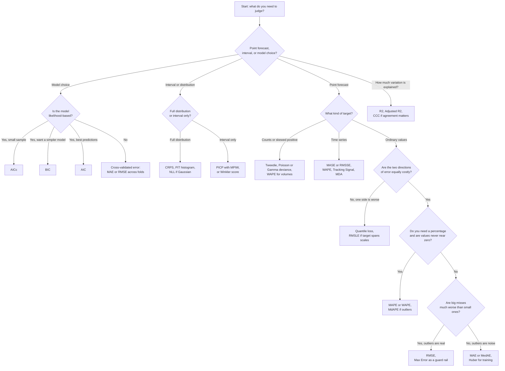

# Regression Metrics: Case Studies and Selection Guide

## Table of Contents

- [Metric Coverage and Self-Check](#metric-coverage-and-self-check)
- [Metric Group Index](#metric-group-index)
- [Metric Comparison Matrix](#metric-comparison-matrix)
- [Decision Flowchart](#decision-flowchart)
- [Common Mistakes](#common-mistakes)
- [Business-to-Metric Cheat Sheet](#business-to-metric-cheat-sheet)
- Part files, by metric group:
  - [Regression Case Studies, Part 1: Absolute and Squared Error Metrics](regression_part1_absolute_squared.md)
  - [Regression Case Studies, Part 2: Percentage, Relative and Scaled Error Metrics](regression_part2_percentage_scaled.md)
  - [Regression Case Studies, Part 3: Log-Based and Goodness-of-Fit Metrics](regression_part3_log_and_goodness_of_fit.md)
  - [Regression Case Studies, Part 4: Robust, Asymmetric, Deviance and Time-Series Metrics](regression_part4_robust_asymmetric_timeseries.md)
  - [Regression Case Studies, Part 5: Probabilistic Forecast and Model-Selection Metrics](regression_part5_probabilistic_and_model_selection.md)

This library explains, for every regression metric, when it is the right choice and when it is the wrong choice, using 5 realistic case studies per metric.

- **Written for:** non-technical managers who need to pick or question a metric; each term is explained in plain English the first time it appears in a part file.
- **How it is organised:** this file is the index. The case studies live in five part files, one per metric group, each with its own table of contents.
- **Source:** the metric list comes from `2_regression_metrics.md`, which is left unchanged.
- **Naming of errors:** the actual value is written as y and the model's prediction as ŷ; error = actual minus prediction unless a case says otherwise.

## Metric Coverage and Self-Check

Every metric below has exactly 5 case studies. 4 metrics were added because they are widely used but have no dedicated section in the source file; they carry the tag `[Added – not in source file]` in their part file.

| Metric | # Case Studies | # Good | # Bad | Source (File / Added) |
|---|---|---|---|---|
| [Mean Absolute Error (MAE)](regression_part1_absolute_squared.md#mean-absolute-error-mae) | 5 | 3 | 2 | File |
| [Median Absolute Error (MedAE)](regression_part1_absolute_squared.md#median-absolute-error-medae) | 5 | 2 | 3 | File |
| [Max Error](regression_part1_absolute_squared.md#max-error) | 5 | 2 | 3 | File |
| [Sum of Squared Errors (SSE / RSS)](regression_part1_absolute_squared.md#sum-of-squared-errors-sse--rss) | 5 | 2 | 3 | File |
| [Mean Squared Error (MSE)](regression_part1_absolute_squared.md#mean-squared-error-mse) | 5 | 3 | 2 | File |
| [Root Mean Squared Error (RMSE)](regression_part1_absolute_squared.md#root-mean-squared-error-rmse) | 5 | 3 | 2 | File |
| [Mean Bias Error (MBE)](regression_part1_absolute_squared.md#mean-bias-error-mbe-added--not-in-source-file) | 5 | 3 | 2 | Added |
| [Mean Absolute Percentage Error (MAPE)](regression_part2_percentage_scaled.md#mean-absolute-percentage-error-mape) | 5 | 3 | 2 | File |
| [Symmetric Mean Absolute Percentage Error (sMAPE)](regression_part2_percentage_scaled.md#symmetric-mean-absolute-percentage-error-smape) | 5 | 2 | 3 | File |
| [Weighted Absolute Percentage Error (WAPE / WMAPE)](regression_part2_percentage_scaled.md#weighted-absolute-percentage-error-wape--wmape) | 5 | 3 | 2 | File |
| [Median Absolute Percentage Error (MdAPE)](regression_part2_percentage_scaled.md#median-absolute-percentage-error-mdape) | 5 | 3 | 2 | File |
| [Mean Percentage Error (MPE)](regression_part2_percentage_scaled.md#mean-percentage-error-mpe) | 5 | 3 | 2 | File |
| [Relative Error Family (RAE, RSE, RRSE)](regression_part2_percentage_scaled.md#relative-error-family-rae-rse-rrse) | 5 | 3 | 2 | File |
| [Mean Absolute Scaled Error (MASE)](regression_part2_percentage_scaled.md#mean-absolute-scaled-error-mase) | 5 | 3 | 2 | File |
| [Theil's U Statistics (U1 and U2)](regression_part2_percentage_scaled.md#theils-u-statistics-u1-and-u2) | 5 | 2 | 3 | File |
| [Root Mean Squared Scaled Error (RMSSE)](regression_part2_percentage_scaled.md#root-mean-squared-scaled-error-rmsse-added--not-in-source-file) | 5 | 3 | 2 | Added |
| [RMSLE (Root Mean Squared Logarithmic Error)](regression_part3_log_and_goodness_of_fit.md#rmsle-root-mean-squared-logarithmic-error) | 5 | 3 | 2 | File |
| [MSLE (Mean Squared Logarithmic Error)](regression_part3_log_and_goodness_of_fit.md#msle-mean-squared-logarithmic-error) | 5 | 2 | 3 | File |
| [Log Accuracy Ratio and Median Symmetric Accuracy (MdSA)](regression_part3_log_and_goodness_of_fit.md#log-accuracy-ratio-and-median-symmetric-accuracy-mdsa) | 5 | 3 | 2 | File |
| [R² (Coefficient of Determination)](regression_part3_log_and_goodness_of_fit.md#r²-coefficient-of-determination) | 5 | 3 | 2 | File |
| [Adjusted R²](regression_part3_log_and_goodness_of_fit.md#adjusted-r²) | 5 | 3 | 2 | File |
| [Explained Variance Score](regression_part3_log_and_goodness_of_fit.md#explained-variance-score) | 5 | 2 | 3 | File |
| [Pearson Correlation (r)](regression_part3_log_and_goodness_of_fit.md#pearson-correlation-r) | 5 | 2 | 3 | File |
| [Spearman Correlation (ρ)](regression_part3_log_and_goodness_of_fit.md#spearman-correlation-ρ) | 5 | 3 | 2 | File |
| [Concordance Correlation Coefficient (CCC, Lin's CCC)](regression_part3_log_and_goodness_of_fit.md#concordance-correlation-coefficient-ccc-lins-ccc) | 5 | 3 | 2 | File |
| [Huber Loss](regression_part4_robust_asymmetric_timeseries.md#huber-loss) | 5 | 3 | 2 | File |
| [Log-cosh Loss](regression_part4_robust_asymmetric_timeseries.md#log-cosh-loss) | 5 | 2 | 3 | File |
| [Quantile Loss (Pinball Loss)](regression_part4_robust_asymmetric_timeseries.md#quantile-loss-pinball-loss) | 5 | 3 | 2 | File |
| [Epsilon-insensitive Loss](regression_part4_robust_asymmetric_timeseries.md#epsilon-insensitive-loss) | 5 | 2 | 3 | File |
| [Tukey's Biweight Loss](regression_part4_robust_asymmetric_timeseries.md#tukeys-biweight-loss) | 5 | 2 | 3 | File |
| [Tracking Signal](regression_part4_robust_asymmetric_timeseries.md#tracking-signal) | 5 | 3 | 2 | File |
| [Multi-output Regression Averaging](regression_part4_robust_asymmetric_timeseries.md#multi-output-regression-averaging) | 5 | 3 | 2 | File |
| [Tweedie / Poisson / Gamma Deviance](regression_part4_robust_asymmetric_timeseries.md#tweedie--poisson--gamma-deviance-added--not-in-source-file) | 5 | 3 | 2 | Added |
| [Mean Directional Accuracy (MDA)](regression_part4_robust_asymmetric_timeseries.md#mean-directional-accuracy-mda-added--not-in-source-file) | 5 | 3 | 2 | Added |
| [Gaussian Negative Log-Likelihood (NLL)](regression_part5_probabilistic_and_model_selection.md#gaussian-negative-log-likelihood-nll) | 5 | 3 | 2 | File |
| [Continuous Ranked Probability Score (CRPS)](regression_part5_probabilistic_and_model_selection.md#continuous-ranked-probability-score-crps) | 5 | 3 | 2 | File |
| [PICP and MPIW](regression_part5_probabilistic_and_model_selection.md#picp-and-mpiw) | 5 | 3 | 2 | File |
| [Interval Score and Winkler Score](regression_part5_probabilistic_and_model_selection.md#interval-score-and-winkler-score) | 5 | 3 | 2 | File |
| [PIT Histogram](regression_part5_probabilistic_and_model_selection.md#pit-histogram) | 5 | 2 | 3 | File |
| [AIC](regression_part5_probabilistic_and_model_selection.md#aic) | 5 | 3 | 2 | File |
| [AICc](regression_part5_probabilistic_and_model_selection.md#aicc) | 5 | 3 | 2 | File |
| [BIC (SIC / SBC)](regression_part5_probabilistic_and_model_selection.md#bic-sic--sbc) | 5 | 3 | 2 | File |
| [Mallows' Cp](regression_part5_probabilistic_and_model_selection.md#mallows-cp) | 5 | 2 | 3 | File |
| [PRESS and Cross-Validated Error](regression_part5_probabilistic_and_model_selection.md#press-and-cross-validated-error) | 5 | 3 | 2 | File |
| **Total (44 metrics)** | **220** | **119** | **101** | 4 Added |

Aliases covered inside the entry named in the right column:

| Alias or variant in the source | Covered in |
|---|---|
| SSE, RSS, SSR | Sum of Squared Errors (SSE / RSS) |
| WMAPE | Weighted Absolute Percentage Error (WAPE / WMAPE) |
| MAD (three different meanings, source section 2.4) | Mean Absolute Error (MAE) and Median Absolute Error (MedAE) |
| RAE, RSE, RRSE | Relative Error Family (RAE, RSE, RRSE) |
| Theil's U1 and U2 | Theil's U Statistics (U1 and U2) |
| Log accuracy ratio, MdSA | Log Accuracy Ratio and Median Symmetric Accuracy (MdSA) |
| Pinball loss | Quantile Loss (Pinball Loss) |
| SIC, SBC | BIC (SIC / SBC) |
| Lin's CCC | Concordance Correlation Coefficient (CCC, Lin's CCC) |
| PICP, MPIW | PICP and MPIW |
| Winkler score | Interval Score and Winkler Score |
| PRESS, leave-one-out error | PRESS and Cross-Validated Error |

Techniques in the source file that are not metrics and so have no case studies: the residual plots and residual diagnostics (Breusch-Pagan, Durbin-Watson, Ljung-Box, Q-Q plots, leverage and influence), horizon-wise evaluation, rolling-origin backtesting and the time-series pitfalls list. They are checks you run next to a metric, not scores. The Multi-output entry covers the metric-choice part of the multi-output section.

Self-check results:

| Check | Result |
|---|---|
| 1. Every metric from the source file is covered (plus the tagged additions) | Pass: 44 entries, listed in the coverage table |
| 2. Each metric has at least 5 case studies | Pass: every metric has exactly 5 |
| 3. Each metric has at least 2 GOOD-fit and 2 BAD-fit cases | Pass: every metric is 3 GOOD + 2 BAD or 2 GOOD + 3 BAD |
| 4. Every case study has a Why other metrics are NOT suitable row | Pass: 220 of 220 cases have it filled in |

## Metric Group Index

### Regression Case Studies, Part 1: Absolute and Squared Error Metrics

- [Mean Absolute Error (MAE)](regression_part1_absolute_squared.md#mean-absolute-error-mae)
- [Median Absolute Error (MedAE)](regression_part1_absolute_squared.md#median-absolute-error-medae)
- [Max Error](regression_part1_absolute_squared.md#max-error)
- [Sum of Squared Errors (SSE / RSS)](regression_part1_absolute_squared.md#sum-of-squared-errors-sse--rss)
- [Mean Squared Error (MSE)](regression_part1_absolute_squared.md#mean-squared-error-mse)
- [Root Mean Squared Error (RMSE)](regression_part1_absolute_squared.md#root-mean-squared-error-rmse)
- [Mean Bias Error (MBE) [Added – not in source file]](regression_part1_absolute_squared.md#mean-bias-error-mbe-added--not-in-source-file)

### Regression Case Studies, Part 2: Percentage, Relative and Scaled Error Metrics

- [Mean Absolute Percentage Error (MAPE)](regression_part2_percentage_scaled.md#mean-absolute-percentage-error-mape)
- [Symmetric Mean Absolute Percentage Error (sMAPE)](regression_part2_percentage_scaled.md#symmetric-mean-absolute-percentage-error-smape)
- [Weighted Absolute Percentage Error (WAPE / WMAPE)](regression_part2_percentage_scaled.md#weighted-absolute-percentage-error-wape--wmape)
- [Median Absolute Percentage Error (MdAPE)](regression_part2_percentage_scaled.md#median-absolute-percentage-error-mdape)
- [Mean Percentage Error (MPE)](regression_part2_percentage_scaled.md#mean-percentage-error-mpe)
- [Relative Error Family (RAE, RSE, RRSE)](regression_part2_percentage_scaled.md#relative-error-family-rae-rse-rrse)
- [Mean Absolute Scaled Error (MASE)](regression_part2_percentage_scaled.md#mean-absolute-scaled-error-mase)
- [Theil's U Statistics (U1 and U2)](regression_part2_percentage_scaled.md#theils-u-statistics-u1-and-u2)
- [Root Mean Squared Scaled Error (RMSSE) [Added – not in source file]](regression_part2_percentage_scaled.md#root-mean-squared-scaled-error-rmsse-added--not-in-source-file)

### Regression Case Studies, Part 3: Log-Based and Goodness-of-Fit Metrics

- [RMSLE (Root Mean Squared Logarithmic Error)](regression_part3_log_and_goodness_of_fit.md#rmsle-root-mean-squared-logarithmic-error)
- [MSLE (Mean Squared Logarithmic Error)](regression_part3_log_and_goodness_of_fit.md#msle-mean-squared-logarithmic-error)
- [Log Accuracy Ratio and Median Symmetric Accuracy (MdSA)](regression_part3_log_and_goodness_of_fit.md#log-accuracy-ratio-and-median-symmetric-accuracy-mdsa)
- [R² (Coefficient of Determination)](regression_part3_log_and_goodness_of_fit.md#r²-coefficient-of-determination)
- [Adjusted R²](regression_part3_log_and_goodness_of_fit.md#adjusted-r²)
- [Explained Variance Score](regression_part3_log_and_goodness_of_fit.md#explained-variance-score)
- [Pearson Correlation (r)](regression_part3_log_and_goodness_of_fit.md#pearson-correlation-r)
- [Spearman Correlation (ρ)](regression_part3_log_and_goodness_of_fit.md#spearman-correlation-ρ)
- [Concordance Correlation Coefficient (CCC, Lin's CCC)](regression_part3_log_and_goodness_of_fit.md#concordance-correlation-coefficient-ccc-lins-ccc)

### Regression Case Studies, Part 4: Robust, Asymmetric, Deviance and Time-Series Metrics

- [Huber Loss](regression_part4_robust_asymmetric_timeseries.md#huber-loss)
- [Log-cosh Loss](regression_part4_robust_asymmetric_timeseries.md#log-cosh-loss)
- [Quantile Loss (Pinball Loss)](regression_part4_robust_asymmetric_timeseries.md#quantile-loss-pinball-loss)
- [Epsilon-insensitive Loss](regression_part4_robust_asymmetric_timeseries.md#epsilon-insensitive-loss)
- [Tukey's Biweight Loss](regression_part4_robust_asymmetric_timeseries.md#tukeys-biweight-loss)
- [Tracking Signal](regression_part4_robust_asymmetric_timeseries.md#tracking-signal)
- [Multi-output Regression Averaging](regression_part4_robust_asymmetric_timeseries.md#multi-output-regression-averaging)
- [Tweedie / Poisson / Gamma Deviance [Added – not in source file]](regression_part4_robust_asymmetric_timeseries.md#tweedie--poisson--gamma-deviance-added--not-in-source-file)
- [Mean Directional Accuracy (MDA) [Added – not in source file]](regression_part4_robust_asymmetric_timeseries.md#mean-directional-accuracy-mda-added--not-in-source-file)

### Regression Case Studies, Part 5: Probabilistic Forecast and Model-Selection Metrics

- [Gaussian Negative Log-Likelihood (NLL)](regression_part5_probabilistic_and_model_selection.md#gaussian-negative-log-likelihood-nll)
- [Continuous Ranked Probability Score (CRPS)](regression_part5_probabilistic_and_model_selection.md#continuous-ranked-probability-score-crps)
- [PICP and MPIW](regression_part5_probabilistic_and_model_selection.md#picp-and-mpiw)
- [Interval Score and Winkler Score](regression_part5_probabilistic_and_model_selection.md#interval-score-and-winkler-score)
- [PIT Histogram](regression_part5_probabilistic_and_model_selection.md#pit-histogram)
- [AIC](regression_part5_probabilistic_and_model_selection.md#aic)
- [AICc](regression_part5_probabilistic_and_model_selection.md#aicc)
- [BIC (SIC / SBC)](regression_part5_probabilistic_and_model_selection.md#bic-sic--sbc)
- [Mallows' Cp](regression_part5_probabilistic_and_model_selection.md#mallows-cp)
- [PRESS and Cross-Validated Error](regression_part5_probabilistic_and_model_selection.md#press-and-cross-validated-error)

## Metric Comparison Matrix

Read each cell as a rule of thumb, not a law. Details and exceptions are in each metric's limitations list.

| Metric | Outlier-sensitive | Scale-dependent | Handles skewed or imbalanced targets | Needs probabilistic output | Threshold or parameter to set | Interpretable to business |
|---|---|---|---|---|---|---|
| Mean Absolute Error (MAE) | Low | Yes | Partly | No | No | High |
| Median Absolute Error (MedAE) | Very low | Yes | Yes | No | No | High |
| Max Error | Extreme (it is the worst point) | Yes | No | No | No | High |
| Sum of Squared Errors (SSE / RSS) | Very high | Yes, and grows with n | No | No | No | Low |
| Mean Squared Error (MSE) | High | Yes (squared units) | No | No | No | Low |
| Root Mean Squared Error (RMSE) | High | Yes (same units) | No | No | No | High |
| Mean Bias Error (MBE) | Medium | Yes | Not applicable | No | No | High (for bias) |
| Mean Absolute Percentage Error (MAPE) | Medium | No | No (breaks near zero) | No | No | High |
| Symmetric Mean Absolute Percentage Error (sMAPE) | Medium | No | No (breaks when both are near zero) | No | No | Medium |
| Weighted Absolute Percentage Error (WAPE / WMAPE) | Low | No | Yes | No | No | High |
| Median Absolute Percentage Error (MdAPE) | Very low | No | Partly | No | No | Medium |
| Mean Percentage Error (MPE) | Medium | No | No | No | No | Medium |
| Relative Error Family (RAE, RSE, RRSE) | Varies (RAE low, RSE and RRSE high) | No | Partly | No | Baseline to choose | Medium |
| Mean Absolute Scaled Error (MASE) | Low | No | Yes | No | Baseline to choose | Medium |
| Theil's U Statistics (U1 and U2) | Medium | No | Partly | No | Baseline to choose | Medium |
| Root Mean Squared Scaled Error (RMSSE) | High | No | Yes | No | Baseline to choose | Low |
| RMSLE (Root Mean Squared Logarithmic Error) | Low | No | Yes (positive targets only) | No | No | Medium |
| MSLE (Mean Squared Logarithmic Error) | Low | No | Yes (positive targets only) | No | No | Low |
| Log Accuracy Ratio and Median Symmetric Accuracy (MdSA) | Low | No | Yes (positive targets only) | No | No | Medium |
| R² (Coefficient of Determination) | High | No | No | No | No | High |
| Adjusted R² | High | No | No | No | No | Medium |
| Explained Variance Score | High | No | No | No | No | Medium |
| Pearson Correlation (r) | High | No | No | No | No | Medium |
| Spearman Correlation (ρ) | Low | No | Yes (uses ranks) | No | No | Medium |
| Concordance Correlation Coefficient (CCC, Lin's CCC) | High | No | No | No | No | Low |
| Huber Loss | Low | Yes | Yes | No | Yes (delta) | Medium |
| Log-cosh Loss | Low | Yes | Yes | No | No | Low |
| Quantile Loss (Pinball Loss) | Low | Yes | Yes | Quantile forecasts | Yes (quantile level) | High |
| Epsilon-insensitive Loss | Low | Yes | Yes | No | Yes (epsilon) | Low |
| Tukey's Biweight Loss | Very low | Yes | Yes | No | Yes (cut-off constant) | Low |
| Tracking Signal | Medium | No | Not applicable | No | Yes (alarm limit) | High |
| Multi-output Regression Averaging | Depends on the base metric | Depends on the base metric | Not applicable | No | Yes (weights) | Medium |
| Tweedie / Poisson / Gamma Deviance | Medium | No | Yes | Distribution assumption | Yes (power) | Low |
| Mean Directional Accuracy (MDA) | Very low | No | Partly | No | No | High |
| Gaussian Negative Log-Likelihood (NLL) | High | Yes | Not applicable | Yes (full distribution) | No | Low |
| Continuous Ranked Probability Score (CRPS) | Medium | Yes | Not applicable | Yes (full distribution) | No | Medium |
| PICP and MPIW | Not applicable | PICP no, MPIW yes | Not applicable | Yes (intervals) | Yes (confidence level) | High |
| Interval Score and Winkler Score | Medium | Yes | Not applicable | Yes (intervals) | Yes (confidence level) | Medium |
| PIT Histogram | Visual check | No | Not applicable | Yes (full distribution) | No | Medium |
| AIC | Through the likelihood | Same data only | Not applicable | Needs a likelihood | No | Low |
| AICc | Through the likelihood | Same data only | Not applicable | Needs a likelihood | No | Low |
| BIC (SIC / SBC) | Through the likelihood | Same data only | Not applicable | Needs a likelihood | No | Low |
| Mallows' Cp | High | Same data only | Not applicable | No | Reference model needed | Low |
| PRESS and Cross-Validated Error | Medium to high | Yes | Not applicable | No | Yes (number of folds) | Medium |

## Decision Flowchart

## Common Mistakes

1. **Using MAPE when actual values can be zero or tiny.** One near-zero actual produces a huge percentage and ruins the average. Use WAPE, MASE or MAE instead.
2. **Reporting R² alone.** R² can be high with a biased model and low with a perfectly useful one. Show an error metric in business units next to it, and look at the residual plot.
3. **Treating RMSE and MAE as interchangeable.** RMSE punishes large misses more. If one bad day costs far more than ten small ones, RMSE fits; if not, MAE is the honest average.
4. **Comparing models on different scales with raw MAE or RMSE.** A rupee error and a kilogram error cannot be averaged. Use a scale-free metric such as MASE, WAPE or RMSSE.
5. **Ignoring bias.** A model can have a small MAE and still over-forecast every day. Track MBE, MPE or the Tracking Signal beside accuracy.
6. **Judging a time-series model without a naive baseline.** An error of 8% means little if repeating last week's value gives 7%. MASE and Theil's U make the baseline explicit.
7. **Using symmetric loss when under- and over-prediction cost different amounts.** Stock-outs and overstock rarely cost the same. Use quantile loss or an explicit cost function.
8. **Choosing a metric after seeing which one flatters the model.** Pick the metric from the business cost before modelling, and write it down.
9. **Comparing in-sample fit across models with different numbers of features.** Plain R² always rises when you add features. Use Adjusted R², AIC, BIC or cross-validated error.
10. **Judging intervals and forecasts by the point error only.** A model can have the same RMSE and wildly different uncertainty. If decisions depend on the range, use PICP, MPIW, Winkler or CRPS.

## Business-to-Metric Cheat Sheet

| Business goal | Recommended metric(s) | Watch out for |
|---|---|---|
| Tell executives the typical miss in plain units | MAE, or RMSE if large misses are especially costly | Do not mix with percentages across products of different size |
| Never be badly wrong on any single case | Max Error and RMSE, plus a percentile of absolute error | Max Error depends on one point; use it as a guard rail only |
| Forecast demand across many products and stores | WAPE for reporting, MASE or RMSSE for comparison | MAPE explodes on slow sellers |
| Price items where the target spans orders of magnitude | RMSLE, MdSA or log-based error | Only for positive targets; it punishes under-prediction more |
| Stock-outs cost more than overstock (or the reverse) | Quantile loss at the cost-ratio quantile | Evaluate coverage as well as loss |
| Train on data with typos or bad sensors | Huber, Tukey or log-cosh loss; MedAE to report | Tune the cut-off constant on clean validation data |
| Check that a forecast is not systematically high or low | MBE, MPE, Tracking Signal | Positive and negative errors cancel in plain averages |
| Explain how much of the variation the model captures | R² or Adjusted R² | Never alone; add an error in units |
| Check agreement between a new measurement method and a reference | CCC, with bias in MBE | Pearson correlation misses a constant offset |
| Count data such as claims, visits or tickets | Poisson or Tweedie deviance | Needs the right distribution assumption |
| Trading and trend calls matter more than size | Mean Directional Accuracy | Ignores how big each move is |
| Give a range, not a single number | PICP with MPIW, Winkler score, CRPS | Coverage alone rewards absurdly wide ranges |
| Choose between regression models of different size | Adjusted R², AIC, AICc, BIC, cross-validated error | Compare only on the same data |
| Score many outputs at once | Multi-output averaging, with weights that match business value | A uniform average hides the large-scale outputs |
| Monitor a forecast over time in production | Tracking Signal, rolling WAPE and MBE | Set alarm limits before launch |

See also the companion file [classification_metrics_case_studies.md](classification_metrics_case_studies.md).
